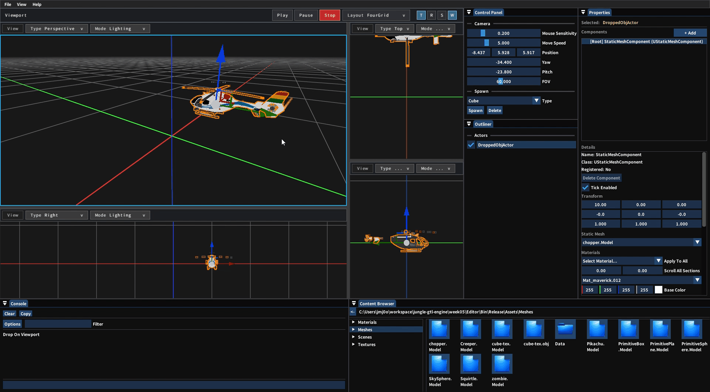
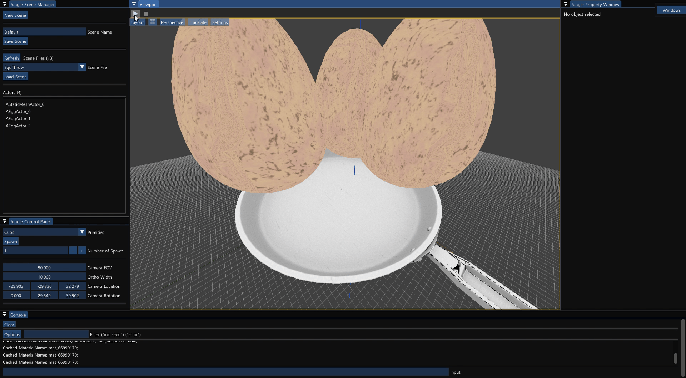
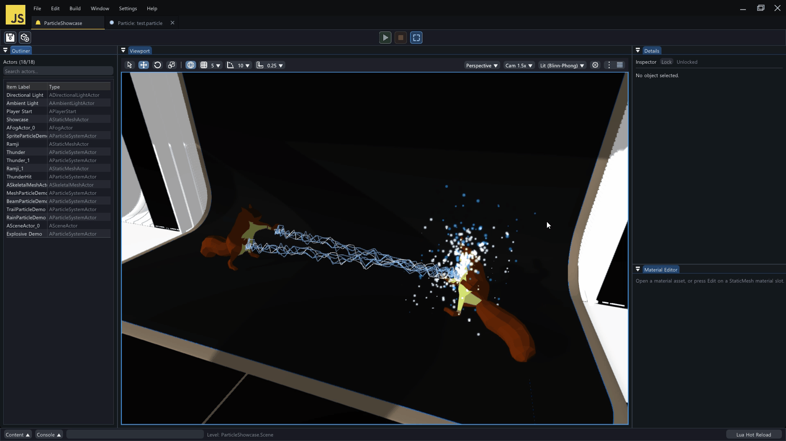

# jungle-gtl-engine

[한국어](./README.md) | **English**

***[KRAFTON Jungle game tech Lab](https://jungle.krafton.com/courses/gametechlab): Hands-on Engine Development · Game Jams***

2026.02. ~ 2026.06.

This is a **3D game engine** built with C++20 and DirectX 11. Each week, we implemented rendering, editor, lighting and shadow, animation, particle, and physics features on that week's topic, and in the game jams, we made **Watermelon Game**, **BLACK OUT**, and **FRACTURE LINE** with this engine.


## 🎮 Project Overview

- **KRAFTON Jungle game tech Lab** is a 24-week residential program that aims to train game programmers who understand game engines in depth and can design and implement them on their own. We build our own game engine in C++ and develop plugins / tools for Unreal Engine

- This repository contains the results of the **hands-on engine development** part. We implemented engine features one by one, such as rendering, the editor, lighting and shadows, animation, particles, and physics, on the given topics

- Every week, we **formed a new team** and implemented the week's goals together, and we held **game jams** to complete a result in a short period of time


## 📸 Preview










## 📅 Weeks

| Week | Topic | Period | My Part |
|------|------|------|------|
| **[🎱 Week 0](./week00/README_en.md)** | Ball Physics Simulation with DirectX 11 | 2026.02. | DirectX 11 rendering and ball physics simulation |
| **[🍉 Week 1](./week01/README_en.md)** | 1st Game Jam: Watermelon Game | 2026.03.09. ~ 2026.03.12. | Fruit merging and score |
| **[🧊 Week 2](./week02/README_en.md)** | Break into 3D | 2026.03.12. ~ 2026.03.19. | Picking and serialization |
| **[🔤 Week 3](./week03/README_en.md)** | Texture and Wireframe | 2026.03.19. ~ 2026.03.26. | Text rendering |
| **[🪟 Week 4](./week04/README_en.md)** | OBJ Import, StaticMesh and Multiple Viewport Rendering | 2026.03.26. ~ 2026.04.02. | Engine core and editor tools |
| **[🥧 Week 5](./week05/README_en.md)** | 2nd Game Jam - Brute Force Competition<br>It's PIE Time! | 2026.04.02. ~ 2026.04.09. | Rendering optimization, PIE and gameplay flow |
| **[🍳 Week 6](./week06/README_en.md)** | Decal<br>P.S. I Love You - Clearing the Fog | 2026.04.09. ~ 2026.04.16. | Projection decals and FXAA |
| **[💡 Week 7](./week07/README_en.md)** | Let There Be Light | 2026.04.16. ~ 2026.04.23. | Lighting and editor bug fixes |
| **[🌗 Week 8](./week08/README_en.md)** | Where There Is Light, There Is Also Shadow | 2026.04.23. ~ 2026.04.30. | Editor input |
| **[🔋 Week 9](./week09/README_en.md)** | 3rd Game Jam - Make Sure to Delegate: BLACK OUT<br>Light, Camera, Action! | 2026.04.30. ~ 2026.05.07. | Lua scripting and game design |
| **[🦴 Week 10](./week10/README_en.md)** | More Than Just Weight | 2026.05.07. ~ 2026.05.14. | Skeletal mesh component and CPU skinning |
| **[🏃 Week 11](./week11/README_en.md)** | Let's go, move! | 2026.05.14. ~ 2026.05.21. | Animation runtime and state machine |
| **[🌪️ Week 12](./week12/README_en.md)** | Dance of the Dust | 2026.05.21. ~ 2026.05.28. | Particle core |
| **[🧲 Week 13](./week13/README_en.md)** | Understanding Focus and Force in 3D World | 2026.05.28. ~ 2026.06.04. | Cloth simulation |
| **[🎯 Week 14](./week14/README_en.md)** | 4th Game Jam - The stage is set. Let the game begin!: FRACTURE LINE | 2026.06.04. ~ 2026.06.09. | Level design and gameplay framework |


## 🛠️ Tech Stack

- **Language**: C++20, Lua

- **Graphics API**: DirectX 11

- **Build**: Visual Studio, MSBuild, vcpkg

- **Libraries**: Autodesk FBX SDK, Dear ImGui, DirectX Tool Kit for DirectX 11, fifo_map, FMOD Engine, imgui-node-editor, JSON for Modern C++, LuaJIT, miniaudio, NvCloth, NVIDIA PhysX SDK, RmlUi, SimpleJSON, sol2, SoLoud, stb, XInput


## 📁 Directory Structure

```
jungle-gtl-engine/
├── LICENSE // Copyright and terms of use
├── docs/   // README media
├── week00/ // Week 0 project
├── week01/ // Week 1 project
├── week02/ // Week 2 project
├── week03/ // Week 3 project
├── week04/ // Week 4 project
├── week05/ // Week 5 project
├── week06/ // Week 6 project
├── week07/ // Week 7 project
├── week08/ // Week 8 project
├── week09/ // Week 9 project
├── week10/ // Week 10 project
├── week11/ // Week 11 project
├── week12/ // Week 12 project
├── week13/ // Week 13 project
└── week14/ // Week 14 project
```


## 👥 People I Worked With

These are the people who built the engine and games with me. Thank you for working with me.

- 강건우([@keonwookang0914](https://github.com/keonwookang0914))

- 강명호([@DDing-Ho](https://github.com/DDing-Ho))

- 국동진([@puter2712git](https://github.com/puter2712git))

- 권현수([@kwonhyeonsoo-goo](https://github.com/kwonhyeonsoo-goo))

- 김기홍([@lin-ion](https://github.com/lin-ion))

- 김기훈([@kim-kihoon](https://github.com/kim-kihoon))

- 김연하([@Yonaim](https://github.com/Yonaim))

- 김지수([@jskim-research](https://github.com/jskim-research))

- 김태현([@MozziDog](https://github.com/MozziDog))

- 김형도([@DKael](https://github.com/DKael))

- 김형준([@Rocketstein](https://github.com/Rocketstein))

- 김호준([@esc10946](https://github.com/esc10946))

- 김효범([@deepBeom](https://github.com/deepBeom))

- 남윤지([@yoonjiii218](https://github.com/yoonjiii218))

- 박상혁([@UltraSion](https://github.com/UltraSion))

- 박세영([@mathison0](https://github.com/mathison0))

- 박준혁([@CaptainTangerine](https://github.com/CaptainTangerine))

- 성원희([@wwonnn](https://github.com/wwonnn))

- 심우진([@shimwoojin](https://github.com/shimwoojin))

- 양현석([@yanggogi1423](https://github.com/yanggogi1423))

- 오준혁([@JHCard7872](https://github.com/JHCard7872))

- 이상훈([@lsh-Brecht](https://github.com/lsh-Brecht))

- 이준협([@JunHyeop3631](https://github.com/JunHyeop3631))

- 이호진([@lois505](https://github.com/lois505))

- 전현길([@alogeclock](https://github.com/alogeclock))

- 정지윤([@jiyoon607](https://github.com/jiyoon607))

- 정찬일([@Chanil-Chong](https://github.com/Chanil-Chong))

- 조상현([@HaXXOrBunny](https://github.com/HaXXOrBunny))

- 조현석([@chodott](https://github.com/chodott))

- 한영서([@persona6whenrelease](https://github.com/persona6whenrelease))


## 🧹 Label it, Clean it, Seal it!

- **17** assignments

- **4** game jams

- **93 days** since move-in day

- **26 days** of weekends

- 17 hours × 93 days = **1,581 hours**


## ⚖️ License

The portions of the code in this repository written by Jang Minjun are released under the MIT License, and the rights to the portions written by other contributors belong to their respective contributors. Third-party libraries and assets, and materials provided by KRAFTON Jungle, are governed by the terms of their respective rights holders. This repository is not an official repository of KRAFTON or KRAFTON Jungle. See [LICENSE](./LICENSE) for details.


## 📬 Contact

For inquiries, please contact Jang Minjun(jmj0ok@gmail.com).
