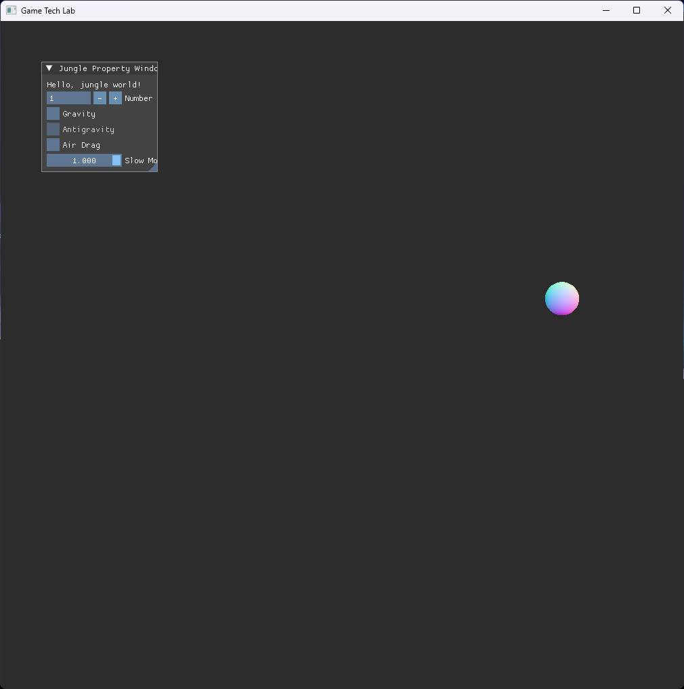
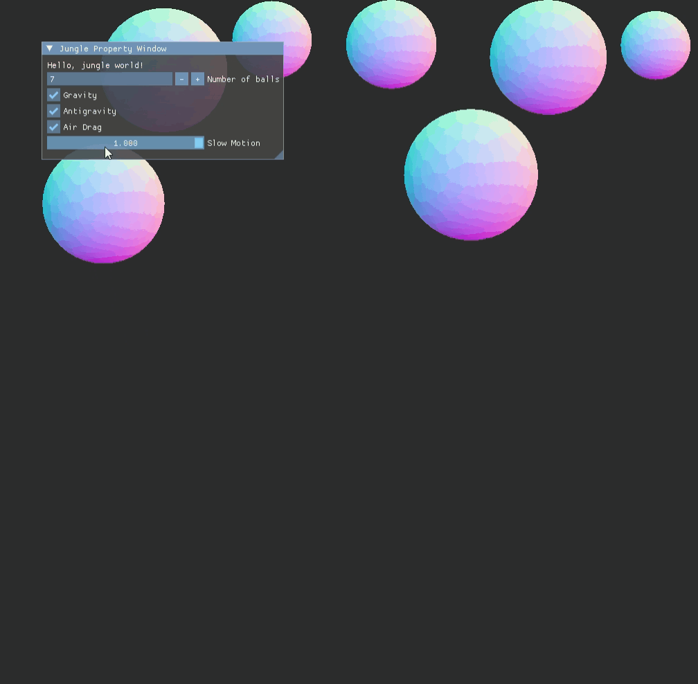
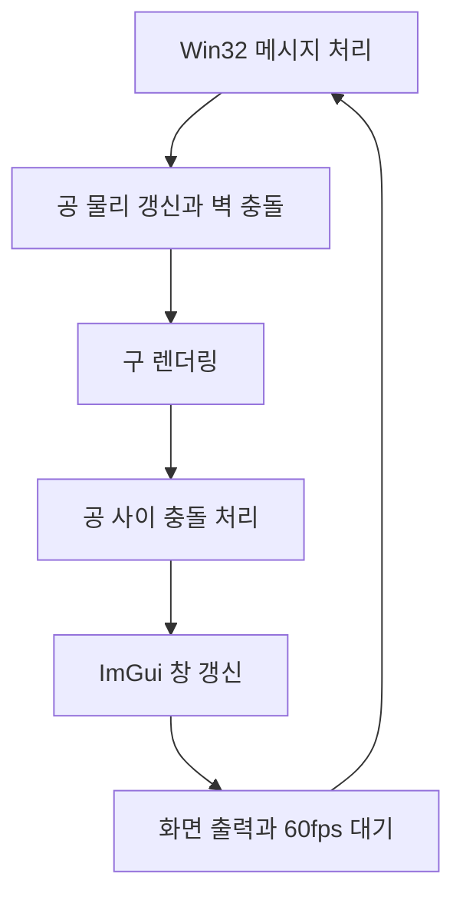

# 🎱 크래프톤 정글 게임테크랩 0주차

**한국어** | [English](./README_en.md)

***DirectX 11 공 물리 시뮬레이션***

<p align="center">
    
    
</p>

DirectX 11과 Dear ImGui로 여러 개의 공이 화면 안에서 움직이며 벽과 서로에게 부딪히는 물리 시뮬레이션을 구현했습니다. 중력에 더해 반중력, 공기 저항, 슬로우 모션도 구현했습니다.


## 🎮 주차 소개

- Win32 창 위에 **DirectX 11 렌더링 파이프라인**을 직접 구성하고, 그 위에서 간단한 물리 시뮬레이션을 실행합니다

- 공을 그리고 움직이며 **중력을 적용**하고, **반중력, 공기 저항, 슬로우 모션**을 추가 구현했습니다


## ✨ 구현 결과

- **구 렌더링**

  구 메시를 정점 버퍼 하나로 만들어 두고, 공마다 위치와 반지름을 상수 버퍼로 넘겨 같은 메시를 여러 번 그립니다

- **공 개수 조절**

  ImGui 창의 `Number of balls` 값에 맞춰 공을 추가하거나 무작위로 제거합니다. 새 공은 무작위 위치와 속도로 생성되며, 생성 순서에 따라 반지름이 달라지고 질량은 반지름에 비례합니다

- **벽 충돌**

  화면 경계에 닿은 공은 속도가 반사됩니다. 중력이 켜져 있으면 바닥에서, 반중력이 켜져 있으면 천장에서도 반발 계수 0.8로 속도가 줄어듭니다

- **공 사이 충돌**

  겹친 두 공을 질량 비율에 따라 밀어낸 뒤, 충돌 법선 방향의 충격량으로 속도를 바꾸는 **완전 탄성 충돌**을 처리합니다

- **중력(Gravity)**

  체크하면 모든 공에 아래 방향의 일정한 가속도를 적용합니다

- **반중력(Antigravity)**

  중력이 켜져 있을 때만 켤 수 있으며, 가속도 방향을 위로 뒤집습니다

- **공기 저항(Air Drag)**

  매 갱신마다 속도를 줄여 공이 서서히 느려지게 합니다. **가벼운 공일수록** 더 강하게 감속합니다

- **슬로우 모션(Slow Motion)**

  슬라이더로 물리 갱신의 시간 배율을 0.1배에서 1배까지 조절합니다


## 🧑‍💻 작업 상세

### DirectX 11 렌더링과 공 물리

- **목표**

  Win32 창에 DirectX 11 렌더링 환경을 구성하고, 여러 개의 공이 움직이며 벽과 서로에게 부딪히고 중력의 영향을 받는 시뮬레이션을 구현합니다

- **구현 내용**

  `URenderer`가 디바이스와 스왑 체인, 렌더 타깃, 래스터라이저 상태, 셰이더, 상수 버퍼의 생성과 해제를 맡습니다. 공은 `UPrimitive` 인터페이스를 상속한 `UBall`로 두어 물리 갱신과 렌더링을 나누었고, 공 목록은 용량이 부족하면 두 배로 늘리는 포인터 배열로 직접 관리합니다. 메인 루프는 VSync와 `QueryPerformanceCounter` 기반 대기로 **60fps를 고정**하고, 물리는 고정 시간 간격으로 갱신합니다. 공 사이 충돌은 모든 쌍을 검사해 겹친 거리만큼 위치를 먼저 보정한 뒤 충격량으로 속도를 갱신합니다

- **어려웠던 점과 해결**

  공이 겹친 상태로 남으면 충돌 처리가 불안정해지기 때문에, 속도를 바꾸기 전에 겹친 거리를 질량 비율로 나눠 두 공의 위치를 먼저 보정했습니다

- **관련 코드**

  [`Source/main.cpp`](./Source/main.cpp), [`Shaders/ShaderW0.hlsl`](./Shaders/ShaderW0.hlsl)


### 반중력, 공기 저항, 슬로우 모션

- **목표**

  기본 시뮬레이션에 물리 옵션을 더해 공의 움직임을 여러 조건에서 관찰할 수 있게 합니다. 슬로우 모션은 중력과 공기 저항이 적용되는 모습을 자세히 확인하기 위해 추가했습니다

- **구현 내용**

  반중력은 중력 가속도의 부호를 뒤집고, 중력이 꺼지면 함께 꺼지도록 ImGui에서 비활성화합니다. 공기 저항은 매 갱신마다 속도에 `1 - 계수 / 질량 * dt`를 곱해 질량이 작은 공일수록 빨리 느려지게 합니다. 슬로우 모션은 물리 갱신에 쓰는 시간 간격에 슬라이더 값을 곱합니다

- **관련 코드**

  [`Source/main.cpp`](./Source/main.cpp)


## 🛠️ 기술 스택

- **Language**: C++20

- **Graphics API**: DirectX 11

- **Build**: Visual Studio 2026, MSBuild

- **Libraries**: Dear ImGui


## 🖥️ 구조



- 동작 흐름

    1. 창 메시지를 처리한 뒤, 각 공의 물리를 고정 시간 간격으로 갱신하고 그립니다

    2. 모든 공 쌍의 충돌을 검사해 위치와 속도를 보정합니다

    3. ImGui 창에서 공 개수와 물리 옵션을 반영하고, 화면을 출력한 뒤 다음 프레임까지 대기합니다


## 📁 디렉토리 구조

```
week00/
├── week00.sln      // 솔루션
├── week00.vcxproj  // 프로젝트
├── Docs/           // README 미디어
├── Source/         // 애플리케이션 코드
├── Shaders/        // 정점, 픽셀 셰이더
└── ThirdParty/     // Dear ImGui
```


## ❓ 빌드 및 실행

### 릴리즈 실행

일부 에셋과 라이브러리의 라이선스 문제로 인해 이 주차의 실행 파일은 제공하지 않습니다.


### 소스 빌드

일부 에셋과 라이브러리를 라이선스 문제로 저장소에 포함하지 못해, 이 주차는 저장소만으로 빌드할 수 없습니다.


## 🕹️ 조작 방법

| 입력 | 동작 |
|------|------|
| **Number of balls** | 공 개수 입력(최소 1개) |
| **Gravity** | 중력 켜기 / 끄기 |
| **Antigravity** | 반중력 켜기 / 끄기(중력이 켜져 있을 때만) |
| **Air Drag** | 공기 저항 켜기 / 끄기 |
| **Slow Motion** | 시간 배율 조절(0.1 ~ 1.0) |


## 📄 서드파티 라이브러리

| 이름 | 저작자 | 버전 | 라이선스 |
|------|--------|------|----------|
| **[Dear ImGui](https://github.com/ocornut/imgui)** | Omar Cornut | 1.92.6 WIP | [MIT License](./ThirdParty/imgui/LICENSE.txt) |


## ⚖️ 라이선스

이 주차의 코드는 MIT 라이선스로 공개합니다. 자세한 내용은 [LICENSE](../LICENSE)를 확인해 주세요.
