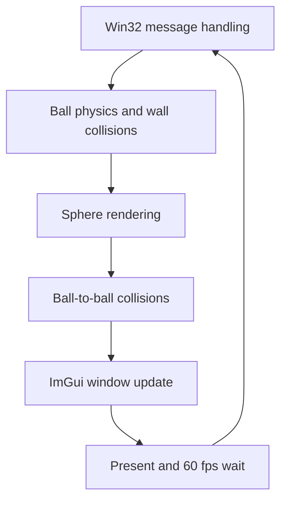

# 🎱 KRAFTON Jungle game tech Lab - Week 0

[한국어](./README.md) | **English**

***Ball Physics Simulation with DirectX 11***

<p align="center">
    
    
</p>

A physics simulation built with DirectX 11 and Dear ImGui in which multiple balls move around the screen and collide with the walls and with each other. Along with gravity, it also implements antigravity, air drag, and slow motion.


## 🎮 Week Overview

- Builds a **DirectX 11 rendering pipeline** on a Win32 window from scratch and runs a simple physics simulation on top of it

- Draws and moves the balls, **applies gravity**, and additionally implements **antigravity, air drag, and slow motion**


## ✨ Features

- **Sphere rendering**

  The sphere mesh is stored in a single vertex buffer, and each ball's position and radius are passed through a constant buffer so the same mesh is drawn multiple times

- **Ball count control**

  Balls are added or randomly removed to match the `Number of balls` value in the ImGui window. New balls spawn with a random position and velocity, their radius varies with spawn order, and their mass is proportional to the radius

- **Wall collisions**

  A ball that reaches the screen boundary has its velocity reflected. With gravity on, it loses speed on the floor with a restitution coefficient of 0.8, and with antigravity on, it does so on the ceiling as well

- **Ball-to-ball collisions**

  Two overlapping balls are pushed apart according to their mass ratio, and a **perfectly elastic collision** is resolved by applying an impulse along the collision normal

- **Gravity**

  When checked, a constant downward acceleration is applied to all balls

- **Antigravity**

  Available only while gravity is on, and flips the direction of acceleration upward

- **Air Drag**

  Reduces velocity on every update so balls gradually slow down. **Lighter balls** slow down more strongly

- **Slow Motion**

  A slider scales the physics time step from 0.1x to 1x


## 🧑‍💻 Work Details

### DirectX 11 Rendering and Ball Physics

- **Goal**

  Set up a DirectX 11 rendering environment on a Win32 window and implement a simulation in which multiple balls move, collide with the walls and with each other, and are affected by gravity

- **Implementation**

  `URenderer` creates and releases the device, swap chain, render target, rasterizer state, shaders, and constant buffer. Each ball is a `UBall` derived from the `UPrimitive` interface, separating physics updates from rendering, and the ball list is managed directly as a pointer array that doubles its capacity when full. The main loop **locks the frame rate to 60 fps** with VSync and a `QueryPerformanceCounter`-based wait, and physics is updated with a fixed time step. Ball-to-ball collisions check every pair, first correcting positions by the overlap and then updating velocities with an impulse

- **Challenges and Solutions**

  Leaving balls overlapped makes collision handling unstable, so before changing velocities, the overlap is split by mass ratio and both balls' positions are corrected first

- **Related Code**

  [`Source/main.cpp`](./Source/main.cpp), [`Shaders/ShaderW0.hlsl`](./Shaders/ShaderW0.hlsl)


### Antigravity, Air Drag, and Slow Motion

- **Goal**

  Add physics options to the base simulation so the balls' motion can be observed under different conditions. Slow motion was added to take a closer look at how gravity and air drag are applied

- **Implementation**

  Antigravity flips the sign of the gravitational acceleration and is disabled in ImGui so it turns off together with gravity. Air drag multiplies the velocity by `1 - coefficient / mass * dt` on every update, so balls with less mass slow down faster. Slow motion multiplies the time step used for physics updates by the slider value

- **Related Code**

  [`Source/main.cpp`](./Source/main.cpp)


## 🛠️ Tech Stack

- **Language**: C++20

- **Graphics API**: DirectX 11

- **Build**: Visual Studio 2026, MSBuild

- **Libraries**: Dear ImGui


## 🖥️ Architecture



- Flow

    1. After handling window messages, each ball's physics is updated with a fixed time step and the ball is drawn

    2. Every pair of balls is checked for collisions, and positions and velocities are corrected

    3. The ball count and physics options from the ImGui window are applied, the frame is presented, and the loop waits until the next frame


## 📁 Directory Structure

```
week00/
├── week00.sln      // Solution
├── week00.vcxproj  // Project
├── Docs/           // README media
├── Source/         // Application code
├── Shaders/        // Vertex and pixel shaders
└── ThirdParty/     // Dear ImGui
```


## ❓ Build and Run

### Running the Release Build

Executables are not provided for this week because of license issues with some of the assets and libraries.


### Building from Source

Some assets and libraries could not be included in the repository because of license issues, so this week cannot be built from the repository alone.


## 🕹️ Controls

| Input | Action |
|------|------|
| **Number of balls** | Set the number of balls(at least 1) |
| **Gravity** | Turn gravity on / off |
| **Antigravity** | Turn antigravity on / off(only while gravity is on) |
| **Air Drag** | Turn air drag on / off |
| **Slow Motion** | Adjust the time scale(0.1 ~ 1.0) |


## 📄 Third-Party Libraries

| Name | Author | Version | License |
|------|--------|------|----------|
| **[Dear ImGui](https://github.com/ocornut/imgui)** | Omar Cornut | 1.92.6 WIP | [MIT License](./ThirdParty/imgui/LICENSE.txt) |


## ⚖️ License

This week's code is released under the MIT License. See [LICENSE](../LICENSE) for details.
