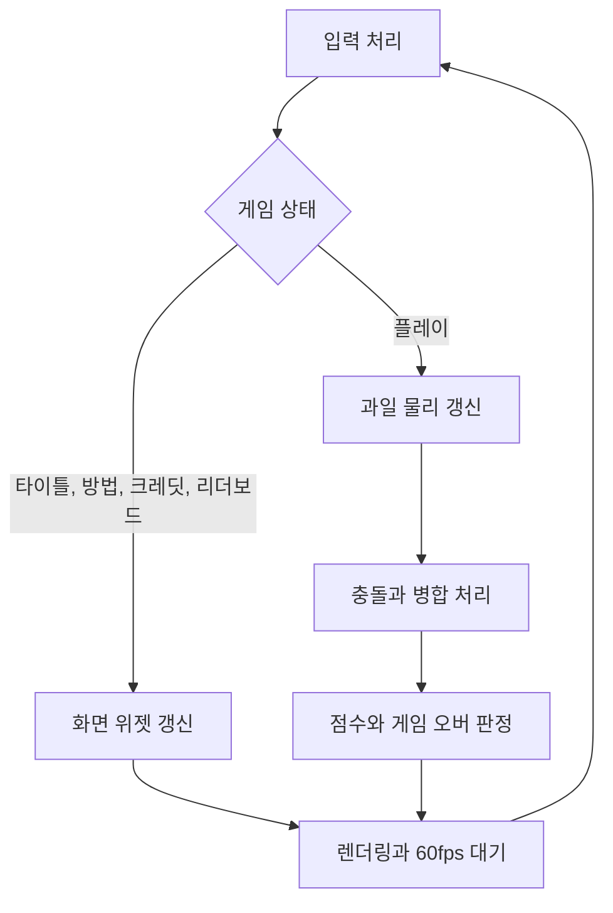

# 🍉 크래프톤 정글 게임테크랩 1주차

**한국어** | [English](./README_en.md)

***1st Game Jam: Watermelon Game***

2026.03.09. ~ 2026.03.12.

4팀: 장민준([@nacho2407](https://github.com/nacho2407)), 박준혁([@CaptainTangerine](https://github.com/CaptainTangerine)), 김지수([@jskim-research](https://github.com/jskim-research)), 정지윤([@jiyoon607](https://github.com/jiyoon607))

<p align="center">
    
    
</p>

같은 과일끼리 합쳐 더 큰 과일을 만드는 퍼즐 게임 **Watermelon Game**을 만들었습니다. DirectX 11 렌더링 위에 과일 물리와 게임 흐름, UI, 사운드를 얹었습니다.


## 🎮 주차 소개

- 과일을 떨어뜨려 같은 종류끼리 합치며 점수를 쌓는 **퍼즐 게임**을 제작합니다. 합쳐진 과일이 클수록 높은 점수를 얻고, 과일이 상자 위로 넘치면 게임이 끝납니다

- 과일 물리와 병합 규칙 위에 **화면 흐름과 리더보드, 사운드와 파티클, 게임 패드 지원**을 더했습니다


## ✨ 구현 결과

- **Watermelon Game**

  공 물리 시뮬레이션을 활용한 게임을 만들기 위해 **수박게임**(Aladdin X, 2021)을 레퍼런스로 삼아 개발했습니다

- **과일 낙하와 병합**

  마우스 위치에 맞춰 과일을 떨어뜨리고, 같은 종류의 과일이 맞닿으면 한 단계 큰 과일로 합칩니다. 병합된 자리에는 파티클과 효과음이 재생되며, 수박끼리 만나면 두 수박이 함께 사라집니다

- **과일 물리**

  공 충돌 처리에 바닥과 벽의 마찰, 각속도, 반발 계수를 더해 과일이 쌓이고 굴러가는 움직임을 만들었습니다. 겹친 과일은 여러 번 반복해 밀어내 쌓인 더미가 떨리지 않게 합니다

- **게임 흐름**

  타이틀, 게임 방법, 크레딧, 리더보드, 플레이, 게임 오버의 여섯 가지 화면을 오가며, 게임 오버 후 재시작과 타이틀 복귀를 지원합니다

- **점수와 리더보드**

  병합된 과일이 클수록 높은 점수를 얻고, 상위 5개 점수를 파일에 저장해 다시 실행해도 유지합니다

- **다음 과일 미리보기와 생성 쿨타임**

  다음에 떨어뜨릴 과일을 미리 보여 줍니다. 과일을 떨어뜨린 뒤 0.5초 동안은 다음 과일을 떨어뜨릴 수 없고, 미리보기도 빈 이미지로 바뀌어 대기 중임을 알립니다

- **게임 오버 판정**

  과일이 상단의 Game Over Line을 0.6초 이상 넘으면 경고가 깜빡이고, 2.5초 이상 유지되면 게임이 끝납니다

- **사운드**

  FMOD로 BGM과 효과음을 재생합니다. 과일 낙하와 병합, 버튼 조작, 승리와 게임 오버에 각각 효과음이 있습니다

- **UI 위젯**

  DirectX Tool Kit for DirectX 11의 스프라이트 렌더링으로 이미지와 텍스트 위젯, 버튼을 만들어 점수와 순위, 화면 전환 버튼을 표시합니다

- **게임 패드 지원**

  XInput으로 아날로그 스틱과 버튼 입력을 받고, 트리거를 누르면 낙하 위치를 더 세밀하게 조절합니다. 과일이 병합될 때는 과일 크기에 비례해 진동합니다


## 👥 팀원 및 담당 파트

| 팀원 | 담당 파트 및 주요 역할 |
|------|------------------------|
| **장민준**([@nacho2407](https://github.com/nacho2407)) | 과일 병합과 점수 - 과일 충돌과 병합 처리, 점수와 최고 점수 기록, 게임 상태 흐름, 단일 파일 구조 정리 |
| **박준혁**([@CaptainTangerine](https://github.com/CaptainTangerine)) | 물리와 사운드 - 마찰과 각속도, 반발 계수 조정, 파티클 시스템, 사운드 매니저, 점수 UI |
| **김지수**([@jskim-research](https://github.com/jskim-research)) | 자료구조와 입력, 텍스처 - 동적 배열과 큐, 과일 데이터, 텍스처 로딩, 위젯, 입력 관리자와 게임 패드, 맵 |
| **정지윤**([@jiyoon607](https://github.com/jiyoon607)) | 게임 흐름과 화면 - 게임 오버와 재시작, 리더보드, 크레딧, 위험 표시 연출, 화면 배경 |


## 🧑‍💻 담당 작업 상세

### 과일 충돌과 병합

- **목표**

  공 충돌 처리를 과일 병합 규칙으로 확장해, 같은 종류의 과일이 맞닿으면 한 단계 큰 과일로 바뀌게 합니다

- **구현 내용**

  과일 쌍을 모두 검사해 두 중심 사이 거리가 반지름 합 이하이고 종류가 같으면, 두 과일에 삭제 표시를 남기고 병합 정보를 대기열에 넣습니다. 목록을 순회하는 도중에 과일을 생성하거나 지우면 목록이 흔들리기 때문에, **삭제와 생성을 대기열로 분리해** 검사가 끝난 뒤에 한 번에 처리합니다. 병합 결과 과일은 먼저 닿은 과일의 자리에 생성하고, 수박끼리 만난 경우에는 새 과일을 만들지 않고 점수만 더합니다

- **어려웠던 점과 해결**

  충돌 판정 기준이 정확히 반지름 합과 같을 때만 병합되도록 하면, 빠르게 움직이는 과일이 서로를 스쳐 지나가며 병합이 되지 않는 경우가 있었습니다. 판정에 약간의 여유값(`MergeSlop`)을 두어 해결했습니다. 과일이 맵 밖으로 빠져나가는 문제와 화면 바깥을 클릭해도 과일이 생성되는 문제도 있어, 낙하 위치를 맵 경계 안으로 제한하고 클릭 위치가 화면 안인지 확인하도록 고쳤습니다

- **관련 코드**

  [`Source/Game.cpp`](./Source/Game.cpp), [`Source/UFruit.cpp`](./Source/UFruit.cpp), [`Source/Physics.cpp`](./Source/Physics.cpp)


### 점수와 최고 점수 기록

- **목표**

  병합한 과일의 크기에 따라 점수를 주고, 게임을 다시 실행해도 최고 점수가 남도록 합니다

- **구현 내용**

  `UScoreManager`가 점수 계산과 순위 관리를 맡습니다. 점수는 과일 단계에 따라 커지도록 계산하며, 게임이 끝나면 상위 5개 순위와 비교해 새 점수가 들어갈 자리를 찾고 아래 순위를 한 칸씩 밀어냅니다. 순위가 바뀌면 점수 배열을 **바이너리 파일로 저장**하고, 프로그램을 시작할 때 다시 읽어 들입니다

- **관련 코드**

  [`Source/UScoreManager.cpp`](./Source/UScoreManager.cpp), [`Source/UScoreManager.hpp`](./Source/UScoreManager.hpp)


### 게임 상태와 화면 흐름

- **목표**

  타이틀에서 시작해 플레이와 게임 오버를 거쳐 다시 시작할 수 있도록, 화면 전환을 한곳에서 관리합니다

- **구현 내용**

  게임 상태를 열거형으로 정의하고, 메인 루프가 현재 상태에 따라 갱신과 렌더링 대상을 고릅니다. 각 화면의 버튼은 상태 값을 바꾸는 방식으로 연결해, 화면이 늘어나도 루프 구조는 그대로 두었습니다

- **관련 코드**

  [`Source/EGameState.h`](./Source/EGameState.h), [`Source/Game.cpp`](./Source/Game.cpp)


## 🛠️ 기술 스택

- **Language**: C++20

- **Graphics API**: DirectX 11

- **Build**: Visual Studio 2026, MSBuild

- **Libraries**: Dear ImGui, DirectX Tool Kit for DirectX 11, FMOD Engine, stb, XInput


## 🖥️ 구조



- 동작 흐름

    1. 마우스와 게임 패드 입력을 읽어 낙하 위치와 버튼 조작을 처리합니다

    2. 플레이 중에는 과일의 물리를 고정 시간 간격으로 갱신하고, 충돌과 병합, 점수와 게임 오버를 판정합니다

    3. 현재 상태에 맞는 화면을 그린 뒤, 다음 프레임까지 대기합니다


## 📁 디렉토리 구조

```
week01/
├── week01.slnx     // 솔루션
├── week01.vcxproj  // 프로젝트
├── Docs/           // README 미디어
├── Source/         // 게임 코드
├── Shaders/        // 정점, 픽셀 셰이더
├── Content/        // 이미지와 사운드
└── ThirdParty/     // Dear ImGui, FMOD, stb
```


## ❓ 빌드 및 실행

### 릴리즈 실행

일부 에셋과 라이브러리의 라이선스 문제로 인해 이 주차의 실행 파일은 제공하지 않습니다.


### 소스 빌드

일부 에셋과 라이브러리를 라이선스 문제로 저장소에 포함하지 못해, 이 주차는 저장소만으로 빌드할 수 없습니다.


## 🕹️ 조작 방법

### 마우스

| 입력 | 동작 |
|------|------|
| **마우스 이동** | 과일 낙하 위치 조절 |
| **좌클릭** | 과일 떨어뜨리기 |


### 게임패드

| 입력 | 동작 |
|------|------|
| **아날로그 스틱** | 과일 낙하 위치 조절 |
| **A 버튼** | 과일 떨어뜨리기 |
| **트리거 버튼 + 아날로그 스틱** | 과일 낙하 위치를 더 세밀하게 조절 |


## 📄 서드파티 라이브러리

| 이름 | 저작자 | 버전 | 라이선스 |
|------|--------|------|----------|
| **[Dear ImGui](https://github.com/ocornut/imgui)** | Omar Cornut | 1.92.6 WIP | [MIT License](./ThirdParty/imgui/LICENSE.txt) |
| **[DirectX Tool Kit for DirectX 11](https://github.com/microsoft/DirectXTK)** | Microsoft Corporation. | 2025.10.28.2 | MIT License |
| **[FMOD Engine](https://www.fmod.com)** | Firelight Technologies Pty Ltd | 2.03.12 | FMOD End User License Agreement |
| **[stb](https://github.com/nothings/stb)** | Sean Barrett | 2.30 | The Unlicense |


## ⚖️ 라이선스

이 주차의 코드 중 장민준이 작성한 부분은 MIT 라이선스로 공개하며, 다른 기여자가 작성한 부분의 권리는 각 기여자에게 있습니다. 자세한 내용은 [LICENSE](../LICENSE)를 확인해 주세요.
