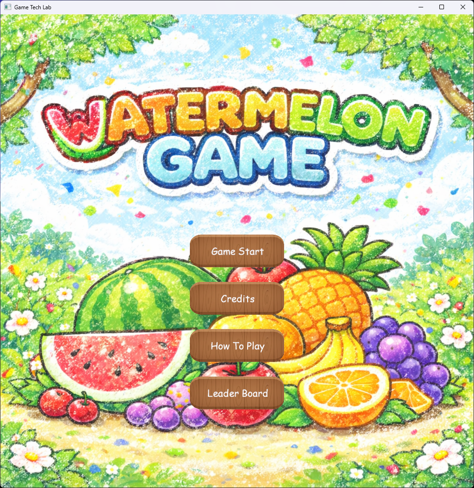
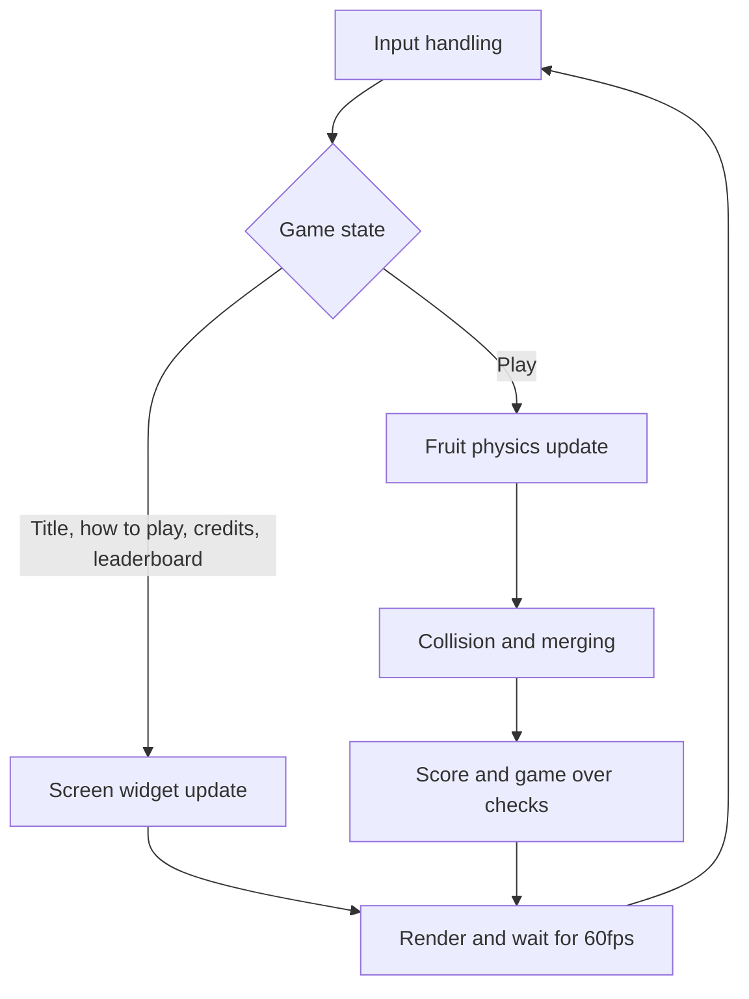

# 🍉 KRAFTON Jungle game tech Lab - Week 1

[한국어](./README.md) | **English**

***1st Game Jam: Watermelon Game***

2026.03.09. ~ 2026.03.12.

Team 4: 장민준([@nacho2407](https://github.com/nacho2407)), 박준혁([@CaptainTangerine](https://github.com/CaptainTangerine)), 김지수([@jskim-research](https://github.com/jskim-research)), 정지윤([@jiyoon607](https://github.com/jiyoon607))

<p align="center">
    
    
</p>

Built **Watermelon Game**, a puzzle game where identical fruits merge into a bigger one. Fruit physics, game flow, UI, and sound were built on top of DirectX 11 rendering.


## 🎮 Week Overview

- Builds a **puzzle game** where fruits are dropped and identical ones merge to build up the score. Larger merged fruits are worth more points, and the game ends when the fruits overflow the box

- On top of the fruit physics and the merging rules, it adds **game flow and a leaderboard, sound and particles, and gamepad support**


## ✨ Features

- **Watermelon Game**

  To make a game that uses ball physics simulation, we developed it with **Suika Game**(Aladdin X, 2021) as a reference

- **Dropping and merging fruits**

  Fruits are dropped at the mouse position, and two fruits of the same kind merge into the next larger one when they touch. A particle effect and a sound effect play at the merge point, and when two watermelons meet they simply disappear together

- **Fruit physics**

  Friction against the floor and walls, angular velocity, and a restitution coefficient were added to the ball collision code so that fruits stack and roll. Overlapping fruits are pushed apart over several iterations to keep the pile from jittering

- **Game flow**

  The game moves between six screens, which are the title, how to play, credits, leaderboard, play, and game over, and supports restarting or returning to the title after a game over

- **Score and leaderboard**

  Larger merged fruits give more points, and the top five scores are saved to a file so they persist across runs

- **Next fruit preview and spawn cooldown**

  The next fruit to drop is shown in advance. For 0.5 seconds after a drop, the next fruit cannot be dropped, and the preview turns into an empty image to show that it is on cooldown

- **Game over detection**

  When a fruit stays above the Game Over Line at the top for more than 0.6 seconds, a warning blinks, and the game ends once it stays there for 2.5 seconds

- **Sound**

  FMOD plays the background music and sound effects. Dropping and merging fruits, button input, winning, and game over each have their own sound effect

- **UI widgets**

  Image and text widgets and buttons were built on the sprite rendering of DirectX Tool Kit for DirectX 11 to show the score, the ranking, and the screen transition buttons

- **Gamepad support**

  XInput reads the analog stick and buttons, and holding the trigger allows finer control of the drop position. The controller vibrates in proportion to the fruit size when fruits merge


## 👥 Team

| Member | Responsibilities |
|--------|------------------|
| **장민준**([@nacho2407](https://github.com/nacho2407)) | Fruit merging and score - fruit collision and merging, score and high score records, game state flow, splitting the single-file structure |
| **박준혁**([@CaptainTangerine](https://github.com/CaptainTangerine)) | Physics and sound - friction and angular velocity, restitution tuning, particle system, sound manager, score UI |
| **김지수**([@jskim-research](https://github.com/jskim-research)) | Data structures, input, and textures - dynamic array and queue, fruit data, texture loading, widgets, input manager and gamepad, map |
| **정지윤**([@jiyoon607](https://github.com/jiyoon607)) | Game flow and screens - game over and restart, leaderboard, credits, danger warning effect, screen backgrounds |


## 🧑‍💻 Work Details

### Fruit collision and merging

- **Goal**

  Extend the ball collision handling into fruit merging rules so that two fruits of the same kind turn into the next larger fruit when they touch

- **Implementation**

  Every pair of fruits is checked, and when the distance between their centers is within the sum of their radii and their kinds match, both fruits are marked for deletion and the merge is pushed onto a queue. Creating or deleting fruits while iterating over the list disturbs the list, so **deletion and creation are separated into queues** and handled together after the checks finish. The merged fruit is created at the position of the first fruit, and when two watermelons meet no new fruit is created and only the score is added

- **Challenges and Solutions**

  When the collision test required the distance to match the sum of the radii exactly, fast moving fruits sometimes passed each other without merging. Adding a small tolerance(`MergeSlop`) to the test solved it. Fruits also escaped the map, and clicking outside the window still spawned fruits, so the drop position is now clamped inside the map bounds and the click position is checked against the window

- **Related Code**

  [`Source/Game.cpp`](./Source/Game.cpp), [`Source/UFruit.cpp`](./Source/UFruit.cpp), [`Source/Physics.cpp`](./Source/Physics.cpp)


### Score and high score records

- **Goal**

  Award points according to the size of the merged fruit and keep the high scores across runs

- **Implementation**

  `UScoreManager` handles the score calculation and the ranking. The score grows with the fruit stage, and when the game ends the new score is compared against the top five, its place is found, and the lower ranks are shifted down by one. Whenever the ranking changes, the score array is **saved to a binary file** and read back when the program starts

- **Related Code**

  [`Source/UScoreManager.cpp`](./Source/UScoreManager.cpp), [`Source/UScoreManager.hpp`](./Source/UScoreManager.hpp)


### Game state and screen flow

- **Goal**

  Manage the screen transitions in one place so the game can go from the title through play and game over and back to a new run

- **Implementation**

  The game state is defined as an enum, and the main loop picks what to update and render based on the current state. The buttons on each screen simply change the state value, so the loop structure stays the same as screens are added

- **Related Code**

  [`Source/EGameState.h`](./Source/EGameState.h), [`Source/Game.cpp`](./Source/Game.cpp)


## 🛠️ Tech Stack

- **Language**: C++20

- **Graphics API**: DirectX 11

- **Build**: Visual Studio 2026, MSBuild

- **Libraries**: Dear ImGui, DirectX Tool Kit for DirectX 11, FMOD Engine, stb, XInput


## 🖥️ Architecture



- Flow

    1. Mouse and gamepad input is read to handle the drop position and button presses

    2. During play, fruit physics is updated at a fixed time step, and collisions, merges, score, and game over are resolved

    3. The screen for the current state is drawn, and the loop waits for the next frame


## 📁 Directory Structure

```
week01/
├── week01.slnx     // Solution
├── week01.vcxproj  // Project
├── Docs/           // README media
├── Source/         // Game code
├── Shaders/        // Vertex, pixel shaders
├── Content/        // Images and sounds
└── ThirdParty/     // Dear ImGui, FMOD, stb
```


## ❓ Build and Run

### Running the Release Build

Executables are not provided for this week because of license issues with some of the assets and libraries.


### Building from Source

Some assets and libraries could not be included in the repository because of license issues, so this week cannot be built from the repository alone.


## 🕹️ Controls

### Mouse

| Input | Action |
|------|------|
| **Mouse move** | Adjust the drop position |
| **Left click** | Drop a fruit |


### Gamepad

| Input | Action |
|------|------|
| **Analog stick** | Adjust the drop position |
| **A button** | Drop a fruit |
| **Trigger + analog stick** | Adjust the drop position more precisely |


## 📄 Third-Party Libraries

| Name | Author | Version | License |
|------|--------|------|----------|
| **[Dear ImGui](https://github.com/ocornut/imgui)** | Omar Cornut | 1.92.6 WIP | [MIT License](./ThirdParty/imgui/LICENSE.txt) |
| **[DirectX Tool Kit for DirectX 11](https://github.com/microsoft/DirectXTK)** | Microsoft Corporation. | 2025.10.28.2 | MIT License |
| **[FMOD Engine](https://www.fmod.com)** | Firelight Technologies Pty Ltd | 2.03.12 | FMOD End User License Agreement |
| **[stb](https://github.com/nothings/stb)** | Sean Barrett | 2.30 | The Unlicense |


## ⚖️ License

The portions of this week's code written by Jang Minjun are released under the MIT License, and the rights to the portions written by other contributors belong to their respective contributors. See [LICENSE](../LICENSE) for details.
