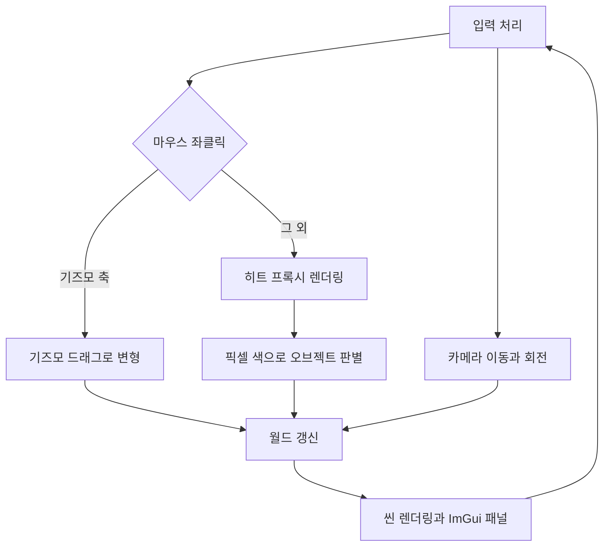

# 🧊 크래프톤 정글 게임테크랩 2주차

**한국어** | [English](./README_en.md)

***Break into 3D***

2026.03.12. ~ 2026.03.19.

2팀: 장민준([@nacho2407](https://github.com/nacho2407)), 박상혁([@UltraSion](https://github.com/UltraSion)), 박세영([@mathison0](https://github.com/mathison0)), 김효범([@deepBeom](https://github.com/deepBeom))


DirectX 11과 Dear ImGui로 **3D 에디터 프로토타입**을 만들었습니다. 월드에 프리미티브를 놓고 마우스로 골라 기즈모로 변형하며, 만든 씬을 JSON 파일로 저장하고 다시 불러올 수 있습니다.


## 🎮 주차 소개

- 2D 렌더링을 3차원 공간으로 넓혀, 월드에 놓인 오브젝트를 **마우스로 고르고 변형하는 에디터**를 만듭니다. 큐브와 구, 토러스, 삼각형을 원하는 개수만큼 생성하고 위치와 회전, 크기를 바꾼 뒤 그 상태를 파일로 남길 수 있습니다

- 화면 뒤쪽으로는 **엔진의 바닥이 되는 코어 시스템**을 함께 만들었습니다. 모든 오브젝트의 최상위 클래스인 `UObject`와 전역 오브젝트 배열, 힙 메모리 사용량 추적, Unreal Engine 방식의 컨테이너와 로그 매크로가 여기에 해당합니다


## ✨ 구현 결과

- **3D 공간과 카메라**

  모델, 뷰, 프로젝션 변환을 직접 구현한 `FMatrix`로 계산해 정점 셰이더의 상수 버퍼로 넘깁니다. 카메라는 키보드로 여섯 방향 이동, 마우스 우클릭 드래그로 시야 회전, 휠로 전후 이동을 지원하며 원근과 직교 투영을 전환할 수 있습니다

- **프리미티브 배치**

  제어 창에서 메시 종류와 개수를 고르고 버튼을 누르면 월드에 오브젝트가 생성됩니다. 선택한 오브젝트는 Delete 키로 지울 수 있습니다

- **마우스 피킹과 강조**

  화면을 좌클릭하면 그 자리에 어떤 오브젝트가 있는지 찾아 선택하고, Inverted Hull 기법으로 테두리를 그려 선택 상태를 보여 줍니다

- **좌표축과 그리드**

  월드 원점의 3차원 축과 바닥 그리드를 그려 공간감을 주고, 선택한 오브젝트에는 로컬 좌표축을 함께 그립니다. 축 색상은 Unreal Engine과 같은 규칙을 따릅니다

- **기즈모 변형**

  선택한 오브젝트에 기즈모가 붙어 이동, 회전, 크기를 마우스 드래그로 바꿀 수 있습니다. 모드는 Space 키나 속성 창의 버튼으로 전환하며, 기즈모는 카메라 거리와 상관없이 화면에서 일정한 크기로 보입니다

- **속성 창**

  선택한 오브젝트의 위치, 회전, 크기를 숫자로 확인하고 직접 고칠 수 있습니다

- **콘솔 창과 로그**

  ImGui로 만든 콘솔 창에 `UE_LOG` 매크로로 남긴 로그가 출력됩니다

- **통계 표시**

  제어 창에서 프레임 레이트와 프레임 시간, 지금까지 할당한 힙 메모리 크기와 할당 횟수를 볼 수 있습니다. VSync는 켜기 / 끄기를 바꿀 수 있습니다

- **씬 저장과 불러오기**

  월드에 놓인 오브젝트의 종류와 변환 정보를 JSON 형식의 `.Scene` 파일로 저장하고, 다시 읽어 같은 배치를 복원합니다

- **엔진 코어**

  모든 오브젝트의 최상위 클래스 `UObject`와 이를 모아 두는 전역 배열, UUID 발행, 클래스 메타데이터, 힙 메모리 추적, 가비지 컬렉션을 구현했습니다. STL 컨테이너는 `TArray`와 `TMap`처럼 Unreal Engine 방식의 이름으로 다시 정의했습니다


## 👥 팀원 및 담당 파트

| 팀원 | 담당 파트 및 주요 역할 |
|------|------------------------|
| **장민준**([@nacho2407](https://github.com/nacho2407)) | 피킹과 직렬화 - 히트 프록시 피킹, JSON 씬 저장과 불러오기, 클래스 선언 매크로, 액터 스폰과 삭제, 프레임 레이트 표시와 VSync |
| **박상혁**([@UltraSion](https://github.com/UltraSion)) | 엔진 코어 - 프로젝트 기반과 모듈 분리, UObject 시스템, 클래스 메타데이터, 오브젝트 생성과 삭제, 메모리 추적 |
| **박세영**([@mathison0](https://github.com/mathison0)) | 에디터 UI - 속성, 제어, 콘솔 패널, 로그 시스템, 기즈모 회전 모드와 모드 전환, 창 크기 실시간 변경 |
| **김효범**([@deepBeom](https://github.com/deepBeom)) | 렌더링과 기즈모 - 기본 렌더링, 카메라 조작, 기즈모 드래그 조작, 외곽선 강조, 좌표축과 그리드, 입력 관리자 |


## 🧑‍💻 담당 작업 상세

### 히트 프록시 피킹

- **목표**

  화면을 클릭했을 때 그 자리에 어떤 오브젝트가 있는지 정확하게 알아냅니다

- **구현 내용**

  화면과 같은 크기의 렌더 타겟에 **각 프리미티브를 자기 번호에서 만든 색으로 칠한 화면을 한 장 더** 그려 둡니다. 클릭이 일어나면 그 텍스처를 읽기용 텍스처로 복사해 클릭한 픽셀 한 개의 색을 읽고, 색을 다시 번호로 되돌려 어떤 오브젝트인지 알아냅니다. 창 크기가 바뀌면 이 버퍼도 화면 크기에 맞춰 다시 만듭니다

- **레이 캐스팅 방식 대신 히트 프록시 방식을 선택한 이유**

  처음에는 마우스 좌표를 3차원 광선으로 바꿔 오브젝트와 교차 검사를 했습니다. 다만 메시를 통째로 감싸는 구 하나로 근사한 판정이라, **토러스 가운데 뚫린 구멍을 클릭해도 선택되는 문제**가 있었습니다. 삼각형 단위로 정확하게 검사하면 해결되지만, 구 메시 하나가 800삼각형이라 클릭할 때마다 모든 오브젝트의 모든 삼각형을 훑어야 합니다. 히트 프록시는 메시가 아무리 복잡해도 **화면 한 장을 더 그리고 픽셀 하나를 읽는 고정 비용**으로 끝나고, 화면에 보이는 그대로 판정되어 가려진 오브젝트가 잘못 선택되지도 않습니다

- **관련 코드**

  [`Source/Render/Private/URenderer.cpp`](./Source/Render/Private/URenderer.cpp), [`Source/Render/Public/FHitProxy.h`](./Source/Render/Public/FHitProxy.h), [`Shaders/HitProxy.hlsl`](./Shaders/HitProxy.hlsl)


### 씬 저장과 불러오기

- **목표**

  월드에 배치한 오브젝트를 파일로 남기고, 다시 읽어 같은 배치를 복원합니다

- **구현 내용**

  저장 형식과 변환 과정을 나눠 만들었습니다. `FWorldSaveData`는 버전과 다음 UUID, 오브젝트 기록의 배열만 담는 단순한 구조체이고, `FWorldSaveConverter`가 월드를 돌며 이 구조체를 채우거나 반대로 구조체에서 월드를 다시 만듭니다. JSON 문자열로 바꾸는 일은 `FJsonConverter`가 맡아, **월드를 아는 코드와 JSON 라이브러리를 쓰는 코드를 분리**했습니다. 파일 이름에 확장자가 없으면 `.Scene`을 붙입니다

- **관련 코드**

  [`Source/Serialization/Private/FWorldSaveConverter.cpp`](./Source/Serialization/Private/FWorldSaveConverter.cpp), [`Source/Serialization/Private/FJsonConverter.cpp`](./Source/Serialization/Private/FJsonConverter.cpp), [`Source/Serialization/Public/FWorldSaveData.h`](./Source/Serialization/Public/FWorldSaveData.h)


### 액터 스폰과 삭제

- **목표**

  에디터에서 원하는 종류의 오브젝트를 원하는 개수만큼 만들고, 필요 없는 것은 지울 수 있게 합니다

- **구현 내용**

  처음에는 애플리케이션 쪽에 있던 생성 코드를 **월드로 옮겨**, 오브젝트의 수명을 월드가 한곳에서 관리하도록 했습니다. 생성할 때 클래스별로 다른 초기화가 필요해, 클래스마다 이름과 부모 정보를 담은 메타데이터를 만들어 주는 선언 매크로를 더했습니다. 삭제는 선택 상태와 기즈모 연결을 먼저 끊은 뒤 월드에 파괴를 요청하는 순서로 처리합니다

- **관련 코드**

  [`Source/Engine/Private/World/UWorld.cpp`](./Source/Engine/Private/World/UWorld.cpp), [`Source/Core/Public/UObject.h`](./Source/Core/Public/UObject.h), [`Source/App/FApplication.cpp`](./Source/App/FApplication.cpp)


## 🛠️ 기술 스택

- **Language**: C++20

- **Graphics API**: DirectX 11

- **Build**: Visual Studio 2026, MSBuild

- **Libraries**: Dear ImGui, JSON for Modern C++


## 🖥️ 구조



- 동작 흐름

    1. 키보드와 마우스 입력을 읽어 카메라를 움직이고, 클릭한 위치를 확인합니다

    2. 좌클릭하면 오브젝트마다 고유한 색을 칠한 화면을 따로 그린 뒤, 클릭한 픽셀의 색을 읽어 어떤 오브젝트인지 알아냅니다

    3. 선택된 오브젝트는 기즈모와 속성 창으로 변형하고, 바뀐 값을 월드에 반영합니다

    4. 씬과 ImGui 패널을 차례로 그려 화면에 표시합니다


## 📁 디렉토리 구조

```
week02/
├── week02.slnx         // 솔루션
├── week02.vcxproj      // 프로젝트
├── Docs/               // README 미디어
├── Source/
│   ├── App/            // 애플리케이션, 입력, 진입점
│   │   └── Panels/     // 에디터 패널
│   ├── Core/           // 객체 시스템, 메모리, 수학
│   ├── Engine/         // 액터, 컴포넌트, 메시, 월드
│   ├── GUI/            // ImGui 관리
│   ├── Render/         // 렌더러와 히트 프록시
│   └── Serialization/  // JSON 씬 저장과 불러오기
├── Shaders/            // 정점, 픽셀 셰이더
└── ThirdParty/         // Dear ImGui, JSON for Modern C++
```


## ❓ 빌드 및 실행

### 릴리즈 실행

일부 에셋과 라이브러리의 라이선스 문제로 인해 이 주차의 실행 파일은 제공하지 않습니다.


### 소스 빌드

일부 에셋과 라이브러리를 라이선스 문제로 저장소에 포함하지 못해, 이 주차는 저장소만으로 빌드할 수 없습니다.


## ⌨️ 단축키

| 단축키 | 동작 |
|--------|------|
| **Space** | 기즈모 모드 전환(이동, 회전, 크기) |
| **Delete** | 선택한 오브젝트 삭제 |


## 📄 서드파티 라이브러리

| 이름 | 저작자 | 버전 | 라이선스 |
|------|--------|------|----------|
| **[Dear ImGui](https://github.com/ocornut/imgui)** | Omar Cornut | 1.92.7 WIP | [MIT License](./ThirdParty/imgui/LICENSE.txt) |
| **[JSON for Modern C++](https://github.com/nlohmann/json)** | Niels Lohmann | 3.12.0 | [MIT License](./ThirdParty/Json/LICENSE.MIT) |


## ⚖️ 라이선스

이 주차의 코드 중 장민준이 작성한 부분은 MIT 라이선스로 공개하며, 다른 기여자가 작성한 부분의 권리는 각 기여자에게 있습니다. 자세한 내용은 [LICENSE](../LICENSE)를 확인해 주세요.
