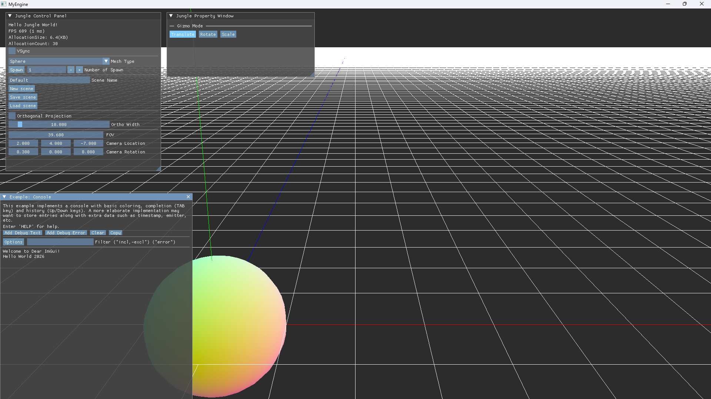
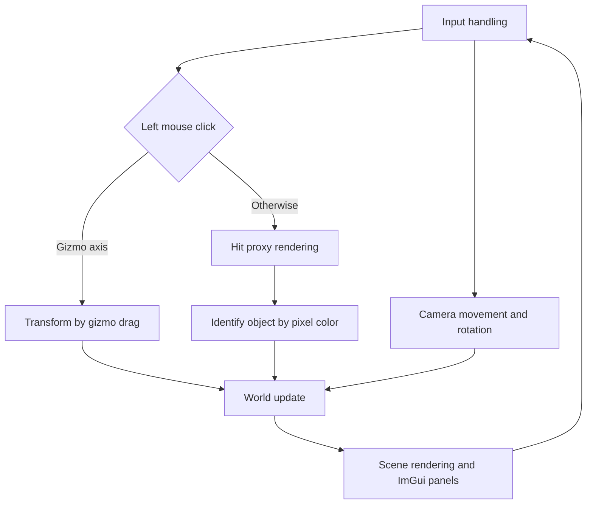

# 🧊 KRAFTON Jungle game tech Lab - Week 2

[한국어](./README.md) | **English**

***Break into 3D***

2026.03.12. ~ 2026.03.19.

Team 2: 장민준([@nacho2407](https://github.com/nacho2407)), 박상혁([@UltraSion](https://github.com/UltraSion)), 박세영([@mathison0](https://github.com/mathison0)), 김효범([@deepBeom](https://github.com/deepBeom))




A **3D editor prototype** built with DirectX 11 and Dear ImGui. Primitives can be placed in the world, picked with the mouse and transformed with a gizmo, and the resulting scene can be saved to a JSON file and loaded back.


## 🎮 Week Overview

- Extends 2D rendering into three-dimensional space and builds an **editor that picks and transforms objects placed in the world** with the mouse. Cubes, spheres, tori, and triangles can be spawned in any number, moved, rotated, and scaled, and the result can be written to a file

- Behind the screen, the **core systems that the engine is built on** were written as well. `UObject` as the base class of every object, the global object array, heap memory usage tracking, and Unreal Engine style containers and log macros belong here


## ✨ Features

- **3D space and camera**

  The model, view, and projection transforms are computed with `FMatrix`, implemented from scratch, and passed to the vertex shader through a constant buffer. The camera moves in six directions with the keyboard, rotates by dragging with the right mouse button, and moves forward and backward with the wheel, and it can switch between perspective and orthographic projection

- **Placing primitives**

  Choosing a mesh type and a count in the control window and pressing the button spawns objects in the world. The selected object can be removed with the Delete key

- **Mouse picking and highlighting**

  Left-clicking the screen finds and selects whatever object is at that spot, and an outline drawn with the Inverted Hull technique shows the selection

- **Axes and grid**

  A three-dimensional axis at the world origin and a floor grid give a sense of space, and the selected object also gets its local axes drawn. The axis colors follow the same convention as Unreal Engine

- **Gizmo transforms**

  A gizmo attaches to the selected object so that its location, rotation, and scale can be changed by dragging with the mouse. The mode is switched with the Space key or the buttons in the property window, and the gizmo keeps a constant size on screen regardless of the camera distance

- **Property window**

  The location, rotation, and scale of the selected object can be inspected as numbers and edited directly

- **Console window and logging**

  Logs written with the `UE_LOG` macro are printed to a console window built with ImGui

- **Statistics**

  The control window shows the frame rate and frame time along with the heap memory allocated so far and the number of allocations. VSync can be toggled on / off

- **Saving and loading scenes**

  The type and transform of every object placed in the world are saved to a `.Scene` file in JSON format and read back to restore the same layout

- **Engine core**

  `UObject` as the base class of every object, the global array that holds them, UUID generation, class metadata, heap memory tracking, and garbage collection were implemented. STL containers were redefined with Unreal Engine style names such as `TArray` and `TMap`


## 👥 Team

| Member | Responsibilities |
|--------|------------------|
| **장민준**([@nacho2407](https://github.com/nacho2407)) | Picking and serialization - hit proxy picking, JSON scene saving and loading, class declaration macro, actor spawning and destruction, frame rate display and VSync |
| **박상혁**([@UltraSion](https://github.com/UltraSion)) | Engine core - project foundation and module split, UObject system, class metadata, object creation and destruction, memory tracking |
| **박세영**([@mathison0](https://github.com/mathison0)) | Editor UI - property, control, and console panels, logging system, gizmo rotation mode and mode switching, live window resizing |
| **김효범**([@deepBeom](https://github.com/deepBeom)) | Rendering and gizmo - base rendering, camera controls, gizmo dragging, outline highlighting, axes and grid, input manager |


## 🧑‍💻 Work Details

### Hit proxy picking

- **Goal**

  Determine exactly which object sits at the clicked position on screen

- **Implementation**

  **One extra frame is drawn into a render target the size of the screen, with each primitive filled in a color derived from its own id.** When a click happens, that texture is copied into a readback texture, the color of the single clicked pixel is read, and turning the color back into an id gives the object. When the window is resized, this buffer is recreated to match the new screen size

- **Why hit proxy was chosen over ray casting**

  Ray casting was used first, turning the mouse position into a three-dimensional ray and intersecting it with the objects. That test approximated each mesh with a single enclosing sphere, however, so **clicking the hole in the middle of a torus still selected it**. Testing per triangle would fix that, but a single sphere mesh has 800 triangles, which means walking every triangle of every object on each click. A hit proxy costs **one extra frame and a single pixel read** no matter how complex the mesh is, and because it matches exactly what is on screen, an occluded object is never picked by mistake

- **Related code**

  [`Source/Render/Private/URenderer.cpp`](./Source/Render/Private/URenderer.cpp), [`Source/Render/Public/FHitProxy.h`](./Source/Render/Public/FHitProxy.h), [`Shaders/HitProxy.hlsl`](./Shaders/HitProxy.hlsl)


### Saving and loading scenes

- **Goal**

  Write the objects placed in the world to a file and read them back to restore the same layout

- **Implementation**

  The save format and the conversion steps were kept apart. `FWorldSaveData` is a plain struct that only holds the version, the next UUID, and an array of object records, while `FWorldSaveConverter` walks the world to fill that struct or rebuilds the world from it. Turning it into a JSON string is left to `FJsonConverter`, which **separates the code that knows about the world from the code that uses the JSON library**. When the file name has no extension, `.Scene` is appended

- **Related code**

  [`Source/Serialization/Private/FWorldSaveConverter.cpp`](./Source/Serialization/Private/FWorldSaveConverter.cpp), [`Source/Serialization/Private/FJsonConverter.cpp`](./Source/Serialization/Private/FJsonConverter.cpp), [`Source/Serialization/Public/FWorldSaveData.h`](./Source/Serialization/Public/FWorldSaveData.h)


### Actor spawning and destruction

- **Goal**

  Let the editor create any number of objects of a chosen type and remove the ones that are no longer needed

- **Implementation**

  The spawning code that first lived on the application side was **moved into the world** so that object lifetimes are managed in one place. Because each class needs different initialization on creation, a declaration macro was added that builds metadata holding the name and parent of each class. Destruction clears the selection and the gizmo link first and only then asks the world to destroy the object

- **Related code**

  [`Source/Engine/Private/World/UWorld.cpp`](./Source/Engine/Private/World/UWorld.cpp), [`Source/Core/Public/UObject.h`](./Source/Core/Public/UObject.h), [`Source/App/FApplication.cpp`](./Source/App/FApplication.cpp)


## 🛠️ Tech Stack

- **Language**: C++20

- **Graphics API**: DirectX 11

- **Build**: Visual Studio 2026, MSBuild

- **Libraries**: Dear ImGui, JSON for Modern C++


## 🖥️ Architecture



- Flow

    1. Keyboard and mouse input is read to move the camera and to check the clicked position

    2. On a left click, a separate frame with a unique color per object is drawn, and the color of the clicked pixel is read to identify the object

    3. The selected object is transformed through the gizmo and the property window, and the new values are applied to the world

    4. The scene and the ImGui panels are drawn in order and presented


## 📁 Directory Structure

```
week02/
├── week02.slnx         // Solution
├── week02.vcxproj      // Project
├── Docs/               // README media
├── Source/
│   ├── App/            // Application, input, and entry point
│   │   └── Panels/     // Editor panels
│   ├── Core/           // Object system, memory, and math
│   ├── Engine/         // Actors, components, meshes, and world
│   ├── GUI/            // ImGui management
│   ├── Render/         // Renderer and hit proxies
│   └── Serialization/  // JSON scene saving and loading
├── Shaders/            // Vertex, pixel shaders
└── ThirdParty/         // Dear ImGui, JSON for Modern C++
```


## ❓ Build and Run

### Running the Release Build

Executables are not provided for this week because of license issues with some of the assets and libraries.


### Building from Source

Some assets and libraries could not be included in the repository because of license issues, so this week cannot be built from the repository alone.


## ⌨️ Shortcuts

| Shortcut | Action |
|--------|------|
| **Space** | Switch the gizmo mode(translate, rotate, scale) |
| **Delete** | Remove the selected object |


## 📄 Third-Party Libraries

| Name | Author | Version | License |
|------|--------|------|----------|
| **[Dear ImGui](https://github.com/ocornut/imgui)** | Omar Cornut | 1.92.7 WIP | [MIT License](./ThirdParty/imgui/LICENSE.txt) |
| **[JSON for Modern C++](https://github.com/nlohmann/json)** | Niels Lohmann | 3.12.0 | [MIT License](./ThirdParty/Json/LICENSE.MIT) |


## ⚖️ License

The portions of this week's code written by Jang Minjun are released under the MIT License, and the rights to the portions written by other contributors belong to their respective contributors. See [LICENSE](../LICENSE) for details.
