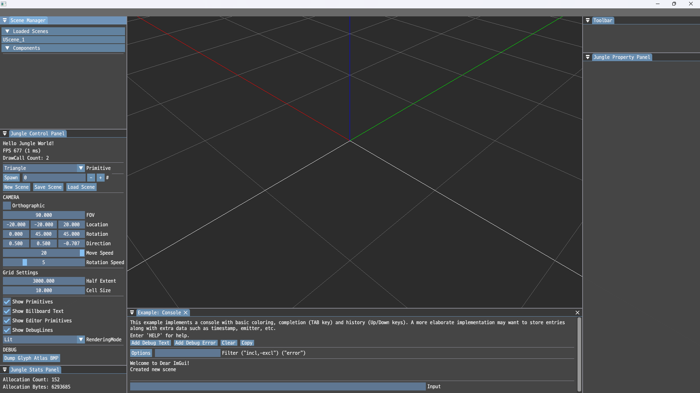
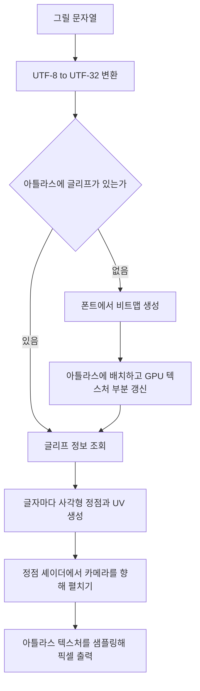

# 🔤 크래프톤 정글 게임테크랩 3주차

**한국어** | [English](./README_en.md)

***텍스처와 와이어프레임***

2026.03.19. ~ 2026.03.26.

3팀: 장민준([@nacho2407](https://github.com/nacho2407)), 이호진([@lois505](https://github.com/lois505)), 이상훈([@lsh-Brecht](https://github.com/lsh-Brecht))




3D 에디터에 **글자와 스프라이트를 그리는 렌더링 경로**를 새로 만들었습니다. 필요한 글자만 실행 중에 아틀라스로 구워 한글까지 화면에 띄우고, 선 렌더링을 하나의 버퍼로 모으며, 여러 씬을 한 에디터에서 다룰 수 있습니다.


## 🎮 주차 소개

- 오브젝트 위에 **UUID를 글자로 띄우고**, 하나의 텍스처를 나눠 쓰는 **스프라이트 애니메이션**을 재생합니다. 글자와 스프라이트 모두 항상 카메라를 바라보는 사각형으로 그립니다

- 그리드와 바운딩 박스처럼 **선으로 그리는 것들을 하나의 버퍼로 모아** 한 번에 그리고, 정점을 인덱스로 참조해 중복 저장을 없앴습니다

- 여러 개의 씬을 동시에 올려 두고 **활성 씬만 그리는 Scene Manager**를 만들어, 씬 단위로 만들고 저장하고 지울 수 있게 했습니다


## ✨ 구현 결과

- **동적 글리프 아틀라스**

  화면에 필요한 글자가 생길 때마다 그 글자만 폰트에서 비트맵으로 구워 아틀라스에 채웁니다. 모든 글자를 미리 굽지 않아도 되어 **한글처럼 글자 수가 많은 문자도 그릴 수 있습니다**

- **UUID 빌보드 텍스트**

  월드에 놓인 오브젝트 위에 각자의 UUID가 글자로 떠 있고, 카메라를 어느 방향으로 돌려도 정면으로 보입니다. Show Flag로 켜고 끌 수 있습니다

- **텍스트 메시**

  빌보드와 달리 월드 공간에 고정되는 글자 오브젝트입니다. 다른 프리미티브처럼 위치와 회전, 크기를 바꾸고 씬에 저장할 수 있습니다

- **SubUV 스프라이트**

  하나의 텍스처를 행과 열로 나눠 UV를 계산해 프레임을 순서대로 재생합니다. 프레임 속도와 반복 여부를 속성 창에서 바꿀 수 있습니다

- **배치 라인 렌더링**

  그리드, 월드 축, 바운딩 박스처럼 선으로 그리는 것을 하나의 동적 정점 버퍼에 모아 그립니다. 선이 버퍼 용량을 넘으면 **청크 단위로 나눠** 여러 번에 걸쳐 그립니다

- **인덱스 버퍼**

  정점을 인덱스로 참조해 같은 정점을 여러 번 저장하지 않습니다

- **바운딩 박스**

  프리미티브를 감싸는 AABB를 선으로 그려 크기와 위치를 확인할 수 있습니다. 디버그 표시라 별도의 배치로 관리합니다

- **Scene Manager와 멀티 씬**

  여러 씬을 동시에 올려 두고 활성 씬만 렌더링합니다. 씬을 새로 만들고, `.Scene` 파일로 저장하고, 목록에서 내리는 일을 패널에서 합니다

- **다중 선택**

  `Ctrl`을 누른 채 클릭하면 여러 오브젝트를 함께 고를 수 있고, 뷰포트와 Scene Manager 패널 양쪽에서 선택됩니다. 이동과 회전, 크기 조정은 마지막에 고른 오브젝트를 기준으로 합니다

- **FName 시스템**

  이름을 문자열 그대로 비교하지 않고, 룩업 테이블에 넣어 받은 인덱스로 비교합니다. 대소문자는 구분하지 않습니다

- **Show Flag와 뷰 모드**

  프리미티브, 빌보드 텍스트, 에디터 프리미티브, 디버그 선을 각각 켜고 끌 수 있고, 렌더링을 Lit과 Unlit, Wireframe으로 바꿀 수 있습니다

- **에디터 설정 저장**

  그리드 간격과 카메라 이동 감도를 `editor.ini`에 저장해 다음 실행에서 복원합니다


## 👥 팀원 및 담당 파트

| 팀원 | 담당 파트 및 주요 역할 |
|------|------------------------|
| **장민준**([@nacho2407](https://github.com/nacho2407)) | 텍스트 렌더링 - 동적 글리프 아틀라스, 빌보드 텍스트, 텍스트 메시, AABB 깊이 처리, 창 크기 실시간 변경 |
| **이호진**([@lois505](https://github.com/lois505)) | 엔진 코어와 디버그 렌더링 - FName 시스템, 배치 라인 렌더링, 인덱스 버퍼, 바운딩 박스, Show Flag, 드로우 콜 표시 |
| **이상훈**([@lsh-Brecht](https://github.com/lsh-Brecht)) | 씬 관리와 에디터 - Scene Manager와 멀티 씬, 다중 선택 피킹, SubUV, 도킹 UI와 그리드 설정, 와이어프레임 모드 |


## 🧑‍💻 담당 작업 상세

### 동적 글리프 아틀라스

- **목표**

  ASCII뿐 아니라 한글까지 화면에 그리되, 쓰지도 않을 글자를 미리 구워 두지 않습니다

- **구현 내용**

  글자를 그릴 때마다 아틀라스에 그 글자가 있는지 먼저 확인하고, 없으면 그 자리에서 만들어 채우는 방식으로 만들었습니다. 문자열은 UTF-8에서 **UTF-32 코드포인트**로 바꿔 글자 단위로 다루고, 코드포인트마다 아틀라스 안의 위치와 크기를 캐시에 기록해 두 번째부터는 다시 굽지 않습니다. 비트맵을 만드는 일은 Dear ImGui가 함께 배포하는 stb_truetype이 맡고, 폰트가 지원하지 않는 코드포인트는 유니코드 대체 문자로 바꿉니다

  아틀라스는 2048x2048 크기에 픽셀당 1바이트를 쓰는 텍스처 한 장이고, 비트맵을 **왼쪽에서 오른쪽으로 채우다 줄이 차면 아래로 내려가는 선반 방식**으로 배치합니다. 이웃한 글자의 색이 번지지 않도록 1픽셀 여백을 둡니다

  **GPU 텍스처는 바뀐 부분만 갱신합니다.** 아틀라스 전체를 매번 올리면 글자 하나가 늘어날 때마다 4MB를 다시 전송해야 하므로, 새로 채운 직사각형 영역만 부분 갱신합니다

- **한계와 개선 방향**

  아틀라스가 2048x2048 한 장뿐이고, 한 번 채운 글리프를 비우지 않습니다. 아틀라스가 가득 차면 그 뒤에 처음 나온 글자는 아틀라스에 들어가지 못하고 그려지지 않습니다. 아틀라스를 여러 장으로 늘리거나, 오랫동안 쓰이지 않은 글리프를 비우고 그 자리를 다시 쓰는 방식이 필요합니다. 구현 당시에도 알고 있던 한계였지만 시간 제약으로 구현하지 못했습니다

- **관련 코드**

  [`Source/Text/FontAsset.cpp`](./Source/Text/FontAsset.cpp), [`Source/Text/GlyphAtlas.cpp`](./Source/Text/GlyphAtlas.cpp), [`Source/Text/TextEncoding.cpp`](./Source/Text/TextEncoding.cpp), [`Source/EngineCore/ResourceManager.cpp`](./Source/EngineCore/ResourceManager.cpp)


### 빌보드 텍스트

- **목표**

  오브젝트 위에 UUID를 띄우되, 카메라를 어느 방향으로 돌려도 글자가 정면으로 보이게 합니다

- **구현 내용**

  글자마다 사각형 두 개의 정점을 만들고, 아틀라스에서 받은 좌표를 UV로 넣습니다. 사각형은 월드 공간에서 세우지 않고 **정점 셰이더에서 카메라의 오른쪽과 위 방향으로 펼쳐** 항상 화면을 마주 보게 합니다. 오브젝트의 월드 위치를 화면 좌표로 옮기는 계산은 카메라 컴포넌트가 맡습니다

- **관련 코드**

  [`Source/Text/TextLayout.cpp`](./Source/Text/TextLayout.cpp), [`Source/Renderer/Renderer.cpp`](./Source/Renderer/Renderer.cpp), [`Shaders/ShaderFont.hlsl`](./Shaders/ShaderFont.hlsl)


### 텍스트 메시

- **목표**

  화면을 따라 도는 빌보드 말고, 월드에 고정되어 다른 프리미티브처럼 다룰 수 있는 글자를 만듭니다

- **구현 내용**

  프리미티브 컴포넌트를 상속해 문자열이 바뀔 때마다 정점을 다시 만드는 컴포넌트로 구현했습니다. 빌보드와 달리 정점을 카메라 방향으로 펼치지 않고 **다른 프리미티브처럼 모델 행렬로 변환**하므로, 이동과 회전, 크기 조정이 같은 방식으로 적용되고 씬에 저장했다가 다시 불러올 수 있습니다

- **관련 코드**

  [`Source/Component/TextMeshComponent.cpp`](./Source/Component/TextMeshComponent.cpp), [`Shaders/ShaderTextMesh.hlsl`](./Shaders/ShaderTextMesh.hlsl)


## 🛠️ 기술 스택

- **Language**: C++20

- **Graphics API**: DirectX 11

- **Build**: Visual Studio 2026, MSBuild

- **Libraries**: Dear ImGui, DirectX Tool Kit for DirectX 11, fifo_map, SimpleJSON


## 🖥️ 구조



- 동작 흐름

    1. 그릴 문자열을 UTF-32 코드포인트로 바꿔 글자 단위로 나눕니다

    2. 코드포인트마다 아틀라스에 글리프가 있는지 확인하고, 없으면 폰트에서 비트맵을 구워 아틀라스에 채웁니다

    3. 새로 채운 직사각형 영역만 GPU 텍스처에 부분 갱신합니다

    4. 글자마다 사각형 정점을 만들고 아틀라스 좌표를 UV로 넣습니다

    5. 정점 셰이더가 사각형을 카메라 방향으로 펼치고, 픽셀 셰이더가 아틀라스를 샘플링해 글자를 그립니다


## 📁 디렉토리 구조

```
week03/
├── week03.sln      // 솔루션
├── week03.vcxproj  // 프로젝트
├── Content/        // 폰트
├── Docs/           // README 미디어
├── Shaders/        // 정점, 픽셀 셰이더
├── Source/         // 월드, 씬 관리, 도형 생성, 진입점
│   ├── Component/  // 컴포넌트
│   ├── Editor/     // 기즈모, 피킹, 에디터 UI
│   ├── EngineApp/  // 애플리케이션
│   ├── EngineCore/ // 공통 타입, 입력, 로그, 리소스 관리
│   ├── Geometry/   // 삼각형 도형
│   ├── Math/       // 벡터, 행렬, 쿼터니언
│   ├── Renderer/   // 렌더러와 레벨
│   └── Text/       // 폰트와 글자 배치
└── ThirdParty/     // Dear ImGui, DirectX Tool Kit for DirectX 11, fifo_map, SimpleJSON
```


## ❓ 빌드 및 실행

### 릴리즈 실행

일부 에셋과 라이브러리의 라이선스 문제로 인해 이 주차의 실행 파일은 제공하지 않습니다.


### 소스 빌드

일부 에셋과 라이브러리를 라이선스 문제로 저장소에 포함하지 못해, 이 주차는 저장소만으로 빌드할 수 없습니다.


## ⌨️ 단축키

| 단축키 | 동작 |
|--------|------|
| **Ctrl + 좌클릭** | 여러 오브젝트를 함께 선택 |
| **Ctrl + A** | Scene Manager 창에서 활성 씬의 오브젝트를 모두 선택 |
| **Space** | 기즈모 모드 전환(이동, 회전, 크기) |
| **Delete** | 선택한 오브젝트 삭제 |


## 📄 서드파티 라이브러리

| 이름 | 저작자 | 버전 | 라이선스 |
|------|--------|------|----------|
| **[Dear ImGui](https://github.com/ocornut/imgui)** | Omar Cornut | 1.92.7 WIP | [MIT License](./ThirdParty/ImGui/LICENSE.txt) |
| **[DirectX Tool Kit for DirectX 11](https://github.com/microsoft/DirectXTK)** | Microsoft Corporation. | - | [MIT License](./ThirdParty/DirectXTK/LICENSE) |
| **[fifo_map](https://github.com/nlohmann/fifo_map)** | Niels Lohmann. | - | [MIT License](./ThirdParty/fifo_map.hpp) |
| **[SimpleJSON](https://github.com/nbsdx/SimpleJSON)** | Neil | - | Do What the Fuck You Want to Public License |


## 🎨 서드파티 에셋

| 이름 | 저작자 | 라이선스 |
|------|--------|----------|
| **[D2Coding](https://github.com/naver/d2codingfont)** | NAVER Corporation | [SIL Open Font License 1.1](./Content/Fonts/OFL.txt) |


## ⚖️ 라이선스

이 주차의 코드 중 장민준이 작성한 부분은 MIT 라이선스로 공개하며, 다른 기여자가 작성한 부분의 권리는 각 기여자에게 있습니다. 자세한 내용은 [LICENSE](../LICENSE)를 확인해 주세요.
