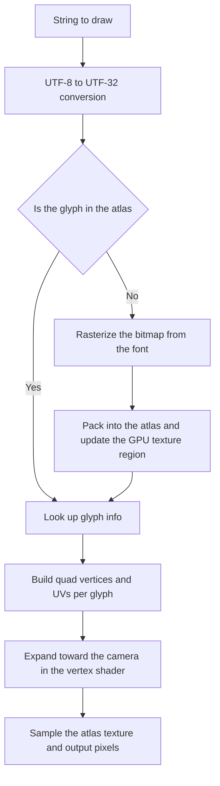

# 🔤 KRAFTON Jungle game tech Lab - Week 3

[한국어](./README.md) | **English**

***Texture and Wireframe***

2026.03.19. ~ 2026.03.26.

Team 3: 장민준([@nacho2407](https://github.com/nacho2407)), 이호진([@lois505](https://github.com/lois505)), 이상훈([@lsh-Brecht](https://github.com/lsh-Brecht))


We added a **rendering path for text and sprites** to the 3D editor. Only the glyphs actually needed are baked into an atlas at runtime, so even Korean text shows up on screen; line rendering is gathered into a single buffer, and several scenes can be handled in one editor.


## 🎮 Week Overview

- Each object shows its **UUID as text floating above it**, and a **sprite animation** plays from a single texture split into frames. Both text and sprites are drawn as quads that always face the camera

- Everything drawn with lines, such as the grid and bounding boxes, is **gathered into one buffer and drawn together**, and vertices are referenced by index so they are not stored twice

- A **Scene Manager that keeps several scenes loaded and renders only the active one** lets scenes be created, saved, and unloaded one by one


## ✨ Features

- **Dynamic Glyph Atlas**

  Whenever a glyph is needed on screen, only that glyph is baked from the font into the atlas. Nothing has to be baked ahead of time, so **scripts with many characters such as Korean can be rendered**

- **UUID Billboard Text**

  Each object in the world has its UUID floating above it as text, and it faces the viewer no matter how the camera turns. It can be toggled with a Show Flag

- **Text Mesh**

  Unlike a billboard, this is a text object fixed in world space. Its position, rotation, and scale can be changed like any other primitive, and it is saved with the scene

- **SubUV Sprites**

  A single texture is split into rows and columns to compute UVs, and the frames play in order. Frame rate and looping can be changed in the property panel

- **Batch Line Rendering**

  Lines such as the grid, world axes, and bounding boxes are gathered into one dynamic vertex buffer and drawn together. When the lines exceed the buffer capacity they are **split into chunks** and drawn over several passes

- **Index Buffer**

  Vertices are referenced by index so the same vertex is not stored more than once

- **Bounding Box**

  The AABB around a primitive is drawn with lines so its size and position can be checked. Being a debug display, it is managed as a separate batch

- **Scene Manager and Multiple Scenes**

  Several scenes stay loaded at once and only the active one is rendered. Creating a scene, saving it as a `.Scene` file, and unloading it from the list are all done in the panel

- **Multi-Selection**

  Holding `Ctrl` while clicking selects several objects at once, from both the viewport and the Scene Manager panel. Moving, rotating, and scaling are based on the object selected last

- **FName System**

  Names are not compared as raw strings; they are put into a lookup table and compared by the index it returns. Comparison is case-insensitive

- **Show Flags and View Modes**

  Primitives, billboard text, editor primitives, and debug lines can each be toggled, and rendering can be switched between Lit, Unlit, and Wireframe

- **Editor Settings Persistence**

  The grid spacing and the camera movement sensitivity are saved to `editor.ini` and restored on the next run


## 👥 Team

| Member | Responsibilities |
|--------|------------------|
| **장민준**([@nacho2407](https://github.com/nacho2407)) | Text rendering - dynamic glyph atlas, billboard text, text mesh, AABB depth handling, live window resizing |
| **이호진**([@lois505](https://github.com/lois505)) | Engine core and debug rendering - FName system, batch line rendering, index buffer, bounding boxes, Show Flags, draw call counter |
| **이상훈**([@lsh-Brecht](https://github.com/lsh-Brecht)) | Scene management and editor - Scene Manager and multiple scenes, multi-selection picking, SubUV, docking UI and grid settings, wireframe mode |


## 🧑‍💻 Work Details

### Dynamic Glyph Atlas

- **Goal**

  Render Korean as well as ASCII, without baking glyphs that will never be used

- **Implementation**

  Every time a glyph is drawn, the atlas is checked first, and if the glyph is missing it is created on the spot and packed in. Strings are converted from UTF-8 to **UTF-32 codepoints** and handled one character at a time, and the position and size inside the atlas are recorded in a cache per codepoint so nothing is baked twice. Rasterizing the bitmap is handled by stb_truetype, which ships with Dear ImGui, and codepoints the font does not support fall back to the Unicode replacement character

  The atlas is a single texture of 2048x2048 with one byte per pixel, and bitmaps are packed **left to right, dropping to the next shelf when a row fills up**. A one pixel margin keeps neighbouring glyphs from bleeding into each other

  **Only the changed region of the GPU texture is updated.** Uploading the whole atlas would mean re-sending 4MB every time a single glyph is added, so only the rectangle that was just filled is updated

- **Limitations and Future Work**

  The atlas is a single 2048x2048 page and glyphs are never evicted once packed. Once the atlas is full, a glyph seen for the first time after that cannot be packed in and is not drawn. Growing the atlas into several pages, or evicting glyphs that have not been used for a long time and reusing their space, would be needed. This limitation was known at the time, but there was not enough time to address it

- **Related Code**

  [`Source/Text/FontAsset.cpp`](./Source/Text/FontAsset.cpp), [`Source/Text/GlyphAtlas.cpp`](./Source/Text/GlyphAtlas.cpp), [`Source/Text/TextEncoding.cpp`](./Source/Text/TextEncoding.cpp), [`Source/EngineCore/ResourceManager.cpp`](./Source/EngineCore/ResourceManager.cpp)


### Billboard Text

- **Goal**

  Show a UUID above an object so that the text faces the viewer no matter how the camera turns

- **Implementation**

  Two triangles worth of vertices are built per glyph, with the coordinates from the atlas fed in as UVs. The quad is not placed upright in world space; it is **expanded along the camera's right and up vectors in the vertex shader** so it always faces the screen. Converting an object's world position into screen coordinates is handled by the camera component

- **Related Code**

  [`Source/Text/TextLayout.cpp`](./Source/Text/TextLayout.cpp), [`Source/Renderer/Renderer.cpp`](./Source/Renderer/Renderer.cpp), [`Shaders/ShaderFont.hlsl`](./Shaders/ShaderFont.hlsl)


### Text Mesh

- **Goal**

  Provide text that stays fixed in the world and behaves like any other primitive, rather than turning to follow the screen

- **Implementation**

  It is implemented as a component deriving from the primitive component that rebuilds its vertices whenever the string changes. Unlike a billboard, the vertices are not expanded toward the camera but **transformed by a model matrix like any other primitive**, so moving, rotating, and scaling work the same way and it can be saved with a scene and loaded back

- **Related Code**

  [`Source/Component/TextMeshComponent.cpp`](./Source/Component/TextMeshComponent.cpp), [`Shaders/ShaderTextMesh.hlsl`](./Shaders/ShaderTextMesh.hlsl)


## 🛠️ Tech Stack

- **Language**: C++20

- **Graphics API**: DirectX 11

- **Build**: Visual Studio 2026, MSBuild

- **Libraries**: Dear ImGui, DirectX Tool Kit for DirectX 11, fifo_map, SimpleJSON


## 🖥️ Architecture



- Flow

    1. The string to draw is converted into UTF-32 codepoints and split per character

    2. For each codepoint the atlas is checked, and if the glyph is missing it is rasterized from the font and packed into the atlas

    3. Only the rectangle that was just filled is updated in the GPU texture

    4. Quad vertices are built per glyph with the atlas coordinates fed in as UVs

    5. The vertex shader expands the quad toward the camera, and the pixel shader samples the atlas to draw the glyph


## 📁 Directory Structure

```
week03/
├── week03.sln      // Solution
├── week03.vcxproj  // Project
├── Content/        // Font
├── Docs/           // README media
├── Shaders/        // Vertex and pixel shaders
├── Source/         // World, scene management, primitive creation, and entry point
│   ├── Component/  // Components
│   ├── Editor/     // Gizmo, picking, and editor UI
│   ├── EngineApp/  // Application
│   ├── EngineCore/ // Common types, input, logging, and resource management
│   ├── Geometry/   // Triangle geometry
│   ├── Math/       // Vectors, matrices, and quaternions
│   ├── Renderer/   // Renderer and level
│   └── Text/       // Fonts and text layout
└── ThirdParty/     // Dear ImGui, DirectX Tool Kit for DirectX 11, fifo_map, SimpleJSON
```


## ❓ Build and Run

### Running the Release Build

Executables are not provided for this week because of license issues with some of the assets and libraries.


### Building from Source

Some assets and libraries could not be included in the repository because of license issues, so this week cannot be built from the repository alone.


## ⌨️ Shortcuts

| Shortcut | Action |
|--------|------|
| **Ctrl + Left Click** | Select several objects at once |
| **Ctrl + A** | Select every object in the active scene, from the Scene Manager window |
| **Space** | Switch the gizmo mode(translate, rotate, scale) |
| **Delete** | Delete the selected objects |


## 📄 Third-Party Libraries

| Name | Author | Version | License |
|------|--------|------|----------|
| **[Dear ImGui](https://github.com/ocornut/imgui)** | Omar Cornut | 1.92.7 WIP | [MIT License](./ThirdParty/ImGui/LICENSE.txt) |
| **[DirectX Tool Kit for DirectX 11](https://github.com/microsoft/DirectXTK)** | Microsoft Corporation. | - | [MIT License](./ThirdParty/DirectXTK/LICENSE) |
| **[fifo_map](https://github.com/nlohmann/fifo_map)** | Niels Lohmann. | - | [MIT License](./ThirdParty/fifo_map.hpp) |
| **[SimpleJSON](https://github.com/nbsdx/SimpleJSON)** | Neil | - | Do What the Fuck You Want to Public License |


## 🎨 Third-Party Assets

| Name | Author | License |
|------|--------|----------|
| **[D2Coding](https://github.com/naver/d2codingfont)** | NAVER Corporation | [SIL Open Font License 1.1](./Content/Fonts/OFL.txt) |


## ⚖️ License

The portions of this week's code written by Jang Minjun are released under the MIT License, and the rights to the portions written by other contributors belong to their respective contributors. See [LICENSE](../LICENSE) for details.
