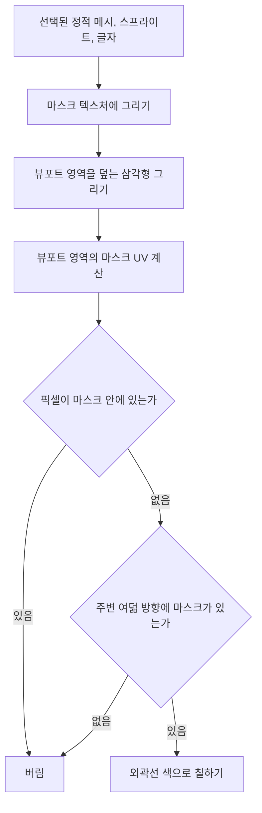

# 🪟 크래프톤 정글 게임테크랩 4주차

**한국어** | [English](./README_en.md)

***OBJ 가져오기, 정적 메시, 다중 뷰포트 렌더링***

2026.03.26. ~ 2026.04.02.

8팀: 장민준([@nacho2407](https://github.com/nacho2407)), 김형도([@DKael](https://github.com/DKael)), 김형준([@Rocketstein](https://github.com/Rocketstein)), 김기훈([@kim-kihoon](https://github.com/kim-kihoon))


3D 에디터에 **Wavefront OBJ 파일을 정적 메시로 불러오는 에셋 파이프라인**과 **네 개로 나뉜 다중 뷰포트**를 더했습니다. 불러온 메시는 바이너리로 구워 다시 쓰고, 콘솔 명령으로 켜는 통계 오버레이와 별도 빌드 구성의 OBJ 뷰어도 함께 만들었습니다.


## 🎮 주차 소개

- Wavefront OBJ와 MTL 파일을 읽어 **정적 메시와 재질**로 만들고, 다른 프리미티브처럼 월드에 배치하고 변형할 수 있게 했습니다. 한 메시 안의 섹션마다 다른 재질을 쓰고, 읽은 결과는 **자체 바이너리 형식으로 구워** 다음부터 파싱 없이 불러옵니다

- 에디터 화면을 **스플리터로 네 개의 뷰포트**로 나누고, 원근 시점과 직교 시점을 동시에 그립니다. 뷰포트마다 카메라를 따로 두고, 원근 카메라 정보는 씬에 함께 저장합니다


## ✨ 구현 결과

- **정적 메시**

  Wavefront OBJ 파일의 정점, 법선, UV와 MTL 파일의 재질을 읽어 정적 메시를 만듭니다. 정적 메시 액터를 월드에 놓고 기즈모로 이동, 회전, 크기 조정할 수 있으며, 속성 창의 드롭다운에서 다른 메시로 바꿀 수 있습니다

- **다중 재질**

  하나의 메시를 재질별 섹션으로 나눠 그립니다. 속성 창에서 섹션마다 재질을 바꿀 수 있고, 바꾼 재질 슬롯은 씬에 저장됩니다

- **바이너리 저장(Bake)**

  콘텐츠 브라우저의 Import로 Wavefront OBJ와 MTL을 자체 바이너리 형식의 `.uasset`으로 구워 둡니다. 구운 파일은 텍스트를 다시 파싱하지 않고 바로 읽습니다

- **다중 뷰포트**

  에디터 화면을 가로, 세로 스플리터로 네 칸으로 나누고, 스플리터를 드래그해 칸의 크기를 바꿉니다. 원근 뷰와 Top, Front 같은 **직교 뷰를 동시에 렌더링**하며, 뷰포트마다 카메라가 따로 움직입니다

- **씬 저장과 복원**

  정적 메시의 에셋 경로와 재질 슬롯, 원근 카메라의 위치와 회전, FOV를 씬 파일에 저장하고 다시 불러옵니다

- **UObject 반복자**

  `TObjectIterator<T>`로 살아 있는 객체 중 특정 클래스의 객체만 골라 순회합니다

- **통계 오버레이**

  콘솔에 `stat fps`, `stat memory`, `stat none`을 입력해 활성 뷰포트 위에 FPS와 프레임 시간, 메모리 사용량을 겹쳐 그리거나 끕니다

- **선택 외곽선**

  선택한 정적 메시, 스프라이트, 글자의 테두리에 후처리 방식으로 외곽선을 그립니다

- **UV 스크롤**

  재질의 UV를 시간에 따라 흘려 보내는 효과입니다. 속성 창에서 스크롤 속도를 바꿀 수 있습니다

- **조명**

  Lit 모드에서 고정된 방향광 하나를 기준으로 픽셀마다 Half-Lambert 확산광을 계산하고 반구 앰비언트를 더해 메시에 음영을 줍니다

- **OBJ 뷰어**

  에디터 대신 Wavefront OBJ 파일 하나를 열어 살펴보는 뷰어로 실행할 수 있습니다. 대상을 중심으로 도는 궤도 카메라와 정면, 측면 같은 시점 버튼, 크기 조절 UI가 있습니다


## 👥 팀원 및 담당 파트

| 팀원 | 담당 파트 및 주요 역할 |
|------|------------------------|
| **장민준**([@nacho2407](https://github.com/nacho2407)) | 엔진 코어와 에디터 도구 - UObject 반복자, 통계 오버레이와 메모리 추적, 후처리 선택 외곽선, 콘솔 토글, 글자와 스프라이트 피킹 수정 |
| **김형도**([@DKael](https://github.com/DKael)) | 에셋 파이프라인 - Wavefront OBJ, MTL 파서, 정적 메시와 재질 에셋, 다중 재질, 바이너리 저장(Bake) |
| **김형준**([@Rocketstein](https://github.com/Rocketstein)) | 다중 뷰포트와 카메라 - 스플리터 4분할, 뷰포트별 카메라와 직교 시점, OBJ 뷰어 |
| **김기훈**([@kim-kihoon](https://github.com/kim-kihoon)) | 에디터 UI와 재질 - 정적 메시 컴포넌트와 재질 클래스, 속성 창 메시 선택, UV 스크롤, 조명, Outliner 단축키 |


## 🧑‍💻 담당 작업 상세

### UObject 슬롯 배열과 TObjectIterator

- **목표**

  월드에 있는 객체 중 특정 클래스의 객체만 골라 순회할 수 있게 하고, 객체가 생기고 사라질 때 전역 객체 목록이 계속 커지지 않게 합니다

- **구현 내용**

  전역 객체 목록을 **빈 칸의 인덱스를 따로 모아 두었다가 다음 객체에 다시 내주는 슬롯 배열**(`FUObjectArray`)로 만들었습니다. 사라진 객체의 칸을 다시 쓰므로 목록이 계속 커지지 않습니다. 객체는 생성자에서 슬롯을 받아 자신의 인덱스를 기억하고, 소멸자에서 그 슬롯을 돌려줍니다

  `TObjectIterator<T>`는 이 슬롯 배열을 앞에서부터 훑으며 빈 칸과 유효하지 않은 객체를 건너뛰고, **`IsA`로 대상 클래스인지 확인한 객체만** 돌려줍니다. 에디터 모듈에서도 쓸 수 있도록 반복자 기반 클래스를 엔진 DLL에서 내보냈습니다

- **관련 코드**

  [`Engine/Source/CoreUObject/UObjectArray.cpp`](./Engine/Source/CoreUObject/UObjectArray.cpp), [`Engine/Source/CoreUObject/UObjectIterator.h`](./Engine/Source/CoreUObject/UObjectIterator.h), [`Engine/Source/CoreUObject/UObjectIterator.cpp`](./Engine/Source/CoreUObject/UObjectIterator.cpp), [`Engine/Source/CoreUObject/Object.cpp`](./Engine/Source/CoreUObject/Object.cpp)


### 통계 오버레이와 메모리 추적

- **목표**

  콘솔 명령으로 뷰포트 위에 FPS와 메모리 사용량을 띄워, 에디터를 쓰는 중에 성능을 바로 확인합니다

- **구현 내용**

  콘솔의 `stat` 명령이 **활성 뷰포트의 통계 플래그**를 켜고 끄며, 뷰포트마다 어떤 통계를 보일지 따로 기억합니다. `stat fps`는 FPS와 프레임 시간을, `stat memory`는 엔진 힙 할당량, 시스템 물리 메모리와 가상 메모리, GPU 리소스 종류별 사용량을 표로 그립니다. 처음에는 오버레이가 ImGui 창 위에 덮여 그려졌기 때문에, **ImGui의 배경 그리기 목록에 뷰포트 영역으로 잘라 그리도록** 바꿔 패널을 가리지 않게 했습니다

  GPU 메모리는 전역 메모리 추적기(`FMemoryTracker`)가 텍스처, 렌더 타깃, 깊이 스텐실, 정점 버퍼, 인덱스 버퍼로 나눠 리소스를 만들 때 더하고 해제할 때 뺍니다. 텍스처 리소스 구조체는 값으로 복사되는 일이 있어 소멸자에서 바로 빼면 여러 번 차감되므로, **공유 포인터로 나눠 갖는 추적 토큰**을 두고 마지막 참조가 사라질 때 한 번만 빼도록 했습니다

- **관련 코드**

  [`Engine/Source/Renderer/MemoryTracker.cpp`](./Engine/Source/Renderer/MemoryTracker.cpp), [`Editor/Source/Viewport/EditorViewportClient.cpp`](./Editor/Source/Viewport/EditorViewportClient.cpp), [`Editor/Source/Panel/ConsolePanel.cpp`](./Editor/Source/Panel/ConsolePanel.cpp)


### 후처리 선택 외곽선

- **목표**

  선택한 오브젝트가 정적 메시든 스프라이트든 글자든 같은 방식으로 외곽선을 그립니다

- **구현 내용**

  외곽선을 **두 패스로 나눈 후처리 방식**으로 그립니다. 먼저 선택된 정적 메시, 스프라이트, 글자만 별도의 마스크 텍스처에 그리고, 다음 패스에서 뷰포트 영역을 덮는 삼각형 하나를 그려 픽셀마다 마스크를 확인합니다. 자신은 마스크 밖이면서 **주변 여덟 방향에 마스크가 있는 픽셀**만 외곽선 색으로 칠하므로, 모양과 종류에 상관없이 테두리가 생깁니다

  마스크 텍스처는 창 전체 크기로 하나만 두고, 뷰포트마다 자기 영역의 UV 범위만 샘플링해 다중 뷰포트에서도 각 칸에 외곽선이 그려집니다

- **관련 코드**

  [`Engine/Source/Renderer/D3D11/D3D11SelectionMaskRenderer.cpp`](./Engine/Source/Renderer/D3D11/D3D11SelectionMaskRenderer.cpp), [`Engine/Source/Renderer/D3D11/D3D11PostProcessOutlineRenderer.cpp`](./Engine/Source/Renderer/D3D11/D3D11PostProcessOutlineRenderer.cpp), [`Editor/Content/Shader/SelectionOutlinePostProcess.hlsl`](./Editor/Content/Shader/SelectionOutlinePostProcess.hlsl)


## 🛠️ 기술 스택

- **Language**: C++20

- **Graphics API**: DirectX 11

- **Build**: Visual Studio 2026, MSBuild

- **Libraries**: Dear ImGui, DirectX Tool Kit for DirectX 11, JSON for Modern C++


## 🖥️ 구조



- 동작 흐름

    1. 선택된 정적 메시, 스프라이트, 글자만 창 크기의 마스크 텍스처에 그립니다

    2. 뷰포트마다 그 영역을 덮는 삼각형을 그리고, 자기 영역에 해당하는 마스크 UV를 계산합니다

    3. 마스크 안쪽 픽셀은 버리고, 바깥 픽셀은 두께만큼 떨어진 여덟 방향의 마스크를 확인합니다

    4. 주변에 마스크가 있는 픽셀만 외곽선 색으로 칠해 선택 대상의 테두리를 만듭니다


## 📁 디렉토리 구조

```
week04/
├── week04.sln                  // 솔루션(Editor, Engine)
├── Docs/                       // README 미디어
├── Editor/                     // 에디터 실행 파일 프로젝트
│   ├── Content/                // 폰트, 샘플 Wavefront OBJ, 씬, 셰이더, 텍스처
│   ├── Resources/              // 리소스 스크립트와 아이콘
│   └── Source/                 // 진입점
│       ├── Camera/             // 뷰포트 카메라
│       ├── Chrome/             // 에디터 창 틀
│       ├── Content/            // 콘텐츠 브라우저 색인
│       ├── Editor/             // 에디터 상태, 설정, 로그
│       ├── Gizmo/              // 기즈모 타입
│       ├── Importer/           // 에셋 가져오기
│       ├── Input/              // 입력 컨텍스트
│       ├── Launch/             // 에디터 진입과 루프
│       ├── Menu/               // 메뉴 등록
│       ├── Panel/              // 에디터 패널
│       ├── ThirdParty/         // Dear ImGui
│       ├── Viewer/             // OBJ 뷰어
│       └── Viewport/           // 뷰포트와 조작 컨트롤러
└── Engine/                     // 엔진 DLL 프로젝트
    ├── Resources/              // 기본 도형 정점 데이터
    └── Source/
        ├── ApplicationCore/    // 창과 입력 플랫폼 계층
        ├── Asset/              // 에셋과 재질 관리
        ├── Core/               // 컨테이너, 수학, 로그, 경로
        ├── CoreUObject/        // 객체 시스템
        ├── Engine/             // 액터, 컴포넌트, 씬
        ├── Launch/             // 엔진 루프
        ├── Renderer/           // D3D11 렌더러
        ├── SceneIO/            // 씬 저장과 불러오기
        └── ThirdParty/         // JSON for Modern C++
```


## ❓ 빌드 및 실행

### 릴리즈 실행

일부 에셋과 라이브러리의 라이선스 문제로 인해 이 주차의 실행 파일은 제공하지 않습니다.


### 소스 빌드

일부 에셋과 라이브러리를 라이선스 문제로 저장소에 포함하지 못해, 이 주차는 저장소만으로 빌드할 수 없습니다.


## ⌨️ 단축키

| 단축키 | 동작 |
|--------|------|
| **`` ` ``** | 콘솔 창 열기와 닫기 |
| **1 / 2 / 3** | 뷰 모드 전환(Lit, Unlit, Wireframe)과 기즈모 스냅 켜기와 끄기(이동, 회전, 크기)가 함께 적용 |
| **Space** | 기즈모 모드 전환(이동, 회전, 크기) |
| **X** | 기즈모 기준 전환(월드, 로컬) |
| **F** | 선택한 액터로 카메라 이동 |
| **Alt + 좌클릭 드래그** | 선택 대상을 중심으로 카메라 궤도 회전 |
| **Ctrl + Alt + 드래그** | 박스 선택 |
| **F2** | 선택한 대상의 이름 변경 |
| **Delete** | 선택한 액터 또는 컴포넌트 삭제 |


## 📄 서드파티 라이브러리

| 이름 | 저작자 | 버전 | 라이선스 |
|------|--------|------|----------|
| **[Dear ImGui](https://github.com/ocornut/imgui)** | Omar Cornut | 1.92.7 WIP | [MIT License](./Editor/Source/ThirdParty/ImGui/LICENSE.txt) |
| **[DirectX Tool Kit for DirectX 11](https://github.com/microsoft/DirectXTK)** | Microsoft Corporation. | - | MIT License |
| **[JSON for Modern C++](https://github.com/nlohmann/json)** | Niels Lohmann | 3.12.0 | [MIT License](./Engine/Source/ThirdParty/Json/LICENSE.MIT) |


## 🎨 서드파티 에셋

| 이름 | 저작자 | 라이선스 |
|------|--------|----------|
| **[3d-cubes](https://github.com/garykac/3d-cubes)** | Gary Kac | - |
| **[Galmuri](https://github.com/quiple/galmuri)** | Lee Minseo | [SIL Open Font License 1.1](./Editor/Content/Font/Galmuri11/ofl.md) |
| **[JetBrains Mono](https://github.com/JetBrains/JetBrainsMono)** | The JetBrains Mono Project Authors | [SIL Open Font License 1.1](./Editor/Content/Font/JetBrainsMono/OFL.txt) |


## ⚖️ 라이선스

이 주차의 코드 중 장민준이 작성한 부분은 MIT 라이선스로 공개하며, 다른 기여자가 작성한 부분의 권리는 각 기여자에게 있습니다. 자세한 내용은 [LICENSE](../LICENSE)를 확인해 주세요.
