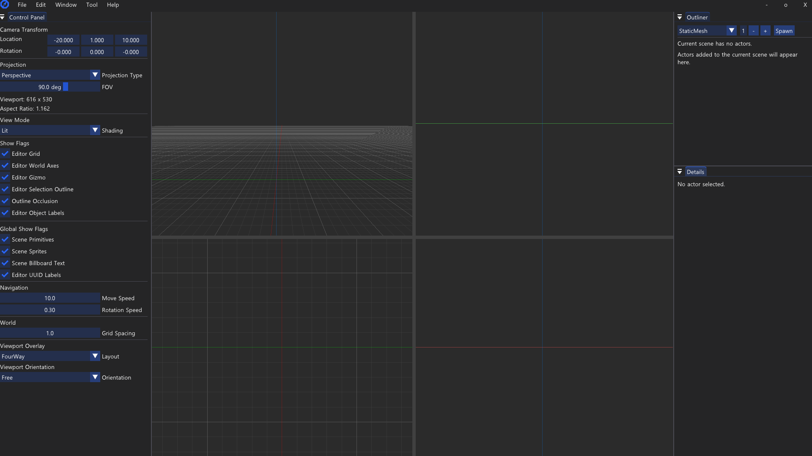
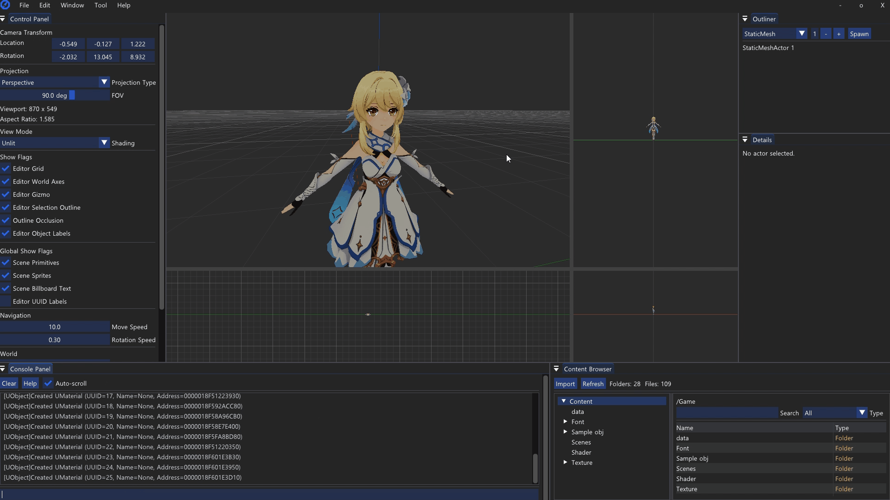
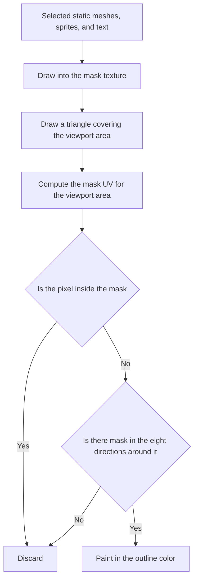

# 🪟 KRAFTON Jungle game tech Lab - Week 4

[한국어](./README.md) | **English**

***OBJ Import, StaticMesh and Multiple Viewport Rendering***

2026.03.26. ~ 2026.04.02.

Team 8: 장민준([@nacho2407](https://github.com/nacho2407)), 김형도([@DKael](https://github.com/DKael)), 김형준([@Rocketstein](https://github.com/Rocketstein)), 김기훈([@kim-kihoon](https://github.com/kim-kihoon))





We added an **asset pipeline that loads Wavefront OBJ files as static meshes** and **multiple viewports split into four** to the 3D editor. Loaded meshes are baked into a binary format for reuse, and we also built a stats overlay toggled by console commands and an OBJ viewer with its own build configuration.


## 🎮 Week Overview

- Wavefront OBJ and MTL files are read into **static meshes and materials**, which can be placed in the world and transformed like any other primitive. Each section of a mesh can use its own material, and the result is **baked into our own binary format** so it loads without parsing next time

- The editor screen is **split into four viewports with splitters**, rendering perspective and orthographic views at the same time. Each viewport has its own camera, and the perspective camera settings are saved with the scene


## ✨ Features

- **Static Mesh**

  A static mesh is built from the vertices, normals, and UVs of a Wavefront OBJ file and the materials of its MTL file. Static mesh actors can be placed in the world, moved, rotated, and scaled with the gizmo, and swapped for another mesh from a dropdown in the properties panel

- **Multiple Materials**

  A mesh is drawn in sections split by material. The material of each section can be changed in the properties panel, and the changed material slots are saved with the scene

- **Binary Baking**

  The Import action in the content browser bakes Wavefront OBJ and MTL files into `.uasset` files in our own binary format. Baked files are read directly without parsing the text again

- **Multiple Viewports**

  Horizontal and vertical splitters divide the editor screen into four panes, and dragging a splitter resizes them. The perspective view and **orthographic views such as Top and Front are rendered at the same time**, and each viewport's camera moves independently

- **Scene Saving and Loading**

  The asset path and material slots of each static mesh, along with the perspective camera's location, rotation, and FOV, are saved to the scene file and restored on load

- **UObject Iterator**

  `TObjectIterator<T>` iterates over only the live objects of a given class

- **Stats Overlay**

  Typing `stat fps`, `stat memory`, or `stat none` in the console overlays FPS, frame time, and memory usage on the active viewport, or turns them off

- **Selection Outline**

  Selected static meshes, sprites, and text are outlined with a post-processing pass

- **UV Scroll**

  An effect that scrolls a material's UVs over time. The scroll speed can be changed in the properties panel

- **Lighting**

  In Lit mode, meshes are shaded per pixel with Half-Lambert diffuse lighting from a single fixed directional light, plus hemisphere ambient lighting

- **OBJ Viewer**

  Instead of the editor, it can run as a viewer for opening and inspecting a single Wavefront OBJ file. It has an orbit camera that circles the target, view buttons such as front and side, and a scale UI


## 👥 Team

| Member | Responsibilities |
|------|------------------------|
| **장민준**([@nacho2407](https://github.com/nacho2407)) | Engine core and editor tools - UObject iterator, stats overlay and memory tracking, post-process selection outline, console toggle, text and sprite picking fixes |
| **김형도**([@DKael](https://github.com/DKael)) | Asset pipeline - Wavefront OBJ and MTL parser, static mesh and material assets, multiple materials, binary baking |
| **김형준**([@Rocketstein](https://github.com/Rocketstein)) | Multiple viewports and cameras - four-way splitter layout, per-viewport cameras and orthographic views, OBJ viewer |
| **김기훈**([@kim-kihoon](https://github.com/kim-kihoon)) | Editor UI and materials - static mesh component and material classes, mesh selection in the properties panel, UV scroll, lighting, Outliner shortcuts |


## 🧑‍💻 Work Details

### UObject Slot Array and TObjectIterator

- **Goal**

  Make it possible to iterate over only the objects of a given class in the world, and keep the global object list from growing endlessly as objects are created and destroyed

- **Implementation**

  The global object list is a **slot array that collects the indices of empty slots and hands them out to the next object**(`FUObjectArray`). Because slots freed by destroyed objects are reused, the list does not keep growing. Each object takes a slot in its constructor, remembers its own index, and returns the slot in its destructor

  `TObjectIterator<T>` walks this slot array from the front, skipping empty slots and invalid objects, and returns **only the objects that pass an `IsA` check for the target class**. The iterator base class is exported from the engine DLL so the editor module can use it too

- **Related Code**

  [`Engine/Source/CoreUObject/UObjectArray.cpp`](./Engine/Source/CoreUObject/UObjectArray.cpp), [`Engine/Source/CoreUObject/UObjectIterator.h`](./Engine/Source/CoreUObject/UObjectIterator.h), [`Engine/Source/CoreUObject/UObjectIterator.cpp`](./Engine/Source/CoreUObject/UObjectIterator.cpp), [`Engine/Source/CoreUObject/Object.cpp`](./Engine/Source/CoreUObject/Object.cpp)


### Stats Overlay and Memory Tracking

- **Goal**

  Show FPS and memory usage over the viewport through console commands, so performance can be checked right away while using the editor

- **Implementation**

  The console's `stat` command toggles **the stat flags of the active viewport**, and each viewport remembers which stats it shows. `stat fps` draws FPS and frame time, and `stat memory` draws a table of engine heap allocations, system physical and virtual memory, and GPU usage by resource type. At first the overlay was drawn on top of the ImGui windows, so it was changed to **draw into ImGui's background draw list, clipped to the viewport area**, keeping it from covering the panels

  For GPU memory, a global memory tracker(`FMemoryTracker`) adds to separate counters for textures, render targets, depth stencils, vertex buffers, and index buffers when resources are created, and subtracts when they are released. The texture resource struct is sometimes copied by value, so subtracting in its destructor would count the same texture several times; instead, a **tracking token shared through a shared pointer** subtracts only once, when the last reference goes away

- **Related Code**

  [`Engine/Source/Renderer/MemoryTracker.cpp`](./Engine/Source/Renderer/MemoryTracker.cpp), [`Editor/Source/Viewport/EditorViewportClient.cpp`](./Editor/Source/Viewport/EditorViewportClient.cpp), [`Editor/Source/Panel/ConsolePanel.cpp`](./Editor/Source/Panel/ConsolePanel.cpp)


### Post-Process Selection Outline

- **Goal**

  Draw outlines the same way whether the selected object is a static mesh, a sprite, or text

- **Implementation**

  The outline is drawn as a **post-process split into two passes**. First, only the selected static meshes, sprites, and text are drawn into a separate mask texture; in the next pass, a single triangle covering the viewport area is drawn and each pixel checks the mask. Only pixels that are outside the mask themselves but **have the mask in one of the eight directions around them** are painted in the outline color, so an edge appears regardless of shape or type

  There is only one mask texture, the size of the whole window, and each viewport samples only the UV range of its own area, so outlines are drawn in every pane even with multiple viewports

- **Related Code**

  [`Engine/Source/Renderer/D3D11/D3D11SelectionMaskRenderer.cpp`](./Engine/Source/Renderer/D3D11/D3D11SelectionMaskRenderer.cpp), [`Engine/Source/Renderer/D3D11/D3D11PostProcessOutlineRenderer.cpp`](./Engine/Source/Renderer/D3D11/D3D11PostProcessOutlineRenderer.cpp), [`Editor/Content/Shader/SelectionOutlinePostProcess.hlsl`](./Editor/Content/Shader/SelectionOutlinePostProcess.hlsl)


## 🛠️ Tech Stack

- **Language**: C++20

- **Graphics API**: DirectX 11

- **Build**: Visual Studio 2026, MSBuild

- **Libraries**: Dear ImGui, DirectX Tool Kit for DirectX 11, JSON for Modern C++


## 🖥️ Architecture



- Flow

    1. Only the selected static meshes, sprites, and text are drawn into a window-sized mask texture

    2. For each viewport, a triangle covering its area is drawn and the mask UV for that area is computed

    3. Pixels inside the mask are discarded, and pixels outside check the mask in eight directions at the outline thickness

    4. Only pixels with mask around them are painted in the outline color, forming the edge of the selection


## 📁 Directory Structure

```
week04/
├── week04.sln                  // Solution(Editor, Engine)
├── Docs/                       // README media
├── Editor/                     // Editor executable project
│   ├── Content/                // Fonts, sample Wavefront OBJ, scenes, shaders, textures
│   ├── Resources/              // Resource script and icon
│   └── Source/                 // Entry point
│       ├── Camera/             // Viewport camera
│       ├── Chrome/             // Editor window chrome
│       ├── Content/            // Content browser index
│       ├── Editor/             // Editor state, settings, and logging
│       ├── Gizmo/              // Gizmo types
│       ├── Importer/           // Asset import
│       ├── Input/              // Input contexts
│       ├── Launch/             // Editor entry point and loop
│       ├── Menu/               // Menu registry
│       ├── Panel/              // Editor panels
│       ├── ThirdParty/         // Dear ImGui
│       ├── Viewer/             // OBJ viewer
│       └── Viewport/           // Viewports and interaction controllers
└── Engine/                     // Engine DLL project
    ├── Resources/              // Basic shape vertex data
    └── Source/
        ├── ApplicationCore/    // Window and input platform layer
        ├── Asset/              // Asset and material management
        ├── Core/               // Containers, math, logging, and paths
        ├── CoreUObject/        // Object system
        ├── Engine/             // Actors, components, and scene
        ├── Launch/             // Engine loop
        ├── Renderer/           // D3D11 renderer
        ├── SceneIO/            // Scene saving and loading
        └── ThirdParty/         // JSON for Modern C++
```


## ❓ Build and Run

### Running the Release Build

Executables are not provided for this week because of license issues with some of the assets and libraries.


### Building from Source

Some assets and libraries could not be included in the repository because of license issues, so this week cannot be built from the repository alone.


## ⌨️ Shortcuts

| Shortcut | Action |
|--------|------|
| **`` ` ``** | Open and close the console window |
| **1 / 2 / 3** | Switch the view mode(Lit, Unlit, Wireframe) and toggle gizmo snapping(translate, rotate, scale) at the same time |
| **Space** | Switch the gizmo mode(translate, rotate, scale) |
| **X** | Switch the gizmo space(world, local) |
| **F** | Move the camera to the selected actor |
| **Alt + Left Drag** | Orbit the camera around the selection |
| **Ctrl + Alt + Drag** | Box selection |
| **F2** | Rename the selected item |
| **Delete** | Delete the selected actor or component |


## 📄 Third-Party Libraries

| Name | Author | Version | License |
|------|--------|------|----------|
| **[Dear ImGui](https://github.com/ocornut/imgui)** | Omar Cornut | 1.92.7 WIP | [MIT License](./Editor/Source/ThirdParty/ImGui/LICENSE.txt) |
| **[DirectX Tool Kit for DirectX 11](https://github.com/microsoft/DirectXTK)** | Microsoft Corporation. | - | MIT License |
| **[JSON for Modern C++](https://github.com/nlohmann/json)** | Niels Lohmann | 3.12.0 | [MIT License](./Engine/Source/ThirdParty/Json/LICENSE.MIT) |


## 🎨 Third-Party Assets

| Name | Author | License |
|------|--------|----------|
| **[3d-cubes](https://github.com/garykac/3d-cubes)** | Gary Kac | - |
| **[Galmuri](https://github.com/quiple/galmuri)** | Lee Minseo | [SIL Open Font License 1.1](./Editor/Content/Font/Galmuri11/ofl.md) |
| **[JetBrains Mono](https://github.com/JetBrains/JetBrainsMono)** | The JetBrains Mono Project Authors | [SIL Open Font License 1.1](./Editor/Content/Font/JetBrainsMono/OFL.txt) |


## ⚖️ License

The portions of this week's code written by Jang Minjun are released under the MIT License, and the rights to the portions written by other contributors belong to their respective contributors. See [LICENSE](../LICENSE) for details.
