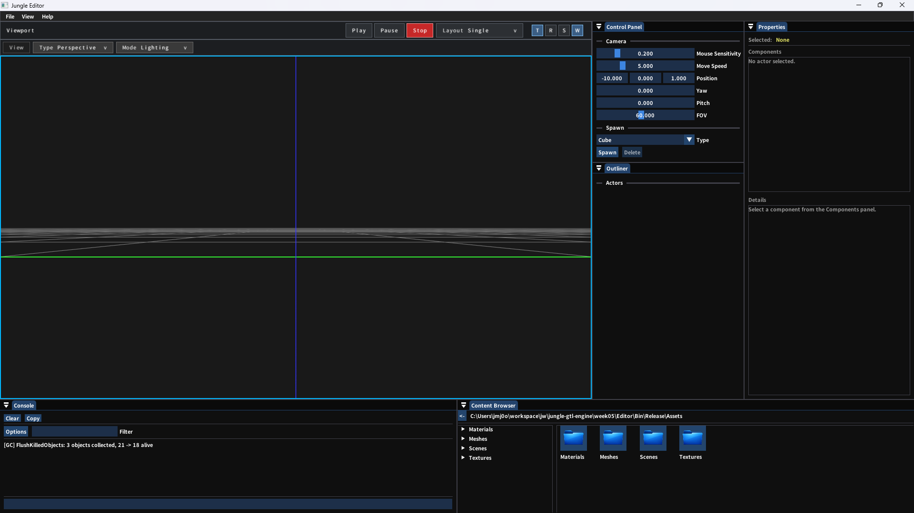
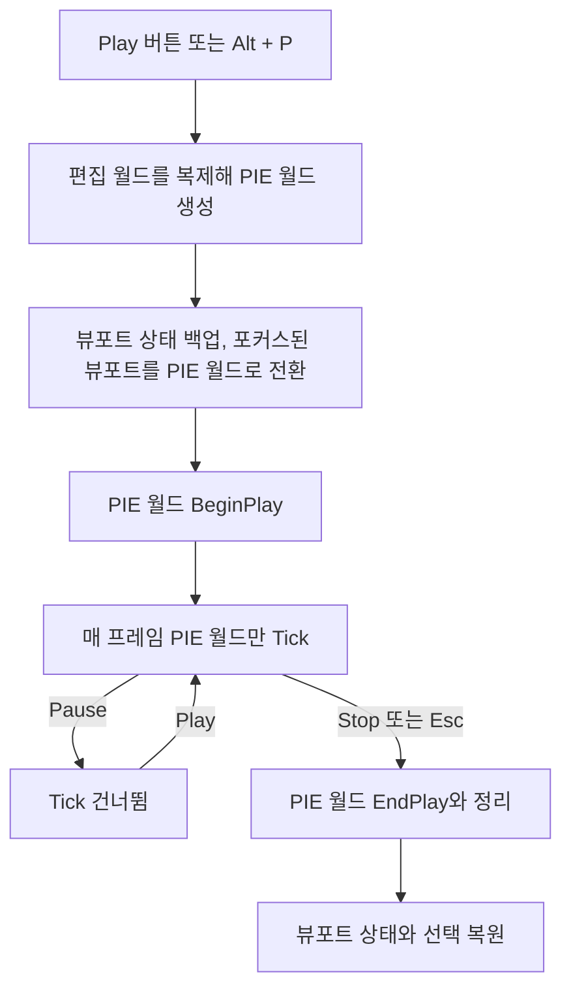

# 🥧 크래프톤 정글 게임테크랩 5주차

**한국어** | [English](./README_en.md)

***2nd Game Jam - Brute Force Competition***

***It's PIE Time!***

2026.04.02. ~ 2026.04.09.

5팀: 장민준([@nacho2407](https://github.com/nacho2407)), 남윤지([@yoonjiii218](https://github.com/yoonjiii218)), 정찬일([@Chanil-Chong](https://github.com/Chanil-Chong)), 강건우([@keonwookang0914](https://github.com/keonwookang0914))




3D 에디터에 **편집 중인 월드를 복제해 에디터 안에서 바로 실행하는 PIE(Play In Editor)**와 **월드, 레벨, 액터, 컴포넌트로 이어지는 액터 시스템**을 만들었습니다. 많은 정적 메시를 빠르게 그리고 고를 수 있도록 BVH로 컬링과 피킹을 가속하고, 렌더 명령을 정렬해 그립니다.


## 🎮 주차 소개

- 에디터의 Play 버튼을 누르면 **편집 중인 월드를 통째로 복제한 PIE 월드**가 뷰포트에서 실행됩니다. 실행 중에 무엇이 바뀌어도 편집 월드는 그대로이고, Stop을 누르면 실행 전의 편집 상태로 돌아옵니다

- 월드가 레벨을, 레벨이 액터를, 액터가 컴포넌트를 소유하는 구조를 만들고, **월드 종류에 따라 Tick과 BeginPlay, EndPlay가 다르게 흐르도록** 했습니다. 속성 창에서 액터에 텍스트, 빌보드, SubUV, 이동 컴포넌트 등을 붙일 수 있습니다

- 많은 정적 메시를 다루기 위해 **SAH 기반 BVH로 프러스텀 컬링과 레이 피킹을 가속**하고, 렌더 명령을 재질과 메시 기준으로 정렬해 상태 변경을 줄였습니다


## ✨ 구현 결과

- **PIE(Play In Editor)**

  뷰포트 툴바의 Play, Pause, Stop 버튼과 `Alt + P`로 PIE를 시작, 일시 정지, 종료합니다. PIE는 포커스된 뷰포트에서 실행되며, 끝나면 뷰포트의 카메라와 뷰 모드, 선택 상태가 실행 전으로 돌아옵니다

- **월드 복제**

  편집 월드의 레벨을 액터와 컴포넌트까지 깊은 복사해 PIE 월드를 만듭니다. 복제한 객체의 대응 관계를 기록해 두었다가, 복제본끼리 서로를 가리키도록 참조를 다시 잇습니다

- **월드, 레벨, 액터, 컴포넌트**

  월드는 레벨을, 레벨은 액터 목록을 가지고, 액터는 루트 컴포넌트와 소유한 컴포넌트 집합을 가집니다. 편집 월드에서는 에디터에서도 Tick하도록 표시한 액터만, PIE 월드에서는 BeginPlay를 마친 액터만 Tick합니다

- **컴포넌트 추가와 삭제**

  속성 창의 Add 버튼으로 선택한 액터에 Scene, Static Mesh, Text, SubUV, Billboard, Move 컴포넌트를 붙이고, 인스턴스로 추가한 컴포넌트를 지웁니다

- **텍스트 렌더 컴포넌트**

  폰트 아틀라스로 월드 공간에 글자를 그립니다. 액터 위에 표시되는 UUID도 이 컴포넌트로 그립니다

- **빌보드 컴포넌트**

  항상 카메라를 바라보는 스프라이트입니다. 속성 창의 Sprite 드롭다운에서 텍스처를 고릅니다

- **SubUV 컴포넌트**

  스프라이트 시트의 프레임을 정해진 FPS로 넘겨 애니메이션을 재생합니다. 반복 여부와 빌보드 여부를 속성 창에서 바꿉니다

- **이동 컴포넌트**

  BeginPlay 이후 액터를 위아래로 흔들며 회전시켜, PIE에서 Tick이 도는 것을 바로 확인할 수 있습니다

- **플레이어 카메라**

  PlayerCamera 액터를 월드에 놓으면 PIE가 그 카메라의 시점으로 시작하고, 여러 개를 놓으면 방향키로 바꿔 가며 볼 수 있습니다

- **BVH 기반 컬링과 피킹**

  레벨의 프리미티브를 SAH로 나눈 BVH로 묶어, 뷰포트마다 프러스텀 안의 프리미티브만 골라 그립니다. 피킹은 같은 BVH를 레이로 훑으며 지금까지 찾은 가장 가까운 거리보다 먼 노드를 건너뛰고, 후보 메시는 메시별 삼각형 BVH로 정확히 교차 검사합니다. 디버그 표시를 켜면 선택한 액터의 BVH 노드가 보입니다

- **렌더 명령 정렬과 UI 배칭**

  렌더 명령을 기본, 반투명, 오버레이 층으로 나누고, 기본 층은 재질과 메시 기준으로 정렬해 상태 변경을 줄입니다. 반투명 층은 카메라에서 먼 것부터 그리고, 화면 UI는 같은 재질의 그리기가 이어지면 정점을 하나로 합쳐 한 번에 그립니다


## 👥 팀원 및 담당 파트

| 팀원 | 담당 파트 및 주요 역할 |
|------|------------------------|
| **장민준**([@nacho2407](https://github.com/nacho2407)) | 렌더링 최적화, PIE와 게임플레이 흐름 - GPU 오클루전 컬링, PIE 시작, 일시 정지, 종료와 뷰포트 상태 복원, 월드 종류별 Tick, BeginPlay와 EndPlay 전파, PIE 입력과 단축키, 플레이어 카메라 |
| **남윤지**([@yoonjiii218](https://github.com/yoonjiii218)) | 컴포넌트 - 텍스트 렌더 컴포넌트, 빌보드 컴포넌트와 액터, 이동 컴포넌트, 게임 중 숨김 설정, 컴포넌트 속성 UI |
| **정찬일**([@Chanil-Chong](https://github.com/Chanil-Chong)) | 렌더러와 에디터 UI - BVH 기반 컬링과 피킹, 레벨 구조, 렌더러와 Slate UI 재구성(렌더 큐 분리, UI 배칭), 재생 버튼과 다중 뷰포트 PIE, SubUV 컴포넌트 |
| **강건우**([@keonwookang0914](https://github.com/keonwookang0914)) | 객체 복제와 컴포넌트 관리 - 월드, 레벨, 액터, 컴포넌트 복제, 컴포넌트 보관 구조, 컴포넌트 추가와 삭제, 루트 컴포넌트 직렬화 |


## 🧑‍💻 담당 작업 상세

### GPU 오클루전 컬링

- **목표**

  다른 메시에 가려져 보이지 않는 정적 메시를 GPU에서 가려 내 그리지 않고, 컬링의 효과를 수치로 확인합니다

- **구현 내용**

  깊이 버퍼로 **HZB**(Hierarchical Z-Buffer)를 만듭니다. 첫 밉에 깊이를 복사한 뒤, 컴퓨트 셰이더로 2x2 영역에서 가장 먼 깊이를 모아 밉을 차례로 줄입니다. 정적 메시의 경계 구를 구조화 버퍼로 올리면, 컴퓨트 셰이더가 경계 구를 화면에 투영해 크기에 맞는 밉을 고르고, 영역 안 다섯 곳의 HZB 깊이와 경계 구의 가장 가까운 깊이를 비교해 가려졌는지 판정합니다

  판정 결과는 스테이징 버퍼 세 개를 돌려 쓰며 GPU를 기다리지 않고 읽어 오고, 이후 프레임에서 가려진 메시는 그리기 명령을 만들기 전에 건너뜁니다. 콘솔 변수 `r.GpuOcclusionCulling`으로 켜고 끌 수 있고, 성능 창에 오클루전 전후의 드로우 콜 수, 건너뛴 메시 수, 단계별 CPU 시간을 표시했습니다. 수직 동기화를 끈 상태에서 FPS를 제대로 잴 수 있도록 스왑 체인의 화면 찢김 허용(`DXGI_PRESENT_ALLOW_TEARING`)도 지원합니다

- **한계와 개선 방향**

  가려짐 판정이 깊이 비교의 여유 값(`DepthBias`) 하나에 크게 좌우되어, 값에 따라 메시가 깜빡이거나 거의 컬링되지 않았고 값을 여러 번 바꿔 가며 맞춰야 했습니다. 마감까지 이 문제의 근본적인 해결을 찾지는 못했습니다


### PIE 시작과 종료

- **목표**

  편집 중인 월드를 건드리지 않고 에디터 안에서 게임을 실행해 보고, 끝나면 실행 전의 편집 상태로 그대로 돌아옵니다

- **구현 내용**

  PIE를 시작하면 편집 월드를 복제해 PIE 월드를 만들고, 이를 담는 **PIE 전용 월드 컨텍스트**를 새로 둡니다. 활성 뷰포트마다 연결된 월드 컨텍스트와 카메라 등의 뷰포트 상태를 백업한 뒤, 포커스된 뷰포트 하나만 PIE 월드로 바꿉니다. 선택을 풀고 입력을 잡은 뒤 PIE 월드의 BeginPlay를 부릅니다

  매 프레임 PIE가 실행 중이면 **PIE 월드만 Tick**하고, 일시 정지 중에는 Tick을 건너뜁니다. 종료할 때는 백업해 둔 뷰포트 상태를 되돌리고, PIE 월드의 EndPlay를 부른 뒤 PIE 월드 컨텍스트를 없앱니다. 실행 전에 선택했던 액터와 커서 상태도 복원합니다

- **관련 코드**

  [`Editor/Source/EditorEngine.cpp`](./Editor/Source/EditorEngine.cpp), [`Engine/Source/Core/Engine.cpp`](./Engine/Source/Core/Engine.cpp)


### 월드 종류별 Tick과 BeginPlay, EndPlay 전파

- **목표**

  같은 액터라도 편집 월드와 PIE 월드에서 다르게 동작하도록 Tick의 책임을 월드에 두고, 게임 시작과 끝을 컴포넌트까지 전달합니다

- **구현 내용**

  월드가 레벨의 액터를 순회하며 **월드 종류에 따라 Tick할 액터를 고릅니다.** 편집 월드에서는 에디터에서도 Tick하도록 표시한 액터만, PIE와 게임 월드에서는 BeginPlay를 마친 액터만 Tick하고, 액터도 같은 규칙으로 자신의 컴포넌트를 Tick합니다

  월드의 BeginPlay와 EndPlay가 레벨의 액터들에게 전해지도록 하고, 액터의 EndPlay는 BeginPlay를 마친 컴포넌트에게만 전달해 컴포넌트까지 게임의 끝을 알 수 있게 했습니다. 월드는 시작 여부를 기록해 두어 같은 월드에서 BeginPlay와 EndPlay가 두 번 불리지 않습니다

- **관련 코드**

  [`Engine/Source/World/World.cpp`](./Engine/Source/World/World.cpp), [`Engine/Source/Actor/Actor.cpp`](./Engine/Source/Actor/Actor.cpp)


### PIE 입력과 플레이어 카메라

- **목표**

  PIE 뷰포트에서 게임처럼 마우스와 키보드로 시점을 조작하고, 월드에 놓아 둔 카메라의 시점으로 게임을 볼 수 있게 합니다

- **구현 내용**

  PIE를 시작하면 **마우스 입력을 뷰포트에 잡아 두고**, 커서를 숨긴 채 매 프레임 뷰포트 가운데로 되돌리며 그 이동량으로 시점을 돌립니다. WASD로 이동하고 Q, E로 위아래로 움직입니다. `Shift + F1`로 커서를 놓고, 뷰포트를 클릭하면 다시 잡으며, 입력을 잡은 동안 `Esc`로 PIE를 끝냅니다. PIE 뷰포트의 툴바에는 뷰 종류와 뷰 모드 드롭다운 대신 커서 안내 문구를 보입니다

  PlayerCamera 액터는 카메라 컴포넌트와 방향을 보여 주는 화살표 메시를 가집니다. PIE를 시작하면 PIE 월드의 PlayerCamera 액터를 모아 화면에서 숨기고, **첫 번째 카메라를 활성 카메라로 삼아** 뷰포트 시점을 맞춥니다. 좌우 방향키로 이전 카메라와 다음 카메라로 바꿉니다

- **관련 코드**

  [`Editor/Source/Viewport/Services/EditorViewportInputService.cpp`](./Editor/Source/Viewport/Services/EditorViewportInputService.cpp), [`Engine/Source/Actor/PlayerCameraActor.cpp`](./Engine/Source/Actor/PlayerCameraActor.cpp), [`Editor/Source/Slate/ViewportToolbar.cpp`](./Editor/Source/Slate/ViewportToolbar.cpp)


## 🛠️ 기술 스택

- **Language**: C++20

- **Graphics API**: DirectX 11

- **Build**: Visual Studio 2026, MSBuild

- **Libraries**: Dear ImGui, DirectX Tool Kit for DirectX 11, JSON for Modern C++, stb


## 🖥️ 구조



- 동작 흐름

    1. Play 버튼이나 `Alt + P`로 편집 월드를 복제해 PIE 월드와 그 월드 컨텍스트를 만듭니다

    2. 뷰포트 상태를 백업하고, 포커스된 뷰포트를 PIE 월드로 바꾼 뒤 BeginPlay를 부릅니다

    3. 실행 중에는 PIE 월드만 Tick하고, 일시 정지 중에는 Tick을 건너뜁니다

    4. Stop이나 `Esc`로 끝내면 PIE 월드의 EndPlay와 정리를 거쳐 해제하고, 뷰포트 상태와 선택을 복원합니다


## 📁 디렉토리 구조

```
week05/
├── week05.sln          // 솔루션(Editor, Engine)
├── Assets/             // 재질, 메시, 씬, 텍스처
├── Content/            // 폰트, SubUV 스프라이트
├── Docs/               // README 미디어
├── Editor/             // 에디터 실행 파일 프로젝트
│   ├── Source/         // 에디터 엔진, 진입점
│   │   ├── Axis/       // 축 표시
│   │   ├── Controller/ // 뷰포트 조작
│   │   ├── Gizmo/      // 기즈모
│   │   ├── Pawn/       // 에디터 카메라 폰
│   │   ├── Picking/    // 피킹
│   │   ├── Slate/      // 뷰포트 오버레이와 위젯
│   │   ├── Subsystem/  // 카메라, 선택 서브시스템
│   │   ├── UI/         // 에디터 창
│   │   └── Viewport/   // 뷰포트와 뷰포트 서비스
│   └── ThirdParty/     // Dear ImGui
└── Engine/             // 엔진 DLL 프로젝트
    ├── Shaders/        // HLSL 셰이더
    ├── Source/         // DLL 내보내기 매크로와 공통 헤더
    │   ├── Actor/      // 액터
    │   ├── Asset/      // Wavefront OBJ 메시 관리
    │   ├── Camera/     // 카메라
    │   ├── Component/  // 컴포넌트
    │   ├── Core/       // 엔진 루프, 콘솔 변수, 경로, 타이머
    │   ├── Debug/      // 디버그 그리기와 로그
    │   ├── Input/      // 입력과 Enhanced Input
    │   ├── Level/      // 레벨과 BVH
    │   ├── Math/       // 벡터, 행렬, 쿼터니언, 프러스텀
    │   ├── Memory/     // 메모리 관리
    │   ├── Object/     // 객체 시스템
    │   ├── Physics/    // 물리
    │   ├── Platform/   // Windows 플랫폼
    │   ├── Primitive/  // 기즈모 도형
    │   ├── Renderer/   // 렌더러, 셰이더, 재질
    │   ├── Serializer/ // 아카이브와 씬 저장
    │   ├── Types/      // 컨테이너와 기본 타입
    │   └── World/      // 월드
    └── ThirdParty/     // JSON for Modern C++, stb
```


## ❓ 빌드 및 실행

### 릴리즈 실행

1. `Editor.exe` 실행

- 실행 환경

    - Windows 10 / 11(x64)

    - DirectX 11을 지원하는 GPU

    - Microsoft Visual C++ 재배포 가능 패키지(x64)

- 참고

    - 라이선스 문제로 인해 일부 에셋을 포함하지 못해, 아래 항목이 표시되지 않거나 다르게 표시될 수 있습니다

        - 빌보드 액터의 기본 아이콘

        - Content Browser 창의 폴더와 파일 아이콘

        - 물 재질의 텍스처


### 소스 빌드

- 요구 사항

    - Windows 10 / 11(x64)

    - Visual Studio 2026(C++를 사용한 데스크톱 개발)

    - MSVC v143 빌드 도구

    - Windows SDK

1. `week05/week05.sln` 열기

2. 구성을 `Release`, 플랫폼을 `x64`로 선택

3. 빌드 후 실행

- 참고

    - 라이선스 문제로 인해 일부 에셋을 포함하지 못해, 아래 항목이 표시되지 않거나 다르게 표시될 수 있습니다

        - 빌보드 액터의 기본 아이콘

        - Content Browser 창의 폴더와 파일 아이콘

        - 물 재질의 텍스처


## ⌨️ 단축키

| 단축키 | 동작 |
|--------|------|
| **Alt + P** | PIE 시작(일시 정지 중이면 재개) |
| **Esc** | PIE 종료(PIE 뷰포트가 입력을 잡고 있을 때) |
| **Shift + F1** | PIE 중 마우스 커서 놓기(뷰포트를 클릭하면 다시 잡음) |
| **← / →** | PIE 중 이전, 다음 플레이어 카메라로 전환 |
| **W / E / R** | 기즈모 모드 전환(이동, 회전, 크기). 마우스 오른쪽 버튼을 누르고 있을 때는 카메라 이동 키로 동작 |
| **Space** | 기즈모 모드 순환(이동, 회전, 크기) |
| **L** | 기즈모 기준 전환(월드, 로컬) |


## 📄 서드파티 라이브러리

| 이름 | 저작자 | 버전 | 라이선스 |
|------|--------|------|----------|
| **[Dear ImGui](https://github.com/ocornut/imgui)** | Omar Cornut | 1.92.7 WIP | [MIT License](./Editor/ThirdParty/imgui/LICENSE.txt) |
| **[DirectX Tool Kit for DirectX 11](https://github.com/microsoft/DirectXTK)** | Microsoft Corporation. | - | MIT License |
| **[JSON for Modern C++](https://github.com/nlohmann/json)** | Niels Lohmann | 3.11.3 | [MIT License](./Engine/ThirdParty/nlohmann/LICENSE.MIT) |
| **[stb](https://github.com/nothings/stb)** | Sean Barrett | 2.30 | The Unlicense |


## 🎨 서드파티 에셋

| 이름 | 저작자 | 라이선스 |
|------|--------|----------|
| **[3d-cubes](https://github.com/garykac/3d-cubes)** | Gary Kac | - |
| **[Dinosaur](https://opengameart.org/content/dinosaur-0)** | pixelartm | [Creative Commons Attribution 3.0 Unported](https://creativecommons.org/licenses/by/3.0/) |
| **[Noto Sans KR](https://github.com/notofonts/noto-cjk)** | Adobe | [SIL Open Font License 1.1](./Content/Fonts/OFL.txt) |
| **[Super Random Penguin Edit](https://opengameart.org/content/super-random-penguin-edit)** | Zombie Rat(원작: GrafxKid의 [Super Random Sprites](https://opengameart.org/content/super-random-sprites)) | [Creative Commons Zero v1.0 Universal](https://creativecommons.org/publicdomain/zero/1.0/) |


## ⚖️ 라이선스

이 주차의 코드 중 장민준이 작성한 부분은 MIT 라이선스로 공개하며, 다른 기여자가 작성한 부분의 권리는 각 기여자에게 있습니다. 자세한 내용은 [LICENSE](../LICENSE)를 확인해 주세요.
