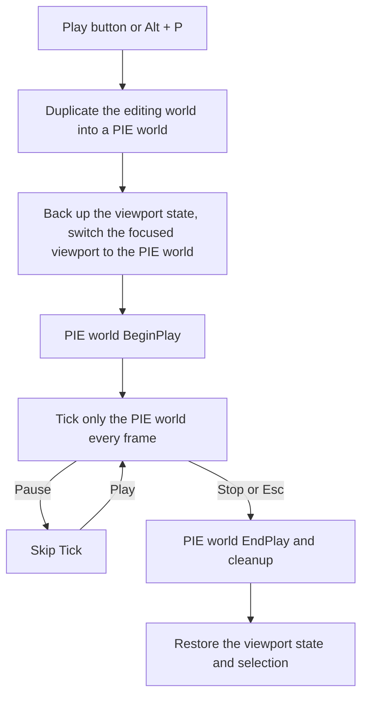

# 🥧 KRAFTON Jungle game tech Lab - Week 5

[한국어](./README.md) | **English**

***2nd Game Jam - Brute Force Competition***

***It's PIE Time!***

2026.04.02. ~ 2026.04.09.

Team 5: 장민준([@nacho2407](https://github.com/nacho2407)), 남윤지([@yoonjiii218](https://github.com/yoonjiii218)), 정찬일([@Chanil-Chong](https://github.com/Chanil-Chong)), 강건우([@keonwookang0914](https://github.com/keonwookang0914))


We added **PIE(Play In Editor), which duplicates the world being edited and runs it right inside the editor**, and an **actor system that goes from worlds to levels, actors, and components** to the 3D editor. To draw and pick many static meshes quickly, culling and picking are accelerated with a BVH, and render commands are sorted before drawing.


## 🎮 Week Overview

- Pressing the editor's Play button runs a **PIE world that is a full copy of the world being edited** in the viewport. Whatever changes during play, the editing world stays as it was, and pressing Stop returns to the editing state from before play

- We built a structure in which a world owns levels, a level owns actors, and an actor owns components, and made **Tick, BeginPlay, and EndPlay flow differently depending on the world type**. Text, billboard, SubUV, movement, and other components can be attached to an actor from the properties panel

- To handle many static meshes, **frustum culling and ray picking are accelerated with an SAH-based BVH**, and render commands are sorted by material and mesh to reduce state changes


## ✨ Features

- **PIE(Play In Editor)**

  The Play, Pause, and Stop buttons on the viewport toolbar and `Alt + P` start, pause, and stop PIE. PIE runs in the focused viewport, and when it ends, the viewport's camera, view mode, and selection return to what they were before play

- **World Duplication**

  The PIE world is created by deep-copying the levels of the editing world down to their actors and components. The mapping between the original and duplicated objects is recorded, and references are then reconnected so the duplicates point to one another

- **Worlds, Levels, Actors, and Components**

  A world has levels, a level has a list of actors, and an actor has a root component and a set of owned components. In the editing world, only actors marked to tick in the editor tick, and in the PIE world, only actors that have finished BeginPlay tick

- **Adding and Removing Components**

  The Add button in the properties panel attaches Scene, Static Mesh, Text, SubUV, Billboard, and Move components to the selected actor, and components added to an instance can be removed

- **Text Render Component**

  Draws text in world space with a font atlas. The UUID shown above actors is also drawn with this component

- **Billboard Component**

  A sprite that always faces the camera. Its texture is chosen from the Sprite drop-down in the properties panel

- **SubUV Component**

  Plays an animation by advancing through the frames of a sprite sheet at a set FPS. Looping and billboarding can be changed in the properties panel

- **Movement Component**

  After BeginPlay, it bobs the actor up and down while rotating it, so you can see right away that Tick is running in PIE

- **Player Camera**

  Placing a PlayerCamera actor in the world starts PIE from that camera's view, and with several of them placed, you can switch between them with the arrow keys

- **BVH-Based Culling and Picking**

  The level's primitives are grouped into a BVH split by SAH, and each viewport draws only the primitives inside its frustum. Picking walks the same BVH with a ray, skipping nodes farther than the closest hit found so far, and candidate meshes are tested exactly against a per-mesh triangle BVH. Turning on the debug display shows the BVH nodes of the selected actor

- **Render Command Sorting and UI Batching**

  Render commands are divided into default, transparent, and overlay layers, and the default layer is sorted by material and mesh to reduce state changes. The transparent layer is drawn from the farthest to the nearest to the camera, and screen UI merges consecutive draws with the same material into one vertex batch drawn at once


## 👥 Team

| Member | Responsibilities |
|------|------------------------|
| **장민준**([@nacho2407](https://github.com/nacho2407)) | Rendering optimization, PIE and gameplay flow - GPU occlusion culling, starting, pausing, and stopping PIE with viewport state restoration, per-world-type Tick, BeginPlay and EndPlay propagation, PIE input and shortcuts, player camera |
| **남윤지**([@yoonjiii218](https://github.com/yoonjiii218)) | Components - text render component, billboard component and actor, movement component, hidden-in-game setting, component property UI |
| **정찬일**([@Chanil-Chong](https://github.com/Chanil-Chong)) | Renderer and editor UI - BVH-based culling and picking, level structure, renderer and Slate UI restructuring(render queue separation, UI batching), play buttons and multi-viewport PIE, SubUV component |
| **강건우**([@keonwookang0914](https://github.com/keonwookang0914)) | Object duplication and component management - duplication of worlds, levels, actors, and components, component storage structure, adding and removing components, root component serialization |


## 🧑‍💻 Work Details

### GPU Occlusion Culling

- **Goal**

  Find static meshes hidden behind other meshes on the GPU and skip drawing them, and measure the effect of the culling

- **Implementation**

  An **HZB**(Hierarchical Z-Buffer) is built from the depth buffer. The depth is copied into the first mip, and a compute shader then reduces the mips one after another, keeping the farthest depth of each 2x2 region. Once the bounding spheres of the static meshes are uploaded to a structured buffer, a compute shader projects each bounding sphere onto the screen, picks the mip that fits its size, and compares the HZB depth at five points in that region with the nearest depth of the sphere to decide whether it is occluded

  The results are read back without waiting for the GPU by cycling through three staging buffers, and in later frames occluded meshes are skipped before draw commands are built. The console variable `r.GpuOcclusionCulling` turns the feature on and off, and the performance window shows the draw call count before and after occlusion, the number of skipped meshes, and the CPU time of each stage. The swap chain also supports tearing(`DXGI_PRESENT_ALLOW_TEARING`) so that FPS can be measured properly with vertical sync off

- **Limitations and Future Work**

  The occlusion test depends heavily on a single depth comparison margin(`DepthBias`). Depending on the value, meshes flickered or were barely culled, and the value had to be tuned many times. A fundamental solution to this problem was not found before the deadline


### Starting and Stopping PIE

- **Goal**

  Run the game inside the editor without touching the world being edited, and return exactly to the editing state from before play when it ends

- **Implementation**

  Starting PIE duplicates the editing world into a PIE world and sets up a new **PIE-only world context** to hold it. The world context and viewport state, such as the camera, of every active viewport are backed up, and then only the focused viewport is switched to the PIE world. The selection is cleared, input is captured, and BeginPlay is called on the PIE world

  Every frame while PIE is running, **only the PIE world ticks**, and Tick is skipped while paused. On stop, the backed-up viewport state is restored, EndPlay is called on the PIE world, and the PIE world context is removed. The selected actors and the cursor state from before play are restored as well

- **Related Code**

  [`Editor/Source/EditorEngine.cpp`](./Editor/Source/EditorEngine.cpp), [`Engine/Source/Core/Engine.cpp`](./Engine/Source/Core/Engine.cpp)


### Per-World-Type Tick and BeginPlay, EndPlay Propagation

- **Goal**

  Put the responsibility for Tick on the world so the same actor behaves differently in the editing world and the PIE world, and pass the start and end of play down to components

- **Implementation**

  The world iterates over the actors in its levels and **chooses which actors to tick based on the world type**. In the editing world, only actors marked to tick in the editor tick, and in PIE and game worlds, only actors that have finished BeginPlay tick, and actors tick their own components by the same rule

  The world's BeginPlay and EndPlay are passed on to the actors in its levels, and an actor's EndPlay is delivered only to components that have finished BeginPlay, so components also learn when play ends. The world records whether it has started, so BeginPlay and EndPlay are never called twice on the same world

- **Related Code**

  [`Engine/Source/World/World.cpp`](./Engine/Source/World/World.cpp), [`Engine/Source/Actor/Actor.cpp`](./Engine/Source/Actor/Actor.cpp)


### PIE Input and Player Camera

- **Goal**

  Control the view with the mouse and keyboard in the PIE viewport as in a game, and view the game from a camera placed in the world

- **Implementation**

  When PIE starts, **mouse input is captured by the viewport**. The cursor is hidden and moved back to the center of the viewport every frame, and the amount it moved is used to rotate the view. WASD moves the camera, and Q and E move it up and down. `Shift + F1` releases the cursor, clicking the viewport captures it again, and `Esc` ends PIE while input is captured. The PIE viewport's toolbar shows a cursor hint instead of the view type and view mode drop-downs

  A PlayerCamera actor has a camera component and an arrow mesh that shows its direction. When PIE starts, the PlayerCamera actors in the PIE world are collected and hidden from the screen, and **the first camera becomes the active camera** that the viewport view follows. The left and right arrow keys switch to the previous and next camera

- **Related Code**

  [`Editor/Source/Viewport/Services/EditorViewportInputService.cpp`](./Editor/Source/Viewport/Services/EditorViewportInputService.cpp), [`Engine/Source/Actor/PlayerCameraActor.cpp`](./Engine/Source/Actor/PlayerCameraActor.cpp), [`Editor/Source/Slate/ViewportToolbar.cpp`](./Editor/Source/Slate/ViewportToolbar.cpp)


## 🛠️ Tech Stack

- **Language**: C++20

- **Graphics API**: DirectX 11

- **Build**: Visual Studio 2026, MSBuild

- **Libraries**: Dear ImGui, DirectX Tool Kit for DirectX 11, JSON for Modern C++, stb


## 🖥️ Architecture



- Flow

    1. The Play button or `Alt + P` duplicates the editing world to create a PIE world and its world context

    2. The viewport state is backed up, the focused viewport is switched to the PIE world, and BeginPlay is called

    3. While running, only the PIE world ticks, and Tick is skipped while paused

    4. Ending with Stop or `Esc` releases the PIE world after its EndPlay and cleanup, and restores the viewport state and selection


## 📁 Directory Structure

```
week05/
├── week05.sln          // Solution(Editor, Engine)
├── Assets/             // Materials, meshes, scenes, textures
├── Content/            // Fonts, SubUV sprites
├── Docs/               // README media
├── Editor/             // Editor executable project
│   ├── Source/         // Editor engine and entry point
│   │   ├── Axis/       // Axis display
│   │   ├── Controller/ // Viewport controller
│   │   ├── Gizmo/      // Gizmo
│   │   ├── Pawn/       // Editor camera pawn
│   │   ├── Picking/    // Picking
│   │   ├── Slate/      // Viewport overlay and widgets
│   │   ├── Subsystem/  // Camera and selection subsystems
│   │   ├── UI/         // Editor windows
│   │   └── Viewport/   // Viewports and viewport services
│   └── ThirdParty/     // Dear ImGui
└── Engine/             // Engine DLL project
    ├── Shaders/        // HLSL shaders
    ├── Source/         // DLL export macro and common header
    │   ├── Actor/      // Actors
    │   ├── Asset/      // Wavefront OBJ mesh management
    │   ├── Camera/     // Camera
    │   ├── Component/  // Components
    │   ├── Core/       // Engine loop, console variables, paths, and timer
    │   ├── Debug/      // Debug drawing and logging
    │   ├── Input/      // Input and Enhanced Input
    │   ├── Level/      // Level and BVH
    │   ├── Math/       // Vectors, matrices, quaternions, and frustum
    │   ├── Memory/     // Memory management
    │   ├── Object/     // Object system
    │   ├── Physics/    // Physics
    │   ├── Platform/   // Windows platform
    │   ├── Primitive/  // Gizmo primitives
    │   ├── Renderer/   // Renderer, shaders, and materials
    │   ├── Serializer/ // Archive and scene serialization
    │   ├── Types/      // Containers and core types
    │   └── World/      // World
    └── ThirdParty/     // JSON for Modern C++, stb
```


## ❓ Build and Run

### Running the Release Build

1. Run `Editor.exe`

- Requirements

    - Windows 10 / 11(x64)

    - A GPU that supports DirectX 11

    - Microsoft Visual C++ Redistributable(x64)

- Notes

    - Some assets could not be included because of license issues, so the following items may be missing or displayed differently

        - Default icon of billboard actors

        - Folder and file icons in the Content Browser window

        - Texture of the water material


### Building from Source

- Requirements

    - Windows 10 / 11(x64)

    - Visual Studio 2026(Desktop development with C++)

    - MSVC v143 build tools

    - Windows SDK

1. Open `week05/week05.sln`

2. Set the configuration to `Release` and the platform to `x64`

3. Build and run

- Notes

    - Some assets could not be included because of license issues, so the following items may be missing or displayed differently

        - Default icon of billboard actors

        - Folder and file icons in the Content Browser window

        - Texture of the water material


## ⌨️ Shortcuts

| Shortcut | Action |
|--------|------|
| **Alt + P** | Start PIE(resumes it if paused) |
| **Esc** | Stop PIE(while the PIE viewport has captured input) |
| **Shift + F1** | Release the mouse cursor during PIE(click the viewport to capture it again) |
| **← / →** | Switch to the previous or next player camera during PIE |
| **W / E / R** | Switch the gizmo mode(translate, rotate, scale). While the right mouse button is held, they work as camera movement keys |
| **Space** | Cycle the gizmo mode(translate, rotate, scale) |
| **L** | Switch the gizmo space(world, local) |


## 📄 Third-Party Libraries

| Name | Author | Version | License |
|------|--------|------|----------|
| **[Dear ImGui](https://github.com/ocornut/imgui)** | Omar Cornut | 1.92.7 WIP | [MIT License](./Editor/ThirdParty/imgui/LICENSE.txt) |
| **[DirectX Tool Kit for DirectX 11](https://github.com/microsoft/DirectXTK)** | Microsoft Corporation. | - | MIT License |
| **[JSON for Modern C++](https://github.com/nlohmann/json)** | Niels Lohmann | 3.11.3 | [MIT License](./Engine/ThirdParty/nlohmann/LICENSE.MIT) |
| **[stb](https://github.com/nothings/stb)** | Sean Barrett | 2.30 | The Unlicense |


## 🎨 Third-Party Assets

| Name | Author | License |
|------|--------|----------|
| **[3d-cubes](https://github.com/garykac/3d-cubes)** | Gary Kac | - |
| **[Dinosaur](https://opengameart.org/content/dinosaur-0)** | pixelartm | [Creative Commons Attribution 3.0 Unported](https://creativecommons.org/licenses/by/3.0/) |
| **[Noto Sans KR](https://github.com/notofonts/noto-cjk)** | Adobe | [SIL Open Font License 1.1](./Content/Fonts/OFL.txt) |
| **[Super Random Penguin Edit](https://opengameart.org/content/super-random-penguin-edit)** | Zombie Rat(original: [Super Random Sprites](https://opengameart.org/content/super-random-sprites) by GrafxKid) | [Creative Commons Zero v1.0 Universal](https://creativecommons.org/publicdomain/zero/1.0/) |


## ⚖️ License

The portions of this week's code written by Jang Minjun are released under the MIT License, and the rights to the portions written by other contributors belong to their respective contributors. See [LICENSE](../LICENSE) for details.
