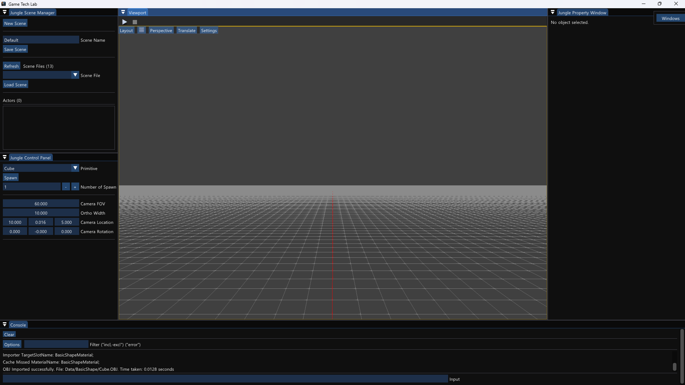
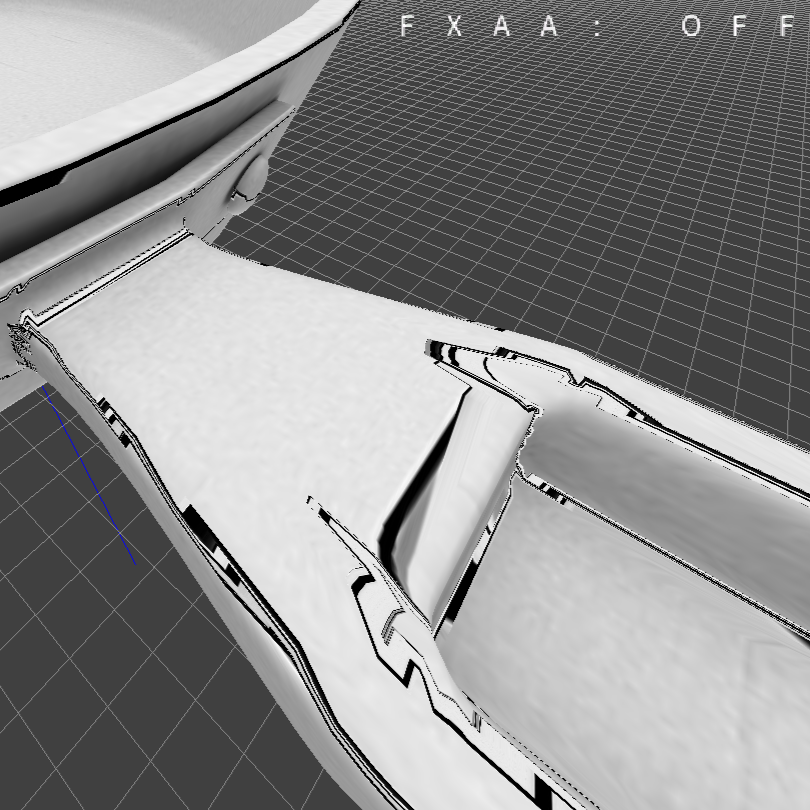
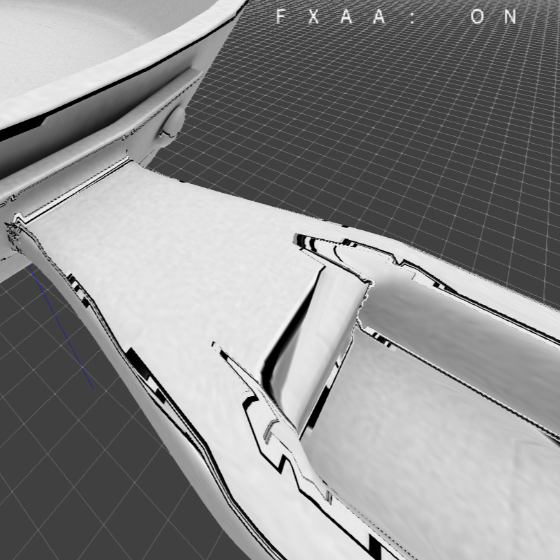
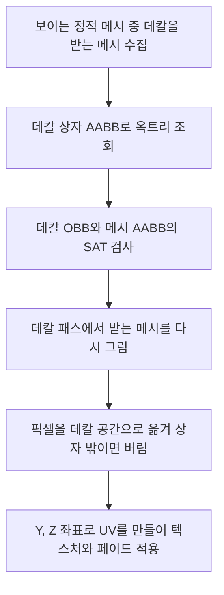

# 🍳 크래프톤 정글 게임테크랩 6주차

**한국어** | [English](./README_en.md)

***Decal***

***P.S. I Love You - Clearing the Fog***

2026.04.09. ~ 2026.04.16.

6팀: 장민준([@nacho2407](https://github.com/nacho2407)), 강명호([@DDing-Ho](https://github.com/DDing-Ho)), 김호준([@esc10946](https://github.com/esc10946)), 조현석([@chodott](https://github.com/chodott))



<p align="center">
    
    
</p>


3D 에디터에 **메시 표면에 텍스처를 입히는 투영 데칼**과 **깊이 버퍼로 계산하는 지수 높이 안개**, **주변 표면을 비추는 파이어볼**을 만들었습니다. 화면 전체에 FXAA를 적용하고, 날아가다 부딪힌 자리에 데칼을 남기는 발사체로 이 효과들을 확인할 수 있습니다.


## 🎮 주차 소개

- 데칼 액터를 놓으면 **데칼 상자와 겹치는 메시 표면에 텍스처가 투영**됩니다. 데칼은 액터의 X축 방향으로 투영되고, 정해 둔 시간에 맞춰 서서히 나타나고 사라집니다. 데칼을 받을 메시를 옥트리와 분리축 검사로 골라, 겹치는 메시만 다시 그립니다

- 깊이 버퍼로 각 픽셀의 월드 위치를 복원하는 후처리 패스로 **지수 높이 안개**를 그리고, 깊이와 노멀 버퍼로 **일정 반경의 표면을 밝히는 파이어볼**을 만들었습니다. 깊이 버퍼를 회색조로 보여 주는 Scene Depth 뷰 모드도 있습니다

- 중력을 받아 날아가다 부딪힌 자리에 데칼을 남기는 **발사체**, 빌보드와 데칼로 만든 **가짜 스포트라이트**, 화면 전체의 계단 현상을 줄이는 **FXAA**를 더했습니다


## ✨ 구현 결과

- **투영 데칼**

  데칼 액터를 놓으면 데칼 상자와 겹치는 정적 메시 표면에 텍스처가 투영됩니다. 투영 방향은 데칼의 X축이고, 속성 창에서 텍스처와 크기를 바꿉니다. 정적 메시마다 데칼을 받을지 정할 수 있고, 데칼을 선택하면 상자와 투영 방향이 선으로 보입니다

- **데칼 페이드 인, 아웃**

  나타나는 시간, 사라지는 시간, 전체 수명을 정하면 그에 맞춰 데칼의 투명도가 바뀝니다. 한 번 사라지면 스스로 지워지게 할 수도 있습니다

- **데칼 쇼 플래그와 통계**

  뷰포트 Settings 메뉴의 Show 항목에서 `Decals`로 데칼을 켜고 끕니다. Stat Profiler 창과 콘솔 명령 `stat decal`로 보이는 데칼 수, 받는 메시 후보 수, 실제로 그린 수와 수집, 렌더 시간을 봅니다

- **가짜 스포트라이트**

  빌보드와 그 아래를 비추는 원형 그라데이션 데칼로, 조명처럼 보이는 스포트라이트 액터를 만들었습니다

- **Scene Depth 뷰 모드**

  뷰포트 Settings 메뉴의 View Mode에서 `SceneDepthBuffer`를 고르면, 깊이 버퍼를 선형 거리로 바꿔 회색조로 보여 줍니다

- **지수 높이 안개(Exponential Height Fog)**

  안개 액터의 높이, 밀도, 높이에 따른 감쇠, 색, 최대 불투명도, 시작 거리와 차단 거리로 안개를 조절합니다. 깊이 버퍼로 복원한 픽셀의 월드 위치까지 카메라 광선을 따라 안개 밀도를 적분해 화면에 섞습니다. Show 항목의 `Fog`로 켜고 끕니다

- **파이어볼**

  파이어볼 컴포넌트가 정한 반경 안의 표면을 색과 세기에 맞춰 밝힙니다. 깊이와 노멀 버퍼로 표면의 위치와 방향을 구해, 파이어볼을 향한 면일수록, 중심에 가까울수록 밝게 더합니다

- **발사체와 회전 이동 컴포넌트**

  발사체 이동 컴포넌트는 초기 속도와 중력으로 날아가며 이동 경로의 충돌을 검사합니다. 계란 액터는 부딪히면 모습을 감추고, 부딪힌 면을 향한 데칼을 남긴 뒤 페이드 아웃과 함께 사라집니다. 회전 이동 컴포넌트는 정한 속도로 액터를 계속 돌립니다

- **FXAA**

  화면을 다 그린 뒤 밝기 차이로 가장자리를 찾아 그 방향으로 섞어 계단 현상을 줄입니다. 뷰포트 Settings 메뉴의 Anti-Aliasing 항목에서 켜고 끄며, FXAA Settings 창에서 가장자리 판정 기준과 탐색 단계 수를 바꿉니다


## 👥 팀원 및 담당 파트

| 팀원 | 담당 파트 및 주요 역할 |
|------|------------------------|
| **장민준**([@nacho2407](https://github.com/nacho2407)) | 투영 데칼과 FXAA - 데칼 컴포넌트와 액터, 받는 메시 선별(옥트리, SAT)과 데칼 패스, 데칼 셰이더, 데칼 쇼 플래그와 통계, 데칼 상자와 방향 표시, FXAA와 설정 창 |
| **강명호**([@DDing-Ho](https://github.com/DDing-Ho)) | 지수 높이 안개 - 안개 컴포넌트와 액터, 안개 후처리 패스, 안개 쇼 플래그, 데칼 통계 보완 |
| **김호준**([@esc10946](https://github.com/esc10946)) | 데칼, 게임플레이와 뷰 모드 - 발사체와 회전 이동 컴포넌트, 계란 액터와 충돌 데칼, 가짜 스포트라이트, Scene Depth 뷰 모드, `stat decal` 오버레이, 데칼 구현 병합 |
| **조현석**([@chodott](https://github.com/chodott)) | 데칼과 파이어볼 - 파이어볼 컴포넌트와 패스, 노멀과 알베도 버퍼 출력, 데칼 페이드 인, 아웃, 선택 외곽선 마스크 |


## 🧑‍💻 담당 작업 상세

### 투영 데칼 렌더링

- **목표**

  데칼 상자와 겹치는 메시 표면에만 텍스처를 입히고, 씬의 모든 메시를 다시 그리지 않도록 데칼을 받을 메시를 빠르게 고릅니다

- **구현 내용**

  매 프레임 화면에 보이는 정적 메시 중 **데칼을 받도록 설정된 것**만 모읍니다. 데칼마다 데칼 상자를 감싸는 AABB로 옥트리를 조회해 후보를 좁히고(Broad Phase), 후보마다 데칼의 방향 있는 상자(OBB)와 메시의 AABB를 **분리축 정리(SAT)의 15개 축**으로 검사해 실제로 겹치는 메시만 남깁니다(Narrow Phase)

  남은 메시는 데칼 패스에서 **깊이를 읽기만 하고 알파 블렌딩으로 한 번 더 그립니다.** 픽셀 셰이더는 픽셀의 월드 위치를 데칼 공간으로 옮겨 상자 밖이면 버리고, 안이면 데칼 공간의 Y, Z 좌표를 UV로 삼아 텍스처를 입힙니다. 그래서 데칼은 X축 방향으로 투영되고, 페이드 값은 알파에 곱해집니다

- **관련 코드**

  [`Source/Engine/Render/Pipeline/RenderCollector.cpp`](./Source/Engine/Render/Pipeline/RenderCollector.cpp), [`Source/Engine/Collision/IntersectionUtils.cpp`](./Source/Engine/Collision/IntersectionUtils.cpp), [`Source/Engine/Render/Pipeline/Renderer.cpp`](./Source/Engine/Render/Pipeline/Renderer.cpp), [`Shaders/Decal.hlsl`](./Shaders/Decal.hlsl)


### 데칼 액터와 에디터 지원

- **목표**

  에디터에서 데칼을 배치하고 고치기 쉽도록, 데칼의 범위와 방향을 눈으로 확인하고 데칼에 드는 비용을 수치로 봅니다

- **구현 내용**

  데칼 컴포넌트에 텍스처와 크기를 두고 저장과 불러오기, 속성 창 편집을 붙였습니다. 데칼 액터는 데칼 컴포넌트와 아이콘 빌보드로 이루어지며, 아이콘으로 선택합니다. 데칼 크기를 바꾸려고 액터의 스케일을 키워도 아이콘은 커지지 않도록 **부모 스케일을 무시하는 빌보드 옵션**을 더했습니다. 선택한 데칼에는 상자의 모서리 12개를 파란 선으로, 투영 방향을 노란 화살표로 그립니다

  Show 항목에 데칼 플래그를 두고, 정적 메시마다 데칼 수신 여부를 두었습니다. 데칼 수집 과정에서 **보이는 데칼과 받는 메시 수, Broad Phase 후보 수, SAT를 통과한 수, 제출하고 실제로 그린 그리기 수**를 세고, 수집과 렌더에 걸린 시간과 함께 Stat Profiler 창에 보여 줍니다

- **관련 코드**

  [`Source/Engine/Component/DecalComponent.cpp`](./Source/Engine/Component/DecalComponent.cpp), [`Source/Engine/GameFramework/DecalActor.cpp`](./Source/Engine/GameFramework/DecalActor.cpp), [`Source/Editor/EditorRenderPipeline.cpp`](./Source/Editor/EditorRenderPipeline.cpp), [`Source/Editor/UI/EditorStatWidget.cpp`](./Source/Editor/UI/EditorStatWidget.cpp)


### FXAA

- **목표**

  멀티 샘플링 없이 후처리 한 번으로 가장자리의 계단 현상을 줄입니다

- **구현 내용**

  다 그린 화면을 텍스처로 읽어 픽셀과 상하좌우 이웃의 밝기를 비교하고, **대비가 기준보다 작으면 그대로 둡니다.** 가장자리로 판정되면 주변 3x3 밝기로 가장자리가 가로인지 세로인지 정하고, 밝기 차이가 큰 쪽을 짝으로 고릅니다. 가장자리를 따라 양쪽으로 밝기가 달라지는 끝을 찾아, **가까운 끝까지의 거리로 샘플 위치를 옮겨** 섞습니다. 한 픽셀보다 작은 계단은 주변 평균과의 대비에 따라 3x3 평균 색을 따로 섞습니다

  가장자리 판정 기준, 탐색 기준, 서브픽셀 세기와 상한, 탐색 단계 수를 FXAA Settings 창에서 바꾸며, 값은 에디터 설정 파일에 저장됩니다

- **관련 코드**

  [`Shaders/FXAA.hlsl`](./Shaders/FXAA.hlsl), [`Source/Editor/UI/EditorFXAAWidget.cpp`](./Source/Editor/UI/EditorFXAAWidget.cpp), [`Source/Editor/Settings/EditorSettings.cpp`](./Source/Editor/Settings/EditorSettings.cpp)


## 🛠️ 기술 스택

- **Language**: C++20

- **Graphics API**: DirectX 11

- **Build**: Visual Studio 2026, MSBuild

- **Libraries**: Dear ImGui, DirectX Tool Kit for DirectX 11, SimpleJSON


## 🖥️ 구조



- 동작 흐름

    1. 화면에 보이는 정적 메시 중 데칼을 받도록 설정된 메시를 모읍니다

    2. 데칼마다 데칼 상자를 감싸는 AABB로 옥트리를 조회해 후보를 좁히고, SAT로 실제로 겹치는 메시만 남깁니다

    3. 데칼 패스에서 남은 메시를 깊이 읽기 전용, 알파 블렌딩으로 다시 그립니다

    4. 픽셀 셰이더가 데칼 상자 밖의 픽셀을 버리고, 상자 안에서는 데칼 공간 좌표로 텍스처를 입힌 뒤 페이드 값을 곱합니다


## 📁 디렉토리 구조

```
week06/
├── week06.sln              // 솔루션
├── Asset/                  // 앱 아이콘, 씬, 데칼 텍스처
├── Data/                   // Wavefront OBJ 모델과 텍스처
├── Docs/                   // README 미디어
├── Settings/               // 리소스 목록
├── Shaders/                // HLSL 셰이더
├── Source/                 // 진입점
│   ├── Editor/             // 에디터 엔진과 렌더 파이프라인
│   │   ├── PIE/            // PIE 타입
│   │   ├── Selection/      // 선택 관리
│   │   ├── Settings/       // 에디터 설정
│   │   ├── Subsystem/      // 오버레이 통계
│   │   ├── UI/             // 에디터 위젯
│   │   └── Viewport/       // 뷰포트와 레이아웃
│   ├── Engine/
│   │   ├── Collision/      // 레이 판정, BVH, 옥트리
│   │   ├── Component/      // 컴포넌트
│   │   ├── Core/           // 공통 타입과 틱
│   │   ├── GameFramework/  // 액터와 레벨
│   │   ├── Input/          // 입력
│   │   ├── Materials/      // 재질
│   │   ├── Math/           // 벡터, 행렬, 쿼터니언
│   │   ├── Mesh/           // Wavefront OBJ 가져오기와 정적 메시
│   │   ├── Object/         // 객체 시스템
│   │   ├── Platform/       // 경로와 크래시 덤프
│   │   ├── Profiling/      // 통계와 GPU 프로파일링
│   │   ├── Render/         // 렌더 파이프라인, 컬링, 배처
│   │   ├── Resource/       // 리소스 관리
│   │   ├── Runtime/        // 엔진 루프와 창
│   │   ├── Serialization/  // 씬 저장과 불러오기
│   │   ├── Texture/        // 텍스처
│   │   ├── UI/             // 스플리터와 창 위젯
│   │   └── Viewport/       // 뷰포트
│   └── ObjViewer/          // OBJ 뷰어
└── ThirdParty/             // Dear ImGui, SimpleJSON
```


## ❓ 빌드 및 실행

### 릴리즈 실행

1. `week06.exe` 실행

- 실행 환경

    - Windows 10 / 11(x64)

    - DirectX 11을 지원하는 GPU

    - Microsoft Visual C++ 재배포 가능 패키지(x64)

- 참고

    - 라이선스 문제로 인해 일부 에셋을 포함하지 못해, 아래 항목이 표시되지 않거나 다르게 표시될 수 있습니다

        - 액터 UUID와 텍스트 렌더 컴포넌트의 글자

        - 오버레이 통계의 글자

        - 데칼 액터와 가짜 스포트라이트의 빌보드 아이콘

        - SubUV 파티클

        - 계란 액터의 메시와 충돌 데칼의 텍스처

        - 뷰포트 레이아웃 버튼과 분할 전환 버튼의 아이콘

        - PIE 버튼의 아이콘


### 소스 빌드

- 요구 사항

    - Windows 10 / 11(x64)

    - Visual Studio 2026(C++를 사용한 데스크톱 개발)

    - MSVC v143 빌드 도구

    - Windows SDK

1. `week06/week06.sln` 열기

2. 구성을 `Release`, 플랫폼을 `x64`로 선택

3. 빌드 후 실행

- 참고

    - 라이선스 문제로 인해 일부 에셋을 포함하지 못해, 아래 항목이 표시되지 않거나 다르게 표시될 수 있습니다

        - 액터 UUID와 텍스트 렌더 컴포넌트의 글자

        - 오버레이 통계의 글자

        - 데칼 액터와 가짜 스포트라이트의 빌보드 아이콘

        - SubUV 파티클

        - 계란 액터의 메시와 충돌 데칼의 텍스처

        - 뷰포트 레이아웃 버튼과 분할 전환 버튼의 아이콘

        - PIE 버튼의 아이콘


## ⌨️ 단축키

| 단축키 | 동작 |
|--------|------|
| **Space** | 기즈모 모드 순환(이동, 회전, 크기) |
| **Ctrl + D** | 선택한 액터 복제 |
| **← / → / ↑ / ↓** | 원근 뷰포트에서 카메라 회전 |
| **Esc** | PIE 종료 |
| **액터 목록 더블클릭** | 모든 뷰포트의 카메라를 그 액터 앞으로 이동 |


## 📄 서드파티 라이브러리

| 이름 | 저작자 | 버전 | 라이선스 |
|------|--------|------|----------|
| **[Dear ImGui](https://github.com/ocornut/imgui)** | Omar Cornut | 1.92.7 WIP | [MIT License](./ThirdParty/ImGui/LICENSE.txt) |
| **[DirectX Tool Kit for DirectX 11](https://github.com/microsoft/DirectXTK)** | Microsoft Corporation. | - | MIT License |
| **[SimpleJSON](https://github.com/nbsdx/SimpleJSON)** | Neil | - | Do What the Fuck You Want to Public License |


## 🎨 서드파티 에셋

| 이름 | 저작자 | 라이선스 |
|------|--------|----------|
| **[3d-cubes](https://github.com/garykac/3d-cubes)** | Gary Kac | - |


## ⚖️ 라이선스

이 주차의 코드 중 장민준이 작성한 부분은 MIT 라이선스로 공개하며, 다른 기여자가 작성한 부분의 권리는 각 기여자에게 있습니다. 자세한 내용은 [LICENSE](../LICENSE)를 확인해 주세요.
