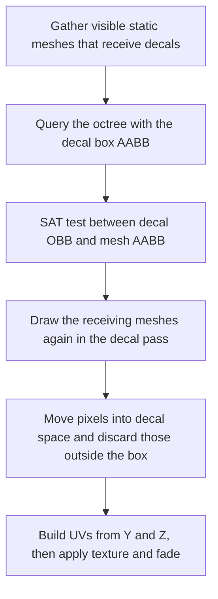

# 🍳 KRAFTON Jungle game tech Lab - Week 6

[한국어](./README.md) | **English**

***Decal***

***P.S. I Love You - Clearing the Fog***

2026.04.09. ~ 2026.04.16.

Team 6: 장민준([@nacho2407](https://github.com/nacho2407)), 강명호([@DDing-Ho](https://github.com/DDing-Ho)), 김호준([@esc10946](https://github.com/esc10946)), 조현석([@chodott](https://github.com/chodott))


<p align="center">
    
    
</p>


We added **projection decals that put textures on mesh surfaces**, **exponential height fog computed from the depth buffer**, and **fireballs that light up nearby surfaces** to the 3D editor. FXAA is applied to the whole screen, and these effects can be seen with projectiles that leave a decal where they hit.


## 🎮 Week Overview

- Placing a decal actor **projects a texture onto the mesh surfaces that overlap the decal box**. The decal is projected along the actor's X axis and fades in and out over the times you set. The meshes that receive a decal are picked with an octree and a separating axis test, and only the overlapping meshes are drawn again

- A post-process pass that reconstructs each pixel's world position from the depth buffer draws **exponential height fog**, and **fireballs that light up surfaces within a radius** are built from the depth and normal buffers. There is also a Scene Depth view mode that shows the depth buffer in grayscale

- We added **projectiles** that fly under gravity and leave a decal where they hit, a **fake spotlight** made of a billboard and a decal, and **FXAA** that reduces jagged edges across the screen


## ✨ Features

- **Projection Decals**

  Placing a decal actor projects a texture onto the static mesh surfaces that overlap the decal box. The projection direction is the decal's X axis, and the texture and size are changed in the properties panel. Each static mesh can choose whether to receive decals, and selecting a decal shows its box and projection direction as lines

- **Decal Fade In and Out**

  Setting the fade-in time, the fade-out time, and the total lifetime changes the decal's opacity to match. A decal can also remove itself once it has faded out

- **Decal Show Flag and Stats**

  `Decals` under Show in the viewport Settings menu turns decals on and off. The Stat Profiler window and the console command `stat decal` show the number of visible decals, receiving mesh candidates, and draws actually made, along with the collection and render times

- **Fake Spotlight**

  A spotlight actor that looks like a light is made of a billboard and a round gradient decal projected below it

- **Scene Depth View Mode**

  Choosing `SceneDepthBuffer` under View Mode in the viewport Settings menu converts the depth buffer to linear distance and shows it in grayscale

- **Exponential Height Fog**

  The fog is controlled by the fog actor's height, density, height falloff, color, maximum opacity, start distance, and cutoff distance. The fog density is integrated along the camera ray up to each pixel's world position reconstructed from the depth buffer and blended into the screen. It is toggled with `Fog` under Show

- **Fireball**

  A fireball component lights up the surfaces within its radius with its color and intensity. Using the depth and normal buffers to get each surface's position and direction, it adds more light to surfaces that face the fireball and lie closer to its center

- **Projectile and Rotating Movement Components**

  The projectile movement component flies with an initial velocity and gravity and checks for collisions along its path. An egg actor hides itself on impact, leaves a decal facing the surface it hit, and disappears as the decal fades out. The rotating movement component keeps turning an actor at a set rate

- **FXAA**

  After the whole screen is drawn, edges are found from differences in brightness and blended along their direction to reduce jagged edges. It is toggled under Anti-Aliasing in the viewport Settings menu, and the FXAA Settings window changes the edge thresholds and the number of search steps


## 👥 Team

| Member | Responsibilities |
|------|------------------------|
| **장민준**([@nacho2407](https://github.com/nacho2407)) | Projection decals and FXAA - decal component and actor, receiving mesh selection(octree, SAT) and decal pass, decal shader, decal show flag and stats, decal box and direction display, FXAA and its settings window |
| **강명호**([@DDing-Ho](https://github.com/DDing-Ho)) | Exponential height fog - fog component and actor, fog post-process pass, fog show flag, decal stat refinements |
| **김호준**([@esc10946](https://github.com/esc10946)) | Decals, gameplay and view modes - projectile and rotating movement components, egg actor and impact decals, fake spotlight, Scene Depth view mode, `stat decal` overlay, merging the decal implementations |
| **조현석**([@chodott](https://github.com/chodott)) | Decals and fireball - fireball component and pass, normal and albedo buffer output, decal fade in and out, selection outline mask |


## 🧑‍💻 Work Details

### Projection Decal Rendering

- **Goal**

  Put a texture only on the mesh surfaces that overlap the decal box, and quickly pick the meshes that receive a decal instead of drawing every mesh in the scene again

- **Implementation**

  Every frame, only the visible static meshes that are **set to receive decals** are gathered. For each decal, the octree is queried with the AABB enclosing the decal box to narrow down the candidates(Broad Phase), and each candidate is tested with the decal's oriented box(OBB) against the mesh's AABB on **the 15 axes of the separating axis theorem(SAT)** so that only the meshes that actually overlap remain(Narrow Phase)

  The remaining meshes are **drawn once more in the decal pass with depth read-only and alpha blending.** The pixel shader moves each pixel's world position into decal space, discards it if it lies outside the box, and otherwise uses the Y and Z coordinates in decal space as UVs to apply the texture. This is why the decal is projected along the X axis, and the fade value is multiplied into alpha

- **Related Code**

  [`Source/Engine/Render/Pipeline/RenderCollector.cpp`](./Source/Engine/Render/Pipeline/RenderCollector.cpp), [`Source/Engine/Collision/IntersectionUtils.cpp`](./Source/Engine/Collision/IntersectionUtils.cpp), [`Source/Engine/Render/Pipeline/Renderer.cpp`](./Source/Engine/Render/Pipeline/Renderer.cpp), [`Shaders/Decal.hlsl`](./Shaders/Decal.hlsl)


### Decal Actor and Editor Support

- **Goal**

  Make decals easy to place and adjust in the editor by showing their extent and direction visually and their cost in numbers

- **Implementation**

  The decal component holds a texture and a size, with saving, loading, and editing in the properties panel. The decal actor consists of the decal component and an icon billboard, and it is selected through the icon. So that the icon does not grow when the actor is scaled up to resize the decal, a **billboard option that ignores the parent's scale** was added. A selected decal has the 12 edges of its box drawn in blue and its projection direction drawn as a yellow arrow

  A decal flag was added under Show, and each static mesh got a setting for whether it receives decals. While decals are collected, **the numbers of visible decals and receiving meshes, Broad Phase candidates, SAT passes, and draws submitted and actually made** are counted and shown in the Stat Profiler window together with the time spent on collection and rendering

- **Related Code**

  [`Source/Engine/Component/DecalComponent.cpp`](./Source/Engine/Component/DecalComponent.cpp), [`Source/Engine/GameFramework/DecalActor.cpp`](./Source/Engine/GameFramework/DecalActor.cpp), [`Source/Editor/EditorRenderPipeline.cpp`](./Source/Editor/EditorRenderPipeline.cpp), [`Source/Editor/UI/EditorStatWidget.cpp`](./Source/Editor/UI/EditorStatWidget.cpp)


### FXAA

- **Goal**

  Reduce jagged edges with a single post-process pass and no multisampling

- **Implementation**

  The finished screen is read as a texture, and the brightness of each pixel is compared with its four neighbors; **if the contrast is below the threshold, the pixel is left as it is.** When a pixel is judged to be on an edge, the surrounding 3x3 brightness decides whether the edge is horizontal or vertical, and the side with the larger brightness difference is chosen as its pair. The ends of the edge where the brightness changes are searched for in both directions along it, and **the sample position is shifted by the distance to the nearer end** before blending. Steps smaller than a pixel are blended separately with the 3x3 average color, depending on the contrast against the surrounding average

  The edge threshold, the search threshold, the subpixel strength and its cap, and the number of search steps are changed in the FXAA Settings window, and the values are saved in the editor settings file

- **Related Code**

  [`Shaders/FXAA.hlsl`](./Shaders/FXAA.hlsl), [`Source/Editor/UI/EditorFXAAWidget.cpp`](./Source/Editor/UI/EditorFXAAWidget.cpp), [`Source/Editor/Settings/EditorSettings.cpp`](./Source/Editor/Settings/EditorSettings.cpp)


## 🛠️ Tech Stack

- **Language**: C++20

- **Graphics API**: DirectX 11

- **Build**: Visual Studio 2026, MSBuild

- **Libraries**: Dear ImGui, DirectX Tool Kit for DirectX 11, SimpleJSON


## 🖥️ Architecture



- Flow

    1. Among the visible static meshes, those set to receive decals are gathered

    2. For each decal, the octree is queried with the AABB enclosing the decal box to narrow down the candidates, and SAT keeps only the meshes that actually overlap

    3. The remaining meshes are drawn again in the decal pass with depth read-only and alpha blending

    4. The pixel shader discards pixels outside the decal box, and inside the box it applies the texture from decal space coordinates and multiplies in the fade value


## 📁 Directory Structure

```
week06/
├── week06.sln              // Solution
├── Asset/                  // App icon, scenes, decal textures
├── Data/                   // Wavefront OBJ models and textures
├── Docs/                   // README media
├── Settings/               // Resource list
├── Shaders/                // HLSL shaders
├── Source/                 // Entry point
│   ├── Editor/             // Editor engine and render pipeline
│   │   ├── PIE/            // PIE types
│   │   ├── Selection/      // Selection management
│   │   ├── Settings/       // Editor settings
│   │   ├── Subsystem/      // Overlay stats
│   │   ├── UI/             // Editor widgets
│   │   └── Viewport/       // Viewports and layout
│   ├── Engine/
│   │   ├── Collision/      // Ray tests, BVH, and octree
│   │   ├── Component/      // Components
│   │   ├── Core/           // Common types and ticking
│   │   ├── GameFramework/  // Actors and level
│   │   ├── Input/          // Input
│   │   ├── Materials/      // Materials
│   │   ├── Math/           // Vectors, matrices, and quaternions
│   │   ├── Mesh/           // Wavefront OBJ import and static meshes
│   │   ├── Object/         // Object system
│   │   ├── Platform/       // Paths and crash dumps
│   │   ├── Profiling/      // Stats and GPU profiling
│   │   ├── Render/         // Render pipeline, culling, and batchers
│   │   ├── Resource/       // Resource management
│   │   ├── Runtime/        // Engine loop and window
│   │   ├── Serialization/  // Scene saving and loading
│   │   ├── Texture/        // Textures
│   │   ├── UI/             // Splitter and window widgets
│   │   └── Viewport/       // Viewports
│   └── ObjViewer/          // OBJ viewer
└── ThirdParty/             // Dear ImGui, SimpleJSON
```


## ❓ Build and Run

### Running the Release Build

1. Run `week06.exe`

- Requirements

    - Windows 10 / 11(x64)

    - A GPU that supports DirectX 11

    - Microsoft Visual C++ Redistributable(x64)

- Notes

    - Some assets could not be included because of license issues, so the following items may be missing or displayed differently

        - Text of actor UUIDs and text render components

        - Text of the overlay stats

        - Billboard icons of decal actors and fake spotlights

        - SubUV particles

        - Mesh of the egg actor and texture of its impact decals

        - Icons of the viewport layout and split toggle buttons

        - Icons of the PIE buttons


### Building from Source

- Requirements

    - Windows 10 / 11(x64)

    - Visual Studio 2026(Desktop development with C++)

    - MSVC v143 build tools

    - Windows SDK

1. Open `week06/week06.sln`

2. Set the configuration to `Release` and the platform to `x64`

3. Build and run

- Notes

    - Some assets could not be included because of license issues, so the following items may be missing or displayed differently

        - Text of actor UUIDs and text render components

        - Text of the overlay stats

        - Billboard icons of decal actors and fake spotlights

        - SubUV particles

        - Mesh of the egg actor and texture of its impact decals

        - Icons of the viewport layout and split toggle buttons

        - Icons of the PIE buttons


## ⌨️ Shortcuts

| Shortcut | Action |
|--------|------|
| **Space** | Cycle the gizmo mode(move, rotate, scale) |
| **Ctrl + D** | Duplicate the selected actors |
| **← / → / ↑ / ↓** | Rotate the camera in a perspective viewport |
| **Esc** | End PIE |
| **Double-click in the actor list** | Move the cameras of all viewports in front of that actor |


## 📄 Third-Party Libraries

| Name | Author | Version | License |
|------|--------|------|----------|
| **[Dear ImGui](https://github.com/ocornut/imgui)** | Omar Cornut | 1.92.7 WIP | [MIT License](./ThirdParty/ImGui/LICENSE.txt) |
| **[DirectX Tool Kit for DirectX 11](https://github.com/microsoft/DirectXTK)** | Microsoft Corporation. | - | MIT License |
| **[SimpleJSON](https://github.com/nbsdx/SimpleJSON)** | Neil | - | Do What the Fuck You Want to Public License |


## 🎨 Third-Party Assets

| Name | Author | License |
|------|--------|----------|
| **[3d-cubes](https://github.com/garykac/3d-cubes)** | Gary Kac | - |


## ⚖️ License

The portions of this week's code written by Jang Minjun are released under the MIT License, and the rights to the portions written by other contributors belong to their respective contributors. See [LICENSE](../LICENSE) for details.
