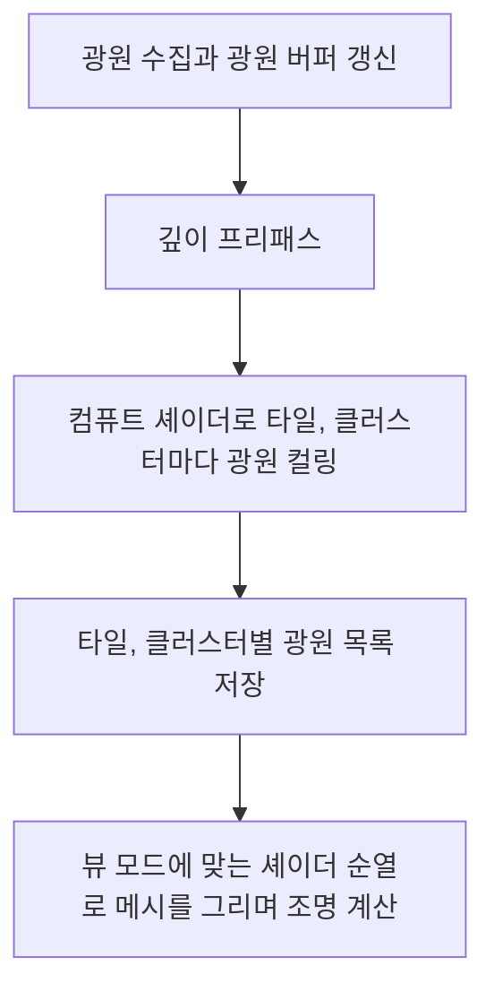

# 💡 크래프톤 정글 게임테크랩 7주차

**한국어** | [English](./README_en.md)

***빛이 있으라***

2026.04.16. ~ 2026.04.23.

8팀: 장민준([@nacho2407](https://github.com/nacho2407)), 김형준([@Rocketstein](https://github.com/Rocketstein)), 한영서([@persona6whenrelease](https://github.com/persona6whenrelease)), 국동진([@puter2712git](https://github.com/puter2712git))


3D 에디터에 **네 종류의 광원**과, 조명 모델을 바꿔 가며 쓰는 **Uber 셰이더**, **노멀 매핑**을 더했습니다. 광원이 많아도 픽셀마다 영향을 주는 광원만 계산하도록 컴퓨트 셰이더로 **Tiled, Clustered 라이트 컬링**을 합니다.


## 🎮 주차 소개

- 앰비언트, 디렉셔널, 포인트, 스포트 네 종류의 **광원 액터**를 놓으면, 메시를 그리는 셰이더에서 바로 광원을 계산하는 Forward Shading으로 장면을 비춥니다. 광원마다 색과 세기를 정하고, 포인트와 스포트 라이트는 감쇠 반경과 감쇠 지수로, 스포트 라이트는 원뿔의 안쪽과 바깥쪽 각도로 비추는 범위를 정합니다

- 셰이더 파일 하나에 **Gouraud, Lambert, Blinn-Phong** 조명 모델과 노멀 맵 사용 여부를 매크로로 나눠 두고, 필요한 조합을 셰이더 순열로 컴파일해 씁니다. 뷰포트마다 조명 모델과 뷰 모드를 바꿀 수 있고, 셰이더 파일을 고치면 실행 중에 다시 컴파일합니다

- 깊이 프리패스 뒤 컴퓨트 셰이더가 화면을 16x16 픽셀 타일로 나눠, 타일마다 영향을 주는 포인트, 스포트 라이트만 추립니다. 타일을 깊이 방향으로 더 나누는 Clustered 방식과 컬링 없이 모든 광원을 계산하는 방식도 고를 수 있고, Heatmap 뷰 모드로 타일마다 계산하는 광원 수를 봅니다


## ✨ 구현 결과

- **광원 액터**

  Jungle Control Panel의 Actor 목록에서 `Ambient`, `Directional`, `Point`, `Spotlight`를 골라 광원을 놓고, 속성 창에서 색, 세기, 감쇠 반경, 감쇠 지수, 원뿔 각도를 바꿉니다. 광원 아이콘은 광원의 색으로 칠해집니다

- **광원 범위 표시**

  광원을 선택하고 Viewport Settings 창의 Show에서 `Bounding Volume`을 켜면, 디렉셔널 라이트는 방향 화살표, 포인트 라이트는 감쇠 반경, 스포트 라이트는 안쪽과 바깥쪽 원뿔을 선으로 그립니다

- **조명 모델**

  뷰포트 메뉴의 View에서 `Lit (Gouraud)`, `Lit (Lambert)`, `Lit (Blinn-Phong)`, `Unlit`을 고릅니다. Gouraud는 정점마다, Lambert와 Blinn-Phong은 픽셀마다 조명을 계산하고, Blinn-Phong은 하프 벡터로 구한 반사광을 더합니다

- **노멀 매핑**

  Wavefront OBJ의 재질 파일에 `map_Bump`로 지정한 노멀 맵을 읽고, 메시를 불러올 때 정점마다 탄젠트를 계산해 노멀 맵의 방향을 월드 노멀로 바꿉니다. View의 `Normal` 뷰 모드로 월드 노멀을 색으로 확인합니다

- **라이트 컬링**

  View의 Light Culling에서 `Clustered`, `Tiled`, `None (All Lights)`를 고릅니다. `Heatmap` 뷰 모드는 타일이나 클러스터마다 계산하는 광원 수를 색으로 보여 줍니다

- **셰이더 실행 중 재컴파일**

  `Shaders/` 폴더를 감시하다가 셰이더 파일이 바뀌면 그 셰이더를 다시 컴파일해 바로 반영합니다


## 👥 팀원 및 담당 파트

| 팀원 | 담당 파트 및 주요 역할 |
|------|------------------------|
| **장민준**([@nacho2407](https://github.com/nacho2407)) | 라이팅과 에디터 버그 수정 - 광원 액터, 셰이더 순열 기반 조명 모델, 포인트와 스포트 라이트, 데칼 조명, 노멀 매핑, 광원 범위 표시, 리소스 경로 정규화, 액터 삭제 시 선택 정리, 재질 저장 경로, 다중 뷰포트 드래그 |
| **김형준**([@Rocketstein](https://github.com/Rocketstein)) | 라이팅 - 광원 컴포넌트, Uber 셰이더와 조명 모델(Gouraud, Lambert, Blinn-Phong), 노멀 매핑, 깊이 프리패스와 컴퓨트 셰이더 라이트 컬링(Tiled, Clustered), 데칼 데이터 구조화 버퍼 |
| **한영서**([@persona6whenrelease](https://github.com/persona6whenrelease)) | 라이팅 |
| **국동진**([@puter2712git](https://github.com/puter2712git)) | 라이팅 - 셰이더 순열과 입력 레이아웃 자동 생성, 셰이더 실행 중 재컴파일, 광원 버퍼와 수집, 라이트 컬링 패스, 광원 범위 표시와 아이콘 색, 뷰 모드(Unlit, Normal, Heatmap), 직렬화, Uber 데칼 셰이더 |


## 🧑‍💻 담당 작업 상세

### 라이팅

- **목표**

  네 종류의 광원과 세 가지 조명 모델, 노멀 매핑을 메시를 그리는 셰이더 안에서 바로 계산하는 Forward Shading으로 구현합니다

- **구현 내용**

  앰비언트와 디렉셔널 라이트는 비어 있던 상수 버퍼 슬롯(b3)에, 포인트와 스포트 라이트는 구조화 버퍼 두 개에 담아 넘기고, 액터 목록에 광원 액터를 더했습니다. 조명 모델(Unlit, Lambert, Blinn-Phong, Gouraud)과 노멀 맵 사용 여부를 비트로 묶은 키로 **셰이더 순열**을 고르고, 없는 조합은 기본 순열로 대신합니다. Gouraud는 정점 셰이더에서 알베도를 뺀 조명 값만 구해 픽셀 셰이더에서 텍스처 색에 곱합니다

  포인트 라이트는 반경에 대한 거리 비율에 감쇠 지수를 적용하고, 스포트 라이트는 여기에 안쪽과 바깥쪽 원뿔 사이에서 부드럽게 줄어드는 감쇠를 곱합니다. 같은 조명 함수를 데칼에도 적용했습니다. 스포트 라이트 각도는 0 ~ 180도로 제한하고 바깥쪽 각도가 안쪽보다 작아지지 않게 했으며, 광원의 범위를 선으로 그리고 광원 아이콘을 광원 색으로 칠합니다

  **노멀 매핑**은 Wavefront OBJ를 불러올 때 삼각형마다 탄젠트와 바이탄젠트를 구해 정점에 모으고, 탄젠트 방향의 부호를 함께 저장합니다. 픽셀 셰이더에서 탄젠트를 노멀에 수직이 되도록 다시 맞추고, 모델 행렬의 행렬식 부호로 음수 스케일에서 뒤집히는 좌표계를 보정한 뒤 노멀 맵의 방향을 월드 노멀로 바꿉니다


### 에디터 버그 수정

- **목표**

  작업 중 드러난 에디터 버그를 고쳐, 리소스 경로, 액터 삭제, 재질 저장, 다중 뷰포트 조작이 어긋나지 않게 합니다

- **구현 내용**

  리소스 관리자가 메시, 셰이더, 컴퓨트 셰이더, 메시 캐시의 경로를 정규화하고 프로젝트 루트 기준 상대 경로로 다뤄, 경로 표기가 달라도 같은 리소스를 찾게 했습니다. 액터가 파괴되면 월드가 리스너에 알리고, 에디터가 선택 목록과 속성 창에서 그 액터를 지우도록 했습니다. 활성 월드가 바뀌면 리스너도 새 월드로 옮깁니다

  메시와 데칼 컴포넌트가 재질 인스턴스를 저장할 때 이름 대신 정규화한 파일 경로를 저장해, 씬을 다시 불러와도 재질을 찾게 했습니다. 다중 뷰포트에서는 우클릭이나 휠 드래그를 시작한 뷰포트를 기억해 마우스를 놓을 때까지 다른 뷰포트로 조작이 넘어가지 않게 하고, UI에서 시작한 드래그는 뷰포트를 조작하지 않게 했습니다. 빌보드 셰이더가 빨강 채널만 보고 픽셀을 버리던 조건을 알파와 검은 배경 기준으로 바꿔, 빌보드의 빈 부분이 그리드를 가리지 않게 했습니다

- **관련 코드**

  [`Source/Engine/Core/ResourceManager.cpp`](./Source/Engine/Core/ResourceManager.cpp), [`Source/Editor/EditorEngine.cpp`](./Source/Editor/EditorEngine.cpp), [`Source/Engine/GameFramework/World.cpp`](./Source/Engine/GameFramework/World.cpp), [`Source/Engine/Component/MeshComponent.cpp`](./Source/Engine/Component/MeshComponent.cpp), [`Source/Editor/Viewport/ViewportLayout.cpp`](./Source/Editor/Viewport/ViewportLayout.cpp), [`Shaders/ShaderSubUV.hlsl`](./Shaders/ShaderSubUV.hlsl)


## 🛠️ 기술 스택

- **Language**: C++20

- **Graphics API**: DirectX 11

- **Build**: Visual Studio 2026, MSBuild

- **Libraries**: Dear ImGui, DirectX Tool Kit for DirectX 11, SimpleJSON


## 🖥️ 구조



- 동작 흐름

    1. 장면의 광원을 모아 앰비언트와 디렉셔널 라이트는 상수 버퍼에, 포인트와 스포트 라이트는 구조화 버퍼에 담습니다

    2. 깊이 프리패스로 불투명 메시의 깊이를 먼저 그립니다

    3. 컴퓨트 셰이더가 타일이나 클러스터마다 영향을 주는 광원을 추려 광원 인덱스 목록과 타일별 시작 위치, 개수를 기록합니다

    4. 불투명 패스가 뷰 모드에 맞는 셰이더 순열로 메시를 그리며, 픽셀이 속한 타일이나 클러스터의 광원만 계산합니다


## 📁 디렉토리 구조

```
week07/
├── week07.sln              // 솔루션
├── Asset/                  // 재질, 메시, 씬, 텍스처
├── Docs/                   // README 미디어
├── Shaders/                // HLSL 셰이더
├── Source/                 // 진입점
│   ├── Editor/             // 에디터 엔진, 렌더 파이프라인, 유틸리티
│   │   ├── Selection/      // 선택 관리
│   │   ├── Settings/       // 에디터 설정
│   │   ├── UI/             // 에디터 위젯
│   │   └── Viewport/       // 뷰포트, 카메라, 레이아웃
│   ├── Engine/
│   │   ├── Asset/          // 에셋 로더와 정적 메시
│   │   ├── Collision/      // 레이 충돌
│   │   ├── Component/      // 컴포넌트
│   │   ├── Core/           // 공통 타입, 컨테이너, 로그, 경로
│   │   ├── GameFramework/  // 액터, 레벨, 월드
│   │   ├── Geometry/       // AABB, OBB, 프러스텀, 평면
│   │   ├── Input/          // 입력과 컨트롤러
│   │   ├── Math/           // 벡터, 행렬, 쿼터니언, 색
│   │   ├── Object/         // 객체 시스템
│   │   ├── Render/         // 렌더러와 렌더 패스
│   │   ├── Runtime/        // 엔진 루프, 창, 뷰포트
│   │   ├── Serialization/  // JSON 읽기와 쓰기, 씬 저장
│   │   ├── Slate/          // 스플리터와 뷰포트 위젯
│   │   └── Spatial/        // BVH와 k-d 트리
│   └── Misc/
│       └── ObjViewer/      // OBJ 뷰어
└── ThirdParty/             // Dear ImGui, SimpleJSON
```


## ❓ 빌드 및 실행

### 릴리즈 실행

1. `week07.exe` 실행

- 실행 환경

    - Windows 10 / 11(x64)

    - DirectX 11을 지원하는 GPU

    - Microsoft Visual C++ 재배포 가능 패키지(x64)

- 참고

    - 라이선스 문제로 인해 일부 에셋을 포함하지 못해, 아래 항목이 표시되지 않거나 다르게 표시될 수 있습니다

        - 액터 UUID와 텍스트 렌더 컴포넌트의 글자

        - 광원, 데칼, 빌보드 액터의 아이콘

        - SubUV 파티클

        - 데칼 기본 재질의 텍스처

        - 파이어볼 액터의 메시


### 소스 빌드

- 요구 사항

    - Windows 10 / 11(x64)

    - Visual Studio 2026(C++를 사용한 데스크톱 개발)

    - MSVC v143 빌드 도구

    - Windows SDK

1. `week07/week07.sln` 열기

2. 구성을 `Release`, 플랫폼을 `x64`로 선택

3. 빌드 후 실행

- 참고

    - 라이선스 문제로 인해 일부 에셋을 포함하지 못해, 아래 항목이 표시되지 않거나 다르게 표시될 수 있습니다

        - 액터 UUID와 텍스트 렌더 컴포넌트의 글자

        - 광원, 데칼, 빌보드 액터의 아이콘

        - SubUV 파티클

        - 데칼 기본 재질의 텍스처

        - 파이어볼 액터의 메시


## ⌨️ 단축키

| 단축키 | 동작 |
|--------|------|
| **Space** | 기즈모 모드 순환(이동, 회전, 크기) |
| **X** | 기즈모 기준 전환(월드, 로컬) |
| **F** | 선택한 액터 쪽으로 카메라 이동 |
| **Ctrl + A** | 모든 액터 선택 |
| **Ctrl + Alt + 드래그** | 박스 선택(Shift를 함께 누르면 기존 선택에 추가) |
| **Ctrl + D** | 선택한 액터 복제 |
| **Delete** | 선택한 액터 삭제 |
| **Ctrl + N / Ctrl + O / Ctrl + S** | 새 씬, 씬 열기, 씬 저장 |
| **\`** | 콘솔 입력창으로 이동 |
| **← / → / ↑ / ↓** | 원근 뷰포트에서 카메라 회전 |
| **Esc** | PIE 종료 |
| **F4** | PIE 중 마우스 커서 풀기(다시 누르면 다시 잡음) |


## 📄 서드파티 라이브러리

| 이름 | 저작자 | 버전 | 라이선스 |
|------|--------|------|----------|
| **[Dear ImGui](https://github.com/ocornut/imgui)** | Omar Cornut | 1.92.7 WIP | [MIT License](./ThirdParty/ImGui/LICENSE.txt) |
| **[DirectX Tool Kit for DirectX 11](https://github.com/microsoft/DirectXTK)** | Microsoft Corporation. | - | MIT License |
| **[SimpleJSON](https://github.com/nbsdx/SimpleJSON)** | Neil | - | Do What the Fuck You Want to Public License |


## 🎨 서드파티 에셋

| 이름 | 저작자 | 라이선스 |
|------|--------|----------|
| **[3d-cubes](https://github.com/garykac/3d-cubes)** | Gary Kac | - |
| **[Dragon](https://graphics.stanford.edu/data/3Dscanrep/)** | Stanford University Computer Graphics Laboratory | - |
| **[Happy Buddha](https://graphics.stanford.edu/data/3Dscanrep/)** | Stanford University Computer Graphics Laboratory | - |
| **[Stanford Bunny](https://graphics.stanford.edu/data/3Dscanrep/)** | Stanford University Computer Graphics Laboratory | - |


## ⚖️ 라이선스

이 주차의 코드 중 장민준이 작성한 부분은 MIT 라이선스로 공개하며, 다른 기여자가 작성한 부분의 권리는 각 기여자에게 있습니다. 자세한 내용은 [LICENSE](../LICENSE)를 확인해 주세요.
