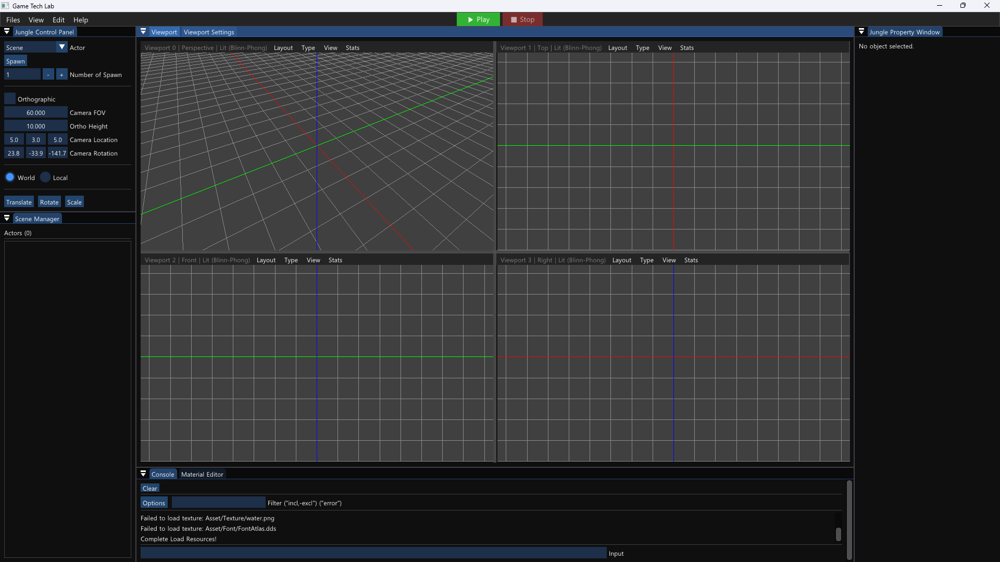
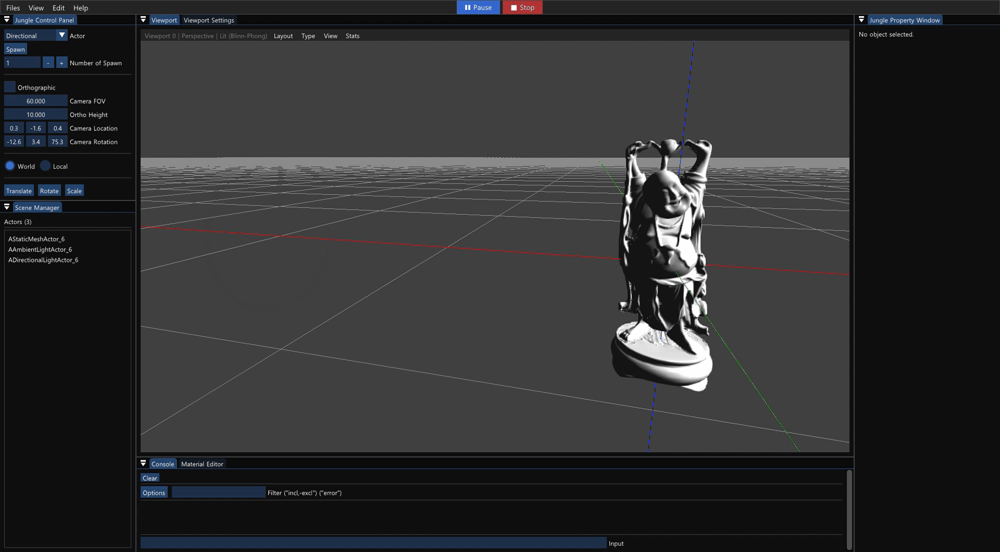
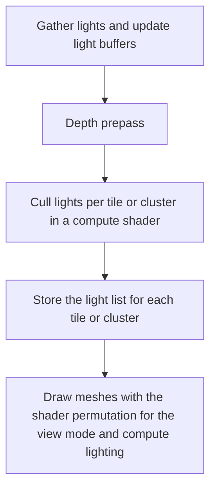

# 💡 KRAFTON Jungle game tech Lab - Week 7

[한국어](./README.md) | **English**

***Let There Be Light***

2026.04.16. ~ 2026.04.23.

Team 8: 장민준([@nacho2407](https://github.com/nacho2407)), 김형준([@Rocketstein](https://github.com/Rocketstein)), 한영서([@persona6whenrelease](https://github.com/persona6whenrelease)), 국동진([@puter2712git](https://github.com/puter2712git))





We added **four kinds of lights**, an **Uber shader** that switches between lighting models, and **normal mapping** to the 3D editor. To compute only the lights that affect each pixel even when there are many lights, a compute shader performs **Tiled and Clustered light culling**.


## 🎮 Week Overview

- Placing one of four kinds of **light actors**, ambient, directional, point, and spot, lights the scene with Forward Shading, which computes the lights right in the shader that draws the meshes. Each light has a color and an intensity, point and spot lights set their reach with an attenuation radius and a falloff exponent, and spot lights also use inner and outer cone angles

- One shader file splits the **Gouraud, Lambert, and Blinn-Phong** lighting models and the use of a normal map with macros, and the needed combinations are compiled as shader permutations. The lighting model and view mode can be changed per viewport, and editing a shader file recompiles it at runtime

- After a depth prepass, a compute shader divides the screen into 16x16 pixel tiles and keeps only the point and spot lights that affect each tile. The Clustered method, which further splits tiles along depth, and computing all lights without culling can also be chosen, and the Heatmap view mode shows how many lights each tile computes


## ✨ Features

- **Light Actors**

  Pick `Ambient`, `Directional`, `Point`, or `Spotlight` from the Actor list in the Jungle Control Panel to place a light, and change the color, intensity, attenuation radius, falloff exponent, and cone angles in the properties panel. Light icons are tinted with the light color

- **Light Range Display**

  Select a light and turn on `Bounding Volume` under Show in the Viewport Settings window, and a directional light is drawn as a direction arrow, a point light as its attenuation radius, and a spot light as its inner and outer cones in lines

- **Lighting Models**

  Choose `Lit (Gouraud)`, `Lit (Lambert)`, `Lit (Blinn-Phong)`, or `Unlit` from View in the viewport menu. Gouraud computes lighting per vertex, Lambert and Blinn-Phong per pixel, and Blinn-Phong adds a specular highlight computed with the half vector

- **Normal Mapping**

  The normal map set with `map_Bump` in a Wavefront OBJ material file is read, tangents are computed per vertex when the mesh is loaded, and the normal map directions are turned into world normals. The `Normal` view mode under View shows the world normals as colors

- **Light Culling**

  Choose `Clustered`, `Tiled`, or `None (All Lights)` from Light Culling under View. The `Heatmap` view mode shows how many lights each tile or cluster computes as colors

- **Runtime Shader Recompilation**

  The `Shaders/` folder is watched, and when a shader file changes, that shader is recompiled and applied right away


## 👥 Team

| Member | Responsibilities |
|------|------------------------|
| **장민준**([@nacho2407](https://github.com/nacho2407)) | Lighting and editor bug fixes - light actors, lighting models based on shader permutations, point and spot lights, decal lighting, normal mapping, light range display, resource path normalization, clearing the selection on actor deletion, material save paths, multi-viewport dragging |
| **김형준**([@Rocketstein](https://github.com/Rocketstein)) | Lighting - light components, Uber shader and lighting models(Gouraud, Lambert, Blinn-Phong), normal mapping, depth prepass and compute shader light culling(Tiled, Clustered), structured buffer for decal data |
| **한영서**([@persona6whenrelease](https://github.com/persona6whenrelease)) | Lighting |
| **국동진**([@puter2712git](https://github.com/puter2712git)) | Lighting - shader permutations and automatic input layout generation, runtime shader recompilation, light buffers and gathering, light culling pass, light range display and icon colors, view modes(Unlit, Normal, Heatmap), serialization, Uber decal shader |


## 🧑‍💻 Work Details

### Lighting

- **Goal**

  Implement four kinds of lights, three lighting models, and normal mapping with Forward Shading, computing the lighting right inside the shader that draws the meshes

- **Implementation**

  Ambient and directional lights are passed in a previously unused constant buffer slot(b3), point and spot lights in two structured buffers, and light actors were added to the actor list. A key that packs the lighting model(Unlit, Lambert, Blinn-Phong, Gouraud) and the use of a normal map into bits selects the **shader permutation**, and a missing combination falls back to the default permutation. Gouraud computes only the lighting value without albedo in the vertex shader and multiplies it by the texture color in the pixel shader

  Point lights apply the falloff exponent to the ratio of distance to radius, and spot lights also multiply in an attenuation that fades smoothly between the inner and outer cones. The same lighting functions are applied to decals as well. Spot light angles are clamped to 0 ~ 180 degrees and the outer angle never gets smaller than the inner one, the light ranges are drawn as lines, and light icons are tinted with the light color

  **Normal mapping** computes the tangent and bitangent of each triangle when a Wavefront OBJ is loaded, accumulates them on the vertices, and also stores the sign of the tangent direction. The pixel shader re-orthogonalizes the tangent against the normal, corrects the coordinate system that flips under negative scale with the sign of the model matrix determinant, and then turns the normal map directions into world normals


### Editor Bug Fixes

- **Goal**

  Fix editor bugs that came up during development so that resource paths, actor deletion, material saving, and multi-viewport controls stay consistent

- **Implementation**

  The resource manager normalizes the paths of meshes, shaders, compute shaders, and the mesh cache and handles them relative to the project root, so the same resource is found even when its path is written differently. When an actor is destroyed, the world notifies its listeners and the editor removes that actor from the selection and the properties panel. When the active world changes, the listener moves to the new world as well

  Mesh and decal components now save material instances by their normalized file path instead of their name, so the materials are found when the scene is loaded again. In multiple viewports, the viewport where a right-click or wheel drag started is remembered so that control does not pass to another viewport until the mouse is released, and drags that start in the UI do not control the viewport. The billboard shader discarded pixels by looking only at the red channel, and this was changed to use alpha and a black background so that the empty parts of billboards no longer cover the grid

- **Related Code**

  [`Source/Engine/Core/ResourceManager.cpp`](./Source/Engine/Core/ResourceManager.cpp), [`Source/Editor/EditorEngine.cpp`](./Source/Editor/EditorEngine.cpp), [`Source/Engine/GameFramework/World.cpp`](./Source/Engine/GameFramework/World.cpp), [`Source/Engine/Component/MeshComponent.cpp`](./Source/Engine/Component/MeshComponent.cpp), [`Source/Editor/Viewport/ViewportLayout.cpp`](./Source/Editor/Viewport/ViewportLayout.cpp), [`Shaders/ShaderSubUV.hlsl`](./Shaders/ShaderSubUV.hlsl)


## 🛠️ Tech Stack

- **Language**: C++20

- **Graphics API**: DirectX 11

- **Build**: Visual Studio 2026, MSBuild

- **Libraries**: Dear ImGui, DirectX Tool Kit for DirectX 11, SimpleJSON


## 🖥️ Architecture



- Flow

    1. The lights in the scene are gathered, ambient and directional lights into a constant buffer and point and spot lights into a structured buffer

    2. A depth prepass draws the depth of opaque meshes first

    3. A compute shader keeps the lights that affect each tile or cluster and records the light index list along with the start position and count for each tile

    4. The opaque pass draws the meshes with the shader permutation for the view mode and computes only the lights of the tile or cluster the pixel belongs to


## 📁 Directory Structure

```
week07/
├── week07.sln              // Solution
├── Asset/                  // Materials, meshes, scenes, textures
├── Docs/                   // README media
├── Shaders/                // HLSL shaders
├── Source/                 // Entry point
│   ├── Editor/             // Editor engine, render pipeline, and utilities
│   │   ├── Selection/      // Selection management
│   │   ├── Settings/       // Editor settings
│   │   ├── UI/             // Editor widgets
│   │   └── Viewport/       // Viewports, camera, and layout
│   ├── Engine/
│   │   ├── Asset/          // Asset loaders and static meshes
│   │   ├── Collision/      // Ray collision
│   │   ├── Component/      // Components
│   │   ├── Core/           // Common types, containers, logging, and paths
│   │   ├── GameFramework/  // Actors, level, and world
│   │   ├── Geometry/       // AABB, OBB, frustum, and plane
│   │   ├── Input/          // Input and controllers
│   │   ├── Math/           // Vectors, matrices, quaternions, and colors
│   │   ├── Object/         // Object system
│   │   ├── Render/         // Renderer and render passes
│   │   ├── Runtime/        // Engine loop, window, and viewports
│   │   ├── Serialization/  // JSON reading and writing, scene saving
│   │   ├── Slate/          // Splitters and viewport widgets
│   │   └── Spatial/        // BVH and k-d tree
│   └── Misc/
│       └── ObjViewer/      // OBJ viewer
└── ThirdParty/             // Dear ImGui, SimpleJSON
```


## ❓ Build and Run

### Running the Release Build

1. Run `week07.exe`

- Requirements

    - Windows 10 / 11(x64)

    - A GPU that supports DirectX 11

    - Microsoft Visual C++ Redistributable(x64)

- Notes

    - Some assets could not be included because of license issues, so the following items may be missing or displayed differently

        - Text of actor UUIDs and text render components

        - Icons of light, decal, and billboard actors

        - SubUV particles

        - Texture of the default decal material

        - Mesh of the fireball actor


### Building from Source

- Requirements

    - Windows 10 / 11(x64)

    - Visual Studio 2026(Desktop development with C++)

    - MSVC v143 build tools

    - Windows SDK

1. Open `week07/week07.sln`

2. Set the configuration to `Release` and the platform to `x64`

3. Build and run

- Notes

    - Some assets could not be included because of license issues, so the following items may be missing or displayed differently

        - Text of actor UUIDs and text render components

        - Icons of light, decal, and billboard actors

        - SubUV particles

        - Texture of the default decal material

        - Mesh of the fireball actor


## ⌨️ Shortcuts

| Shortcut | Action |
|--------|------|
| **Space** | Cycle the gizmo mode(move, rotate, scale) |
| **X** | Switch the gizmo space(world, local) |
| **F** | Move the camera toward the selected actor |
| **Ctrl + A** | Select all actors |
| **Ctrl + Alt + Drag** | Box select(hold Shift as well to add to the current selection) |
| **Ctrl + D** | Duplicate the selected actors |
| **Delete** | Delete the selected actors |
| **Ctrl + N / Ctrl + O / Ctrl + S** | New scene, open scene, save scene |
| **\`** | Move to the console input |
| **← / → / ↑ / ↓** | Rotate the camera in a perspective viewport |
| **Esc** | End PIE |
| **F4** | Release the mouse cursor during PIE(press again to capture it) |


## 📄 Third-Party Libraries

| Name | Author | Version | License |
|------|--------|------|----------|
| **[Dear ImGui](https://github.com/ocornut/imgui)** | Omar Cornut | 1.92.7 WIP | [MIT License](./ThirdParty/ImGui/LICENSE.txt) |
| **[DirectX Tool Kit for DirectX 11](https://github.com/microsoft/DirectXTK)** | Microsoft Corporation. | - | MIT License |
| **[SimpleJSON](https://github.com/nbsdx/SimpleJSON)** | Neil | - | Do What the Fuck You Want to Public License |


## 🎨 Third-Party Assets

| Name | Author | License |
|------|--------|----------|
| **[3d-cubes](https://github.com/garykac/3d-cubes)** | Gary Kac | - |
| **[Dragon](https://graphics.stanford.edu/data/3Dscanrep/)** | Stanford University Computer Graphics Laboratory | - |
| **[Happy Buddha](https://graphics.stanford.edu/data/3Dscanrep/)** | Stanford University Computer Graphics Laboratory | - |
| **[Stanford Bunny](https://graphics.stanford.edu/data/3Dscanrep/)** | Stanford University Computer Graphics Laboratory | - |


## ⚖️ License

The portions of this week's code written by Jang Minjun are released under the MIT License, and the rights to the portions written by other contributors belong to their respective contributors. See [LICENSE](../LICENSE) for details.
