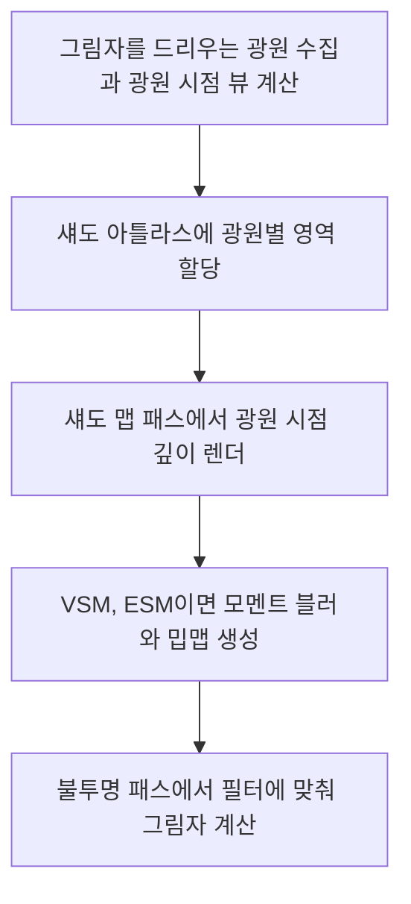

# 🌗 크래프톤 정글 게임테크랩 8주차

**한국어** | [English](./README_en.md)

***빛이 있으면 그림자도 있다***

2026.04.23. ~ 2026.04.30.

4팀: 장민준([@nacho2407](https://github.com/nacho2407)), 김태현([@MozziDog](https://github.com/MozziDog)), 이준협([@JunHyeop3631](https://github.com/JunHyeop3631)), 김연하([@Yonaim](https://github.com/Yonaim))


3D 에디터의 광원에 **그림자**를 더했습니다. 디렉셔널, 포인트, 스포트 라이트의 섀도 맵을 하나의 **섀도 아틀라스**에 모아 그리고, 디렉셔널 라이트의 섀도 맵 방식은 **Standard, PSM, Cascade** 중에서, 그림자 가장자리는 **PCF, VSM, ESM** 필터 중에서 고릅니다.


## 🎮 주차 소개

- 광원 시점에서 장면의 깊이를 그린 섀도 맵으로 그림자를 만드는 **Shadow Mapping**을 구현했습니다. 디렉셔널, 포인트, 스포트 라이트가 그림자를 드리우고, 포인트 라이트는 월드 축 방향 6면, 스포트 라이트는 원뿔을 원근 투영으로 그립니다. 광원마다 그림자 여부와 해상도, Depth, Slope, Normal Bias를 정해 Shadow Acne와 Peter Panning을 줄입니다

- 디렉셔널 라이트는 장면 전체를 담는 **Standard**, 카메라의 원근 공간에서 섀도 맵을 만들어 카메라 가까이에 해상도를 몰아 주는 **PSM**, 시야 거리를 최대 4구간으로 나눠 구간마다 섀도 맵을 두는 **Cascade Shadow Map** 중에서 고릅니다

- 모든 섀도 맵은 4096x4096 크기의 **섀도 아틀라스**에 나눠 담습니다. 광원마다 256 ~ 4096의 해상도 단계만큼 영역을 받고, 자리가 모자라면 교체 정책에 따라 해상도를 낮추거나 다른 광원의 영역을 비웁니다. 그림자 가장자리는 PCF로 여러 번 비교하거나, VSM과 ESM의 모멘트를 흐려 부드럽게 만듭니다


## ✨ 구현 결과

- **그림자 속성**

  광원을 선택하면 Details 창의 Shadow 절에서 `Cast Shadows`, `Shadow Resolution`, `Depth Bias`, `Slope Bias`, `Normal Bias`, `Shadow Sharpen`, `ESM Exponent`를 바꿉니다. 디렉셔널 라이트는 `Cascade Count`와 `Cascade Distribution`으로 캐스케이드 수와 구간 분할을 정합니다

- **섀도 맵 방식**

  뷰포트 툴바의 Shadows에서 `Map Method`를 고르거나, 콘솔에 `shadow_mode STANDARD | PSM | CASCADE`를 입력해 디렉셔널 라이트의 섀도 맵 방식을 바꿉니다

- **그림자 필터**

  Shadows의 `Filter`나 콘솔 `shadow_filter NONE | PCF | VSM | ESM`으로 필터를 바꿉니다. VSM과 ESM은 모멘트를 흐리고 밉맵을 만들어 가장자리를 부드럽게 하고, `Shadow Sharpen`과 `ESM Exponent`로 가장자리의 선명도를 조절합니다

- **섀도 아틀라스**

  Windows 메뉴의 Shadow Atlas 창에서 페이지와 슬라이스마다 어느 광원이 어떤 해상도로 자리를 차지했는지 보고, 깊이와 모멘트를 미리 봅니다. Shadows의 `Eviction Policy`에서 자리가 모자랄 때의 정책(`Prefer Downgrade`, `Prefer Eviction`, `Downgrade Only`)을 고릅니다

- **섀도 맵 미리보기**

  광원을 선택하면 Details 창의 `Shadow Map Preview`에서 그 광원의 섀도 맵을 봅니다. 디렉셔널 라이트는 캐스케이드마다, 포인트 라이트는 6면마다 골라 봅니다

- **광원 시점으로 보기**

  뷰포트 툴바의 Pilot 메뉴나 액터를 우클릭한 메뉴에서 광원을 고르면 뷰포트 카메라가 그 광원의 위치와 방향으로 옮겨 갑니다. 파일럿하는 동안 카메라를 움직이면 광원도 함께 움직이고, `Stop Piloting Actor`로 원래 시점에 돌아옵니다

- **그림자 통계**

  Stat 메뉴나 콘솔 `stat shadow`로 섀도 아틀라스의 메모리, 페이지와 슬라이스 사용량, 광원 종류별 그림자 수를 뷰포트에 띄웁니다

- **로그 콘솔**

  Console 창에서 Verbose, Debug, Info, Warning, Error 다섯 단계로 로그를 거르고 검색합니다


## 👥 팀원 및 담당 파트

| 팀원 | 담당 파트 및 주요 역할 |
|------|------------------------|
| **장민준**([@nacho2407](https://github.com/nacho2407)) | 에디터 입력 - 입력 스냅샷과 뷰포트 입력 라우터, 뷰포트 입력 컨트롤러와 입력 도구(명령, 기즈모, 선택, 내비게이션, 컨텍스트 메뉴), ImGui 입력 캡처, PIE 키 입력, 삭제 키, 다중 선택과 전체 선택 |
| **김태현**([@MozziDog](https://github.com/MozziDog)) | 섀도 맵 - 섀도 맵 렌더링, 2D 섀도 맵과 큐브 맵 분리, 디렉셔널 라이트 뷰 프러스텀 맞춤, Shadow Bias, PSM, 섀도 맵 방식 전환, Cascade Shadow Map(구간 분할, 캐스케이드 블렌딩) |
| **이준협**([@JunHyeop3631](https://github.com/JunHyeop3631)) | 그림자 필터 - PCF, VSM과 모멘트 블러, ESM, Shadow Sharpen과 ESM 지수, 섀도 맵 해상도 저장과 불러오기, 시연 씬 |
| **김연하**([@Yonaim](https://github.com/Yonaim)) | 렌더러와 섀도 아틀라스 - 렌더러와 셰이더 재구성, Forward 렌더 파이프라인, 섀도 아틀라스와 교체 정책, 해상도 단계, 섀도 아틀라스 창, 섀도 맵 미리보기, 파일럿 모드, 셰이더 캐시, 로그 시스템 |


## 🧑‍💻 담당 작업 상세

### 에디터 입력 시스템

- **목표**

  뷰포트 클라이언트 안에 섞여 있던 키보드와 마우스 처리를 단계별로 나눠, 여러 뷰포트와 ImGui 창이 함께 있는 에디터에서 입력이 알맞은 곳으로만 가게 합니다

- **구현 내용**

  입력은 세 단계로 흐릅니다. 입력 시스템이 매 프레임 키와 마우스 상태를 스냅샷으로 모으면, **뷰포트 입력 라우터**가 포인터와 휠 입력은 마우스 아래의 뷰포트에, 키 입력은 활성 뷰포트에 이벤트로 나눠 보냅니다. 마우스 버튼을 누른 뷰포트는 모든 버튼을 뗄 때까지 입력을 붙잡아, 드래그 중에 커서가 다른 뷰포트로 넘어가도 조작이 바뀌지 않습니다. ImGui 창이 마우스나 키보드를 쓰는 동안에는 뷰포트로 입력을 보내지 않고, 키를 누르고 있으면 0.35초 뒤부터 0.05초마다 반복 이벤트를 만듭니다

  뷰포트마다 있는 **입력 컨트롤러**가 받은 이벤트를 한 프레임의 입력(누름, 뗌, 누르고 있음, 마우스 이동량, 휠)으로 모으고, 명령, 기즈모, 컨텍스트 메뉴, 선택, 내비게이션 도구에 차례로 넘겨 먼저 처리한 도구에서 멈춥니다. 그래서 기즈모를 잡고 있는 동안에는 선택이 바뀌지 않고, `Ctrl + A`나 `Ctrl + D`를 누를 때 카메라가 움직이지 않습니다. 명령 도구는 삭제, 전체 선택, 복제, 기즈모 모드 전환, PIE 종료를 맡고, 컨텍스트 메뉴 도구는 드래그 없이 뗀 우클릭을 파일럿 메뉴 요청으로 바꿉니다

  이 구조로 옮기면서 PIE 뷰포트가 키 입력을 받지 못하던 문제, 여러 버튼을 함께 누를 때 마우스 캡처가 풀리던 문제, ImGui 입력 중에 카메라가 움직이던 문제를 고쳤습니다

- **관련 코드**

  [`Source/Engine/Input/InputTypes.h`](./Source/Engine/Input/InputTypes.h), [`Source/Engine/Input/ViewportInputRouter.cpp`](./Source/Engine/Input/ViewportInputRouter.cpp), [`Source/Editor/Input/EditorViewportInputController.cpp`](./Source/Editor/Input/EditorViewportInputController.cpp), [`Source/Editor/Input/EditorViewportCommandTool.cpp`](./Source/Editor/Input/EditorViewportCommandTool.cpp), [`Source/Editor/Input/EditorGizmoTool.cpp`](./Source/Editor/Input/EditorGizmoTool.cpp), [`Source/Editor/Input/EditorSelectionTool.cpp`](./Source/Editor/Input/EditorSelectionTool.cpp), [`Source/Editor/Input/EditorNavigationTool.cpp`](./Source/Editor/Input/EditorNavigationTool.cpp), [`Source/Editor/Input/EditorViewportContextMenuTool.cpp`](./Source/Editor/Input/EditorViewportContextMenuTool.cpp)


## 🛠️ 기술 스택

- **Language**: C++20

- **Graphics API**: DirectX 11

- **Build**: Visual Studio 2026, MSBuild

- **Libraries**: Dear ImGui, DirectX Tool Kit for DirectX 11, SimpleJSON


## 🖥️ 구조



- 동작 흐름

    1. 그림자를 드리우는 광원을 모아 광원 시점의 뷰를 만듭니다. 디렉셔널 라이트는 고른 방식(Standard, PSM, Cascade)으로, 포인트 라이트는 월드 축 방향 6면으로, 스포트 라이트는 원뿔을 담는 원근 투영으로 만듭니다

    2. 광원마다 해상도 단계만큼 섀도 아틀라스의 영역을 할당합니다. 자리가 모자라면 교체 정책에 따라 해상도를 낮추거나, 광원 종류, 세기, 반경 등으로 매긴 점수가 더 낮은 광원의 영역을 비웁니다

    3. 섀도 맵 패스가 할당받은 영역에 광원 시점의 깊이를 그립니다. VSM, ESM 필터에서는 모멘트를 함께 기록하고 흐린 뒤 밉맵을 만듭니다

    4. 불투명 패스가 픽셀의 위치를 광원 시점으로 옮겨, 고른 필터(None, PCF, VSM, ESM)로 그림자를 계산합니다


## 📁 디렉토리 구조

```
week08/
├── week08.sln              // 솔루션
├── Asset/                  // 재질, 메시, 씬, 프로그램 아이콘
├── Docs/                   // README 미디어
├── Settings/               // 리소스 목록
├── Shaders/                // HLSL 셰이더
├── Source/                 // 진입점
│   ├── Editor/             // 에디터 엔진
│   │   ├── Input/          // 뷰포트 입력 컨트롤러와 입력 도구
│   │   ├── Logging/        // 콘솔 로그 버퍼
│   │   ├── PIE/            // PIE 타입
│   │   ├── Selection/      // 선택 관리
│   │   ├── Settings/       // 에디터 설정
│   │   ├── Subsystem/      // 오버레이 통계
│   │   ├── UI/             // 에디터 위젯과 섀도 아틀라스 창
│   │   └── Viewport/       // 뷰포트와 레이아웃
│   ├── Engine/
│   │   ├── Collision/      // 레이 판정, BVH, 옥트리
│   │   ├── Component/      // 컴포넌트
│   │   ├── Core/           // 공통 타입, 틱, 로그
│   │   ├── GameFramework/  // 액터, 레벨, 월드
│   │   ├── Input/          // 입력 수집과 뷰포트 입력 라우터
│   │   ├── Materials/      // 재질
│   │   ├── Math/           // 벡터, 행렬, 쿼터니언
│   │   ├── Mesh/           // Wavefront OBJ 가져오기와 정적 메시
│   │   ├── Object/         // 객체 시스템
│   │   ├── Platform/       // 경로와 크래시 덤프
│   │   ├── Profiling/      // 통계와 GPU 프로파일링
│   │   ├── Render/         // 렌더 파이프라인, 섀도 아틀라스, 컬링
│   │   ├── Resource/       // 리소스 관리
│   │   ├── Runtime/        // 엔진 루프와 창
│   │   ├── Serialization/  // 씬 저장과 불러오기
│   │   ├── Texture/        // 텍스처
│   │   ├── UI/             // 스플리터와 창 위젯
│   │   └── Viewport/       // 뷰포트
│   └── ObjViewer/          // OBJ 뷰어
└── ThirdParty/             // Dear ImGui, SimpleJSON
```


## ❓ 빌드 및 실행

### 릴리즈 실행

1. `week08.exe` 실행

- 실행 환경

    - Windows 10 / 11(x64)

    - DirectX 11을 지원하는 GPU

    - Microsoft Visual C++ 재배포 가능 패키지(x64)

- 참고

    - 라이선스 문제로 인해 일부 에셋을 포함하지 못해, 아래 항목이 표시되지 않거나 다르게 표시될 수 있습니다

        - 액터 UUID와 텍스트 렌더 컴포넌트의 글자

        - 광원, 데칼, 높이 안개 액터의 빌보드 아이콘

        - 뷰포트 레이아웃 버튼의 아이콘

        - PIE 버튼의 아이콘

        - 벽돌 재질의 텍스처


### 소스 빌드

- 요구 사항

    - Windows 10 / 11(x64)

    - Visual Studio 2026(C++를 사용한 데스크톱 개발)

    - MSVC v143 빌드 도구

    - Windows SDK

1. `week08/week08.sln` 열기

2. 구성을 `Release`, 플랫폼을 `x64`로 선택

3. 빌드 후 실행

- 참고

    - 라이선스 문제로 인해 일부 에셋을 포함하지 못해, 아래 항목이 표시되지 않거나 다르게 표시될 수 있습니다

        - 액터 UUID와 텍스트 렌더 컴포넌트의 글자

        - 광원, 데칼, 높이 안개 액터의 빌보드 아이콘

        - 뷰포트 레이아웃 버튼의 아이콘

        - PIE 버튼의 아이콘

        - 벽돌 재질의 텍스처


## ⌨️ 단축키

| 단축키 | 동작 |
|--------|------|
| **Space** | 기즈모 모드 순환(이동, 회전, 크기) |
| **Ctrl + 클릭** | 액터를 선택에 더하거나 선택에서 빼기 |
| **Ctrl + A** | 모든 액터 선택 |
| **Ctrl + D** | 선택한 액터 복제 |
| **Delete** | 선택한 액터 삭제 |
| **우클릭** | 액터 위에서 드래그 없이 떼면 파일럿 메뉴 열기 |
| **← / → / ↑ / ↓** | 원근 뷰포트에서 카메라 회전 |
| **Shift + 클릭** | Scene Manager 목록에서 액터를 선택에 더하거나 선택에서 빼기 |
| **↑ / ↓** | 콘솔 입력창에서 이전에 입력한 명령 불러오기 |
| **Tab** | 콘솔 입력창에서 명령 이름 자동 완성 |
| **Esc** | PIE 종료 |


## 📄 서드파티 라이브러리

| 이름 | 저작자 | 버전 | 라이선스 |
|------|--------|------|----------|
| **[Dear ImGui](https://github.com/ocornut/imgui)** | Omar Cornut | 1.92.7 WIP | [MIT License](./ThirdParty/ImGui/LICENSE.txt) |
| **[DirectX Tool Kit for DirectX 11](https://github.com/microsoft/DirectXTK)** | Microsoft Corporation. | - | MIT License |
| **[SimpleJSON](https://github.com/nbsdx/SimpleJSON)** | Neil | - | Do What the Fuck You Want to Public License |


## 🎨 서드파티 에셋

| 이름 | 저작자 | 라이선스 |
|------|--------|----------|
| **[3d-cubes](https://github.com/garykac/3d-cubes)** | Gary Kac | - |
| **[Solar System animation](https://sketchfab.com/3d-models/solar-system-animation-b7c69a6b655b47c99f871d5ec5aee854)** | Samer_Arab_S5 | [Creative Commons Attribution 4.0 International](https://creativecommons.org/licenses/by/4.0/) |
| **[Solar Textures](https://www.solarsystemscope.com/textures/)** | Solar System Scope | [Creative Commons Attribution 4.0 International](https://creativecommons.org/licenses/by/4.0/) |


## ⚖️ 라이선스

이 주차의 코드 중 장민준이 작성한 부분은 MIT 라이선스로 공개하며, 다른 기여자가 작성한 부분의 권리는 각 기여자에게 있습니다. 자세한 내용은 [LICENSE](../LICENSE)를 확인해 주세요.
