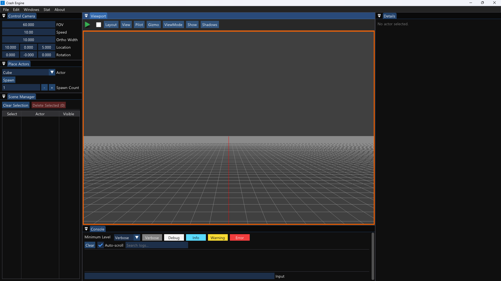
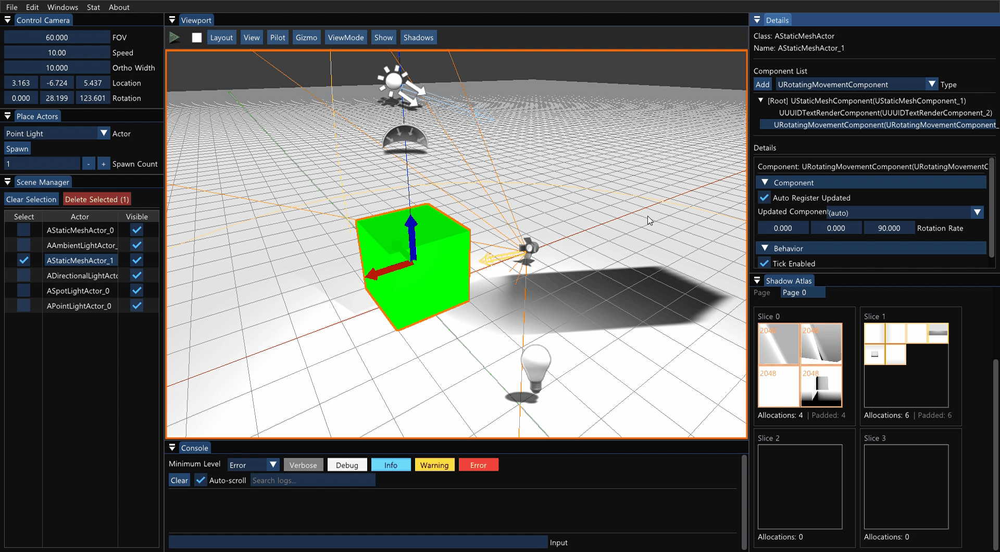
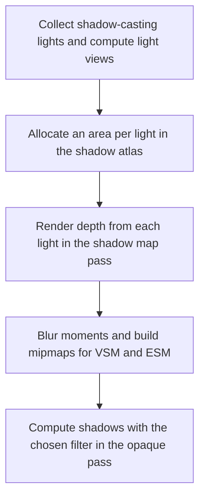

# 🌗 KRAFTON Jungle game tech Lab - Week 8

[한국어](./README.md) | **English**

***Where There Is Light, There Is Also Shadow***

2026.04.23. ~ 2026.04.30.

Team 4: 장민준([@nacho2407](https://github.com/nacho2407)), 김태현([@MozziDog](https://github.com/MozziDog)), 이준협([@JunHyeop3631](https://github.com/JunHyeop3631)), 김연하([@Yonaim](https://github.com/Yonaim))





We added **shadows** to the lights of the 3D editor. The shadow maps of directional, point, and spot lights are drawn together into one **shadow atlas**, the shadow map method of directional lights is chosen from **Standard, PSM, and Cascade**, and the shadow edges are filtered with one of **PCF, VSM, and ESM**.


## 🎮 Week Overview

- We implemented **Shadow Mapping**, which makes shadows from shadow maps that hold the scene depth drawn from each light's point of view. Directional, point, and spot lights cast shadows, point lights draw six faces along the world axes, and spot lights draw their cone with a perspective projection. Each light sets whether it casts shadows, its resolution, and its Depth, Slope, and Normal Bias to reduce Shadow Acne and Peter Panning

- Directional lights choose from **Standard**, which covers the whole scene, **PSM**, which builds the shadow map in the camera's perspective space to concentrate resolution near the camera, and **Cascade Shadow Map**, which splits the view distance into up to four ranges with a shadow map for each

- All shadow maps are packed into a 4096x4096 **shadow atlas**. Each light gets an area of its resolution tier from 256 to 4096, and when space runs out, the eviction policy either lowers resolutions or frees the areas of other lights. Shadow edges are softened by comparing several times with PCF or by blurring the moments of VSM and ESM


## ✨ Features

- **Shadow Properties**

  Selecting a light shows `Cast Shadows`, `Shadow Resolution`, `Depth Bias`, `Slope Bias`, `Normal Bias`, `Shadow Sharpen`, and `ESM Exponent` in the Shadow section of the Details window. Directional lights also set the number of cascades and how the ranges are split with `Cascade Count` and `Cascade Distribution`

- **Shadow Map Methods**

  Choose `Map Method` under Shadows in the viewport toolbar, or enter `shadow_mode STANDARD | PSM | CASCADE` in the console, to change the shadow map method of directional lights

- **Shadow Filters**

  Change the filter with `Filter` under Shadows or with the console command `shadow_filter NONE | PCF | VSM | ESM`. VSM and ESM blur the moments and build mipmaps to soften the edges, and `Shadow Sharpen` and `ESM Exponent` adjust how sharp the edges are

- **Shadow Atlas**

  The Shadow Atlas window in the Windows menu shows which light takes up space at which resolution in each page and slice, and previews the depth and moments. `Eviction Policy` under Shadows chooses what to do when space runs out(`Prefer Downgrade`, `Prefer Eviction`, `Downgrade Only`)

- **Shadow Map Preview**

  Selecting a light shows its shadow map in `Shadow Map Preview` of the Details window. Directional lights can be viewed per cascade, and point lights per face

- **Viewing from a Light**

  Choosing a light from the Pilot menu in the viewport toolbar or from the right-click menu on an actor moves the viewport camera to the light's position and direction. Moving the camera while piloting moves the light with it, and `Stop Piloting Actor` returns to the original view

- **Shadow Stats**

  The Stat menu or the console command `stat shadow` shows the shadow atlas memory, page and slice usage, and the number of shadows per light type in the viewport

- **Log Console**

  The Console window filters logs by five levels, Verbose, Debug, Info, Warning, and Error, and searches them


## 👥 Team

| Member | Responsibilities |
|------|------------------------|
| **장민준**([@nacho2407](https://github.com/nacho2407)) | Editor input - input snapshot and viewport input router, viewport input controller and input tools(command, gizmo, selection, navigation, context menu), ImGui input capture, PIE key input, Delete key, multiple selection and select all |
| **김태현**([@MozziDog](https://github.com/MozziDog)) | Shadow maps - shadow map rendering, separation of 2D shadow maps and cube maps, fitting the directional light view frustum, Shadow Bias, PSM, switching shadow map methods, Cascade Shadow Map(range splitting, cascade blending) |
| **이준협**([@JunHyeop3631](https://github.com/JunHyeop3631)) | Shadow filters - PCF, VSM and moment blur, ESM, Shadow Sharpen and ESM exponent, saving and loading shadow map resolutions, demo scenes |
| **김연하**([@Yonaim](https://github.com/Yonaim)) | Renderer and shadow atlas - renderer and shader restructuring, Forward render pipeline, shadow atlas and eviction policy, resolution tiers, Shadow Atlas window, shadow map preview, pilot mode, shader cache, logging system |


## 🧑‍💻 Work Details

### Editor Input System

- **Goal**

  Split the keyboard and mouse handling that was mixed into the viewport client into stages, so that input goes only where it belongs in an editor with several viewports and ImGui windows

- **Implementation**

  Input flows through three stages. The input system collects the key and mouse state into a snapshot every frame, and the **viewport input router** sends pointer and wheel input to the viewport under the mouse and key input to the active viewport as events. The viewport where a mouse button was pressed holds the input until all buttons are released, so the operation does not change even when the cursor moves into another viewport while dragging. While an ImGui window uses the mouse or keyboard, no input is sent to the viewports, and a held key produces repeat events every 0.05 seconds after 0.35 seconds

  The **input controller** of each viewport gathers the received events into one frame of input(pressed, released, held, mouse movement, wheel) and passes it to the command, gizmo, context menu, selection, and navigation tools in order, stopping at the first tool that handles it. So the selection does not change while the gizmo is held, and the camera does not move when `Ctrl + A` or `Ctrl + D` is pressed. The command tool handles deleting, selecting all, duplicating, switching the gizmo mode, and ending PIE, and the context menu tool turns a right-click released without dragging into a pilot menu request

  While moving to this structure, we fixed the PIE viewport not receiving key input, the mouse capture being released when several buttons were pressed together, and the camera moving during ImGui input

- **Related Code**

  [`Source/Engine/Input/InputTypes.h`](./Source/Engine/Input/InputTypes.h), [`Source/Engine/Input/ViewportInputRouter.cpp`](./Source/Engine/Input/ViewportInputRouter.cpp), [`Source/Editor/Input/EditorViewportInputController.cpp`](./Source/Editor/Input/EditorViewportInputController.cpp), [`Source/Editor/Input/EditorViewportCommandTool.cpp`](./Source/Editor/Input/EditorViewportCommandTool.cpp), [`Source/Editor/Input/EditorGizmoTool.cpp`](./Source/Editor/Input/EditorGizmoTool.cpp), [`Source/Editor/Input/EditorSelectionTool.cpp`](./Source/Editor/Input/EditorSelectionTool.cpp), [`Source/Editor/Input/EditorNavigationTool.cpp`](./Source/Editor/Input/EditorNavigationTool.cpp), [`Source/Editor/Input/EditorViewportContextMenuTool.cpp`](./Source/Editor/Input/EditorViewportContextMenuTool.cpp)


## 🛠️ Tech Stack

- **Language**: C++20

- **Graphics API**: DirectX 11

- **Build**: Visual Studio 2026, MSBuild

- **Libraries**: Dear ImGui, DirectX Tool Kit for DirectX 11, SimpleJSON


## 🖥️ Architecture



- Flow

    1. Shadow-casting lights are collected and their light views are built. Directional lights use the chosen method(Standard, PSM, Cascade), point lights use six faces along the world axes, and spot lights use a perspective projection that contains the cone

    2. Each light is allocated an area of its resolution tier in the shadow atlas. When space runs out, the eviction policy either lowers resolutions or frees the areas of lights with lower scores based on light type, intensity, radius, and so on

    3. The shadow map pass draws the depth from each light's point of view into its allocated area. With the VSM and ESM filters, it also records moments, blurs them, and builds mipmaps

    4. The opaque pass moves each pixel's position into the light's view and computes the shadow with the chosen filter(None, PCF, VSM, ESM)


## 📁 Directory Structure

```
week08/
├── week08.sln              // Solution
├── Asset/                  // Materials, meshes, scenes, program icon
├── Docs/                   // README media
├── Settings/               // Resource list
├── Shaders/                // HLSL shaders
├── Source/                 // Entry point
│   ├── Editor/             // Editor engine
│   │   ├── Input/          // Viewport input controller and input tools
│   │   ├── Logging/        // Console log buffer
│   │   ├── PIE/            // PIE types
│   │   ├── Selection/      // Selection management
│   │   ├── Settings/       // Editor settings
│   │   ├── Subsystem/      // Overlay stats
│   │   ├── UI/             // Editor widgets and Shadow Atlas window
│   │   └── Viewport/       // Viewports and layout
│   ├── Engine/
│   │   ├── Collision/      // Ray tests, BVH, and octree
│   │   ├── Component/      // Components
│   │   ├── Core/           // Common types, ticking, and logging
│   │   ├── GameFramework/  // Actors, level, and world
│   │   ├── Input/          // Input collection and viewport input router
│   │   ├── Materials/      // Materials
│   │   ├── Math/           // Vectors, matrices, and quaternions
│   │   ├── Mesh/           // Wavefront OBJ import and static meshes
│   │   ├── Object/         // Object system
│   │   ├── Platform/       // Paths and crash dumps
│   │   ├── Profiling/      // Stats and GPU profiling
│   │   ├── Render/         // Render pipeline, shadow atlas, and culling
│   │   ├── Resource/       // Resource management
│   │   ├── Runtime/        // Engine loop and window
│   │   ├── Serialization/  // Scene saving and loading
│   │   ├── Texture/        // Textures
│   │   ├── UI/             // Splitter and window widgets
│   │   └── Viewport/       // Viewports
│   └── ObjViewer/          // OBJ viewer
└── ThirdParty/             // Dear ImGui, SimpleJSON
```


## ❓ Build and Run

### Running the Release Build

1. Run `week08.exe`

- Requirements

    - Windows 10 / 11(x64)

    - A GPU that supports DirectX 11

    - Microsoft Visual C++ Redistributable(x64)

- Notes

    - Some assets could not be included because of license issues, so the following items may be missing or displayed differently

        - Text of actor UUIDs and text render components

        - Billboard icons of light, decal, and height fog actors

        - Icons of the viewport layout buttons

        - Icons of the PIE buttons

        - Textures of the brick materials


### Building from Source

- Requirements

    - Windows 10 / 11(x64)

    - Visual Studio 2026(Desktop development with C++)

    - MSVC v143 build tools

    - Windows SDK

1. Open `week08/week08.sln`

2. Set the configuration to `Release` and the platform to `x64`

3. Build and run

- Notes

    - Some assets could not be included because of license issues, so the following items may be missing or displayed differently

        - Text of actor UUIDs and text render components

        - Billboard icons of light, decal, and height fog actors

        - Icons of the viewport layout buttons

        - Icons of the PIE buttons

        - Textures of the brick materials


## ⌨️ Shortcuts

| Shortcut | Action |
|--------|------|
| **Space** | Cycle the gizmo mode(move, rotate, scale) |
| **Ctrl + Click** | Add an actor to or remove it from the selection |
| **Ctrl + A** | Select all actors |
| **Ctrl + D** | Duplicate the selected actors |
| **Delete** | Delete the selected actors |
| **Right-click** | Open the pilot menu when released over an actor without dragging |
| **← / → / ↑ / ↓** | Rotate the camera in a perspective viewport |
| **Shift + Click** | Add an actor to or remove it from the selection in the Scene Manager list |
| **↑ / ↓** | Recall previously entered commands in the console input |
| **Tab** | Complete command names in the console input |
| **Esc** | End PIE |


## 📄 Third-Party Libraries

| Name | Author | Version | License |
|------|--------|------|----------|
| **[Dear ImGui](https://github.com/ocornut/imgui)** | Omar Cornut | 1.92.7 WIP | [MIT License](./ThirdParty/ImGui/LICENSE.txt) |
| **[DirectX Tool Kit for DirectX 11](https://github.com/microsoft/DirectXTK)** | Microsoft Corporation. | - | MIT License |
| **[SimpleJSON](https://github.com/nbsdx/SimpleJSON)** | Neil | - | Do What the Fuck You Want to Public License |


## 🎨 Third-Party Assets

| Name | Author | License |
|------|--------|----------|
| **[3d-cubes](https://github.com/garykac/3d-cubes)** | Gary Kac | - |
| **[Solar System animation](https://sketchfab.com/3d-models/solar-system-animation-b7c69a6b655b47c99f871d5ec5aee854)** | Samer_Arab_S5 | [Creative Commons Attribution 4.0 International](https://creativecommons.org/licenses/by/4.0/) |
| **[Solar Textures](https://www.solarsystemscope.com/textures/)** | Solar System Scope | [Creative Commons Attribution 4.0 International](https://creativecommons.org/licenses/by/4.0/) |


## ⚖️ License

The portions of this week's code written by Jang Minjun are released under the MIT License, and the rights to the portions written by other contributors belong to their respective contributors. See [LICENSE](../LICENSE) for details.
