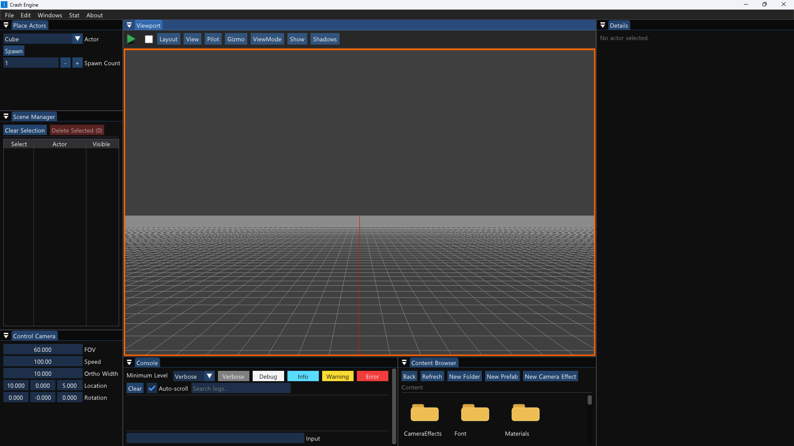
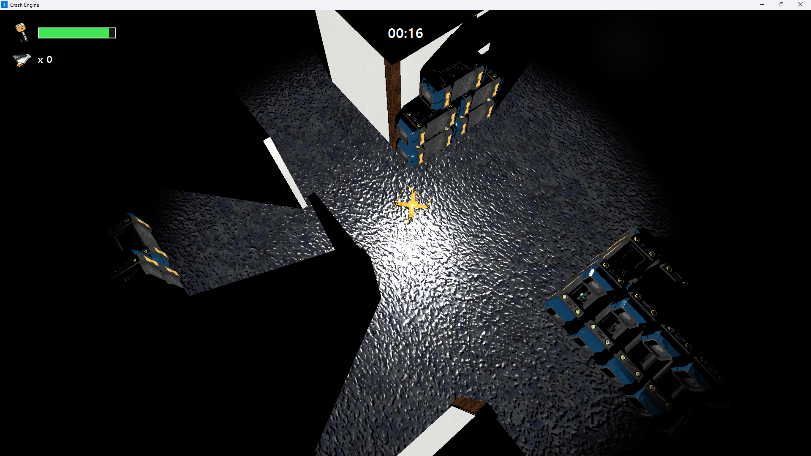
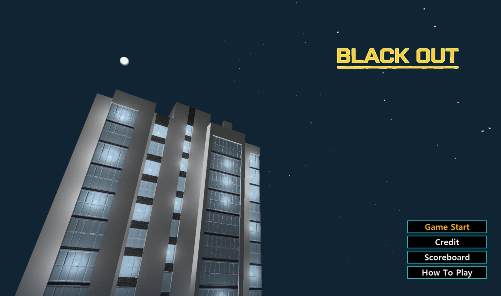
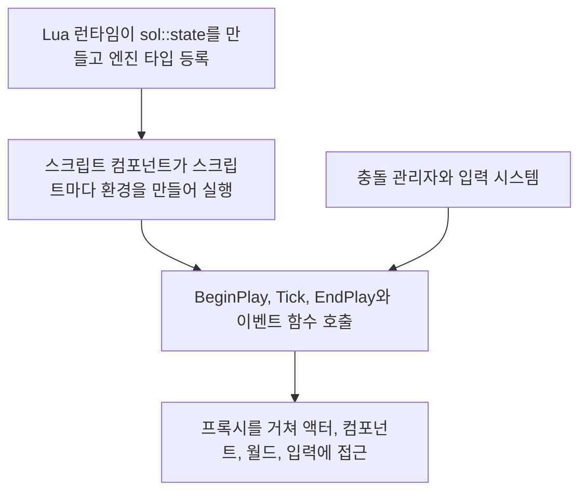

# 🔋 크래프톤 정글 게임테크랩 9주차

**한국어** | [English](./README_en.md)

***3rd Game Jam - 확실히 위임하라: BLACK OUT***

***Light, Camera, Action!***

2026.04.30. ~ 2026.05.07.

8팀: 장민준([@nacho2407](https://github.com/nacho2407)), 오준혁([@JHCard7872](https://github.com/JHCard7872)), 권현수([@kwonhyeonsoo-goo](https://github.com/kwonhyeonsoo-goo)), 이호진([@lois505](https://github.com/lois505))







- [BLACK OUT - Gameplay | Custom C++ & DirectX 11 Engine](https://www.youtube.com/watch?v=z6gPxxjiB1U)

  [](https://www.youtube.com/watch?v=z6gPxxjiB1U)

게임 규칙을 **Lua 스크립트**로 쓰는 3D 게임 **BLACK OUT**을 만들었습니다. 정전된 건물에서 드론을 조종해 포탑과 순찰 드론을 피하며 문서를 모으고, 배터리가 다 닳기 전에 탈출합니다. 여기에 카메라 셰이크, 페이드, 스프링 암 같은 **카메라 연출**과 슬로모, 히트 스톱을 더했습니다.


## 🎮 주차 소개

- 드론을 조종하는 잠입 게임 **BLACK OUT**을 만들었습니다. 드론의 배터리는 체력이자 주변을 밝히는 조명이라, 시간이 지나거나 총알에 맞을수록 화면이 어두워집니다. 배터리를 주워 버티면서 문서를 모으고, 문서를 하나 이상 가진 채 탈출 지점에 닿으면 점수가 매겨집니다

- 게임 로직을 C++ 대신 **Lua 스크립트**로 쓰도록 LuaJIT를 엔진에 붙였습니다. 액터에 스크립트 컴포넌트를 달면 스크립트가 액터와 컴포넌트, 월드, 입력을 다루고, 스크립트를 고쳐 저장하면 실행 중에도 다시 불러옵니다. 충돌은 Box, Sphere, Capsule 컴포넌트의 Overlap과 Hit 이벤트로, 이벤트 전달은 Delegate로 처리합니다

- 플레이어 카메라 매니저에 **카메라 모디파이어**를 쌓아 셰이크, 레터박스, 페이드, 감마 보정, 비네트를 적용하고, 스프링 암과 카메라 전환으로 시점을 부드럽게 옮깁니다. 시간 배율을 바꾸는 슬로모와 히트 스톱, 피격 시 넉백과 스쿼시도 넣었습니다. 에디터 없이 게임만 실행하는 빌드 구성도 따로 만들었습니다


## ✨ 구현 결과

- **BLACK OUT**

  **Bullet Echo**(ZeptoLab, 2020)를 레퍼런스로 삼아, 조명과 그림자를 활용해 플레이어의 시야를 체력과 같은 개념으로 다루는 게임을 만드는 것을 목표로 했습니다

  시작 화면에서 `Game Start`, `Credit`, `Scoreboard`, `How To Play`를 고릅니다. 레벨에 들어가면 미리 표시해 둔 후보 위치 중 일부에 배터리, 문서, 포탑이 무작위로 놓여 판마다 배치가 달라집니다. 포탑과 순찰 드론은 플레이어를 향해 총알을 쏘고, 플레이어는 조준 상태에서만 총알을 쏴 적을 부술 수 있습니다. 게임이 끝나면 처치 수, 문서 수, 배터리 수, 걸린 시간으로 점수를 매기고, 이름을 적어 점수판에 남깁니다

- **Lua 스크립트 컴포넌트**

  Details 창의 `Create Script`로 템플릿을 복사한 새 스크립트를 만들고, `Edit Script`로 연결된 편집기에서 엽니다. 스크립트 파일이 바뀌면 자동으로 다시 불러오고, `Reload Script`로 직접 다시 불러올 수도 있습니다. 스크립트에는 `BeginPlay`, `Tick`, `EndPlay`와 `OnOverlapBegin`, `OnOverlapEnd`, `OnTakeDamage`, `OnKeyPressed`, `OnMouseButtonPressed`, `OnGamepadButtonPressed` 같은 이벤트 함수를 씁니다

- **Lua 게임플레이 API**

  스크립트에서 `obj`로 자기 액터의 위치, 회전, 태그, 컴포넌트를 다루고, `World`로 액터를 만들거나 찾고 카메라 효과를 재생합니다. `Input`으로 키보드, 마우스, 게임패드 상태를 읽고, `StartCoroutine`과 `Wait`, `MoveTo`, `WaitUntilMoveDone`으로 여러 프레임에 걸친 동작을 순서대로 적습니다. 사운드 재생, UI 문서 조작, 점수 저장, 씬 전환도 Lua에서 호출합니다

- **충돌 컴포넌트**

  Box, Sphere, Capsule 컴포넌트를 액터에 달아 겹침을 검사합니다. 겹침이 시작되거나 끝날 때와 막힐 때 Delegate로 이벤트를 보내고, 스크립트 컴포넌트가 이를 Lua 함수로 넘깁니다. 벽 태그가 붙은 액터는 이동을 막습니다

- **카메라 효과**

  Content Browser의 `New Camera Effect`로 셰이크, 레터박스, 페이드, 감마 보정, 비네트 효과 에셋을 만들고, 커브 에디터로 시간에 따른 세기를 조절합니다. 게임에서는 피격 시 화면이 흔들리고, 조준할 때 비네트와 감마 보정이 걸리며, 씬이 바뀔 때 화면이 어두워졌다 밝아집니다

- **스프링 암과 카메라 전환**

  카메라 붐 컴포넌트가 대상 액터를 일정한 거리와 방향에서 따라가며, 지연을 두어 부드럽게 움직입니다. 조준을 시작하거나 끝낼 때는 두 시점 사이를 보간해 넘어갑니다

- **슬로모와 히트 스톱, 넉백과 스쿼시**

  게임 시간 배율을 잠시 낮추거나 멈추는 슬로모와 히트 스톱을 Lua에서 요청합니다. 게임이 끝날 때 슬로모가 걸립니다. 히트 리액션 컴포넌트는 맞은 방향의 반대로 밀려나는 넉백과 크기가 잠시 찌그러지는 스쿼시를 적용합니다

- **게임패드**

  XInput 게임패드로 메뉴를 고르고 드론을 조종합니다

- **사운드와 게임 UI**

  FMOD로 배경음과 효과음을 재생하고, RmlUi로 HUD, 시작 화면, 게임 오버 화면을 그립니다

- **콘텐츠 브라우저**

  에셋 폴더를 둘러보고, 메시 파일을 뷰포트로 끌어다 놓아 액터를 만듭니다

- **단독 실행 빌드**

  `GameRelease` 구성으로 빌드하면 에디터 없이 시작 씬부터 게임만 실행합니다


## 👥 팀원 및 담당 파트

| 팀원 | 담당 파트 및 주요 역할 |
|------|------------------------|
| **장민준**([@nacho2407](https://github.com/nacho2407)) | Lua 스크립팅과 게임 기획 - LuaJIT 연동, Lua 스크립트 컴포넌트와 게임플레이 API(게임 오브젝트, 컴포넌트, 월드, 입력), 게임패드 입력, 스프링 암, 게임 기획과 레벨 디자인 |
| **오준혁**([@JHCard7872](https://github.com/JHCard7872)) | 스크립트 편집과 UI, 사운드 - 스크립트 생성과 편집, 핫 리로드, 코루틴, 사운드 매니저, 게임 UI, 시작 화면과 점수판, 슬로모와 히트 스톱, 넉백과 스쿼시 |
| **권현수**([@kwonhyeonsoo-goo](https://github.com/kwonhyeonsoo-goo)) | 충돌과 게임 로직 - 충돌 컴포넌트와 충돌 시스템, 콘텐츠 브라우저, 플레이어와 게임 매니저 로직, 점수 저장, SubUV 효과, 카메라 전환 |
| **이호진**([@lois505](https://github.com/lois505)) | Delegate와 카메라 - Delegate, 단독 실행 빌드, 카메라 액터, 태그 시스템, 총알과 순찰과 포탑 로직, 카메라 매니저와 모디파이어, 플레이어 컨트롤러, 커브 에디터 |


## 🧑‍💻 담당 작업 상세

### 게임 기획과 레벨 디자인

- **목표**

  팀이 만든 엔진 기능(Lua 스크립트, 충돌, 조명과 그림자)이 게임 안에서 자연스럽게 쓰이도록 게임의 규칙과 레벨을 정합니다

- **구현 내용**

  정전된 건물에 드론을 들여보내 문서를 빼 오는 게임 **BLACK OUT**을 기획했습니다. 드론의 배터리를 체력이자 조명으로 삼아, 남은 배터리가 줄수록 드론 주변의 빛이 약해지고 시야가 좁아지도록 했습니다. 문서를 모을수록 점수가 오르지만 오래 머물수록 배터리가 닳아, 더 모을지 지금 탈출할지를 고르게 됩니다

  레벨은 에디터에서 직접 구성했습니다. 바닥과 벽에 재질을 입히고 책상, 의자, 수납장 같은 소품을 놓아 사무실 구역을 만들었습니다

- **관련 코드**

  [`Asset/Content/Scene/DroneLevel.Scene`](./Asset/Content/Scene/DroneLevel.Scene)


### Lua 스크립팅

- **목표**

  게임 규칙을 고칠 때마다 엔진을 다시 빌드하지 않도록, 액터와 컴포넌트, 월드, 입력을 Lua 스크립트에서 다룰 수 있게 합니다

- **구현 내용**

  LuaJIT를 엔진에 붙이고 sol2로 C++ 타입을 Lua에 등록했습니다. Lua 런타임은 `sol::state` 하나를 만들어 JIT를 켜고 `Vector`와 프록시 타입을 등록합니다. **스크립트 컴포넌트**는 스크립트마다 전역 테이블을 물려받는 `sol::environment`를 따로 만들어 실행하므로, 여러 액터가 같은 스크립트를 써도 전역 변수가 서로 섞이지 않습니다. 스크립트를 불러오면 `BeginPlay`, `Tick`, `EndPlay`와 이벤트 함수를 찾아 두었다가 엔진의 같은 시점에 호출합니다

  스크립트가 엔진 객체를 직접 잡지 않도록 **프록시**를 두었습니다. 게임 오브젝트 프록시와 컴포넌트 프록시는 포인터 대신 UUID를 들고 있다가 호출할 때마다 실제 객체를 찾으므로, 스크립트가 이미 파괴된 액터를 가리키고 있어도 안전하게 실패합니다. 게임 오브젝트 프록시는 위치, 회전, 크기, 방향 벡터, 태그, 컴포넌트 추가와 조회를, 컴포넌트 프록시는 트랜스폼, 가시성, 정적 메시와 재질, 조명, 충돌 셰이프의 크기를 다룹니다. 월드 프록시로는 액터를 만들고 지웁니다

  입력은 두 가지 방식으로 넘깁니다. `Input`으로 키, 마우스 버튼, 게임패드 버튼과 축의 현재 상태를 읽을 수 있고, 스크립트 컴포넌트가 매 프레임 입력 스냅샷에서 눌림과 뗌을 찾아 `OnKeyPressed`, `OnMouseButtonPressed`, `OnGamepadButtonPressed` 같은 이벤트 함수를 호출합니다

  이 작업을 하면서 액터의 틱과 컴포넌트의 틱을 나눴습니다

- **관련 코드**

  [`Source/Engine/LuaScript/LuaRuntime.cpp`](./Source/Engine/LuaScript/LuaRuntime.cpp), [`Source/Engine/Component/LuaScriptComponent.cpp`](./Source/Engine/Component/LuaScriptComponent.cpp), [`Source/Engine/LuaScript/LuaGameObjectProxy.cpp`](./Source/Engine/LuaScript/LuaGameObjectProxy.cpp), [`Source/Engine/LuaScript/LuaComponentProxy.cpp`](./Source/Engine/LuaScript/LuaComponentProxy.cpp), [`Source/Engine/LuaScript/LuaWorldProxy.cpp`](./Source/Engine/LuaScript/LuaWorldProxy.cpp), [`Source/Engine/LuaScript/LuaInputProxy.cpp`](./Source/Engine/LuaScript/LuaInputProxy.cpp), [`Source/Engine/Core/TickFunction.cpp`](./Source/Engine/Core/TickFunction.cpp)


### 게임패드 입력

- **목표**

  키보드와 마우스뿐 아니라 게임패드로도 메뉴와 드론을 조작할 수 있게 합니다

- **구현 내용**

  입력 시스템이 매 프레임 XInput으로 게임패드 네 개까지의 상태를 읽어 입력 스냅샷에 담습니다. 아날로그 스틱은 데드존 안의 값을 0으로 처리한 뒤 -1 ~ 1로, 트리거는 임계값을 뺀 뒤 0 ~ 1로 정규화하고, 버튼은 이전 프레임과 비교해 눌림과 뗌을 구합니다. Lua에서는 `Input:GetAxis("GamepadLeftX")`처럼 축을 읽거나 `OnGamepadButtonPressed` 이벤트로 버튼을 받습니다

- **관련 코드**

  [`Source/Engine/Input/InputSystem.cpp`](./Source/Engine/Input/InputSystem.cpp), [`Source/Engine/Input/InputTypes.h`](./Source/Engine/Input/InputTypes.h), [`Source/Engine/LuaScript/LuaInputProxy.cpp`](./Source/Engine/LuaScript/LuaInputProxy.cpp)


### 스프링 암

- **목표**

  카메라가 드론을 일정한 거리에서 부드럽게 따라가게 합니다

- **구현 내용**

  카메라 붐 컴포넌트가 대상 액터의 위치에 오프셋을 더한 지점을 기준점으로 삼고, 정해 둔 방향으로 정해 둔 거리만큼 떨어진 곳을 카메라의 목표 위치로 계산합니다. 카메라는 목표 위치로 바로 옮기지 않고 지연 속도에 따라 보간해 따라가며, 항상 기준점을 바라봅니다. 대상 액터와 거리, 방향, 지연 속도는 Details 창에서 바꾸고 씬에 저장하며, 에디터에서도 결과를 미리 봅니다

- **관련 코드**

  [`Source/Engine/Component/CameraBoomComponent.cpp`](./Source/Engine/Component/CameraBoomComponent.cpp)


## 🛠️ 기술 스택

- **Language**: C++20, Lua

- **Graphics API**: DirectX 11

- **Build**: Visual Studio 2026, MSBuild, vcpkg

- **Libraries**: Dear ImGui, DirectX Tool Kit for DirectX 11, FMOD Engine, LuaJIT, RmlUi, SimpleJSON, sol2


## 🖥️ 구조



- 동작 흐름

    1. 엔진이 시작할 때 Lua 런타임이 `sol::state`를 만들고 벡터, 프록시, 사운드, UI, 점수 저장 타입과 유틸리티 함수를 등록합니다

    2. 액터의 스크립트 컴포넌트가 플레이를 시작하면 자기 환경을 만들어 스크립트 파일을 실행하고, 그 안의 `BeginPlay`, `Tick`, `EndPlay`와 이벤트 함수를 찾아 둡니다

    3. 매 프레임 `Tick`을 호출하고, 입력 스냅샷과 충돌 관리자가 알린 겹침, 피해를 이벤트 함수로 넘깁니다

    4. 스크립트는 `obj`, `World`, `Input`과 컴포넌트 프록시로 엔진 객체를 다룹니다. 프록시는 UUID로 실제 객체를 찾아 호출을 전달합니다

    5. 스크립트 파일이 바뀌면 스크립트 매니저가 그 스크립트를 쓰는 컴포넌트를 다시 불러옵니다


## 📁 디렉토리 구조

```
week09/
├── week09.sln              // 솔루션
├── vcpkg.json              // vcpkg 매니페스트
├── Asset/
│   ├── Content/            // 재질, 메시, 텍스처, 씬, Lua 스크립트, UI 문서, 카메라 효과
│   └── Editor/             // 프로그램 아이콘, 아이콘 재질
├── Docs/                   // README 미디어
├── Settings/               // 리소스 목록, 단독 실행 설정
├── Shaders/                // HLSL 셰이더
├── Source/                 // 진입점
│   ├── Editor/             // 에디터 엔진
│   │   ├── Input/          // 뷰포트 입력 컨트롤러와 입력 도구
│   │   ├── Logging/        // 콘솔 로그 버퍼
│   │   ├── PIE/            // PIE 타입
│   │   ├── Selection/      // 선택 관리
│   │   ├── Settings/       // 에디터 설정, 단독 실행 설정
│   │   ├── Subsystem/      // 오버레이 통계
│   │   ├── UI/             // 에디터 위젯, 콘텐츠 브라우저, 커브 에디터
│   │   └── Viewport/       // 뷰포트와 레이아웃
│   ├── Engine/
│   │   ├── CameraManage/   // 카메라 매니저, 카메라 모디파이어, 카메라 효과 에셋
│   │   ├── Collision/      // 레이 판정, BVH, 옥트리, 충돌 판정
│   │   ├── Component/      // 컴포넌트
│   │   ├── Core/           // 공통 타입, 틱, 로그, Delegate, 코루틴, 사운드, 시간 관리
│   │   ├── GameFramework/  // 액터, 레벨, 월드, 플레이어 컨트롤러
│   │   ├── Input/          // 입력 수집과 뷰포트 입력 라우터
│   │   ├── LuaScript/      // Lua 런타임, 스크립트 매니저, 프록시
│   │   ├── Materials/      // 재질
│   │   ├── Math/           // 벡터, 행렬, 쿼터니언
│   │   ├── Mesh/           // Wavefront OBJ 가져오기와 정적 메시
│   │   ├── Object/         // 객체 시스템
│   │   ├── Physics/        // 충돌 관리자
│   │   ├── Platform/       // 경로와 크래시 덤프
│   │   ├── Profiling/      // 통계와 GPU 프로파일링
│   │   ├── Render/         // 렌더 파이프라인, 섀도 아틀라스, 컬링
│   │   ├── Resource/       // 리소스 관리
│   │   ├── Runtime/        // 엔진 루프와 창
│   │   ├── Serialization/  // 씬 저장과 불러오기
│   │   ├── Texture/        // 텍스처
│   │   ├── UI/             // 스플리터와 창 위젯, RmlUi 매니저
│   │   └── Viewport/       // 뷰포트
│   ├── GameRelease/        // 단독 실행 엔진
│   └── ObjViewer/          // OBJ 뷰어
└── ThirdParty/             // Dear ImGui, RmlUi, SimpleJSON, sol2
```


## ❓ 빌드 및 실행

### 릴리즈 실행

일부 에셋과 라이브러리의 라이선스 문제로 인해 이 주차의 실행 파일은 제공하지 않습니다.


### 소스 빌드

일부 에셋과 라이브러리를 라이선스 문제로 저장소에 포함하지 못해, 이 주차는 저장소만으로 빌드할 수 없습니다.


## 🕹️ 조작 방법

### 키보드와 마우스

| 입력 | 동작 |
|------|------|
| **W / A / S / D, ← / → / ↑ / ↓** | 드론 이동 |
| **우클릭(누르고 있기)** | 조준. 누르고 있는 동안 마우스를 움직여 조준 방향을 바꾸며, 드론은 이동하지 않음 |
| **좌클릭** | 조준 중에 총알 발사 |
| **↑ / ↓** | 메뉴 항목 선택 |
| **Enter** | 메뉴 항목 결정, 게임 오버 화면에서 점수 등록 |
| **Esc** | 메뉴에서 뒤로 가기, 게임 오버 화면에서 점수를 등록하지 않고 시작 화면으로 돌아가기 |
| **글자 키, Backspace** | 게임 오버 화면에서 이름 입력과 지우기 |


### 게임패드

| 입력 | 동작 |
|------|------|
| **왼쪽 스틱** | 드론 이동, 메뉴 항목 선택 |
| **왼쪽 트리거(누르고 있기)** | 조준. 누르고 있는 동안 드론은 이동하지 않음 |
| **오른쪽 스틱** | 조준 중에 조준 방향 바꾸기 |
| **오른쪽 트리거** | 조준 중에 총알 발사 |
| **방향 패드 ↑ / ↓** | 메뉴 항목 선택 |
| **A, Start** | 메뉴 항목 결정, 게임 오버 화면에서 점수 등록 |
| **B** | 메뉴에서 뒤로 가기, 게임 오버 화면에서 점수를 등록하지 않고 시작 화면으로 돌아가기 |
| **X, Back** | 게임 오버 화면에서 이름의 마지막 글자 지우기 |


## 📄 서드파티 라이브러리

| 이름 | 저작자 | 버전 | 라이선스 |
|------|--------|------|----------|
| **[Dear ImGui](https://github.com/ocornut/imgui)** | Omar Cornut | 1.92.7 WIP | [MIT License](./ThirdParty/ImGui/LICENSE.txt) |
| **[DirectX Tool Kit for DirectX 11](https://github.com/microsoft/DirectXTK)** | Microsoft Corporation. | - | MIT License |
| **[FMOD Engine](https://www.fmod.com)** | Firelight Technologies Pty Ltd | 2.03.13 | FMOD End User License Agreement |
| **[LuaJIT](https://luajit.org)** | Mike Pall | - | MIT License |
| **[RmlUi](https://github.com/mikke89/RmlUi)** | The RmlUi Team, and contributors | - | [MIT License](./ThirdParty/RmlUi/LICENSE.txt) |
| **[SimpleJSON](https://github.com/nbsdx/SimpleJSON)** | Neil | - | Do What the Fuck You Want to Public License |
| **[sol2](https://github.com/ThePhD/sol2)** | Rapptz, ThePhD and contributors | 3.5.0 | [MIT License](./ThirdParty/sol/sol.hpp) |


## 🎨 서드파티 에셋

| 이름 | 저작자 | 라이선스 |
|------|--------|----------|
| **[3d-cubes](https://github.com/garykac/3d-cubes)** | Gary Kac | - |
| **[9V Battery](https://sketchfab.com/3d-models/9v-battery-8da31e535056495b8fb2c1d6b3674ae8)** | The Lost Sock | [Creative Commons Attribution 4.0 International](https://creativecommons.org/licenses/by/4.0/) |
| **[ambientCG Materials](https://ambientcg.com)** | ambientCG | [Creative Commons Zero v1.0 Universal](https://creativecommons.org/publicdomain/zero/1.0/) |
| **[Aquarium](https://sketchfab.com/3d-models/aquarium-e954de85f1f64c7eb5657c8f644fc066)** | lennartburgold | [Creative Commons Attribution 4.0 International](https://creativecommons.org/licenses/by/4.0/) |
| **[Army Green Supply Crate](https://sketchfab.com/3d-models/army-green-supply-crate-3a1d6ffce80a4f7789aee5fabe627b83)** | Glowbox 3D | [Creative Commons Attribution 4.0 International](https://creativecommons.org/licenses/by/4.0/) |
| **[Desk Low-Poly](https://sketchfab.com/3d-models/desk-low-poly-ed62a64f51bf4d80a13e1344093c3909)** | Pedro Belthori | [Creative Commons Attribution 4.0 International](https://creativecommons.org/licenses/by/4.0/) |
| **[DJI DRONE ANIMATED](https://sketchfab.com/3d-models/dji-drone-animated-b7321a814bd64aca8e1493098890c1fb)** | dp935991 | [Creative Commons Attribution 4.0 International](https://creativecommons.org/licenses/by/4.0/) |
| **[Document File Folder](https://sketchfab.com/3d-models/document-file-folder-11390179bba7462484d344e2fe22c703)** | Kami Rapacz | [Creative Commons Attribution 4.0 International](https://creativecommons.org/licenses/by/4.0/) |
| **[Metal Storage Cabinet](https://sketchfab.com/3d-models/metal-storage-cabinet-4d49691a269745cabe0e1d5c1c3bef9b)** | jimbogies | [Creative Commons Attribution 4.0 International](https://creativecommons.org/licenses/by/4.0/) |
| **[Military Drone](https://sketchfab.com/3d-models/military-drone-2169104d64e64999b7ff3781451a8702)** | osiris2000 | [Creative Commons Attribution Non Commercial 4.0 International](https://creativecommons.org/licenses/by-nc/4.0/) |
| **[Office Chair](https://sketchfab.com/3d-models/office-chair-b228a29fa84544c2be501c295653ffe7)** | Red Fox / nokillnando | [Creative Commons Attribution 4.0 International](https://creativecommons.org/licenses/by/4.0/) |
| **[Turret](https://sketchfab.com/3d-models/turret-8d97fe5a2d654a2bb316824e56f90efb)** | Kirilllucas | [Creative Commons Attribution 4.0 International](https://creativecommons.org/licenses/by/4.0/) |


## ⚖️ 라이선스

이 주차의 코드 중 장민준이 작성한 부분은 MIT 라이선스로 공개하며, 다른 기여자가 작성한 부분의 권리는 각 기여자에게 있습니다. 자세한 내용은 [LICENSE](../LICENSE)를 확인해 주세요.
