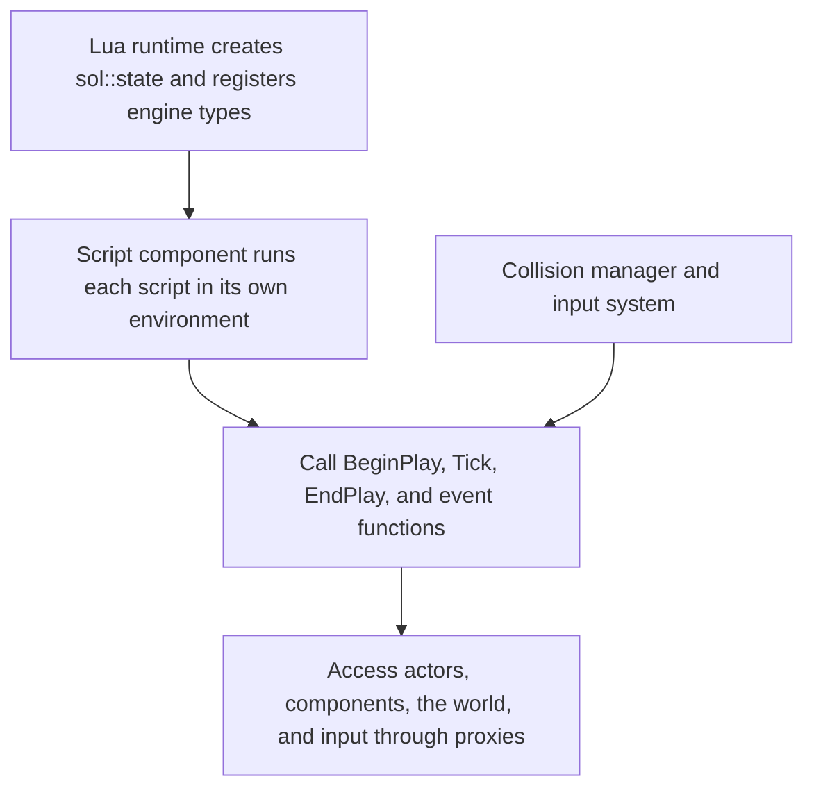

# 🔋 KRAFTON Jungle game tech Lab - Week 9

[한국어](./README.md) | **English**

***3rd Game Jam - Make Sure to Delegate: BLACK OUT***

***Light, Camera, Action!***

2026.04.30. ~ 2026.05.07.

Team 8: 장민준([@nacho2407](https://github.com/nacho2407)), 오준혁([@JHCard7872](https://github.com/JHCard7872)), 권현수([@kwonhyeonsoo-goo](https://github.com/kwonhyeonsoo-goo)), 이호진([@lois505](https://github.com/lois505))


- [BLACK OUT - Gameplay | Custom C++ & DirectX 11 Engine](https://www.youtube.com/watch?v=z6gPxxjiB1U)

  [](https://www.youtube.com/watch?v=z6gPxxjiB1U)

We made **BLACK OUT**, a 3D game whose rules are written in **Lua scripts**. The player flies a drone through a building in a blackout, collects documents while avoiding turrets and patrol drones, and escapes before the battery runs out. On top of that, we added **camera effects** such as camera shake, fade, and a spring arm, along with slow motion and hit stop.


## 🎮 Week Overview

- We made **BLACK OUT**, a stealth game in which the player flies a drone. The drone's battery is both its health and the light around it, so the screen gets darker as time passes or as bullets hit. The player holds out by picking up batteries while collecting documents, and a score is given on reaching the escape point with at least one document

- We attached LuaJIT to the engine so that game logic is written in **Lua scripts** instead of C++. When a script component is attached to an actor, the script handles actors, components, the world, and input, and saving an edited script reloads it even while running. Collision is handled with the Overlap and Hit events of Box, Sphere, and Capsule components, and events are delivered with Delegates

- **Camera modifiers** stacked on the player camera manager apply shake, letterbox, fade, gamma correction, and vignette, and a spring arm and camera transitions move the view smoothly. We also added slow motion and hit stop, which change the time scale, and knockback and squash on hit. A separate build configuration runs only the game without the editor


## ✨ Features

- **BLACK OUT**

  Taking **Bullet Echo**(ZeptoLab, 2020) as a reference, we aimed to make a game that uses light and shadow so that the player's field of view works as their health

  The start screen offers `Game Start`, `Credit`, `Scoreboard`, and `How To Play`. On entering the level, batteries, documents, and turrets are placed at random on some of the candidate spots marked in advance, so the layout differs every run. Turrets and patrol drones shoot at the player, and the player can shoot and destroy enemies only while aiming. When the game ends, the score is computed from kills, documents, batteries, and elapsed time, and the player enters a name to leave it on the scoreboard

- **Lua Script Component**

  `Create Script` in the Details window makes a new script copied from a template, and `Edit Script` opens it in the associated editor. A script is reloaded automatically when its file changes, and `Reload Script` reloads it by hand. A script defines `BeginPlay`, `Tick`, `EndPlay`, and event functions such as `OnOverlapBegin`, `OnOverlapEnd`, `OnTakeDamage`, `OnKeyPressed`, `OnMouseButtonPressed`, and `OnGamepadButtonPressed`

- **Lua Gameplay API**

  A script handles its own actor's location, rotation, tags, and components through `obj`, and spawns or finds actors and plays camera effects through `World`. `Input` reads the keyboard, mouse, and gamepad state, and `StartCoroutine` with `Wait`, `MoveTo`, and `WaitUntilMoveDone` writes actions that span several frames in order. Playing sounds, handling UI documents, saving scores, and changing scenes are also called from Lua

- **Collision Components**

  Box, Sphere, and Capsule components attached to actors test for overlaps. Events are sent through Delegates when an overlap begins or ends and when movement is blocked, and the script component passes them to Lua functions. Actors with the wall tag block movement

- **Camera Effects**

  `New Camera Effect` in the Content Browser creates shake, letterbox, fade, gamma correction, and vignette effect assets, and the curve editor adjusts their strength over time. In the game, the screen shakes on hit, vignette and gamma correction are applied while aiming, and the screen fades out and in when the scene changes

- **Spring Arm and Camera Transitions**

  The camera boom component follows the target actor at a fixed distance and direction, moving smoothly with a lag. When aiming starts or ends, the view is interpolated between the two viewpoints

- **Slow Motion and Hit Stop, Knockback and Squash**

  Lua requests slow motion and hit stop, which briefly lower or stop the game time scale. Slow motion is applied when the game ends. The hit reaction component applies knockback, which pushes the actor away from the hit direction, and squash, which briefly deforms its scale

- **Gamepad**

  An XInput gamepad navigates the menus and flies the drone

- **Sound and Game UI**

  FMOD plays the background music and sound effects, and RmlUi draws the HUD, the start screen, and the game over screen

- **Content Browser**

  It browses the asset folders, and dragging a mesh file onto the viewport creates an actor

- **Standalone Build**

  Building with the `GameRelease` configuration runs only the game from the start scene, without the editor


## 👥 Team

| Member | Responsibilities |
|------|------------------------|
| **장민준**([@nacho2407](https://github.com/nacho2407)) | Lua scripting and game design - LuaJIT integration, Lua script component and gameplay API(game object, component, world, input), gamepad input, spring arm, game design and level design |
| **오준혁**([@JHCard7872](https://github.com/JHCard7872)) | Script editing, UI, and sound - script creation and editing, hot reload, coroutines, sound manager, game UI, start screen and scoreboard, slow motion and hit stop, knockback and squash |
| **권현수**([@kwonhyeonsoo-goo](https://github.com/kwonhyeonsoo-goo)) | Collision and game logic - collision components and collision system, content browser, player and game manager logic, score saving, SubUV effects, camera transitions |
| **이호진**([@lois505](https://github.com/lois505)) | Delegates and camera - Delegates, standalone build, camera actor, tag system, bullet, patrol, and turret logic, camera manager and modifiers, player controller, curve editor |


## 🧑‍💻 Work Details

### Game Design and Level Design

- **Goal**

  Decide the rules and the level of the game so that the engine features the team built(Lua scripts, collision, lights and shadows) are used naturally in the game

- **Implementation**

  **BLACK OUT** was designed as a game in which a drone is sent into a building in a blackout to bring out documents. The drone's battery is both its health and its light, so the light around the drone weakens and the view narrows as the remaining battery drops. The score rises with every document collected, but the battery drains the longer the player stays, so the player has to choose between collecting more and escaping now

  The level was built by hand in the editor. Materials were applied to the floors and walls, and props such as desks, chairs, and cabinets were placed to make the office areas

- **Related Code**

  [`Asset/Content/Scene/DroneLevel.Scene`](./Asset/Content/Scene/DroneLevel.Scene)


### Lua Scripting

- **Goal**

  Let Lua scripts handle actors, components, the world, and input, so that the engine does not have to be rebuilt every time a game rule changes

- **Implementation**

  LuaJIT was attached to the engine, and C++ types were registered to Lua with sol2. The Lua runtime creates a single `sol::state`, turns on the JIT, and registers `Vector` and the proxy types. The **script component** runs each script in its own `sol::environment` that inherits the global table, so global variables do not mix even when several actors use the same script. When a script is loaded, `BeginPlay`, `Tick`, `EndPlay`, and the event functions are looked up and then called at the matching points of the engine

  **Proxies** keep scripts from holding engine objects directly. The game object proxy and the component proxy hold a UUID instead of a pointer and look up the actual object on every call, so a script fails safely even when it points to an actor that has already been destroyed. The game object proxy handles location, rotation, scale, direction vectors, tags, and adding and getting components, and the component proxy handles transforms, visibility, static meshes and materials, lights, and the size of collision shapes. The world proxy spawns and destroys actors

  Input is passed in two ways. `Input` reads the current state of keys, mouse buttons, and gamepad buttons and axes, and the script component finds presses and releases in the input snapshot every frame and calls event functions such as `OnKeyPressed`, `OnMouseButtonPressed`, and `OnGamepadButtonPressed`

  During this work, the actor tick and the component tick were separated

- **Related Code**

  [`Source/Engine/LuaScript/LuaRuntime.cpp`](./Source/Engine/LuaScript/LuaRuntime.cpp), [`Source/Engine/Component/LuaScriptComponent.cpp`](./Source/Engine/Component/LuaScriptComponent.cpp), [`Source/Engine/LuaScript/LuaGameObjectProxy.cpp`](./Source/Engine/LuaScript/LuaGameObjectProxy.cpp), [`Source/Engine/LuaScript/LuaComponentProxy.cpp`](./Source/Engine/LuaScript/LuaComponentProxy.cpp), [`Source/Engine/LuaScript/LuaWorldProxy.cpp`](./Source/Engine/LuaScript/LuaWorldProxy.cpp), [`Source/Engine/LuaScript/LuaInputProxy.cpp`](./Source/Engine/LuaScript/LuaInputProxy.cpp), [`Source/Engine/Core/TickFunction.cpp`](./Source/Engine/Core/TickFunction.cpp)


### Gamepad Input

- **Goal**

  Let the menus and the drone be controlled with a gamepad as well as with the keyboard and mouse

- **Implementation**

  The input system reads the state of up to four gamepads with XInput every frame and puts it into the input snapshot. Analog sticks are normalized to -1 ~ 1 after values inside the dead zone are treated as 0, triggers are normalized to 0 ~ 1 after the threshold is subtracted, and buttons are compared with the previous frame to find presses and releases. Lua reads an axis with a call such as `Input:GetAxis("GamepadLeftX")` or receives buttons through the `OnGamepadButtonPressed` event

- **Related Code**

  [`Source/Engine/Input/InputSystem.cpp`](./Source/Engine/Input/InputSystem.cpp), [`Source/Engine/Input/InputTypes.h`](./Source/Engine/Input/InputTypes.h), [`Source/Engine/LuaScript/LuaInputProxy.cpp`](./Source/Engine/LuaScript/LuaInputProxy.cpp)


### Spring Arm

- **Goal**

  Make the camera follow the drone smoothly at a fixed distance

- **Implementation**

  The camera boom component takes the target actor's location plus an offset as the pivot, and computes the camera's target position at the set distance in the set direction from it. The camera does not jump to the target position but follows it by interpolating at the lag speed, and it always looks at the pivot. The target actor, distance, direction, and lag speed are changed in the Details window and saved to the scene, and the result is previewed in the editor as well

- **Related Code**

  [`Source/Engine/Component/CameraBoomComponent.cpp`](./Source/Engine/Component/CameraBoomComponent.cpp)


## 🛠️ Tech Stack

- **Language**: C++20, Lua

- **Graphics API**: DirectX 11

- **Build**: Visual Studio 2026, MSBuild, vcpkg

- **Libraries**: Dear ImGui, DirectX Tool Kit for DirectX 11, FMOD Engine, LuaJIT, RmlUi, SimpleJSON, sol2


## 🖥️ Architecture



- Flow

    1. When the engine starts, the Lua runtime creates a `sol::state` and registers the vector, proxy, sound, UI, and score saving types and the utility functions

    2. When an actor's script component begins play, it creates its own environment, runs the script file, and looks up `BeginPlay`, `Tick`, `EndPlay`, and the event functions in it

    3. `Tick` is called every frame, and the input snapshot and the overlaps and damage reported by the collision manager are passed to the event functions

    4. The script handles engine objects through `obj`, `World`, `Input`, and the component proxies. A proxy finds the actual object by UUID and forwards the call

    5. When a script file changes, the script manager reloads the components that use that script


## 📁 Directory Structure

```
week09/
├── week09.sln              // Solution
├── vcpkg.json              // vcpkg manifest
├── Asset/
│   ├── Content/            // Materials, meshes, textures, scenes, Lua scripts, UI documents, camera effects
│   └── Editor/             // Program icon and icon materials
├── Docs/                   // README media
├── Settings/               // Resource list and standalone settings
├── Shaders/                // HLSL shaders
├── Source/                 // Entry point
│   ├── Editor/             // Editor engine
│   │   ├── Input/          // Viewport input controller and input tools
│   │   ├── Logging/        // Console log buffer
│   │   ├── PIE/            // PIE types
│   │   ├── Selection/      // Selection management
│   │   ├── Settings/       // Editor settings and standalone settings
│   │   ├── Subsystem/      // Overlay stats
│   │   ├── UI/             // Editor widgets, content browser, and curve editor
│   │   └── Viewport/       // Viewports and layout
│   ├── Engine/
│   │   ├── CameraManage/   // Camera manager, camera modifiers, and camera effect assets
│   │   ├── Collision/      // Ray tests, BVH, octree, and collision tests
│   │   ├── Component/      // Components
│   │   ├── Core/           // Common types, tick, log, Delegates, coroutines, sound, and time management
│   │   ├── GameFramework/  // Actors, levels, world, and player controller
│   │   ├── Input/          // Input collection and viewport input router
│   │   ├── LuaScript/      // Lua runtime, script manager, and proxies
│   │   ├── Materials/      // Materials
│   │   ├── Math/           // Vectors, matrices, and quaternions
│   │   ├── Mesh/           // Wavefront OBJ import and static meshes
│   │   ├── Object/         // Object system
│   │   ├── Physics/        // Collision manager
│   │   ├── Platform/       // Paths and crash dumps
│   │   ├── Profiling/      // Stats and GPU profiling
│   │   ├── Render/         // Render pipeline, shadow atlas, and culling
│   │   ├── Resource/       // Resource management
│   │   ├── Runtime/        // Engine loop and window
│   │   ├── Serialization/  // Scene saving and loading
│   │   ├── Texture/        // Textures
│   │   ├── UI/             // Splitter and window widgets, RmlUi manager
│   │   └── Viewport/       // Viewports
│   ├── GameRelease/        // Standalone engine
│   └── ObjViewer/          // OBJ viewer
└── ThirdParty/             // Dear ImGui, RmlUi, SimpleJSON, sol2
```


## ❓ Build and Run

### Running the Release Build

Executables are not provided for this week because of license issues with some of the assets and libraries.


### Building from Source

Some assets and libraries could not be included in the repository because of license issues, so this week cannot be built from the repository alone.


## 🕹️ Controls

### Keyboard and Mouse

| Input | Action |
|------|------|
| **W / A / S / D, ← / → / ↑ / ↓** | Move the drone |
| **Right click(hold)** | Aim. While held, moving the mouse changes the aim direction, and the drone does not move |
| **Left click** | Fire a bullet while aiming |
| **↑ / ↓** | Select a menu item |
| **Enter** | Confirm a menu item, submit the score on the game over screen |
| **Esc** | Go back in a menu, return to the start screen without submitting the score on the game over screen |
| **Letter keys, Backspace** | Enter and erase the name on the game over screen |


### Gamepad

| Input | Action |
|------|------|
| **Left stick** | Move the drone, select a menu item |
| **Left trigger(hold)** | Aim. While held, the drone does not move |
| **Right stick** | Change the aim direction while aiming |
| **Right trigger** | Fire a bullet while aiming |
| **D-pad ↑ / ↓** | Select a menu item |
| **A, Start** | Confirm a menu item, submit the score on the game over screen |
| **B** | Go back in a menu, return to the start screen without submitting the score on the game over screen |
| **X, Back** | Erase the last letter of the name on the game over screen |


## 📄 Third-Party Libraries

| Name | Author | Version | License |
|------|--------|------|----------|
| **[Dear ImGui](https://github.com/ocornut/imgui)** | Omar Cornut | 1.92.7 WIP | [MIT License](./ThirdParty/ImGui/LICENSE.txt) |
| **[DirectX Tool Kit for DirectX 11](https://github.com/microsoft/DirectXTK)** | Microsoft Corporation. | - | MIT License |
| **[FMOD Engine](https://www.fmod.com)** | Firelight Technologies Pty Ltd | 2.03.13 | FMOD End User License Agreement |
| **[LuaJIT](https://luajit.org)** | Mike Pall | - | MIT License |
| **[RmlUi](https://github.com/mikke89/RmlUi)** | The RmlUi Team, and contributors | - | [MIT License](./ThirdParty/RmlUi/LICENSE.txt) |
| **[SimpleJSON](https://github.com/nbsdx/SimpleJSON)** | Neil | - | Do What the Fuck You Want to Public License |
| **[sol2](https://github.com/ThePhD/sol2)** | Rapptz, ThePhD and contributors | 3.5.0 | [MIT License](./ThirdParty/sol/sol.hpp) |


## 🎨 Third-Party Assets

| Name | Author | License |
|------|--------|----------|
| **[3d-cubes](https://github.com/garykac/3d-cubes)** | Gary Kac | - |
| **[9V Battery](https://sketchfab.com/3d-models/9v-battery-8da31e535056495b8fb2c1d6b3674ae8)** | The Lost Sock | [Creative Commons Attribution 4.0 International](https://creativecommons.org/licenses/by/4.0/) |
| **[ambientCG Materials](https://ambientcg.com)** | ambientCG | [Creative Commons Zero v1.0 Universal](https://creativecommons.org/publicdomain/zero/1.0/) |
| **[Aquarium](https://sketchfab.com/3d-models/aquarium-e954de85f1f64c7eb5657c8f644fc066)** | lennartburgold | [Creative Commons Attribution 4.0 International](https://creativecommons.org/licenses/by/4.0/) |
| **[Army Green Supply Crate](https://sketchfab.com/3d-models/army-green-supply-crate-3a1d6ffce80a4f7789aee5fabe627b83)** | Glowbox 3D | [Creative Commons Attribution 4.0 International](https://creativecommons.org/licenses/by/4.0/) |
| **[Desk Low-Poly](https://sketchfab.com/3d-models/desk-low-poly-ed62a64f51bf4d80a13e1344093c3909)** | Pedro Belthori | [Creative Commons Attribution 4.0 International](https://creativecommons.org/licenses/by/4.0/) |
| **[DJI DRONE ANIMATED](https://sketchfab.com/3d-models/dji-drone-animated-b7321a814bd64aca8e1493098890c1fb)** | dp935991 | [Creative Commons Attribution 4.0 International](https://creativecommons.org/licenses/by/4.0/) |
| **[Document File Folder](https://sketchfab.com/3d-models/document-file-folder-11390179bba7462484d344e2fe22c703)** | Kami Rapacz | [Creative Commons Attribution 4.0 International](https://creativecommons.org/licenses/by/4.0/) |
| **[Metal Storage Cabinet](https://sketchfab.com/3d-models/metal-storage-cabinet-4d49691a269745cabe0e1d5c1c3bef9b)** | jimbogies | [Creative Commons Attribution 4.0 International](https://creativecommons.org/licenses/by/4.0/) |
| **[Military Drone](https://sketchfab.com/3d-models/military-drone-2169104d64e64999b7ff3781451a8702)** | osiris2000 | [Creative Commons Attribution Non Commercial 4.0 International](https://creativecommons.org/licenses/by-nc/4.0/) |
| **[Office Chair](https://sketchfab.com/3d-models/office-chair-b228a29fa84544c2be501c295653ffe7)** | Red Fox / nokillnando | [Creative Commons Attribution 4.0 International](https://creativecommons.org/licenses/by/4.0/) |
| **[Turret](https://sketchfab.com/3d-models/turret-8d97fe5a2d654a2bb316824e56f90efb)** | Kirilllucas | [Creative Commons Attribution 4.0 International](https://creativecommons.org/licenses/by/4.0/) |


## ⚖️ License

The portions of this week's code written by Jang Minjun are released under the MIT License, and the rights to the portions written by other contributors belong to their respective contributors. See [LICENSE](../LICENSE) for details.
