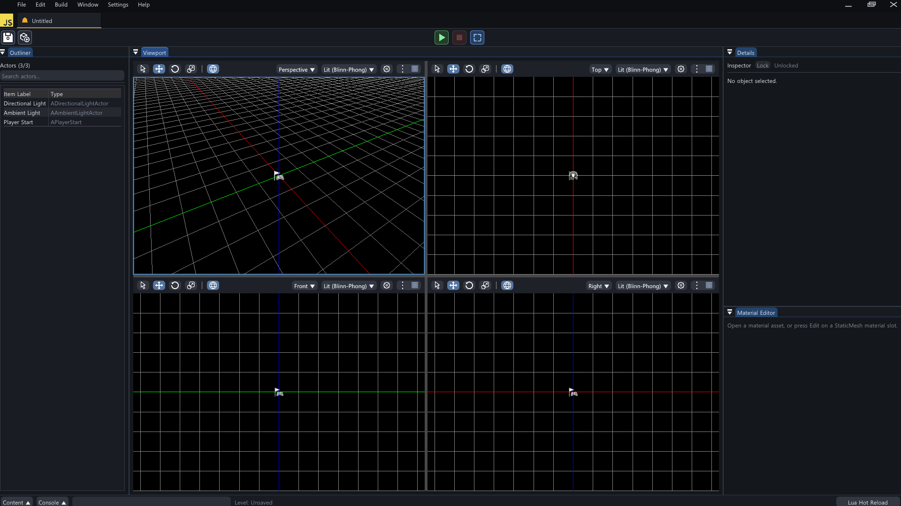
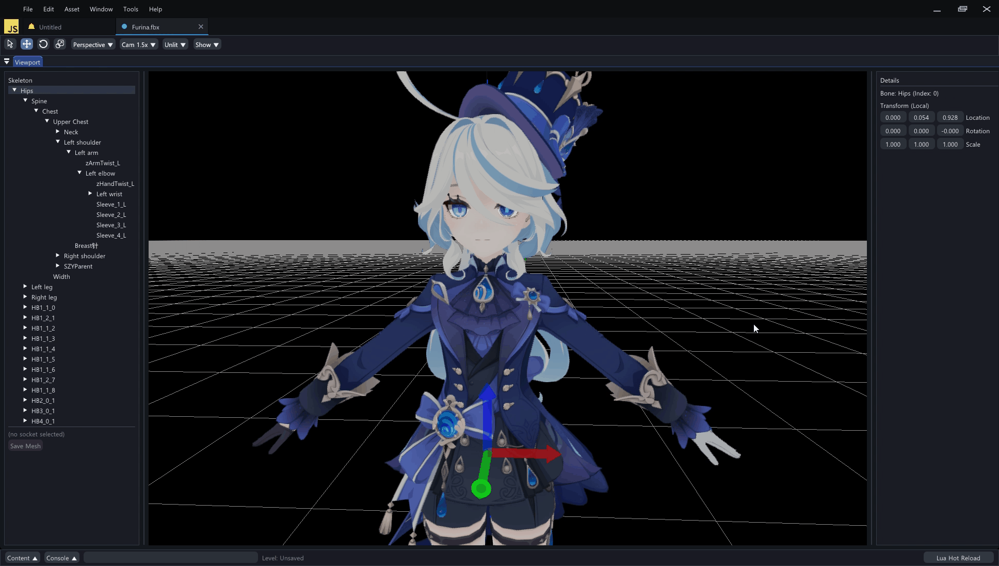
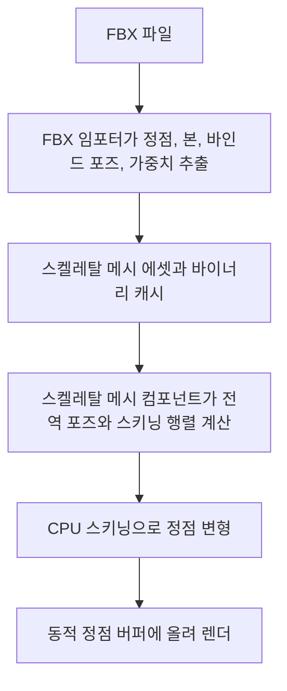

# 🦴 크래프톤 정글 게임테크랩 10주차

**한국어** | [English](./README_en.md)

***무게 그 이상의 의미***

2026.05.07. ~ 2026.05.14.

1팀: 장민준([@nacho2407](https://github.com/nacho2407)), 심우진([@shimwoojin](https://github.com/shimwoojin)), 김지수([@jskim-research](https://github.com/jskim-research)), 양현석([@yanggogi1423](https://github.com/yanggogi1423))





3D 에디터에 **스켈레탈 메시**를 더했습니다. FBX SDK로 FBX 파일에서 메시와 본 계층, 스킨 가중치를 읽어 들이고, **CPU 스키닝**으로 본의 자세에 맞춰 정점을 변형해 그립니다. 에디터 안의 **스켈레탈 메시 뷰어**에서 본 계층을 살펴보고 본을 기즈모로 움직입니다.


## 🎮 주차 소개

- **FBX 임포터**를 만들어 FBX 파일의 정적 메시와 스켈레탈 메시를 엔진의 메시 에셋으로 읽어 들입니다. 스켈레탈 메시는 스킨 클러스터에서 본과 바인드 포즈, 정점별 가중치를 읽고, 재질과 텍스처도 함께 뽑아 냅니다. 한 번 읽은 메시는 바이너리 캐시로 저장해 다음부터는 FBX를 다시 해석하지 않습니다

- 스켈레탈 메시 컴포넌트가 본의 현재 자세로 **스키닝 행렬**을 만들고, 정점마다 최대 4개 본의 가중치로 위치와 노멀, 탄젠트를 섞는 **CPU 스키닝**을 합니다. 변형한 정점은 동적 정점 버퍼에 올려 기존 메시 렌더 경로로 그립니다

- 에디터 안에서 메시마다 **스켈레탈 메시 뷰어** 탭을 열어 본 계층 트리를 보고, 본을 골라 기즈모로 움직이고, 소켓을 달아 다른 컴포넌트를 본에 붙입니다


## ✨ 구현 결과

- **FBX 메시 배치**

  Content Browser의 FBX 파일을 뷰포트로 끌어다 놓으면 내용에 따라 정적 메시 액터나 스켈레탈 메시 액터를 배치합니다. 액터 배치 메뉴의 `Skeletal Mesh`로도 스켈레탈 메시 액터를 만들 수 있습니다

- **Reference Pose 렌더링**

  스켈레탈 메시는 바인드 포즈 그대로 CPU 스키닝을 거쳐 그려집니다. 재질과 조명, 선택 외곽선, 피킹이 정적 메시와 같이 동작합니다

- **스켈레탈 메시 쇼 플래그**

  뷰포트 툴바의 설정 메뉴에 있는 `Show` 항목에서 `Skeletal Mesh`를 꺼 스켈레탈 메시를 숨깁니다

- **스켈레탈 메시 뷰어**

  Content Browser에서 FBX 파일을 더블 클릭하면 그 메시의 뷰어 탭이 열립니다. 메시마다 탭이 따로 열려 여러 메시를 함께 볼 수 있고, 탭을 떼어 별도 창으로 둘 수 있습니다. 뷰어의 `Show`에서 `Skeletal Mesh`를 끄거나, `Bones`로 본을 선으로 표시하고 `Selected Bone Only`로 선택한 본만 표시합니다

- **본 계층 트리와 본 기즈모**

  뷰어의 `Skeleton` 패널이 본 계층을 트리로 보여 줍니다. 본을 고르면 뷰포트의 그 본 위치에 기즈모가 나타나 본을 움직일 수 있고, `Details` 패널에서 본의 로컬 트랜스폼을 값으로 고칩니다

- **소켓**

  뷰어에서 본을 우클릭해 `Add Socket`으로 소켓을 만들고 이름과 트랜스폼을 고칩니다. `Add Preview Mesh...`로 소켓에 미리보기 메시를 붙여 위치를 확인하고, 레벨에서는 컴포넌트를 소켓에 붙여 본을 따라 움직이게 합니다

- **본 포즈 디버그**

  레벨에서 스켈레탈 메시 컴포넌트를 선택하면 Details 창의 `Bone Pose Debug`에서 `Edit Bone Pose`를 켜고 본을 골라 `Location Offset`, `Rotation Offset`, `Scale Offset`으로 바인드 포즈에서 벗어난 자세를 만들어 봅니다. `Reset Bone`과 `Reset Pose`로 되돌립니다

- **바이너리 캐시**

  읽어 들인 메시는 `Asset/Mesh/Bin/`과 `Asset/SkeletalMesh/Bin/`에 바이너리로 저장하고, 원본 FBX가 바뀌지 않았으면 캐시를 읽습니다


## 👥 팀원 및 담당 파트

| 팀원 | 담당 파트 및 주요 역할 |
|------|------------------------|
| **장민준**([@nacho2407](https://github.com/nacho2407)) | 스켈레탈 메시 컴포넌트와 CPU 스키닝 - 스킨드 메시와 스켈레탈 메시 컴포넌트, FBX 스켈레탈 메시 임포트, CPU 스키닝, 스켈레탈 메시 렌더 경로, 쇼 플래그, 액터 배치와 선택, 본 포즈 디버그 |
| **심우진**([@shimwoojin](https://github.com/shimwoojin)) | FBX 임포트와 소켓 - FBX 정적 메시 임포트와 좌표계 정책, FBX 재질과 텍스처 추출, 스켈레탈 메시 바이너리 직렬화와 캐시, 소켓과 소켓 편집 UI, 본 와이어 표시 |
| **김지수**([@jskim-research](https://github.com/jskim-research)) | 스켈레탈 메시 뷰어 - FBX SDK 도입, 뷰어 창과 뷰포트, 뷰어 카메라, 본 계층 트리, 본 기즈모 조작, 여러 뷰어 동시 열기, 선택 관리 구조 정리 |
| **양현석**([@yanggogi1423](https://github.com/yanggogi1423)) | 에디터와 렌더링 구조 - 셰이더 구조 재구성, 재질 셰이더 타입, 에디터 탭 UI와 위젯 분리, 본 피킹, 액터 시퀀서, 입력 시스템과 Pawn, 게임 모드 설정 UI, 게임 패키징 |


## 🧑‍💻 담당 작업 상세

### FBX 스켈레탈 메시 임포트

- **목표**

  FBX 파일에서 스켈레탈 메시를 그리는 데 필요한 정점, 본 계층, 바인드 포즈, 정점별 본 가중치를 읽어 엔진의 스켈레탈 메시 에셋으로 만듭니다

- **구현 내용**

  씬을 삼각형으로 바꾼 뒤 메시 노드를 두 번 돕니다. 첫 번째 순회에서는 스킨 디포머가 있는 메시를 처리합니다. 스킨 클러스터가 가리키는 노드를 본으로 등록하고, 클러스터의 링크 행렬을 본의 전역 바인드 변환으로 삼아 그 역행렬을 **역 바인드 포즈**로 저장합니다. 본의 부모는 노드 계층에서 찾고, 로컬 바인드 변환은 부모의 전역 바인드 변환의 역행렬을 곱해 구합니다

  클러스터마다 컨트롤 포인트의 가중치를 모은 뒤, 폴리곤의 꼭짓점을 정점으로 풀어내면서 가중치가 큰 순서로 최대 4개 본만 남기고 합이 1이 되도록 정규화합니다. 정점 위치와 노멀은 메시의 바인드 시점 변환을 미리 곱해 본과 같은 공간에 두었습니다. 재질마다 섹션을 나누고 마지막에 탄젠트와 로컬 바운드를 계산합니다

  두 번째 순회에서는 스킨 디포머 없이 본 아래에 붙어 있는 메시를 처리합니다. 이런 메시는 가장 가까운 조상 본 하나에 가중치 1로 묶어, 스키닝 경로 하나로 함께 그려지게 했습니다

- **관련 코드**

  [`Source/Engine/Asset/FbxImporter.cpp`](./Source/Engine/Asset/FbxImporter.cpp), [`Source/Engine/Asset/FbxImporter.h`](./Source/Engine/Asset/FbxImporter.h), [`Source/Engine/Asset/SkeletalMesh.cpp`](./Source/Engine/Asset/SkeletalMesh.cpp), [`Source/Engine/Core/ResourceManager.cpp`](./Source/Engine/Core/ResourceManager.cpp)


### 스켈레탈 메시 컴포넌트와 CPU 스키닝

- **목표**

  본의 자세가 바뀌면 그에 맞춰 메시가 변형되도록, 스켈레탈 메시를 다루는 컴포넌트와 CPU에서 정점을 변형하는 스키닝을 만듭니다

- **구현 내용**

  메시 컴포넌트를 상속한 `USkinnedMeshComponent`가 본별 로컬 포즈, 전역 포즈, 스키닝 행렬과 스키닝한 정점을 갖고, `USkeletalMeshComponent`가 이를 상속합니다. 메시를 지정하면 바인드 포즈로 자세를 초기화합니다

  스키닝은 세 단계입니다. 먼저 로컬 포즈에서 **전역 포즈**를 구합니다. FBX의 본 배열은 부모가 자식보다 앞에 온다는 보장이 없어, 부모 쪽으로 재귀하며 이미 계산한 본은 건너뜁니다. 다음으로 본마다 `역 바인드 포즈 * 현재 전역 포즈`로 **스키닝 행렬**을 만듭니다. 마지막으로 정점마다 유효한 본 가중치의 합으로 다시 정규화한 뒤, 본별 스키닝 행렬로 변환한 위치, 노멀, 탄젠트를 가중치만큼 더합니다. 섞인 노멀과 탄젠트는 다시 정규화하고, 길이가 0이 되면 원래 값을 씁니다

  자세가 바뀔 때만 다시 계산하도록 더티 플래그를 두었습니다. 스키닝이 끝나면 바운드와 렌더 상태를 더티로 표시하고, 월드 바운드는 스키닝한 정점으로 다시 구해 컬링과 피킹이 변형된 모양을 따르게 했습니다

- **한계와 개선 방향**

  모든 정점을 매 갱신마다 CPU에서 변형하고 정점 버퍼 전체를 다시 올리므로, 정점이 많은 메시나 여러 캐릭터에서는 비용이 큽니다. 이 비용은 본 행렬을 셰이더에 넘겨 정점 셰이더에서 정점을 변형하는 GPU 스키닝으로 줄일 수 있을 것으로 보입니다

- **관련 코드**

  [`Source/Engine/Component/SkinnedMeshComponent.cpp`](./Source/Engine/Component/SkinnedMeshComponent.cpp), [`Source/Engine/Component/SkinnedMeshComponent.h`](./Source/Engine/Component/SkinnedMeshComponent.h), [`Source/Engine/Component/SkeletalMeshComponent.cpp`](./Source/Engine/Component/SkeletalMeshComponent.cpp)


### 스켈레탈 메시 렌더 경로와 에디터 지원

- **목표**

  스키닝한 정점을 기존 렌더러로 그리고, 에디터에서 스켈레탈 메시를 정적 메시처럼 배치하고 선택하고 살펴볼 수 있게 합니다

- **구현 내용**

  드로우 커맨드를 만들 때 컴포넌트의 스키닝을 최신으로 맞추고, 렌더 상태가 더티일 때만 컴포넌트별 **동적 정점 버퍼**에 스키닝한 정점을 다시 올립니다. 인덱스와 섹션은 에셋의 것을 그대로 쓰므로 재질 섹션별 드로우는 정적 메시와 같습니다

  에디터에는 스켈레탈 메시 쇼 플래그, 액터 배치 메뉴와 Content Browser에서의 배치, 스키닝한 정점에 대한 레이 판정으로 하는 선택을 더했습니다. Details 창의 본 포즈 디버그는 고른 본의 로컬 포즈에 위치, 회전, 크기 오프셋을 곱해 스키닝 결과를 바로 확인하는 도구입니다

- **관련 코드**

  [`Source/Engine/Render/Scene/PrimitiveDrawCommandBuilder.cpp`](./Source/Engine/Render/Scene/PrimitiveDrawCommandBuilder.cpp), [`Source/Engine/Render/Resource/MeshBufferManager.cpp`](./Source/Engine/Render/Resource/MeshBufferManager.cpp), [`Source/Engine/Render/Resource/Buffer.cpp`](./Source/Engine/Render/Resource/Buffer.cpp), [`Source/Editor/UI/EditorPropertyWidget.cpp`](./Source/Editor/UI/EditorPropertyWidget.cpp), [`Source/Engine/GameFramework/PrimitiveActors.cpp`](./Source/Engine/GameFramework/PrimitiveActors.cpp)


## 🛠️ 기술 스택

- **Language**: C++20

- **Graphics API**: DirectX 11

- **Build**: Visual Studio 2026, MSBuild

- **Libraries**: Autodesk FBX SDK, Dear ImGui, DirectX Tool Kit for DirectX 11, LuaJIT, RmlUi, SimpleJSON, sol2, SoLoud


## 🖥️ 구조



- 동작 흐름

    1. FBX 임포터가 FBX SDK로 씬을 읽어 정점, 본 계층, 바인드 포즈, 정점별 본 가중치를 뽑습니다. 바이너리 캐시가 있고 원본이 바뀌지 않았으면 캐시를 읽습니다

    2. 스켈레탈 메시 에셋이 정점, 인덱스, 재질 섹션, 본, 소켓을 갖습니다

    3. 스켈레탈 메시 컴포넌트가 본의 로컬 포즈에서 전역 포즈를 구하고, 역 바인드 포즈와 곱해 스키닝 행렬을 만듭니다

    4. 정점마다 최대 4개 본의 스키닝 행렬을 가중치로 섞어 위치, 노멀, 탄젠트를 변형합니다

    5. 변형한 정점을 동적 정점 버퍼에 올리고, 재질 섹션별로 드로우 커맨드를 만들어 그립니다


## 📁 디렉토리 구조

```
week10/
├── week10.sln              // 솔루션
├── Asset/                  // 재질, 메시, 프리팹, 커브, 텍스처, UI 문서
├── BuildTools/             // RmlUi, SoLoud 정적 라이브러리 빌드 스크립트
├── Docs/                   // README 미디어
├── LuaDefinitions/         // Lua 편집기용 엔진 API 정의
├── Resources/              // 프로그램 아이콘
├── Shaders/                // HLSL 셰이더
├── Source/                 // 진입점
│   ├── Editor/             // 에디터 엔진과 렌더 파이프라인
│   │   ├── Asset/          // 에셋 서비스
│   │   ├── Command/        // 에디터 명령
│   │   ├── Input/          // 뷰포트 입력 매핑과 월드 컨트롤러
│   │   ├── Notification/   // 알림
│   │   ├── PIE/            // PIE 세션
│   │   ├── Packaging/      // 게임 패키징
│   │   ├── Scene/          // 씬 서비스
│   │   ├── Selection/      // 선택 관리
│   │   ├── Settings/       // 에디터와 프로젝트 설정
│   │   ├── UI/             // 에디터 위젯, 뷰어 창, 액터 시퀀서
│   │   ├── Undo/           // 실행 취소
│   │   ├── Viewer/         // 메시 뷰어
│   │   └── Viewport/       // 뷰포트 클라이언트와 내비게이션
│   ├── Engine/
│   │   ├── Animation/      // 액터 시퀀스와 타임라인
│   │   ├── Asset/          // FBX 임포터, Wavefront OBJ 로더, 메시 에셋, 바이너리 직렬화
│   │   ├── Audio/          // 오디오 시스템
│   │   ├── Camera/         // 카메라 매니저와 카메라 셰이크
│   │   ├── Collision/      // 충돌과 레이 판정
│   │   ├── Component/      // 컴포넌트
│   │   ├── Core/           // 공통 타입, 리소스 관리, 경로
│   │   ├── GameFramework/  // 액터, 월드, 게임 모드
│   │   ├── Geometry/       // 기하 타입
│   │   ├── Input/          // 입력 시스템
│   │   ├── Math/           // 수학
│   │   ├── Object/         // UObject, 이름
│   │   ├── Render/         // 렌더러와 GPU 리소스
│   │   ├── Runtime/        // 엔진 루프, 창, Lua 스크립트
│   │   ├── Serialization/  // 씬과 프리팹 저장
│   │   ├── Slate/          // 창과 스플리터
│   │   ├── Spatial/        // BVH, KD 트리
│   │   └── UI/             // RmlUi 런타임 UI
│   ├── Launch/             // 실행 모드 선택
│   └── Misc/               // OBJ 뷰어
└── ThirdParty/             // Dear ImGui, LuaJIT, RmlUi, SimpleJSON, sol2, SoLoud
```


## ❓ 빌드 및 실행

### 릴리즈 실행

일부 에셋과 라이브러리의 라이선스 문제로 인해 이 주차의 실행 파일은 제공하지 않습니다.


### 소스 빌드

일부 에셋과 라이브러리를 라이선스 문제로 저장소에 포함하지 못해, 이 주차는 저장소만으로 빌드할 수 없습니다.


## ⌨️ 단축키

| 단축키 | 동작 |
|--------|------|
| **Q / W / E / R, 1 / 2 / 3 / 4** | 편집 모드 전환(선택, 이동, 회전, 크기) |
| **Tab** | 편집 모드 순환 |
| **Space** | 기즈모 모드 순환(이동, 회전, 크기) |
| **X** | 기즈모 기준 전환(월드, 로컬) |
| **F** | 선택한 액터 쪽으로 카메라 이동 |
| **Ctrl + A** | 모든 액터 선택 |
| **Ctrl + Alt + 드래그** | 박스 선택(Shift를 함께 누르면 기존 선택에 추가) |
| **Ctrl + D** | 선택한 액터 복제 |
| **Delete** | 선택한 액터 삭제 |
| **F2** | 선택한 액터 이름 바꾸기 |
| **Ctrl + Z / Ctrl + Shift + Z** | 실행 취소, 다시 실행 |
| **Ctrl + N / Ctrl + O / Ctrl + S / Ctrl + Shift + S** | 새 씬, 씬 열기, 씬 저장, 다른 이름으로 저장 |
| **Ctrl + Space** | Content Browser 열기와 닫기 |
| **\`** | 콘솔 입력창으로 이동, 콘솔 창 열기, 닫기 순환 |
| **Esc** | PIE 종료 |
| **F8** | PIE 중 빙의와 해제 전환 |
| **Shift + F1** | PIE 중 마우스 커서 풀기 |


## 📄 서드파티 라이브러리

| 이름 | 저작자 | 버전 | 라이선스 |
|------|--------|------|----------|
| **[Autodesk FBX SDK](https://aps.autodesk.com/developer/overview/fbx-sdk)** | Autodesk, Inc. | 2020.3.9 | Autodesk License and Services Agreement |
| **[Dear ImGui](https://github.com/ocornut/imgui)** | Omar Cornut | 1.92.7 WIP | [MIT License](./ThirdParty/ImGui/LICENSE.txt) |
| **[DirectX Tool Kit for DirectX 11](https://github.com/microsoft/DirectXTK)** | Microsoft Corporation. | - | MIT License |
| **[LuaJIT](https://luajit.org)** | Mike Pall | 2.1 | [MIT License](./ThirdParty/luajit/COPYRIGHT) |
| **[RmlUi](https://github.com/mikke89/RmlUi)** | The RmlUi Team, and contributors | - | [MIT License](./ThirdParty/RmlUi/LICENSE.txt) |
| **[SimpleJSON](https://github.com/nbsdx/SimpleJSON)** | Neil | - | Do What the Fuck You Want to Public License |
| **[sol2](https://github.com/ThePhD/sol2)** | Rapptz, ThePhD, and contributors | 3.5.0 | [MIT License](./ThirdParty/sol/LICENSE.txt) |
| **[SoLoud](https://github.com/jarikomppa/soloud)** | Jari Komppa | 202002 | [zlib License](./ThirdParty/SoLoud/LICENSE) |


## 🎨 서드파티 에셋

| 이름 | 저작자 | 라이선스 |
|------|--------|----------|
| **[3d-cubes](https://github.com/garykac/3d-cubes)** | Gary Kac | - |
| **[Abandoned children's slide](https://sketchfab.com/3d-models/abandoned-childrens-slide-11de2b21ec264c0a814ac024c45ab425)** | sergeilihandristov | [Creative Commons Attribution 4.0 International](https://creativecommons.org/licenses/by/4.0/) |
| **[logo.js](https://github.com/voodootikigod/logo.js)** | Christopher Williams | [MIT License](./Resources/Editor/Branding/logo.js-LICENSE) |


## ⚖️ 라이선스

이 주차의 코드 중 장민준이 작성한 부분은 MIT 라이선스로 공개하며, 다른 기여자가 작성한 부분의 권리는 각 기여자에게 있습니다. 자세한 내용은 [LICENSE](../LICENSE)를 확인해 주세요.
