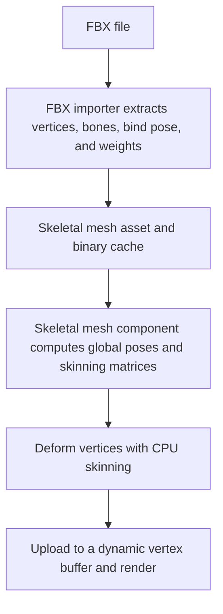

# 🦴 KRAFTON Jungle game tech Lab - Week 10

[한국어](./README.md) | **English**

***More Than Just Weight***

2026.05.07. ~ 2026.05.14.

Team 1: 장민준([@nacho2407](https://github.com/nacho2407)), 심우진([@shimwoojin](https://github.com/shimwoojin)), 김지수([@jskim-research](https://github.com/jskim-research)), 양현석([@yanggogi1423](https://github.com/yanggogi1423))


We added **skeletal meshes** to the 3D editor. The FBX SDK reads meshes, the bone hierarchy, and skin weights from FBX files, and **CPU skinning** deforms the vertices to match the bone poses before drawing. The **skeletal mesh viewer** inside the editor shows the bone hierarchy and moves bones with a gizmo.


## 🎮 Week Overview

- An **FBX importer** reads the static meshes and skeletal meshes in FBX files into the engine's mesh assets. For a skeletal mesh, it reads the bones, the bind pose, and the per-vertex weights from the skin clusters, and extracts the materials and textures as well. A mesh that has been read once is saved as a binary cache, so the FBX is not parsed again from then on

- The skeletal mesh component builds **skinning matrices** from the current pose of the bones and performs **CPU skinning**, which blends the position, normal, and tangent of each vertex with the weights of up to four bones. The deformed vertices are uploaded to a dynamic vertex buffer and drawn through the existing mesh render path

- Inside the editor, a **skeletal mesh viewer** tab opens for each mesh to show the bone hierarchy tree, move a selected bone with a gizmo, and add sockets that attach other components to a bone


## ✨ Features

- **FBX Mesh Placement**

  Dragging an FBX file from the Content Browser onto the viewport places a static mesh actor or a skeletal mesh actor depending on its contents. `Skeletal Mesh` in the actor placement menu also creates a skeletal mesh actor

- **Reference Pose Rendering**

  A skeletal mesh is drawn in its bind pose after going through CPU skinning. Materials and lighting, the selection outline, and picking work the same as for static meshes

- **Skeletal Mesh Show Flag**

  Turning off `Skeletal Mesh` under `Show` in the settings menu of the viewport toolbar hides skeletal meshes

- **Skeletal Mesh Viewer**

  Double-clicking an FBX file in the Content Browser opens a viewer tab for that mesh. Each mesh opens in its own tab, so several meshes can be viewed together, and a tab can be detached into a separate window. `Show` in the viewer turns off `Skeletal Mesh`, draws the bones as lines with `Bones`, and shows only the selected bone with `Selected Bone Only`

- **Bone Hierarchy Tree and Bone Gizmo**

  The `Skeleton` panel of the viewer shows the bone hierarchy as a tree. Selecting a bone shows a gizmo at that bone's position in the viewport to move the bone, and the `Details` panel edits the bone's local transform by value

- **Sockets**

  Right-clicking a bone in the viewer and choosing `Add Socket` creates a socket, whose name and transform can then be edited. `Add Preview Mesh...` attaches a preview mesh to the socket to check its position, and in a level a component attached to a socket follows the bone

- **Bone Pose Debug**

  Selecting a skeletal mesh component in a level and turning on `Edit Bone Pose` under `Bone Pose Debug` in the Details window lets a bone be picked and posed away from the bind pose with `Location Offset`, `Rotation Offset`, and `Scale Offset`. `Reset Bone` and `Reset Pose` restore it

- **Binary Cache**

  Imported meshes are saved as binaries in `Asset/Mesh/Bin/` and `Asset/SkeletalMesh/Bin/`, and the cache is read if the source FBX has not changed


## 👥 Team

| Member | Responsibilities |
|------|------------------------|
| **장민준**([@nacho2407](https://github.com/nacho2407)) | Skeletal mesh component and CPU skinning - skinned mesh and skeletal mesh components, FBX skeletal mesh import, CPU skinning, skeletal mesh render path, show flag, actor placement and selection, bone pose debug |
| **심우진**([@shimwoojin](https://github.com/shimwoojin)) | FBX import and sockets - FBX static mesh import and coordinate system policy, FBX material and texture extraction, skeletal mesh binary serialization and cache, sockets and socket editing UI, bone wire display |
| **김지수**([@jskim-research](https://github.com/jskim-research)) | Skeletal mesh viewer - FBX SDK integration, viewer window and viewport, viewer camera, bone hierarchy tree, bone gizmo control, opening several viewers at once, selection management restructuring |
| **양현석**([@yanggogi1423](https://github.com/yanggogi1423)) | Editor and rendering structure - shader structure reorganization, material shader types, editor tab UI and widget separation, bone picking, actor sequencer, input system and Pawn, game mode settings UI, game packaging |


## 🧑‍💻 Work Details

### FBX Skeletal Mesh Import

- **Goal**

  Read the vertices, bone hierarchy, bind pose, and per-vertex bone weights needed to draw a skeletal mesh from an FBX file and build the engine's skeletal mesh asset from them

- **Implementation**

  After the scene is triangulated, the mesh nodes are traversed twice. The first pass handles meshes that have a skin deformer. The nodes that the skin clusters point to are registered as bones, each cluster's link matrix is taken as the bone's global bind transform, and its inverse is stored as the **inverse bind pose**. A bone's parent is found in the node hierarchy, and its local bind transform is obtained by multiplying by the inverse of the parent's global bind transform

  The weights of the control points are gathered per cluster, and then, while the polygon corners are unpacked into vertices, only up to four bones are kept in order of weight and normalized so that they sum to 1. Vertex positions and normals are multiplied in advance by the mesh's transform at bind time so that they lie in the same space as the bones. Sections are split per material, and tangents and local bounds are computed at the end

  The second pass handles meshes that are attached under a bone without a skin deformer. Such a mesh is bound to its nearest ancestor bone with a weight of 1, so that it is drawn together through the single skinning path

- **Related Code**

  [`Source/Engine/Asset/FbxImporter.cpp`](./Source/Engine/Asset/FbxImporter.cpp), [`Source/Engine/Asset/FbxImporter.h`](./Source/Engine/Asset/FbxImporter.h), [`Source/Engine/Asset/SkeletalMesh.cpp`](./Source/Engine/Asset/SkeletalMesh.cpp), [`Source/Engine/Core/ResourceManager.cpp`](./Source/Engine/Core/ResourceManager.cpp)


### Skeletal Mesh Component and CPU Skinning

- **Goal**

  Build the components that handle skeletal meshes and the skinning that deforms vertices on the CPU, so that the mesh deforms to match the bones when their pose changes

- **Implementation**

  `USkinnedMeshComponent`, which inherits from the mesh component, holds the per-bone local poses, global poses, and skinning matrices along with the skinned vertices, and `USkeletalMeshComponent` inherits from it. Setting a mesh initializes the pose to the bind pose

  Skinning has three steps. First, the **global poses** are computed from the local poses. The FBX bone array does not guarantee that a parent comes before its children, so the computation recurses toward the parent and skips bones that are already computed. Next, a **skinning matrix** is built for each bone as `inverse bind pose * current global pose`. Finally, for each vertex, the weights are renormalized by the sum of the valid bone weights, and the position, normal, and tangent transformed by each bone's skinning matrix are added in proportion to the weights. The blended normal and tangent are normalized again, and the original value is used if the length becomes 0

  A dirty flag makes the computation run again only when the pose changes. When skinning finishes, the bounds and the render state are marked dirty, and the world bounds are recomputed from the skinned vertices so that culling and picking follow the deformed shape

- **Limitations and Future Work**

  Every vertex is deformed on the CPU on each update and the whole vertex buffer is uploaded again, so the cost is high for meshes with many vertices or for several characters. This cost could likely be reduced with GPU skinning, which passes the bone matrices to the shader and deforms the vertices in the vertex shader

- **Related Code**

  [`Source/Engine/Component/SkinnedMeshComponent.cpp`](./Source/Engine/Component/SkinnedMeshComponent.cpp), [`Source/Engine/Component/SkinnedMeshComponent.h`](./Source/Engine/Component/SkinnedMeshComponent.h), [`Source/Engine/Component/SkeletalMeshComponent.cpp`](./Source/Engine/Component/SkeletalMeshComponent.cpp)


### Skeletal Mesh Render Path and Editor Support

- **Goal**

  Draw the skinned vertices with the existing renderer, and let skeletal meshes be placed, selected, and inspected in the editor like static meshes

- **Implementation**

  When draw commands are built, the component's skinning is brought up to date, and the skinned vertices are uploaded again to a per-component **dynamic vertex buffer** only when the render state is dirty. The indices and sections of the asset are used as they are, so drawing per material section is the same as for static meshes

  The editor gained the skeletal mesh show flag, placement from the actor placement menu and the Content Browser, and selection by ray tests against the skinned vertices. Bone pose debug in the Details window is a tool that multiplies location, rotation, and scale offsets into the local pose of the chosen bone to check the skinning result right away

- **Related Code**

  [`Source/Engine/Render/Scene/PrimitiveDrawCommandBuilder.cpp`](./Source/Engine/Render/Scene/PrimitiveDrawCommandBuilder.cpp), [`Source/Engine/Render/Resource/MeshBufferManager.cpp`](./Source/Engine/Render/Resource/MeshBufferManager.cpp), [`Source/Engine/Render/Resource/Buffer.cpp`](./Source/Engine/Render/Resource/Buffer.cpp), [`Source/Editor/UI/EditorPropertyWidget.cpp`](./Source/Editor/UI/EditorPropertyWidget.cpp), [`Source/Engine/GameFramework/PrimitiveActors.cpp`](./Source/Engine/GameFramework/PrimitiveActors.cpp)


## 🛠️ Tech Stack

- **Language**: C++20

- **Graphics API**: DirectX 11

- **Build**: Visual Studio 2026, MSBuild

- **Libraries**: Autodesk FBX SDK, Dear ImGui, DirectX Tool Kit for DirectX 11, LuaJIT, RmlUi, SimpleJSON, sol2, SoLoud


## 🖥️ Architecture



- Flow

    1. The FBX importer reads the scene with the FBX SDK and extracts the vertices, bone hierarchy, bind pose, and per-vertex bone weights. If a binary cache exists and the source has not changed, the cache is read

    2. The skeletal mesh asset holds the vertices, indices, material sections, bones, and sockets

    3. The skeletal mesh component computes the global poses from the bones' local poses and multiplies them with the inverse bind poses to build the skinning matrices

    4. For each vertex, the skinning matrices of up to four bones are blended by weight to deform the position, normal, and tangent

    5. The deformed vertices are uploaded to a dynamic vertex buffer, and draw commands are built per material section and drawn


## 📁 Directory Structure

```
week10/
├── week10.sln              // Solution
├── Asset/                  // Materials, meshes, prefabs, curves, textures, UI documents
├── BuildTools/             // Build scripts for the RmlUi and SoLoud static libraries
├── Docs/                   // README media
├── LuaDefinitions/         // Engine API definitions for Lua editors
├── Resources/              // Program icon
├── Shaders/                // HLSL shaders
├── Source/                 // Entry point
│   ├── Editor/             // Editor engine and render pipeline
│   │   ├── Asset/          // Asset service
│   │   ├── Command/        // Editor commands
│   │   ├── Input/          // Viewport input mapping and world controller
│   │   ├── Notification/   // Notifications
│   │   ├── PIE/            // PIE session
│   │   ├── Packaging/      // Game packaging
│   │   ├── Scene/          // Scene service
│   │   ├── Selection/      // Selection management
│   │   ├── Settings/       // Editor and project settings
│   │   ├── UI/             // Editor widgets, viewer window, and actor sequencer
│   │   ├── Undo/           // Undo
│   │   ├── Viewer/         // Mesh viewer
│   │   └── Viewport/       // Viewport client and navigation
│   ├── Engine/
│   │   ├── Animation/      // Actor sequence and timeline
│   │   ├── Asset/          // FBX importer, Wavefront OBJ loader, mesh assets, and binary serialization
│   │   ├── Audio/          // Audio system
│   │   ├── Camera/         // Camera manager and camera shake
│   │   ├── Collision/      // Collision and ray tests
│   │   ├── Component/      // Components
│   │   ├── Core/           // Common types, resource management, and paths
│   │   ├── GameFramework/  // Actors, world, and game mode
│   │   ├── Geometry/       // Geometry types
│   │   ├── Input/          // Input system
│   │   ├── Math/           // Math
│   │   ├── Object/         // UObject and names
│   │   ├── Render/         // Renderer and GPU resources
│   │   ├── Runtime/        // Engine loop, window, and Lua scripts
│   │   ├── Serialization/  // Scene and prefab saving
│   │   ├── Slate/          // Windows and splitters
│   │   ├── Spatial/        // BVH and KD tree
│   │   └── UI/             // RmlUi runtime UI
│   ├── Launch/             // Launch mode selection
│   └── Misc/               // OBJ viewer
└── ThirdParty/             // Dear ImGui, LuaJIT, RmlUi, SimpleJSON, sol2, SoLoud
```


## ❓ Build and Run

### Running the Release Build

Executables are not provided for this week because of license issues with some of the assets and libraries.


### Building from Source

Some assets and libraries could not be included in the repository because of license issues, so this week cannot be built from the repository alone.


## ⌨️ Shortcuts

| Shortcut | Action |
|--------|------|
| **Q / W / E / R, 1 / 2 / 3 / 4** | Switch the edit mode(select, move, rotate, scale) |
| **Tab** | Cycle the edit mode |
| **Space** | Cycle the gizmo mode(move, rotate, scale) |
| **X** | Toggle the gizmo space(world, local) |
| **F** | Move the camera to the selected actor |
| **Ctrl + A** | Select all actors |
| **Ctrl + Alt + Drag** | Box selection(hold Shift as well to add to the current selection) |
| **Ctrl + D** | Duplicate the selected actors |
| **Delete** | Delete the selected actors |
| **F2** | Rename the selected actor |
| **Ctrl + Z / Ctrl + Shift + Z** | Undo, redo |
| **Ctrl + N / Ctrl + O / Ctrl + S / Ctrl + Shift + S** | New scene, open scene, save scene, save as |
| **Ctrl + Space** | Open and close the Content Browser |
| **\`** | Cycle through focusing the console input, opening the console window, and closing it |
| **Esc** | End PIE |
| **F8** | Toggle between possessing and ejecting during PIE |
| **Shift + F1** | Release the mouse cursor during PIE |


## 📄 Third-Party Libraries

| Name | Author | Version | License |
|------|--------|------|----------|
| **[Autodesk FBX SDK](https://aps.autodesk.com/developer/overview/fbx-sdk)** | Autodesk, Inc. | 2020.3.9 | Autodesk License and Services Agreement |
| **[Dear ImGui](https://github.com/ocornut/imgui)** | Omar Cornut | 1.92.7 WIP | [MIT License](./ThirdParty/ImGui/LICENSE.txt) |
| **[DirectX Tool Kit for DirectX 11](https://github.com/microsoft/DirectXTK)** | Microsoft Corporation. | - | MIT License |
| **[LuaJIT](https://luajit.org)** | Mike Pall | 2.1 | [MIT License](./ThirdParty/luajit/COPYRIGHT) |
| **[RmlUi](https://github.com/mikke89/RmlUi)** | The RmlUi Team, and contributors | - | [MIT License](./ThirdParty/RmlUi/LICENSE.txt) |
| **[SimpleJSON](https://github.com/nbsdx/SimpleJSON)** | Neil | - | Do What the Fuck You Want to Public License |
| **[sol2](https://github.com/ThePhD/sol2)** | Rapptz, ThePhD, and contributors | 3.5.0 | [MIT License](./ThirdParty/sol/LICENSE.txt) |
| **[SoLoud](https://github.com/jarikomppa/soloud)** | Jari Komppa | 202002 | [zlib License](./ThirdParty/SoLoud/LICENSE) |


## 🎨 Third-Party Assets

| Name | Author | License |
|------|--------|----------|
| **[3d-cubes](https://github.com/garykac/3d-cubes)** | Gary Kac | - |
| **[Abandoned children's slide](https://sketchfab.com/3d-models/abandoned-childrens-slide-11de2b21ec264c0a814ac024c45ab425)** | sergeilihandristov | [Creative Commons Attribution 4.0 International](https://creativecommons.org/licenses/by/4.0/) |
| **[logo.js](https://github.com/voodootikigod/logo.js)** | Christopher Williams | [MIT License](./Resources/Editor/Branding/logo.js-LICENSE) |


## ⚖️ License

The portions of this week's code written by Jang Minjun are released under the MIT License, and the rights to the portions written by other contributors belong to their respective contributors. See [LICENSE](../LICENSE) for details.
