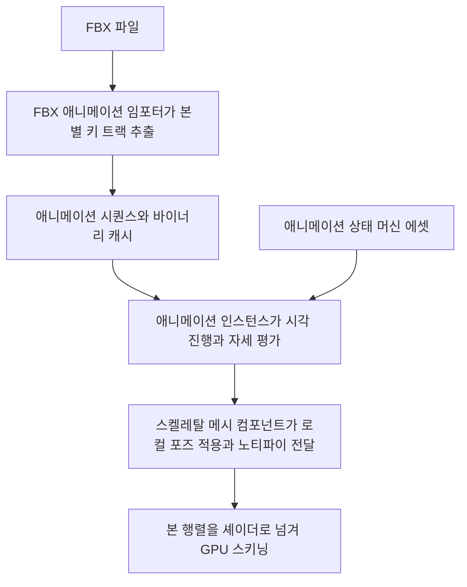

# 🏃 크래프톤 정글 게임테크랩 11주차

**한국어** | [English](./README_en.md)

***뛰어!***

2026.05.14. ~ 2026.05.21.

5팀: 장민준([@nacho2407](https://github.com/nacho2407)), 김기홍([@lin-ion](https://github.com/lin-ion)), 조상현([@HaXXOrBunny](https://github.com/HaXXOrBunny)), 권현수([@kwonhyeonsoo-goo](https://github.com/kwonhyeonsoo-goo))


3D 에디터의 스켈레탈 메시에 **본 애니메이션**을 더했습니다. FBX 파일의 애니메이션을 **애니메이션 시퀀스**로 읽어 재생하고, **애니메이션 상태 머신**으로 조건에 따라 상태를 전환하며 자세를 블렌딩합니다. 정점 변형은 정점 셰이더에서 하는 **GPU 스키닝**으로 옮겼습니다.


## 🎮 주차 소개

- FBX 파일의 애니메이션 스택을 본별 키 트랙을 가진 **애니메이션 시퀀스**로 읽어 들이고, 스켈레탈 메시 컴포넌트의 **애니메이션 인스턴스**가 매 프레임 시각을 진행시켜 본의 자세를 만듭니다. 시퀀스에는 정해진 시각에 이벤트를 알리는 **노티파이**를 달 수 있습니다

- **애니메이션 상태 머신**이 상태마다 애니메이션을 하나씩 두고, 변수와 트리거, Lua 함수로 쓴 조건에 따라 상태를 전환합니다. 전환하는 동안에는 두 상태의 자세를 블렌딩하며, 상태 머신은 노드 그래프 편집기에서 만듭니다

- 스켈레탈 메시 뷰어에 **애니메이션 모드**를 더해 타임라인으로 애니메이션을 재생하고 노티파이를 편집합니다

- 본 행렬을 셰이더로 넘겨 정점 셰이더에서 정점을 변형하는 **GPU 스키닝**을 더하고, 콘솔 명령으로 CPU 스키닝과 바꿔 가며 비교합니다. 헤더의 매크로를 읽어 타입 정보를 만드는 **리플렉션**과 크래시 덤프 확인 메뉴도 더했습니다


## ✨ 구현 결과

- **애니메이션 뷰어**

  Content Browser에서 FBX 파일을 더블 클릭해 연 뷰어의 툴바에서 `Mode`를 `Animation`으로 바꾸면 타임라인이 나타납니다. `Animation List`에서 FBX의 애니메이션 스택을 고르고, 재생, 역재생, 일시 정지, 정지, 처음과 끝으로 이동, 이전과 다음 프레임 버튼과 스크러버로 재생을 제어합니다. `Loop Playback`과 `Play Rate`로 반복 여부와 재생 속도를 바꿉니다

- **애니메이션 노티파이**

  뷰어의 스크러버를 우클릭해 `Add Notify Event`로 그 시각에 노티파이를 더하고, `Notify Detail`에서 이름, 시각, 길이, 이벤트 ID, 페이로드를 고칩니다. 재생 중에 그 시각을 지나면 컴포넌트의 델리게이트와 Lua 스크립트의 `OnAnimNotify` 함수로 전달됩니다

- **애니메이션 시퀀스 에셋**

  뷰어의 `Save AnimSequence Asset`으로 고른 애니메이션 스택을 `.animsequence` 에셋으로 저장합니다. 레벨에서 스켈레탈 메시 컴포넌트를 선택하고 Details 창의 `AnimSequenceAsset`에 에셋을 끌어다 놓거나 목록에서 골라 재생합니다. 읽어 들인 시퀀스는 바이너리 캐시로 저장해 다음부터는 FBX를 다시 해석하지 않습니다

- **애니메이션 상태 머신**

  Content Browser를 우클릭해 `Create`의 `Animation State Machine`으로 `.animsm` 에셋을 만들고, 더블 클릭해 편집기 탭을 엽니다. `Add State`로 상태를 더해 FBX와 애니메이션 스택, 반복 여부, 재생 속도를 정하고, 상태의 출력 핀을 다른 상태의 입력 핀으로 끌어 전환을 만듭니다. 전환을 고르면 `Inspector`에서 조건과 `Blend Time`, `Priority`, 인터럽트 여부를 고치고, `Validate`로 에셋을 검사합니다

- **애니메이션 블렌딩**

  상태 머신이 상태를 전환할 때 전환의 `Blend Time` 동안 두 상태의 자세를 본별로 섞어 자연스럽게 이어지게 합니다

- **Lua 연동**

  Lua 스크립트에서 `SetAnimStateMachine`으로 스켈레탈 메시에 상태 머신을 지정하고, `SetAnimVariableFloat`, `SetAnimVariableBool`, `SetAnimTrigger`로 변수와 트리거를 바꿔 상태 전환을 일으킵니다. 전환 조건을 Lua 함수로 쓸 수도 있습니다

- **GPU 스키닝**

  콘솔에서 `skinning gpu`, `skinning cpu`로 스키닝 방식을 바꾸고, `stat skinning`으로 자세 갱신과 CPU 스키닝에 걸린 시간, 스켈레탈 메시와 정점 수, 상수 버퍼 갱신량을 뷰포트에 표시해 비교합니다

- **본 가중치 히트맵**

  뷰어의 뷰 모드를 `Heatmap`으로 바꾸면 선택한 본이 각 정점에 주는 가중치를 색으로 표시합니다

- **크래시 덤프**

  콘솔 명령 `causecrash`로 일부러 크래시를 일으켜 미니덤프를 남기고, 메뉴의 `Help`에 있는 `Crash Reports`에서 가장 최근의 덤프와 로그, 덤프 폴더를 엽니다

- **리플렉션**

  헤더에 `UCLASS`, `UPROPERTY`, `UFUNCTION` 같은 매크로를 적어 두면 빌드 전에 도구가 헤더를 읽어 타입 정보 코드를 만듭니다. Details 창의 속성 UI와 Lua 바인딩이 이 정보를 씁니다


## 👥 팀원 및 담당 파트

| 팀원 | 담당 파트 및 주요 역할 |
|------|------------------------|
| **장민준**([@nacho2407](https://github.com/nacho2407)) | 애니메이션 런타임과 상태 머신 - 애니메이션 인스턴스와 단일 노드 재생, 노티파이 전달, 루트 모션, 포즈 블렌딩, 애니메이션 상태 머신과 노드 그래프 편집기, 상태 머신 Lua 바인딩, 데모 프리팹과 Lua 스크립트 |
| **김기홍**([@lin-ion](https://github.com/lin-ion)) | GPU 스키닝 - GPU 스키닝과 패스별 적용, 스키닝 전환 명령과 Stat, 본 가중치 히트맵, `causecrash` 명령, 셰이더 진입점 이름 정리, 기즈모와 다중 선택 버그 수정 |
| **조상현**([@HaXXOrBunny](https://github.com/HaXXOrBunny)) | FBX 애니메이션 임포트 - 레퍼런스 스켈레톤, FBX 애니메이션 시퀀스 임포터, 시퀀스 바이너리 캐시, `.animsequence` 에셋, 섹션별 본 팔레트 |
| **권현수**([@kwonhyeonsoo-goo](https://github.com/kwonhyeonsoo-goo)) | 리플렉션과 애니메이션 뷰어 - 프로퍼티 파서와 리플렉션 매크로, 리플렉션 기반 속성 UI와 Lua 바인딩, 뷰어 타임라인과 재생 컨트롤, 노티파이 편집 UI, 크래시 덤프 메뉴, 발자국 데칼 |


## 🧑‍💻 담당 작업 상세

### 애니메이션 인스턴스와 단일 노드 재생

- **목표**

  애니메이션 시퀀스의 키 데이터를 매 프레임 본의 자세로 바꿔 스키닝으로 넘기는 런타임 경로를 만듭니다

- **구현 내용**

  스켈레탈 메시 컴포넌트가 애니메이션 모드(`None`, `SingleNode`, `AnimInstance`)에 맞는 `UAnimInstance`를 소유합니다. 매 틱마다 인스턴스의 `NativeUpdateAnimation`으로 시각을 진행시키고, `EvaluateAnimation`으로 본별 로컬 포즈를 받아 컴포넌트의 로컬 포즈에 넣은 뒤 포즈를 더티로 표시합니다. 그 뒤의 전역 포즈와 스키닝 행렬 계산은 기존 스키닝 경로가 맡으므로, 애니메이션은 로컬 포즈를 만드는 일만 합니다

  `UAnimSingleNodeInstance`는 시퀀스 하나를 재생합니다. 시각은 재생 속도를 곱해 진행하며 음수 속도로 역재생합니다. 반복 재생이면 길이를 넘어간 시각을 반대쪽 끝으로 감고, 아니면 양 끝에서 멈춥니다. 뷰어의 스크러버처럼 시각을 직접 옮기는 경우를 위해, 틱을 기다리지 않고 현재 시각의 자세를 바로 다시 계산하는 경로를 따로 두었습니다

  인스턴스는 이름으로 찾는 실수, 불리언, 트리거 변수를 갖습니다. 게임 코드와 Lua 스크립트가 이 변수를 바꾸고, 상태 머신이 이 변수로 전환 조건을 평가합니다

- **관련 코드**

  [`Source/Engine/Animation/AnimInstance.cpp`](./Source/Engine/Animation/AnimInstance.cpp), [`Source/Engine/Animation/AnimSingleNodeInstance.cpp`](./Source/Engine/Animation/AnimSingleNodeInstance.cpp), [`Source/Engine/Animation/AnimationTypes.h`](./Source/Engine/Animation/AnimationTypes.h), [`Source/Engine/Component/SkeletalMeshComponent.cpp`](./Source/Engine/Component/SkeletalMeshComponent.cpp)


### 노티파이와 루트 모션

- **목표**

  애니메이션의 정해진 시각에 게임 코드로 이벤트를 알리고, 루트 본의 움직임을 액터의 이동으로 바꿉니다

- **구현 내용**

  노티파이는 이름, 시각, 길이, 이벤트 ID, 페이로드를 갖습니다. 매 갱신마다 이전 시각과 현재 시각 사이의 구간에 든 노티파이를 찾으며, 반복 재생으로 시각이 끝에서 처음으로 넘어간 프레임에는 구간을 둘로 나눠 검사합니다. 길이가 없는 노티파이는 `Instant`로, 길이가 있는 노티파이는 `Begin`, `Tick`, `End` 단계로 알립니다. 컴포넌트는 받은 노티파이를 `OnAnimNotify` 델리게이트로 내보내고, 스크립트 컴포넌트가 이를 Lua의 `OnAnimNotify` 함수로 넘깁니다

  상태 머신이 전환 중일 때는 두 상태의 노티파이가 함께 걸릴 수 있으므로, 블렌딩 가중치가 기준값 이상인 상태의 노티파이만 알리게 했습니다

  루트 모션은 `Ignore`, `ExtractOnly`, `ApplyToOwner` 세 모드를 둡니다. 이전 프레임의 루트 본 변환의 역변환에 현재 변환을 곱해 프레임 사이의 변화량을 구하고, 탐색이나 반복, 상태 전환으로 시각이 이어지지 않는 프레임에는 변화량을 내지 않고 기준만 다시 잡습니다. `ApplyToOwner`에서는 변화량을 소유 액터에 적용하고 루트 본을 바인드 포즈로 되돌려, 메시가 액터 이동과 본 이동으로 두 번 움직이지 않게 했습니다

- **관련 코드**

  [`Source/Engine/Animation/AnimationRuntime.cpp`](./Source/Engine/Animation/AnimationRuntime.cpp), [`Source/Engine/Animation/AnimInstance.cpp`](./Source/Engine/Animation/AnimInstance.cpp), [`Source/Engine/Animation/AnimationTypes.h`](./Source/Engine/Animation/AnimationTypes.h), [`Source/Engine/Runtime/Script/ScriptComponent.cpp`](./Source/Engine/Runtime/Script/ScriptComponent.cpp)


### 애니메이션 상태 머신

- **목표**

  여러 애니메이션을 상태로 묶고, 게임 상황에 따라 상태를 전환하면서 자세가 끊기지 않게 이어 줍니다

- **구현 내용**

  상태 머신은 json 형식의 `.animsm` 에셋입니다. 상태는 FBX 경로와 애니메이션 스택, 반복 여부, 재생 속도를 갖고, 전환은 출발과 도착 상태, 조건, 블렌드 시간, 우선순위, 인터럽트 허용 여부를 갖습니다. 로더는 편집기가 다루는 초안과 런타임에서 쓰는 에셋을 구분해, 런타임에서는 진입 상태와 상태의 애니메이션 참조, 전환이 가리키는 상태, 조건 값을 검증한 뒤에만 씁니다

  `UAnimStateMachineInstance`는 매 갱신마다 현재 상태에서 나가는 전환 중 조건이 참이고 우선순위가 가장 높은 것을 고르고, 없으면 어느 상태에서나 출발할 수 있는 Any 전환을 검사합니다. 조건은 불리언과 실수 변수 비교, 트리거, Lua 함수 가운데 하나이며, Lua 함수 조건은 소유 액터의 스크립트 컴포넌트에 있는 함수를 불러 결과를 받습니다

  전환 중에는 두 상태의 시각을 모두 진행시키고, 본마다 위치와 크기는 선형 보간, 회전은 구면 선형 보간으로 섞습니다. 전환 도중에도, 진행 중인 전환이 인터럽트를 허용하고 우선순위가 더 높은 Any 전환이나 도착 상태에서 나가는 전환의 조건이 참이 되면 **인터럽트**합니다. 이때 진행 중이던 전환의 블렌딩된 자세를 스냅샷으로 잡아 두고, 그 자세에서 새 상태로 블렌딩을 시작해 자세가 튀지 않게 했습니다

  스켈레탈 메시 컴포넌트에 상태 머신 지정과 변수, 트리거 접근 함수를 두고 Lua에 바인딩해, 스크립트에서 입력에 따라 상태 머신을 구동합니다

- **관련 코드**

  [`Source/Engine/Animation/AnimStateMachineInstance.cpp`](./Source/Engine/Animation/AnimStateMachineInstance.cpp), [`Source/Engine/Animation/AnimStateMachineTypes.h`](./Source/Engine/Animation/AnimStateMachineTypes.h), [`Source/Engine/Animation/AnimationRuntime.cpp`](./Source/Engine/Animation/AnimationRuntime.cpp), [`Source/Engine/Asset/AnimStateMachineLoader.cpp`](./Source/Engine/Asset/AnimStateMachineLoader.cpp), [`Source/Engine/Runtime/Script/ScriptManagerComponentBindings.cpp`](./Source/Engine/Runtime/Script/ScriptManagerComponentBindings.cpp)


### 상태 머신 노드 그래프 편집기

- **목표**

  json 파일을 직접 고치지 않고 상태와 전환을 그래프로 보면서 상태 머신을 만들고 고칩니다

- **구현 내용**

  imgui-node-editor로 상태를 노드로, 전환을 링크로 그립니다. 상태 노드 안에서 FBX와 애니메이션 스택, 반복 여부, 재생 속도를 고르고 진입 상태로 지정합니다. 출력 핀을 다른 상태의 입력 핀으로 끌면 전환이 생기고, Any State 노드에서 끌면 Any 전환이 됩니다. 전환 링크를 고르면 `Inspector`에서 조건의 종류와 변수, 비교 연산, 값, 블렌드 시간, 우선순위, 인터럽트 허용 여부를 고칩니다

  편집기는 Content Browser에서 `.animsm` 에셋을 더블 클릭해 열고, 새로 만들기와 불러오기, 저장, 다른 이름으로 저장, 검사를 지원합니다. 노드 위치도 에셋에 함께 저장해 다시 열었을 때 배치가 유지됩니다

- **관련 코드**

  [`Source/Editor/UI/EditorAnimStateMachineWidget.cpp`](./Source/Editor/UI/EditorAnimStateMachineWidget.cpp), [`Source/Editor/UI/EditorAnimStateMachineWidget.h`](./Source/Editor/UI/EditorAnimStateMachineWidget.h), [`Source/Editor/UI/EditorContentBrowserWidget.cpp`](./Source/Editor/UI/EditorContentBrowserWidget.cpp)


## 🛠️ 기술 스택

- **Language**: C++20

- **Graphics API**: DirectX 11

- **Build**: Visual Studio 2026, MSBuild

- **Libraries**: Autodesk FBX SDK, Dear ImGui, DirectX Tool Kit for DirectX 11, imgui-node-editor, LuaJIT, RmlUi, SimpleJSON, sol2, SoLoud


## 🖥️ 구조



- 동작 흐름

    1. FBX 애니메이션 임포터가 애니메이션 스택마다 본별 위치, 회전, 크기 키를 읽어 애니메이션 시퀀스를 만듭니다. 바이너리 캐시가 있으면 캐시를 읽습니다

    2. 스켈레탈 메시 컴포넌트가 애니메이션 모드에 맞는 애니메이션 인스턴스를 만들고 매 프레임 갱신합니다

    3. 단일 노드 인스턴스는 시퀀스 하나의 시각을 진행시키고, 상태 머신 인스턴스는 조건을 평가해 상태를 전환하며 전환 중에는 두 상태의 자세를 블렌딩합니다

    4. 인스턴스가 지나간 구간의 노티파이를 모아 컴포넌트로 넘기고, 컴포넌트가 델리게이트와 Lua 스크립트로 전달합니다

    5. 평가한 로컬 포즈로 전역 포즈와 스키닝 행렬을 만들고, 본 행렬을 셰이더로 넘겨 정점 셰이더에서 정점을 변형합니다


## 📁 디렉토리 구조

```
week11/
├── week11.sln                  // 솔루션
├── Asset/                      // 재질, 메시, 프리팹, 씬, 커브, 텍스처, 애니메이션 시퀀스, 상태 머신, UI 문서
├── BuildTools/                 // RmlUi, SoLoud 정적 라이브러리 빌드 스크립트
├── Docs/                       // README 미디어
├── LuaDefinitions/             // Lua 편집기용 엔진 API 정의
├── LuaScript/                  // Lua 스크립트
├── Resources/                  // 프로그램 아이콘
├── Shaders/                    // HLSL 셰이더
├── Source/                     // 진입점
│   ├── Editor/                 // 에디터 엔진과 렌더 파이프라인
│   │   ├── Asset/              // 에셋 서비스
│   │   ├── Command/            // 에디터 명령
│   │   ├── Input/              // 뷰포트 입력 매핑과 월드 컨트롤러
│   │   ├── Notification/       // 알림
│   │   ├── PIE/                // PIE 세션
│   │   ├── Packaging/          // 게임 패키징
│   │   ├── Scene/              // 씬 서비스
│   │   ├── Selection/          // 선택 관리
│   │   ├── Settings/           // 에디터와 프로젝트 설정
│   │   ├── UI/                 // 에디터 위젯, 뷰어 창, 상태 머신 편집기, 액터 시퀀서
│   │   ├── Undo/               // 실행 취소
│   │   ├── Viewer/             // 메시와 애니메이션 뷰어
│   │   └── Viewport/           // 뷰포트 클라이언트와 내비게이션
│   ├── Engine/
│   │   ├── Animation/          // 애니메이션 시퀀스, 애니메이션 인스턴스, 상태 머신, 액터 시퀀스
│   │   ├── Asset/              // FBX 임포터, 애니메이션 임포터와 로더, Wavefront OBJ 로더, 메시 에셋, 바이너리 직렬화
│   │   ├── Audio/              // 오디오 시스템
│   │   ├── Camera/             // 카메라 매니저와 카메라 셰이크
│   │   ├── Collision/          // 충돌과 레이 판정
│   │   ├── Component/          // 컴포넌트
│   │   ├── Core/               // 공통 타입, 리소스 관리, 경로, 크래시 덤프
│   │   ├── GameFramework/      // 액터, 월드, 게임 모드
│   │   ├── Geometry/           // 기하 타입
│   │   ├── Input/              // 입력 시스템
│   │   ├── Math/               // 수학
│   │   ├── Object/             // UObject, 이름
│   │   ├── ReflectionSystem/   // 리플렉션 타입 정보와 프로퍼티
│   │   ├── Render/             // 렌더러와 GPU 리소스
│   │   ├── Runtime/            // 엔진 루프, 창, Lua 스크립트
│   │   ├── Serialization/      // 씬과 프리팹 저장
│   │   ├── Slate/              // 창과 스플리터
│   │   ├── Spatial/            // BVH, KD 트리
│   │   └── UI/                 // RmlUi 런타임 UI
│   ├── Launch/                 // 실행 모드 선택
│   └── Misc/                   // OBJ 뷰어
├── ThirdParty/                 // Dear ImGui, imgui-node-editor, LuaJIT, RmlUi, SimpleJSON, sol2, SoLoud
└── Tools/                      // 리플렉션 코드 생성 도구
```


## ❓ 빌드 및 실행

### 릴리즈 실행

일부 에셋과 라이브러리의 라이선스 문제로 인해 이 주차의 실행 파일은 제공하지 않습니다.


### 소스 빌드

일부 에셋과 라이브러리를 라이선스 문제로 저장소에 포함하지 못해, 이 주차는 저장소만으로 빌드할 수 없습니다.


## ⌨️ 단축키

| 단축키 | 동작 |
|--------|------|
| **Q / W / E / R, 1 / 2 / 3 / 4** | 편집 모드 전환(선택, 이동, 회전, 크기) |
| **Tab** | 편집 모드 순환 |
| **Space** | 기즈모 모드 순환(이동, 회전, 크기) |
| **X** | 기즈모 기준 전환(월드, 로컬) |
| **F** | 선택한 액터 쪽으로 카메라 이동 |
| **Ctrl + A** | 모든 액터 선택 |
| **Ctrl + Alt + 드래그** | 박스 선택(Shift를 함께 누르면 기존 선택에 추가) |
| **Ctrl + D** | 선택한 액터 복제 |
| **Delete** | 선택한 액터 삭제 |
| **F2** | 선택한 액터 이름 바꾸기 |
| **Ctrl + Z / Ctrl + Shift + Z** | 실행 취소, 다시 실행 |
| **Ctrl + N / Ctrl + O / Ctrl + S / Ctrl + Shift + S** | 새 씬, 씬 열기, 씬 저장, 다른 이름으로 저장 |
| **Ctrl + Space** | Content Browser 열기와 닫기 |
| **\`** | 콘솔 입력창으로 이동, 콘솔 창 열기, 닫기 순환 |
| **Esc** | PIE 종료 |
| **F8** | PIE 중 빙의와 해제 전환 |
| **Shift + F1** | PIE 중 마우스 커서 풀기 |


## 📄 서드파티 라이브러리

| 이름 | 저작자 | 버전 | 라이선스 |
|------|--------|------|----------|
| **[Autodesk FBX SDK](https://aps.autodesk.com/developer/overview/fbx-sdk)** | Autodesk, Inc. | 2020.3.9 | Autodesk License and Services Agreement |
| **[Dear ImGui](https://github.com/ocornut/imgui)** | Omar Cornut | 1.92.7 WIP | [MIT License](./ThirdParty/ImGui/LICENSE.txt) |
| **[DirectX Tool Kit for DirectX 11](https://github.com/microsoft/DirectXTK)** | Microsoft Corporation. | - | MIT License |
| **[imgui-node-editor](https://github.com/thedmd/imgui-node-editor)** | Michał Cichoń | 0.9.3 | [MIT License](./ThirdParty/imgui-node-editor/LICENSE) |
| **[LuaJIT](https://luajit.org)** | Mike Pall | 2.1 | [MIT License](./ThirdParty/luajit/COPYRIGHT) |
| **[RmlUi](https://github.com/mikke89/RmlUi)** | The RmlUi Team, and contributors | - | [MIT License](./ThirdParty/RmlUi/LICENSE.txt) |
| **[SimpleJSON](https://github.com/nbsdx/SimpleJSON)** | Neil | - | Do What the Fuck You Want to Public License |
| **[sol2](https://github.com/ThePhD/sol2)** | Rapptz, ThePhD, and contributors | 3.5.0 | [MIT License](./ThirdParty/sol/LICENSE.txt) |
| **[SoLoud](https://github.com/jarikomppa/soloud)** | Jari Komppa | 202002 | [zlib License](./ThirdParty/SoLoud/LICENSE) |


## 🎨 서드파티 에셋

| 이름 | 저작자 | 라이선스 |
|------|--------|----------|
| **[3d-cubes](https://github.com/garykac/3d-cubes)** | Gary Kac | - |
| **[Abandoned children's slide](https://sketchfab.com/3d-models/abandoned-childrens-slide-11de2b21ec264c0a814ac024c45ab425)** | sergeilihandristov | [Creative Commons Attribution 4.0 International](https://creativecommons.org/licenses/by/4.0/) |
| **[logo.js](https://github.com/voodootikigod/logo.js)** | Christopher Williams | [MIT License](./Resources/Editor/Branding/logo.js-LICENSE) |


## ⚖️ 라이선스

이 주차의 코드 중 장민준이 작성한 부분은 MIT 라이선스로 공개하며, 다른 기여자가 작성한 부분의 권리는 각 기여자에게 있습니다. 자세한 내용은 [LICENSE](../LICENSE)를 확인해 주세요.
