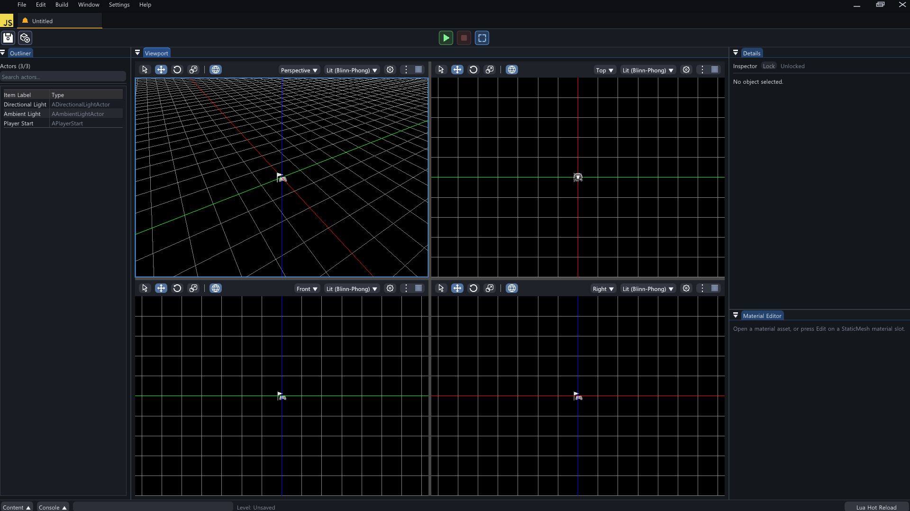
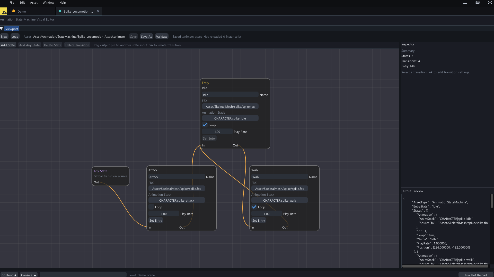
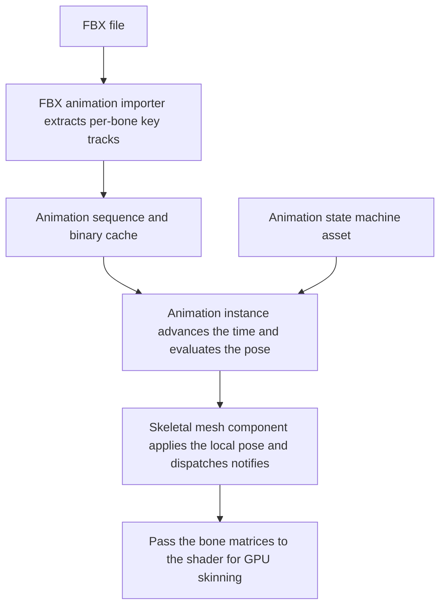

# 🏃 KRAFTON Jungle game tech Lab - Week 11

[한국어](./README.md) | **English**

***Let's go, move!***

2026.05.14. ~ 2026.05.21.

Team 5: 장민준([@nacho2407](https://github.com/nacho2407)), 김기홍([@lin-ion](https://github.com/lin-ion)), 조상현([@HaXXOrBunny](https://github.com/HaXXOrBunny)), 권현수([@kwonhyeonsoo-goo](https://github.com/kwonhyeonsoo-goo))






We added **bone animation** to the skeletal meshes of the 3D editor. Animations in FBX files are read as **animation sequences** and played back, and an **animation state machine** switches states according to conditions while blending poses. Vertex deformation moved to **GPU skinning**, which runs in the vertex shader.


## 🎮 Week Overview

- The animation stacks of an FBX file are read as **animation sequences** with per-bone key tracks, and the **animation instance** of a skeletal mesh component advances the time every frame to produce the bone poses. A sequence can carry **notifies** that announce events at set times

- An **animation state machine** holds one animation per state and switches states according to conditions written with variables, triggers, and Lua functions. During a transition it blends the poses of the two states, and state machines are authored in a node graph editor

- The skeletal mesh viewer gained an **animation mode** that plays animations on a timeline and edits notifies

- **GPU skinning**, which passes the bone matrices to the shader and deforms the vertices in the vertex shader, was added and can be compared with CPU skinning by switching between them with a console command. We also added **reflection**, which reads macros in headers to generate type information, and a menu for checking crash dumps


## ✨ Features

- **Animation Viewer**

  Changing `Mode` to `Animation` in the toolbar of the viewer opened by double-clicking an FBX file in the Content Browser shows a timeline. `Animation List` selects one of the FBX's animation stacks, and playback is controlled with the play, reverse play, pause, stop, jump to start and end, and previous and next frame buttons along with the scrubber. `Loop Playback` and `Play Rate` change looping and the playback speed

- **Animation Notifies**

  Right-clicking the scrubber in the viewer and choosing `Add Notify Event` adds a notify at that time, and `Notify Detail` edits its name, time, duration, event ID, and payload. When playback passes that time, the notify is delivered to the component's delegate and to the `OnAnimNotify` function of Lua scripts

- **Animation Sequence Assets**

  `Save AnimSequence Asset` in the viewer saves the selected animation stack as an `.animsequence` asset. Selecting a skeletal mesh component in a level and dragging the asset onto `AnimSequenceAsset` in the Details window, or choosing it from the list, plays it. An imported sequence is saved as a binary cache, so the FBX is not parsed again from then on

- **Animation State Machine**

  Right-clicking in the Content Browser and choosing `Animation State Machine` under `Create` creates an `.animsm` asset, and double-clicking it opens an editor tab. `Add State` adds a state whose FBX, animation stack, looping, and play rate are then set, and dragging a state's output pin to another state's input pin creates a transition. Selecting a transition lets its condition, `Blend Time`, `Priority`, and interrupt options be edited in the `Inspector`, and `Validate` checks the asset

- **Animation Blending**

  When the state machine switches states, the poses of the two states are blended per bone over the transition's `Blend Time` so that they connect smoothly

- **Lua Integration**

  A Lua script assigns a state machine to a skeletal mesh with `SetAnimStateMachine` and changes variables and triggers with `SetAnimVariableFloat`, `SetAnimVariableBool`, and `SetAnimTrigger` to cause state transitions. A transition condition can also be written as a Lua function

- **GPU Skinning**

  `skinning gpu` and `skinning cpu` in the console switch the skinning method, and `stat skinning` shows the time spent on pose updates and CPU skinning, the number of skeletal meshes and vertices, and the amount of constant buffer updates in the viewport for comparison

- **Bone Weight Heatmap**

  Changing the viewer's view mode to `Heatmap` shows the weight that the selected bone gives to each vertex as a color

- **Crash Dumps**

  The console command `causecrash` crashes the engine on purpose to leave a minidump, and `Crash Reports` under `Help` in the menu opens the latest dump, the log, and the dump folder

- **Reflection**

  When macros such as `UCLASS`, `UPROPERTY`, and `UFUNCTION` are written in headers, a tool reads the headers before the build and generates type information code. The property UI in the Details window and the Lua bindings use this information


## 👥 Team

| Member | Responsibilities |
|------|------------------------|
| **장민준**([@nacho2407](https://github.com/nacho2407)) | Animation runtime and state machine - animation instance and single node playback, notify dispatch, root motion, pose blending, animation state machine and node graph editor, state machine Lua bindings, demo prefab and Lua scripts |
| **김기홍**([@lin-ion](https://github.com/lin-ion)) | GPU skinning - GPU skinning and its application to each pass, skinning switch command and stat, bone weight heatmap, `causecrash` command, shader entry point naming cleanup, gizmo and multi-selection bug fixes |
| **조상현**([@HaXXOrBunny](https://github.com/HaXXOrBunny)) | FBX animation import - reference skeleton, FBX animation sequence importer, sequence binary cache, `.animsequence` assets, per-section bone palettes |
| **권현수**([@kwonhyeonsoo-goo](https://github.com/kwonhyeonsoo-goo)) | Reflection and animation viewer - property parser and reflection macros, reflection-based property UI and Lua bindings, viewer timeline and playback controls, notify editing UI, crash dump menu, footstep decals |


## 🧑‍💻 Work Details

### Animation Instance and Single Node Playback

- **Goal**

  Build the runtime path that turns the key data of an animation sequence into bone poses every frame and hands them to skinning

- **Implementation**

  The skeletal mesh component owns a `UAnimInstance` that matches its animation mode(`None`, `SingleNode`, `AnimInstance`). On every tick, the instance's `NativeUpdateAnimation` advances the time, `EvaluateAnimation` returns the per-bone local poses, and the component stores them in its local pose and marks the pose dirty. The global poses and skinning matrices that follow are computed by the existing skinning path, so animation only has to produce the local pose

  `UAnimSingleNodeInstance` plays a single sequence. The time advances multiplied by the play rate, and a negative rate plays in reverse. With looping, a time that passes the length wraps around to the opposite end, and without it the time stops at either end. For cases where the time is moved directly, such as the viewer's scrubber, there is a separate path that recomputes the pose at the current time right away without waiting for a tick

  An instance holds float, boolean, and trigger variables that are looked up by name. Game code and Lua scripts change these variables, and the state machine evaluates its transition conditions with them

- **Related Code**

  [`Source/Engine/Animation/AnimInstance.cpp`](./Source/Engine/Animation/AnimInstance.cpp), [`Source/Engine/Animation/AnimSingleNodeInstance.cpp`](./Source/Engine/Animation/AnimSingleNodeInstance.cpp), [`Source/Engine/Animation/AnimationTypes.h`](./Source/Engine/Animation/AnimationTypes.h), [`Source/Engine/Component/SkeletalMeshComponent.cpp`](./Source/Engine/Component/SkeletalMeshComponent.cpp)


### Notifies and Root Motion

- **Goal**

  Announce events to game code at set times in an animation, and turn the movement of the root bone into movement of the actor

- **Implementation**

  A notify has a name, a time, a duration, an event ID, and a payload. On every update, the notifies that fall in the range between the previous time and the current time are found, and on a frame where looping carries the time from the end back to the start, the range is split in two and both parts are checked. A notify without a duration is announced as `Instant`, and one with a duration is announced in the `Begin`, `Tick`, and `End` phases. The component sends the notifies it receives out through the `OnAnimNotify` delegate, and the script component passes them on to the `OnAnimNotify` function in Lua

  While the state machine is in a transition, the notifies of both states can fire together, so only the notifies of a state whose blend weight is at or above a threshold are announced

  Root motion has three modes, `Ignore`, `ExtractOnly`, and `ApplyToOwner`. The change between frames is obtained by multiplying the inverse of the previous frame's root bone transform by the current transform, and on a frame where the time is not continuous because of a seek, a loop, or a state transition, no change is produced and only the reference is reset. In `ApplyToOwner`, the change is applied to the owning actor and the root bone is returned to the bind pose, so that the mesh does not move twice through the actor movement and the bone movement

- **Related Code**

  [`Source/Engine/Animation/AnimationRuntime.cpp`](./Source/Engine/Animation/AnimationRuntime.cpp), [`Source/Engine/Animation/AnimInstance.cpp`](./Source/Engine/Animation/AnimInstance.cpp), [`Source/Engine/Animation/AnimationTypes.h`](./Source/Engine/Animation/AnimationTypes.h), [`Source/Engine/Runtime/Script/ScriptComponent.cpp`](./Source/Engine/Runtime/Script/ScriptComponent.cpp)


### Animation State Machine

- **Goal**

  Group several animations as states and switch between them according to the game situation while keeping the pose continuous

- **Implementation**

  A state machine is an `.animsm` asset in json format. A state has an FBX path and an animation stack, looping, and a play rate, and a transition has a source and a target state, a condition, a blend time, a priority, and interrupt permissions. The loader distinguishes the draft handled by the editor from the asset used at runtime, and at runtime the asset is used only after the entry state, the animation references of the states, the states that the transitions point to, and the condition values are validated

  On every update, `UAnimStateMachineInstance` picks the transition leaving the current state whose condition is true and whose priority is highest, and if there is none it checks the Any transitions, which can start from any state. A condition is one of a boolean or float variable comparison, a trigger, or a Lua function, and a Lua function condition calls a function in the script component of the owning actor and takes its result

  During a transition, the times of both states advance, and for each bone the translation and scale are blended with linear interpolation and the rotation with spherical linear interpolation. Even in the middle of a transition, it **interrupts** if the transition in progress allows interruption and the condition of a higher-priority Any transition or of a transition leaving the target state becomes true. At that point the blended pose of the transition in progress is captured as a snapshot, and blending toward the new state starts from that pose so that the pose does not pop

  The skeletal mesh component has functions for assigning a state machine and accessing variables and triggers, and they are bound to Lua so that a script drives the state machine according to input

- **Related Code**

  [`Source/Engine/Animation/AnimStateMachineInstance.cpp`](./Source/Engine/Animation/AnimStateMachineInstance.cpp), [`Source/Engine/Animation/AnimStateMachineTypes.h`](./Source/Engine/Animation/AnimStateMachineTypes.h), [`Source/Engine/Animation/AnimationRuntime.cpp`](./Source/Engine/Animation/AnimationRuntime.cpp), [`Source/Engine/Asset/AnimStateMachineLoader.cpp`](./Source/Engine/Asset/AnimStateMachineLoader.cpp), [`Source/Engine/Runtime/Script/ScriptManagerComponentBindings.cpp`](./Source/Engine/Runtime/Script/ScriptManagerComponentBindings.cpp)


### State Machine Node Graph Editor

- **Goal**

  Create and edit a state machine while viewing its states and transitions as a graph, without editing the json file by hand

- **Implementation**

  imgui-node-editor draws states as nodes and transitions as links. Inside a state node, the FBX, animation stack, looping, and play rate are chosen and the state can be set as the entry state. Dragging an output pin to another state's input pin creates a transition, and dragging from the Any State node creates an Any transition. Selecting a transition link lets the condition type and variable, comparison operator, value, blend time, priority, and interrupt permissions be edited in the `Inspector`

  The editor opens by double-clicking an `.animsm` asset in the Content Browser and supports creating, loading, saving, saving under another name, and validating. Node positions are saved in the asset as well, so the layout is kept when the asset is opened again

- **Related Code**

  [`Source/Editor/UI/EditorAnimStateMachineWidget.cpp`](./Source/Editor/UI/EditorAnimStateMachineWidget.cpp), [`Source/Editor/UI/EditorAnimStateMachineWidget.h`](./Source/Editor/UI/EditorAnimStateMachineWidget.h), [`Source/Editor/UI/EditorContentBrowserWidget.cpp`](./Source/Editor/UI/EditorContentBrowserWidget.cpp)


## 🛠️ Tech Stack

- **Language**: C++20

- **Graphics API**: DirectX 11

- **Build**: Visual Studio 2026, MSBuild

- **Libraries**: Autodesk FBX SDK, Dear ImGui, DirectX Tool Kit for DirectX 11, imgui-node-editor, LuaJIT, RmlUi, SimpleJSON, sol2, SoLoud


## 🖥️ Architecture



- Flow

    1. The FBX animation importer reads the per-bone translation, rotation, and scale keys of each animation stack and builds an animation sequence. If a binary cache exists, the cache is read

    2. The skeletal mesh component creates the animation instance that matches its animation mode and updates it every frame

    3. A single node instance advances the time of one sequence, and a state machine instance evaluates conditions to switch states and blends the poses of the two states during a transition

    4. The instance gathers the notifies in the range that has passed and hands them to the component, and the component delivers them to the delegate and to Lua scripts

    5. The global poses and skinning matrices are built from the evaluated local pose, and the bone matrices are passed to the shader so that the vertex shader deforms the vertices


## 📁 Directory Structure

```
week11/
├── week11.sln                  // Solution
├── Asset/                      // Materials, meshes, prefabs, scenes, curves, textures, animation sequences, state machines, UI documents
├── BuildTools/                 // Build scripts for the RmlUi and SoLoud static libraries
├── Docs/                       // README media
├── LuaDefinitions/             // Engine API definitions for Lua editors
├── LuaScript/                  // Lua scripts
├── Resources/                  // Program icon
├── Shaders/                    // HLSL shaders
├── Source/                     // Entry point
│   ├── Editor/                 // Editor engine and render pipeline
│   │   ├── Asset/              // Asset service
│   │   ├── Command/            // Editor commands
│   │   ├── Input/              // Viewport input mapping and world controller
│   │   ├── Notification/       // Notifications
│   │   ├── PIE/                // PIE session
│   │   ├── Packaging/          // Game packaging
│   │   ├── Scene/              // Scene service
│   │   ├── Selection/          // Selection management
│   │   ├── Settings/           // Editor and project settings
│   │   ├── UI/                 // Editor widgets, viewer window, state machine editor, and actor sequencer
│   │   ├── Undo/               // Undo
│   │   ├── Viewer/             // Mesh and animation viewer
│   │   └── Viewport/           // Viewport client and navigation
│   ├── Engine/
│   │   ├── Animation/          // Animation sequences, animation instances, state machine, and actor sequence
│   │   ├── Asset/              // FBX importer, animation importer and loaders, Wavefront OBJ loader, mesh assets, and binary serialization
│   │   ├── Audio/              // Audio system
│   │   ├── Camera/             // Camera manager and camera shake
│   │   ├── Collision/          // Collision and ray tests
│   │   ├── Component/          // Components
│   │   ├── Core/               // Common types, resource management, paths, and crash dumps
│   │   ├── GameFramework/      // Actors, world, and game mode
│   │   ├── Geometry/           // Geometry types
│   │   ├── Input/              // Input system
│   │   ├── Math/               // Math
│   │   ├── Object/             // UObject and names
│   │   ├── ReflectionSystem/   // Reflection type information and properties
│   │   ├── Render/             // Renderer and GPU resources
│   │   ├── Runtime/            // Engine loop, window, and Lua scripts
│   │   ├── Serialization/      // Scene and prefab saving
│   │   ├── Slate/              // Windows and splitters
│   │   ├── Spatial/            // BVH and KD tree
│   │   └── UI/                 // RmlUi runtime UI
│   ├── Launch/                 // Launch mode selection
│   └── Misc/                   // OBJ viewer
├── ThirdParty/                 // Dear ImGui, imgui-node-editor, LuaJIT, RmlUi, SimpleJSON, sol2, SoLoud
└── Tools/                      // Reflection code generation tool
```


## ❓ Build and Run

### Running the Release Build

Executables are not provided for this week because of license issues with some of the assets and libraries.


### Building from Source

Some assets and libraries could not be included in the repository because of license issues, so this week cannot be built from the repository alone.


## ⌨️ Shortcuts

| Shortcut | Action |
|--------|------|
| **Q / W / E / R, 1 / 2 / 3 / 4** | Switch the edit mode(select, move, rotate, scale) |
| **Tab** | Cycle the edit mode |
| **Space** | Cycle the gizmo mode(move, rotate, scale) |
| **X** | Toggle the gizmo space(world, local) |
| **F** | Move the camera to the selected actor |
| **Ctrl + A** | Select all actors |
| **Ctrl + Alt + Drag** | Box selection(hold Shift as well to add to the current selection) |
| **Ctrl + D** | Duplicate the selected actors |
| **Delete** | Delete the selected actors |
| **F2** | Rename the selected actor |
| **Ctrl + Z / Ctrl + Shift + Z** | Undo, redo |
| **Ctrl + N / Ctrl + O / Ctrl + S / Ctrl + Shift + S** | New scene, open scene, save scene, save as |
| **Ctrl + Space** | Open and close the Content Browser |
| **\`** | Cycle through focusing the console input, opening the console window, and closing it |
| **Esc** | End PIE |
| **F8** | Toggle between possessing and ejecting during PIE |
| **Shift + F1** | Release the mouse cursor during PIE |


## 📄 Third-Party Libraries

| Name | Author | Version | License |
|------|--------|------|----------|
| **[Autodesk FBX SDK](https://aps.autodesk.com/developer/overview/fbx-sdk)** | Autodesk, Inc. | 2020.3.9 | Autodesk License and Services Agreement |
| **[Dear ImGui](https://github.com/ocornut/imgui)** | Omar Cornut | 1.92.7 WIP | [MIT License](./ThirdParty/ImGui/LICENSE.txt) |
| **[DirectX Tool Kit for DirectX 11](https://github.com/microsoft/DirectXTK)** | Microsoft Corporation. | - | MIT License |
| **[imgui-node-editor](https://github.com/thedmd/imgui-node-editor)** | Michał Cichoń | 0.9.3 | [MIT License](./ThirdParty/imgui-node-editor/LICENSE) |
| **[LuaJIT](https://luajit.org)** | Mike Pall | 2.1 | [MIT License](./ThirdParty/luajit/COPYRIGHT) |
| **[RmlUi](https://github.com/mikke89/RmlUi)** | The RmlUi Team, and contributors | - | [MIT License](./ThirdParty/RmlUi/LICENSE.txt) |
| **[SimpleJSON](https://github.com/nbsdx/SimpleJSON)** | Neil | - | Do What the Fuck You Want to Public License |
| **[sol2](https://github.com/ThePhD/sol2)** | Rapptz, ThePhD, and contributors | 3.5.0 | [MIT License](./ThirdParty/sol/LICENSE.txt) |
| **[SoLoud](https://github.com/jarikomppa/soloud)** | Jari Komppa | 202002 | [zlib License](./ThirdParty/SoLoud/LICENSE) |


## 🎨 Third-Party Assets

| Name | Author | License |
|------|--------|----------|
| **[3d-cubes](https://github.com/garykac/3d-cubes)** | Gary Kac | - |
| **[Abandoned children's slide](https://sketchfab.com/3d-models/abandoned-childrens-slide-11de2b21ec264c0a814ac024c45ab425)** | sergeilihandristov | [Creative Commons Attribution 4.0 International](https://creativecommons.org/licenses/by/4.0/) |
| **[logo.js](https://github.com/voodootikigod/logo.js)** | Christopher Williams | [MIT License](./Resources/Editor/Branding/logo.js-LICENSE) |


## ⚖️ License

The portions of this week's code written by Jang Minjun are released under the MIT License, and the rights to the portions written by other contributors belong to their respective contributors. See [LICENSE](../LICENSE) for details.
