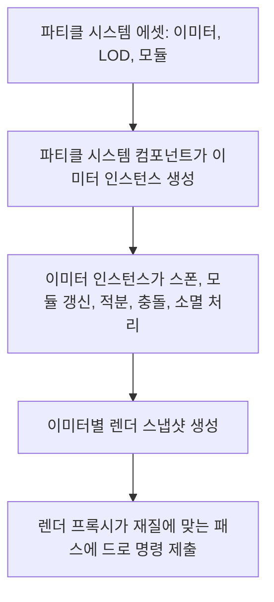

# 🌪️ 크래프톤 정글 게임테크랩 12주차

**한국어** | [English](./README_en.md)

***먼지의 춤***

2026.05.21. ~ 2026.05.28.

4팀: 장민준([@nacho2407](https://github.com/nacho2407)), 김태현([@MozziDog](https://github.com/MozziDog)), 전현길([@alogeclock](https://github.com/alogeclock)), 강건우([@keonwookang0914](https://github.com/keonwookang0914))


3D 에디터에 **파티클 시스템**을 더했습니다. 이미터에 모듈을 쌓아 입자의 생성과 움직임, 소멸을 정하고, 입자를 **스프라이트, 메시, 빔, 리본**으로 그립니다. 파티클 에셋은 결과를 미리 보면서 고치는 **파티클 에디터**에서 만듭니다.


## 🎮 주차 소개

- 파티클 시스템은 여러 **이미터**로 이루어지고, 이미터는 스폰, 수명, 위치, 속도, 색, 크기 같은 **모듈**을 쌓아 입자의 동작을 정합니다. 이미터마다 입자 데이터를 하나의 메모리 블록에 담아 매 프레임 생성과 갱신, 소멸을 처리합니다

- 입자는 카메라를 바라보는 **스프라이트**, 인스턴싱으로 그리는 **메시**, 두 지점을 잇는 **빔**, 지나간 자리를 잇는 **리본**으로 나타내고, 재질에 따라 불투명 패스나 반투명 패스에서 그립니다

- **파티클 에디터**에서 이미터와 모듈을 더하고 속성과 커브를 고치면서 결과를 미리 봅니다. 만든 에셋은 **파티클 시스템 컴포넌트**로 레벨에 배치합니다

- 카메라와의 거리에 따라 모듈 값을 바꾸는 **LOD**, 레벨의 물체와 부딪히는 **충돌**, 입자의 생성과 소멸, 충돌 시점에 다른 이미터가 반응하는 **이벤트**를 더했습니다


## ✨ 구현 결과

- **파티클 에디터**

  Content Browser에서 `.particle` 에셋을 더블 클릭하면 파티클 에디터 탭이 열립니다. 뷰포트에서 결과를 미리 보고, 이미터 패널에서 이미터와 모듈을 고르며, 디테일 패널에서 고른 모듈의 속성을 고칩니다. 툴바에서 저장, 시뮬레이션 다시 시작, 실행 취소와 다시 실행, 바운드와 축 표시, 배경색을 다룹니다

- **이미터와 모듈**

  이미터 패널을 우클릭해 `Add Emitter`로 이미터를 더하고, 이미터를 고른 뒤 `Add Module`에서 모듈을 더합니다. 모듈은 `Basic`, `Type Data`, `Lifetime`, `Location`, `Velocity`, `Color`, `Size`, `Animation`, `Collision`, `Beam`, `Events`, `Rotation`으로 나뉘어 있으며, 모듈마다 체크 박스로 켜고 끕니다. 이미터는 복제하거나 순서를 바꿀 수 있고, 하나만 따로 보는 솔로 버튼이 있습니다

- **스프라이트, 메시, 빔, 리본 이미터**

  `Type Data` 모듈이 이미터의 형태를 정합니다. `Sprite Type Data`는 카메라를 바라보는 사각형을, `Mesh Type Data`는 지정한 스태틱 메시를 입자마다 그립니다. `Beam Type Data`는 두 끝점을 잇는 띠를, `Ribbon Type Data`는 이미터가 지나간 자리를 잇는 띠를 그립니다

- **커브 에디터**

  모듈의 값을 `Constant`, `Random Range`, `Curve`, `Random Range Curve` 가운데 하나로 정합니다. 커브로 정한 값은 파티클 에디터의 커브 에디터 패널에서 키를 더하고 접선 방식(`Auto`, `Break`, `Linear`, `Constant`)을 고릅니다. Content Browser를 우클릭해 `Create`의 `Curve`에서 실수, 벡터, 색 커브 에셋을 따로 만들 수도 있습니다

- **레벨 배치**

  `Particle System` 액터를 레벨에 놓고 Details 창의 `Template`에 파티클 에셋을 지정합니다. `Instance Parameters`에 이름과 값을 더하면 빔의 끝점처럼 인스턴스마다 다른 값을 넘길 수 있습니다

- **Show Flag와 Stat**

  `Show Flags`의 `Particle`을 꺼 파티클을 숨깁니다. 콘솔 명령 `stat particles`나 뷰포트 메뉴 `Stats`의 `Particles`로 스프라이트, 메시, 빔, 트레일별로 이번 프레임에 생성된 수와 살아 있는 수, 소멸한 수, 폴리곤 수를 표시하고, 드로 콜 수와 틱, 정렬에 걸린 시간을 함께 표시합니다

- **파티클 LOD**

  파티클 에디터 툴바의 `Add LOD`로 LOD를 더하고 `Lower LOD`, `Upper LOD`로 옮겨 다니며 LOD마다 모듈 값을 따로 정합니다. 파티클 시스템의 `LOD Distances`에 LOD가 시작되는 거리를 적으면 카메라와의 거리에 따라 LOD가 바뀝니다

- **파티클 충돌**

  `Collision Module`을 더하면 입자가 레벨의 물체와 부딪힙니다. `Damping Factor`로 튕길 때 줄어드는 속도를, `Max Collisions`와 `Collision Complete Option`으로 정해진 횟수만큼 부딪힌 뒤 소멸할지 멈출지를 정합니다

- **파티클 이벤트**

  `Event Generator`가 입자의 생성, 소멸, 충돌 시점에 이름을 붙인 이벤트를 내고, 다른 이미터의 `Event Receiver Spawn`이 그 이벤트를 받아 일어난 자리에 입자를 만듭니다

- **SubUV**

  `SubUV Module`로 스프라이트 시트의 칸을 수명에 따라 차례로 넘기거나 입자마다 한 칸을 무작위로 골라 씁니다


## 👥 팀원 및 담당 파트

| 팀원 | 담당 파트 및 주요 역할 |
|------|------------------------|
| **장민준**([@nacho2407](https://github.com/nacho2407)) | 파티클 코어 - 입자 데이터 구조와 이미터 인스턴스(스폰, 갱신, 소멸), 분포와 난수 스트림, 루프와 버스트, 수명 기반 모듈, 파티클 LOD, Beam 이미터 |
| **김태현**([@MozziDog](https://github.com/MozziDog)) | 파티클 렌더링 - 렌더 패스 재구성과 반투명 패스, 파티클 렌더 프록시, 스프라이트와 메시와 빔과 리본 렌더링, 파티클 Stat, 메시 회전과 속도 기반 색 모듈, 데모 씬 |
| **전현길**([@alogeclock](https://github.com/alogeclock)) | 파티클 에디터 - 파티클 에디터 뷰어와 이미터 패널, 디테일 패널, 커브 에디터와 커브 에셋, 파티클 에셋 저장과 불러오기, 파티클 시스템 액터, SubUV 모듈, 리본 이미터 |
| **강건우**([@keonwookang0914](https://github.com/keonwookang0914)) | 파티클 시스템 컴포넌트와 충돌, 이벤트 - 파티클 시스템 컴포넌트, 메시 이미터, 거리 기반 LOD 선택, 파티클 충돌(Broad Phase, Narrow Phase), 파티클 이벤트 |


## 🧑‍💻 담당 작업 상세

### 입자 데이터와 이미터 인스턴스

- **목표**

  많은 입자를 매 프레임 생성하고 갱신하고 없애는 일을 메모리를 다시 할당하지 않고 처리하는 런타임 구조를 만듭니다

- **구현 내용**

  `FParticleEmitterInstance`가 이미터 하나의 입자를 모두 갖습니다. 입자 하나는 위치, 속도, 수명, 크기, 색 같은 공통 상태인 `FBaseParticle` 뒤에 모듈이 요청한 만큼의 페이로드를 붙인 고정 크기 칸이고, 이 칸을 최대 입자 수만큼 이어 붙인 블록을 16바이트 정렬로 한 번만 할당합니다. 블록 끝에는 활성 순서를 실제 칸 번호로 바꾸는 16비트 인덱스 배열을 둡니다

  입자를 없앨 때는 데이터를 옮기지 않습니다. 수명이 끝난 입자에 소멸 예약 표시만 하고, 틱의 처음과 끝에서 인덱스 배열만 정리해 살아 있는 입자를 앞쪽으로 모읍니다. 갱신 중에는 배열이 바뀌지 않으므로 모듈이 순회 도중에 입자를 없애도 안전하고, 순회 매크로가 소멸 예약된 입자를 건너뜁니다

  한 틱은 소멸 예약된 입자 정리, 스폰, 수명 진행, 모듈 갱신, 위치와 회전 적분, 충돌, 다시 정리의 순서로 진행합니다. 스폰 수는 초당 생성 수에 지난 시간을 곱하고 남은 소수 부분을 다음 프레임으로 넘겨 프레임 속도와 상관없이 일정하게 유지합니다. 정해진 시각에 한꺼번에 내보내는 버스트는 루프마다 한 번만 터지도록 기록하고, 확률과 개수 범위를 줄 수 있습니다

  이미터의 재생 시간과 반복 횟수를 다루기 위해, 한 프레임이 루프의 끝을 넘어가면 프레임을 루프 경계에서 나눠 구간마다 따로 스폰을 계산합니다. 반복 횟수를 정하거나 끝없이 반복하게 할 수 있습니다

- **관련 코드**

  [`Source/Engine/Particle/ParticleEmitterInstance.cpp`](./Source/Engine/Particle/ParticleEmitterInstance.cpp), [`Source/Engine/Particle/ParticleEmitterInstance.h`](./Source/Engine/Particle/ParticleEmitterInstance.h), [`Source/Engine/Particle/ParticleTypes.h`](./Source/Engine/Particle/ParticleTypes.h), [`Source/Engine/Particle/ParticleHelper.h`](./Source/Engine/Particle/ParticleHelper.h)


### 분포와 모듈

- **목표**

  모듈의 값을 상수, 무작위 범위, 커브로 정할 수 있게 하고, 같은 설정이면 같은 결과가 나오게 합니다

- **구현 내용**

  실수, 벡터, 색 값을 담는 분포 타입을 두었습니다. 분포는 `Constant`, `Random Range`, `Curve`, `Random Range Curve` 네 가지 방식 가운데 하나로 값을 내며, 커브 방식은 입자가 생성될 때는 생성 시각으로, 갱신할 때는 수명 진행률로 커브 에셋을 읽습니다. 벡터 분포는 축마다 따로 뽑을지 세 축에 같은 무작위 값을 쓸지 고를 수 있습니다

  무작위 값은 이미터마다 가진 선형 합동 생성기에서 뽑습니다. 시드를 정해 두면 실행할 때마다 같은 결과가 나오고, 루프가 돌 때 시드를 되돌리는 설정도 두었습니다. 두 커브 사이의 값을 고르는 방식처럼 수명 동안 같은 무작위 값을 써야 하는 모듈은, 입자가 생성될 때 뽑은 값을 입자의 페이로드에 기억해 둡니다

  모듈은 입자가 생성될 때 부르는 `Spawn`과 매 프레임 부르는 `Update`를 구현하고, 입자마다 따로 기억할 값이 있으면 필요한 바이트 수를 알려 페이로드 칸을 받습니다. 이미터는 LOD마다 스폰 모듈과 갱신 모듈의 목록, 모듈별 페이로드 위치를 미리 계산해 두고 틱에서는 이 목록만 돕니다

  이 구조 위에 수명에 따른 색과 크기, 속도 변화, 가속, 속도에 따른 크기 변화 모듈을 더했습니다

- **관련 코드**

  [`Source/Engine/Particle/ParticleDistributions.h`](./Source/Engine/Particle/ParticleDistributions.h), [`Source/Engine/Particle/ParticleRandom.h`](./Source/Engine/Particle/ParticleRandom.h), [`Source/Engine/Particle/ParticleModules.cpp`](./Source/Engine/Particle/ParticleModules.cpp), [`Source/Engine/Particle/ParticleModules.h`](./Source/Engine/Particle/ParticleModules.h), [`Source/Engine/Particle/ParticleAsset.h`](./Source/Engine/Particle/ParticleAsset.h)


### 파티클 LOD

- **목표**

  카메라에서 먼 파티클의 비용을 줄이되, LOD가 바뀌는 순간에 입자가 사라지거나 튀지 않게 합니다

- **구현 내용**

  모든 LOD가 LOD 0의 입자 칸 구성을 함께 씁니다. LOD를 바꿀 때는 입자 블록을 다시 할당하지 않고, 지금 실행할 모듈 목록을 가리키는 캐시만 바꿉니다. 이미 살아 있는 입자는 그대로 남아 새 LOD의 모듈로 갱신됩니다

  칸 구성을 함께 쓰려면 모든 LOD의 모듈 구성이 같아야 하므로, 모듈을 더하고 빼는 일은 LOD 0에서만 하게 에디터에서 막았습니다. 런타임에서도 낮은 LOD의 모듈 수와 종류가 LOD 0과 같은지 검사해, 어긋나면 낮은 LOD로 바꾸지 않고 LOD 0을 씁니다

  낮은 LOD의 최대 입자 수는 새로 만드는 입자 수의 상한으로만 씁니다. 꺼 둔 LOD에서는 스폰과 갱신을 멈추지만 수명은 계속 진행시켜, 남아 있던 입자가 자연스럽게 사라지게 했습니다

  카메라가 경계 거리 근처에서 움직일 때 LOD가 계속 오가지 않도록, 경계를 `LOD Hysteresis Distance`만큼 더 지나야 바뀌게 했습니다

- **관련 코드**

  [`Source/Engine/Particle/ParticleEmitterInstance.cpp`](./Source/Engine/Particle/ParticleEmitterInstance.cpp), [`Source/Engine/Particle/ParticleAsset.h`](./Source/Engine/Particle/ParticleAsset.h), [`Source/Engine/Particle/ParticleSystemComponent.cpp`](./Source/Engine/Particle/ParticleSystemComponent.cpp), [`Source/Editor/Viewer/ParticleEditorViewer.cpp`](./Source/Editor/Viewer/ParticleEditorViewer.cpp)


### Beam 이미터

- **목표**

  두 지점을 잇는 띠 모양의 파티클을 만들고, 끝점을 레벨의 액터나 컴포넌트에 묶을 수 있게 합니다

- **구현 내용**

  `Beam Type Data`가 빔의 두께, 중간 점 개수, 노이즈를 갖고, `Beam Source`와 `Beam Target` 모듈이 두 끝점을 정합니다. 끝점은 모듈에 적은 위치, 이름으로 찾는 벡터 값, 액터, 컴포넌트 가운데 하나로 정하며, 뒤의 세 가지는 파티클 시스템 컴포넌트의 `Instance Parameters`에서 이름으로 찾습니다. `Beam Method`를 `Distance`로 두면 타깃 없이 시작점에서 정한 거리만큼 뻗습니다. Details 창에서 버튼 하나로 두 끝점의 파라미터를 더하고 액터나 컴포넌트를 지정할 수 있게 했습니다

  두 끝점과 접선으로 Cubic Hermite 곡선을 만들고, 중간 점 개수만큼 나눠 선분으로 잇습니다. 접선은 두 끝점의 방향에서 자동으로 구하거나 모듈에 직접 적습니다. 노이즈를 켜면 중간 점을 빔 방향에 수직인 평면에서 흔드는데, 시드와 점 번호, 시각을 해시해 값을 만들기 때문에 같은 설정이면 같은 모양이 나옵니다

  렌더링 쪽에는 끝점과 접선, 두께, 색을 담은 스냅샷을 넘깁니다. 경로를 계산하는 함수를 헤더 하나에 모아, 그릴 때와 바운드를 구할 때 같은 경로를 쓰게 해 컬링 범위가 실제 모양과 어긋나지 않게 했습니다

- **관련 코드**

  [`Source/Engine/Particle/ParticleBeamPath.h`](./Source/Engine/Particle/ParticleBeamPath.h), [`Source/Engine/Particle/ParticleModules.cpp`](./Source/Engine/Particle/ParticleModules.cpp), [`Source/Engine/Particle/ParticleSystemComponent.cpp`](./Source/Engine/Particle/ParticleSystemComponent.cpp), [`Source/Editor/UI/EditorPropertyWidget.cpp`](./Source/Editor/UI/EditorPropertyWidget.cpp)


## 🛠️ 기술 스택

- **Language**: C++20

- **Graphics API**: DirectX 11

- **Build**: Visual Studio 2026, MSBuild

- **Libraries**: Autodesk FBX SDK, Dear ImGui, DirectX Tool Kit for DirectX 11, LuaJIT, RmlUi, SimpleJSON, sol2, SoLoud


## 🖥️ 구조



- 동작 흐름

    1. 파티클 시스템 컴포넌트가 파티클 에셋의 이미터마다 Type Data 모듈에 맞는 이미터 인스턴스를 만듭니다

    2. 매 프레임 카메라와의 거리로 LOD를 고르고, 이미터 인스턴스가 스폰, 수명 진행, 모듈 갱신, 적분, 충돌, 소멸 정리를 차례로 합니다

    3. 입자의 생성, 소멸, 충돌에서 나온 이벤트를 모아 같은 파티클 시스템의 수신 모듈로 넘깁니다

    4. 파티클 시스템 컴포넌트가 이미터마다 살아 있는 입자에서 스프라이트, 메시, 빔, 리본의 렌더 스냅샷을 만듭니다

    5. 렌더 프록시가 스냅샷을 정렬해 재질에 맞는 패스의 드로 명령으로 넘깁니다


## 📁 디렉토리 구조

```
week12/
├── week12.sln              // 솔루션
├── Asset/                  // 재질, 메시, 파티클, 커브, 프리팹, 씬, 텍스처, Lua 스크립트, UI 문서
├── Assets/                 // 파티클 커브
├── BuildTools/             // RmlUi, SoLoud 정적 라이브러리 빌드 스크립트
├── Docs/                   // README 미디어
├── LuaDefinitions/         // Lua 편집기용 엔진 API 정의
├── Resources/              // 프로그램 아이콘
├── Scripts/                // 리플렉션 코드 생성 스크립트, 임베디드 Python
├── Shaders/                // HLSL 셰이더
├── Source/                 // 진입점, 미리 컴파일된 헤더
│   ├── Editor/             // 에디터 엔진과 렌더 파이프라인
│   │   ├── Asset/          // 에셋 서비스
│   │   ├── Command/        // 에디터 명령
│   │   ├── Input/          // 뷰포트 입력 매핑과 월드 컨트롤러
│   │   ├── Notification/   // 알림
│   │   ├── PIE/            // PIE 세션
│   │   ├── Packaging/      // 게임 패키징
│   │   ├── Scene/          // 씬 서비스
│   │   ├── Selection/      // 선택 관리
│   │   ├── Settings/       // 에디터와 프로젝트 설정
│   │   ├── UI/             // 에디터 위젯, 파티클 에디터 패널, 커브 에디터, 애니메이션 그래프 편집기, 액터 시퀀서
│   │   ├── Undo/           // 실행 취소
│   │   ├── Viewer/         // 파티클, 스켈레탈 메시, 애니메이션 뷰어
│   │   └── Viewport/       // 뷰포트 클라이언트와 내비게이션
│   ├── Engine/
│   │   ├── Animation/      // 애니메이션 시퀀스, 애니메이션 그래프, 상태 머신, 액터 시퀀스
│   │   ├── Asset/          // FBX 임포터, 파티클과 커브 에셋 로더, Wavefront OBJ 로더, 메시 에셋
│   │   ├── Audio/          // 오디오 시스템
│   │   ├── Camera/         // 카메라 매니저와 카메라 셰이크
│   │   ├── Collision/      // 충돌과 레이 판정
│   │   ├── Component/      // 컴포넌트
│   │   ├── Core/           // 공통 타입, 리소스 관리, 리플렉션, 경로, 크래시 덤프
│   │   ├── GameFramework/  // 액터, 월드, 게임 모드
│   │   ├── Geometry/       // 기하 타입
│   │   ├── Input/          // 입력 시스템
│   │   ├── Math/           // 수학
│   │   ├── Object/         // UObject, 클래스와 프로퍼티, 이름
│   │   ├── Particle/       // 파티클 에셋, 이미터 인스턴스, 모듈, 파티클 시스템 컴포넌트
│   │   ├── Render/         // 렌더러와 GPU 리소스
│   │   ├── Runtime/        // 엔진 루프, 창, Lua 스크립트
│   │   ├── Serialization/  // 씬과 프리팹 저장
│   │   ├── Slate/          // 창과 스플리터
│   │   ├── Spatial/        // BVH, KD 트리
│   │   └── UI/             // RmlUi 런타임 UI
│   ├── Launch/             // 실행 모드 선택
│   └── Misc/               // OBJ 뷰어
└── ThirdParty/             // Dear ImGui, LuaJIT, RmlUi, SimpleJSON, sol2, SoLoud
```


## ❓ 빌드 및 실행

### 릴리즈 실행

일부 에셋과 라이브러리의 라이선스 문제로 인해 이 주차의 실행 파일은 제공하지 않습니다.


### 소스 빌드

일부 에셋과 라이브러리를 라이선스 문제로 저장소에 포함하지 못해, 이 주차는 저장소만으로 빌드할 수 없습니다.


## ⌨️ 단축키

### 레벨 에디터

| 단축키 | 동작 |
|--------|------|
| **Q / W / E / R, 1 / 2 / 3 / 4** | 편집 모드 전환(선택, 이동, 회전, 크기) |
| **Tab** | 편집 모드 순환 |
| **Space** | 기즈모 모드 순환(이동, 회전, 크기) |
| **X** | 기즈모 기준 전환(월드, 로컬) |
| **F** | 선택한 액터 쪽으로 카메라 이동 |
| **Ctrl + A** | 모든 액터 선택 |
| **Ctrl + Alt + 드래그** | 박스 선택(Shift를 함께 누르면 기존 선택에 추가) |
| **Ctrl + D** | 선택한 액터 복제 |
| **Delete** | 선택한 액터 삭제 |
| **F2** | 선택한 액터 이름 바꾸기 |
| **Ctrl + Z / Ctrl + Shift + Z** | 실행 취소, 다시 실행 |
| **Ctrl + N / Ctrl + O / Ctrl + S / Ctrl + Shift + S** | 새 씬, 씬 열기, 씬 저장, 다른 이름으로 저장 |
| **Ctrl + Space** | Content Browser 열기와 닫기 |
| **\`** | 콘솔 입력창으로 이동, 콘솔 창 열기, 닫기 순환 |
| **Esc** | PIE 종료 |
| **F8** | PIE 중 빙의와 해제 전환 |
| **Shift + F1** | PIE 중 마우스 커서 풀기 |


### 파티클 에디터

| 단축키 | 동작 |
|--------|------|
| **Space** | 시뮬레이션 다시 시작 |
| **Delete** | 선택한 이미터나 모듈 삭제, 커브 에디터에서는 선택한 키 삭제 |
| **← / →** | 선택한 이미터의 순서 바꾸기 |
| **Ctrl + S** | 파티클 에셋 저장 |
| **Ctrl + Z / Ctrl + Y** | 실행 취소, 다시 실행 |


## 📄 서드파티 라이브러리

| 이름 | 저작자 | 버전 | 라이선스 |
|------|--------|------|----------|
| **[Autodesk FBX SDK](https://aps.autodesk.com/developer/overview/fbx-sdk)** | Autodesk, Inc. | 2020.3.9 | Autodesk License and Services Agreement |
| **[Dear ImGui](https://github.com/ocornut/imgui)** | Omar Cornut | 1.92.7 WIP | [MIT License](./ThirdParty/ImGui/LICENSE.txt) |
| **[DirectX Tool Kit for DirectX 11](https://github.com/microsoft/DirectXTK)** | Microsoft Corporation. | - | MIT License |
| **[LuaJIT](https://luajit.org)** | Mike Pall | 2.1 | [MIT License](./ThirdParty/luajit/COPYRIGHT) |
| **[Python](https://www.python.org)** | Python Software Foundation | 3.12.9 | [Python Software Foundation License 2.0](./Scripts/python/LICENSE.txt) |
| **[RmlUi](https://github.com/mikke89/RmlUi)** | The RmlUi Team, and contributors | - | [MIT License](./ThirdParty/RmlUi/LICENSE.txt) |
| **[SimpleJSON](https://github.com/nbsdx/SimpleJSON)** | Neil | - | Do What the Fuck You Want to Public License |
| **[sol2](https://github.com/ThePhD/sol2)** | Rapptz, ThePhD, and contributors | 3.5.0 | [MIT License](./ThirdParty/sol/LICENSE.txt) |
| **[SoLoud](https://github.com/jarikomppa/soloud)** | Jari Komppa | 202002 | [zlib License](./ThirdParty/SoLoud/LICENSE) |


## 🎨 서드파티 에셋

| 이름 | 저작자 | 라이선스 |
|------|--------|----------|
| **[3d-cubes](https://github.com/garykac/3d-cubes)** | Gary Kac | - |
| **[logo.js](https://github.com/voodootikigod/logo.js)** | Christopher Williams | [MIT License](./Resources/Editor/Branding/logo.js-LICENSE) |
| **[Particle Pack](https://kenney.nl/assets/particle-pack)** | Kenney | [Creative Commons Zero v1.0 Universal](https://creativecommons.org/publicdomain/zero/1.0/) |


## ⚖️ 라이선스

이 주차의 코드 중 장민준이 작성한 부분은 MIT 라이선스로 공개하며, 다른 기여자가 작성한 부분의 권리는 각 기여자에게 있습니다. 자세한 내용은 [LICENSE](../LICENSE)를 확인해 주세요.
