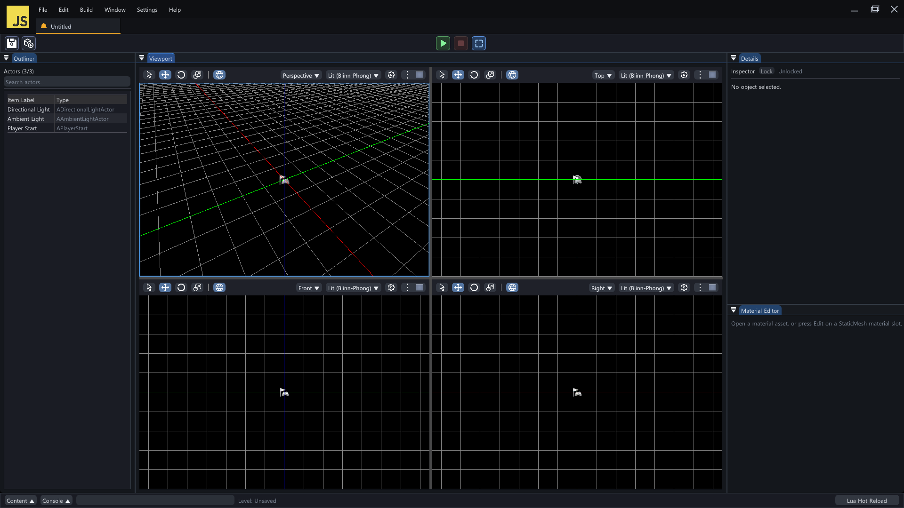
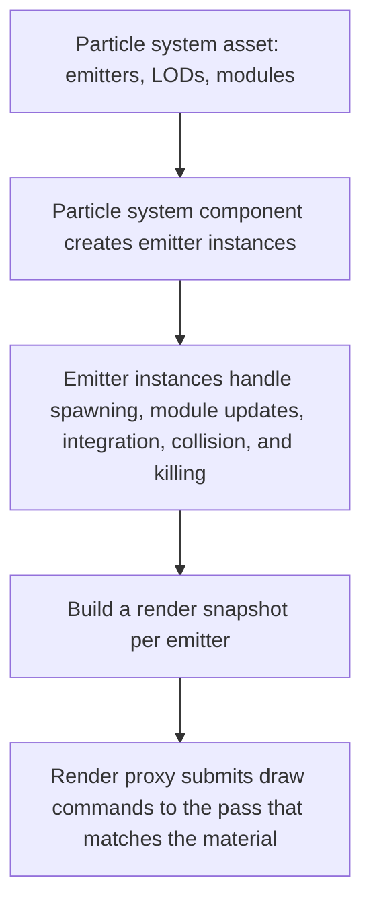

# 🌪️ KRAFTON Jungle game tech Lab - Week 12

[한국어](./README.md) | **English**

***Dance of the Dust***

2026.05.21. ~ 2026.05.28.

Team 4: 장민준([@nacho2407](https://github.com/nacho2407)), 김태현([@MozziDog](https://github.com/MozziDog)), 전현길([@alogeclock](https://github.com/alogeclock)), 강건우([@keonwookang0914](https://github.com/keonwookang0914))




We added a **particle system** to the 3D editor. Modules stacked on an emitter define how particles are spawned, moved, and killed, and the particles are drawn as **sprites, meshes, beams, and ribbons**. Particle assets are authored in a **particle editor** that previews the result while they are edited.


## 🎮 Week Overview

- A particle system consists of several **emitters**, and an emitter stacks **modules** such as spawn, lifetime, location, velocity, color, and size to define how its particles behave. Each emitter keeps its particle data in a single memory block and handles spawning, updating, and killing every frame

- Particles are shown as camera-facing **sprites**, **meshes** drawn with instancing, **beams** that connect two points, and **ribbons** that connect the path an emitter has passed, and they are drawn in the opaque or translucent pass depending on the material

- The **particle editor** adds emitters and modules and edits properties and curves while previewing the result. The resulting asset is placed in a level with a **particle system component**

- We added **LOD**, which changes module values according to the distance from the camera, **collision** with objects in the level, and **events**, which let another emitter react when particles spawn, die, or collide


## ✨ Features

- **Particle Editor**

  Double-clicking a `.particle` asset in the Content Browser opens a particle editor tab. The viewport previews the result, the emitter panel selects emitters and modules, and the details panel edits the properties of the selected module. The toolbar handles saving, restarting the simulation, undo and redo, showing the bounds and axes, and the background color

- **Emitters and Modules**

  Right-clicking the emitter panel and choosing `Add Emitter` adds an emitter, and with an emitter selected, `Add Module` adds a module. Modules are grouped into `Basic`, `Type Data`, `Lifetime`, `Location`, `Velocity`, `Color`, `Size`, `Animation`, `Collision`, `Beam`, `Events`, and `Rotation`, and each module is turned on and off with a checkbox. An emitter can be duplicated or reordered, and a solo button shows only that emitter

- **Sprite, Mesh, Beam, and Ribbon Emitters**

  The `Type Data` module decides the form of an emitter. `Sprite Type Data` draws a camera-facing quad for each particle, and `Mesh Type Data` draws the assigned static mesh for each particle. `Beam Type Data` draws a strip that connects two endpoints, and `Ribbon Type Data` draws a strip that connects the path the emitter has passed

- **Curve Editor**

  A module value is set in one of `Constant`, `Random Range`, `Curve`, and `Random Range Curve`. For a value set with a curve, the curve editor panel of the particle editor adds keys and chooses the tangent mode(`Auto`, `Break`, `Linear`, `Constant`). Float, vector, and color curve assets can also be created separately by right-clicking in the Content Browser and choosing `Curve` under `Create`

- **Level Placement**

  A `Particle System` actor is placed in a level and a particle asset is assigned to `Template` in the Details window. Adding names and values to `Instance Parameters` passes values that differ per instance, such as the endpoints of a beam

- **Show Flag and Stat**

  Turning off `Particle` in `Show Flags` hides particles. The console command `stat particles` or `Particles` under `Stats` in the viewport menu shows, for each of sprites, meshes, beams, and trails, the number spawned this frame, the number alive, the number killed, and the polygon count, along with the number of draw calls and the time spent on ticking and sorting

- **Particle LOD**

  `Add LOD` in the particle editor toolbar adds an LOD, and `Lower LOD` and `Upper LOD` move between LODs so that module values are set separately for each LOD. Writing the distance at which each LOD starts in the particle system's `LOD Distances` switches the LOD according to the distance from the camera

- **Particle Collision**

  Adding a `Collision Module` makes particles collide with objects in the level. `Damping Factor` sets how much speed is lost on a bounce, and `Max Collisions` and `Collision Complete Option` set whether a particle is killed or frozen after colliding the set number of times

- **Particle Events**

  An `Event Generator` emits a named event when a particle spawns, dies, or collides, and the `Event Receiver Spawn` of another emitter receives the event and spawns particles where it occurred

- **SubUV**

  The `SubUV Module` advances through the cells of a sprite sheet in order over the lifetime, or picks one random cell for each particle


## 👥 Team

| Member | Responsibilities |
|------|------------------------|
| **장민준**([@nacho2407](https://github.com/nacho2407)) | Particle core - particle data layout and emitter instance(spawn, update, kill), distributions and random stream, looping and bursts, over-life modules, particle LOD, Beam emitter |
| **김태현**([@MozziDog](https://github.com/MozziDog)) | Particle rendering - render pass restructuring and translucent pass, particle render proxy, sprite, mesh, beam, and ribbon rendering, particle stat, mesh rotation and color by speed modules, demo scene |
| **전현길**([@alogeclock](https://github.com/alogeclock)) | Particle editor - particle editor viewer and emitter panel, details panel, curve editor and curve assets, particle asset saving and loading, particle system actor, SubUV module, ribbon emitter |
| **강건우**([@keonwookang0914](https://github.com/keonwookang0914)) | Particle system component, collision, and events - particle system component, mesh emitter, distance-based LOD selection, particle collision(Broad Phase, Narrow Phase), particle events |


## 🧑‍💻 Work Details

### Particle Data and Emitter Instance

- **Goal**

  Build a runtime structure that spawns, updates, and kills many particles every frame without reallocating memory

- **Implementation**

  `FParticleEmitterInstance` owns all the particles of one emitter. A particle is a fixed-size slot made of `FBaseParticle`, the common state such as location, velocity, lifetime, size, and color, followed by as much payload as the modules request, and a block of these slots for the maximum particle count is allocated only once with 16-byte alignment. At the end of the block is a 16-bit index array that maps the active order to the actual slot numbers

  Killing a particle does not move any data. A particle whose lifetime has ended is only flagged as pending kill, and at the start and end of a tick only the index array is compacted so that the live particles gather at the front. Because the array does not change during an update, it is safe for a module to kill particles in the middle of iteration, and the iteration macro skips particles that are pending kill

  A tick proceeds in the order of compacting pending-kill particles, spawning, advancing lifetimes, updating modules, integrating location and rotation, collision, and compacting again. The spawn count multiplies the rate per second by the elapsed time and carries the remaining fraction over to the next frame, so it stays constant regardless of the frame rate. A burst, which emits many particles at once at a set time, is recorded so that it fires only once per loop, and it can be given a chance and a count range

  To handle the emitter's duration and loop count, a frame that passes the end of a loop is split at the loop boundary and spawning is computed separately for each segment. The loop count can be set, or the emitter can loop forever

- **Related Code**

  [`Source/Engine/Particle/ParticleEmitterInstance.cpp`](./Source/Engine/Particle/ParticleEmitterInstance.cpp), [`Source/Engine/Particle/ParticleEmitterInstance.h`](./Source/Engine/Particle/ParticleEmitterInstance.h), [`Source/Engine/Particle/ParticleTypes.h`](./Source/Engine/Particle/ParticleTypes.h), [`Source/Engine/Particle/ParticleHelper.h`](./Source/Engine/Particle/ParticleHelper.h)


### Distributions and Modules

- **Goal**

  Let module values be set as a constant, a random range, or a curve, and make the same settings produce the same result

- **Implementation**

  There are distribution types that hold float, vector, and color values. A distribution produces a value in one of four modes, `Constant`, `Random Range`, `Curve`, and `Random Range Curve`, and the curve modes read the curve asset with the spawn time when a particle spawns and with the fraction of its lifetime when it is updated. A vector distribution can choose whether to draw each axis separately or to use the same random value for all three axes

  Random values come from a linear congruential generator that each emitter owns. With a fixed seed, every run gives the same result, and there is also an option that resets the seed when the emitter loops. A module that must use the same random value for the whole lifetime, such as one that picks a value between two curves, stores the value drawn when the particle spawns in the particle's payload

  A module implements `Spawn`, called when a particle spawns, and `Update`, called every frame, and if it has values to remember per particle, it reports the number of bytes it needs and receives a payload slot. For each LOD, the emitter computes the lists of spawn modules and update modules and the payload offset of each module in advance, and a tick only walks these lists

  On top of this structure, we added modules for color and size over life, velocity over life, acceleration, and size by speed

- **Related Code**

  [`Source/Engine/Particle/ParticleDistributions.h`](./Source/Engine/Particle/ParticleDistributions.h), [`Source/Engine/Particle/ParticleRandom.h`](./Source/Engine/Particle/ParticleRandom.h), [`Source/Engine/Particle/ParticleModules.cpp`](./Source/Engine/Particle/ParticleModules.cpp), [`Source/Engine/Particle/ParticleModules.h`](./Source/Engine/Particle/ParticleModules.h), [`Source/Engine/Particle/ParticleAsset.h`](./Source/Engine/Particle/ParticleAsset.h)


### Particle LOD

- **Goal**

  Reduce the cost of particles far from the camera without particles disappearing or popping at the moment the LOD changes

- **Implementation**

  Every LOD shares the particle slot layout of LOD 0. Switching the LOD does not reallocate the particle block and only swaps the cache that points to the list of modules to run now. Particles that are already alive stay as they are and are updated by the modules of the new LOD

  Sharing the slot layout requires every LOD to have the same module composition, so the editor allows modules to be added and removed only in LOD 0. The runtime also checks that the number and types of modules in the lower LODs match LOD 0, and if they do not, it uses LOD 0 instead of switching to a lower LOD

  The maximum particle count of a lower LOD is used only as a cap on the number of newly spawned particles. A disabled LOD stops spawning and updating but keeps advancing lifetimes, so that the remaining particles die out naturally

  So that the LOD does not keep flipping while the camera moves near a boundary distance, the LOD changes only after the boundary is passed by `LOD Hysteresis Distance`

- **Related Code**

  [`Source/Engine/Particle/ParticleEmitterInstance.cpp`](./Source/Engine/Particle/ParticleEmitterInstance.cpp), [`Source/Engine/Particle/ParticleAsset.h`](./Source/Engine/Particle/ParticleAsset.h), [`Source/Engine/Particle/ParticleSystemComponent.cpp`](./Source/Engine/Particle/ParticleSystemComponent.cpp), [`Source/Editor/Viewer/ParticleEditorViewer.cpp`](./Source/Editor/Viewer/ParticleEditorViewer.cpp)


### Beam Emitter

- **Goal**

  Create strip-shaped particles that connect two points, and let the endpoints be bound to actors or components in the level

- **Implementation**

  `Beam Type Data` holds the beam's width, number of interpolation points, and noise, and the `Beam Source` and `Beam Target` modules set the two endpoints. An endpoint is set as one of a position written in the module, a vector value looked up by name, an actor, or a component, and the latter three are looked up by name in the `Instance Parameters` of the particle system component. Setting `Beam Method` to `Distance` extends the beam from the source by a set distance without a target. A single button in the Details window adds the parameters for both endpoints so that actors or components can be assigned

  A cubic Hermite curve is built from the two endpoints and their tangents, divided by the number of interpolation points, and connected with line segments. The tangents are derived automatically from the direction between the endpoints or written directly in the modules. With noise turned on, the interpolation points are displaced in the plane perpendicular to the beam direction, and because the values come from hashing the seed, the point index, and the time, the same settings give the same shape

  A snapshot holding the endpoints, tangents, width, and color is handed to rendering. The functions that compute the path are gathered in one header so that drawing and bounds computation use the same path, which keeps the culling bounds from drifting away from the actual shape

- **Related Code**

  [`Source/Engine/Particle/ParticleBeamPath.h`](./Source/Engine/Particle/ParticleBeamPath.h), [`Source/Engine/Particle/ParticleModules.cpp`](./Source/Engine/Particle/ParticleModules.cpp), [`Source/Engine/Particle/ParticleSystemComponent.cpp`](./Source/Engine/Particle/ParticleSystemComponent.cpp), [`Source/Editor/UI/EditorPropertyWidget.cpp`](./Source/Editor/UI/EditorPropertyWidget.cpp)


## 🛠️ Tech Stack

- **Language**: C++20

- **Graphics API**: DirectX 11

- **Build**: Visual Studio 2026, MSBuild

- **Libraries**: Autodesk FBX SDK, Dear ImGui, DirectX Tool Kit for DirectX 11, LuaJIT, RmlUi, SimpleJSON, sol2, SoLoud


## 🖥️ Architecture



- Flow

    1. The particle system component creates, for each emitter of the particle asset, the emitter instance that matches its Type Data module

    2. Every frame, the LOD is chosen by the distance from the camera, and the emitter instance spawns, advances lifetimes, updates modules, integrates, collides, and compacts killed particles in order

    3. The events produced when particles spawn, die, and collide are gathered and handed to the receiver modules of the same particle system

    4. The particle system component builds the render snapshots for sprites, meshes, beams, and ribbons from the live particles of each emitter

    5. The render proxy sorts the snapshots and hands them over as draw commands of the pass that matches the material


## 📁 Directory Structure

```
week12/
├── week12.sln              // Solution
├── Asset/                  // Materials, meshes, particles, curves, prefabs, scenes, textures, Lua scripts, UI documents
├── Assets/                 // Particle curves
├── BuildTools/             // Build scripts for the RmlUi and SoLoud static libraries
├── Docs/                   // README media
├── LuaDefinitions/         // Engine API definitions for Lua editors
├── Resources/              // Program icon
├── Scripts/                // Reflection code generation script and embedded Python
├── Shaders/                // HLSL shaders
├── Source/                 // Entry point and precompiled header
│   ├── Editor/             // Editor engine and render pipeline
│   │   ├── Asset/          // Asset service
│   │   ├── Command/        // Editor commands
│   │   ├── Input/          // Viewport input mapping and world controller
│   │   ├── Notification/   // Notifications
│   │   ├── PIE/            // PIE session
│   │   ├── Packaging/      // Game packaging
│   │   ├── Scene/          // Scene service
│   │   ├── Selection/      // Selection management
│   │   ├── Settings/       // Editor and project settings
│   │   ├── UI/             // Editor widgets, particle editor panels, curve editor, animation graph editor, and actor sequencer
│   │   ├── Undo/           // Undo
│   │   ├── Viewer/         // Particle, skeletal mesh, and animation viewers
│   │   └── Viewport/       // Viewport client and navigation
│   ├── Engine/
│   │   ├── Animation/      // Animation sequences, animation graph, state machine, and actor sequence
│   │   ├── Asset/          // FBX importer, particle and curve asset loaders, Wavefront OBJ loader, and mesh assets
│   │   ├── Audio/          // Audio system
│   │   ├── Camera/         // Camera manager and camera shake
│   │   ├── Collision/      // Collision and ray tests
│   │   ├── Component/      // Components
│   │   ├── Core/           // Common types, resource management, reflection, paths, and crash dumps
│   │   ├── GameFramework/  // Actors, world, and game mode
│   │   ├── Geometry/       // Geometry types
│   │   ├── Input/          // Input system
│   │   ├── Math/           // Math
│   │   ├── Object/         // UObject, classes and properties, and names
│   │   ├── Particle/       // Particle assets, emitter instances, modules, and particle system component
│   │   ├── Render/         // Renderer and GPU resources
│   │   ├── Runtime/        // Engine loop, window, and Lua scripts
│   │   ├── Serialization/  // Scene and prefab saving
│   │   ├── Slate/          // Windows and splitters
│   │   ├── Spatial/        // BVH and KD tree
│   │   └── UI/             // RmlUi runtime UI
│   ├── Launch/             // Launch mode selection
│   └── Misc/               // OBJ viewer
└── ThirdParty/             // Dear ImGui, LuaJIT, RmlUi, SimpleJSON, sol2, SoLoud
```


## ❓ Build and Run

### Running the Release Build

Executables are not provided for this week because of license issues with some of the assets and libraries.


### Building from Source

Some assets and libraries could not be included in the repository because of license issues, so this week cannot be built from the repository alone.


## ⌨️ Shortcuts

### Level Editor

| Shortcut | Action |
|--------|------|
| **Q / W / E / R, 1 / 2 / 3 / 4** | Switch the edit mode(select, move, rotate, scale) |
| **Tab** | Cycle the edit mode |
| **Space** | Cycle the gizmo mode(move, rotate, scale) |
| **X** | Toggle the gizmo space(world, local) |
| **F** | Move the camera to the selected actor |
| **Ctrl + A** | Select all actors |
| **Ctrl + Alt + Drag** | Box selection(hold Shift as well to add to the current selection) |
| **Ctrl + D** | Duplicate the selected actors |
| **Delete** | Delete the selected actors |
| **F2** | Rename the selected actor |
| **Ctrl + Z / Ctrl + Shift + Z** | Undo, redo |
| **Ctrl + N / Ctrl + O / Ctrl + S / Ctrl + Shift + S** | New scene, open scene, save scene, save as |
| **Ctrl + Space** | Open and close the Content Browser |
| **\`** | Cycle through focusing the console input, opening the console window, and closing it |
| **Esc** | End PIE |
| **F8** | Toggle between possessing and ejecting during PIE |
| **Shift + F1** | Release the mouse cursor during PIE |


### Particle Editor

| Shortcut | Action |
|--------|------|
| **Space** | Restart the simulation |
| **Delete** | Delete the selected emitter or module, or the selected key in the curve editor |
| **← / →** | Reorder the selected emitter |
| **Ctrl + S** | Save the particle asset |
| **Ctrl + Z / Ctrl + Y** | Undo, redo |


## 📄 Third-Party Libraries

| Name | Author | Version | License |
|------|--------|------|----------|
| **[Autodesk FBX SDK](https://aps.autodesk.com/developer/overview/fbx-sdk)** | Autodesk, Inc. | 2020.3.9 | Autodesk License and Services Agreement |
| **[Dear ImGui](https://github.com/ocornut/imgui)** | Omar Cornut | 1.92.7 WIP | [MIT License](./ThirdParty/ImGui/LICENSE.txt) |
| **[DirectX Tool Kit for DirectX 11](https://github.com/microsoft/DirectXTK)** | Microsoft Corporation. | - | MIT License |
| **[LuaJIT](https://luajit.org)** | Mike Pall | 2.1 | [MIT License](./ThirdParty/luajit/COPYRIGHT) |
| **[Python](https://www.python.org)** | Python Software Foundation | 3.12.9 | [Python Software Foundation License 2.0](./Scripts/python/LICENSE.txt) |
| **[RmlUi](https://github.com/mikke89/RmlUi)** | The RmlUi Team, and contributors | - | [MIT License](./ThirdParty/RmlUi/LICENSE.txt) |
| **[SimpleJSON](https://github.com/nbsdx/SimpleJSON)** | Neil | - | Do What the Fuck You Want to Public License |
| **[sol2](https://github.com/ThePhD/sol2)** | Rapptz, ThePhD, and contributors | 3.5.0 | [MIT License](./ThirdParty/sol/LICENSE.txt) |
| **[SoLoud](https://github.com/jarikomppa/soloud)** | Jari Komppa | 202002 | [zlib License](./ThirdParty/SoLoud/LICENSE) |


## 🎨 Third-Party Assets

| Name | Author | License |
|------|--------|----------|
| **[3d-cubes](https://github.com/garykac/3d-cubes)** | Gary Kac | - |
| **[logo.js](https://github.com/voodootikigod/logo.js)** | Christopher Williams | [MIT License](./Resources/Editor/Branding/logo.js-LICENSE) |
| **[Particle Pack](https://kenney.nl/assets/particle-pack)** | Kenney | [Creative Commons Zero v1.0 Universal](https://creativecommons.org/publicdomain/zero/1.0/) |


## ⚖️ License

The portions of this week's code written by Jang Minjun are released under the MIT License, and the rights to the portions written by other contributors belong to their respective contributors. See [LICENSE](../LICENSE) for details.
