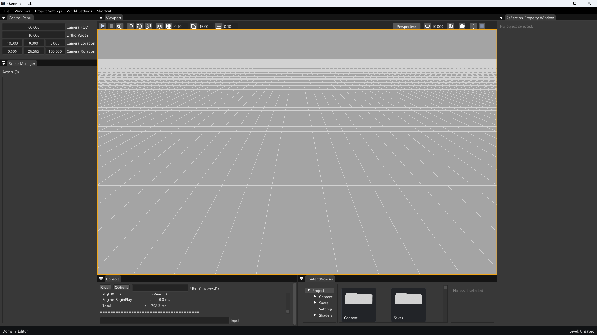
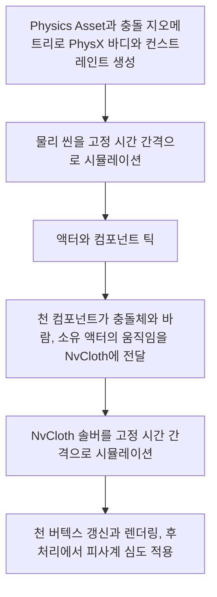

# 🧲 크래프톤 정글 게임테크랩 13주차

**한국어** | [English](./README_en.md)

***3차원 세상에서 초점과 힘의 이해***

2026.05.28. ~ 2026.06.04.

6팀: 장민준([@nacho2407](https://github.com/nacho2407)), 박상혁([@UltraSion](https://github.com/UltraSion)), 성원희([@wwonnn](https://github.com/wwonnn)), 오준혁([@JHCard7872](https://github.com/JHCard7872))




3D 에디터에 **PhysX 기반 물리**와 **피사계 심도**를 더했습니다. 스켈레탈 메시의 충돌 바디와 관절을 **Physics Asset 에디터**에서 만들어 **래그돌**로 쓰러뜨리고, **PxVehicle 차량**을 몰며, **NvCloth 천 시뮬레이션**으로 바람에 날리는 천을 그립니다.


## 🎮 주차 소개

- **PhysX SDK**를 엔진에 통합해 물리 씬을 만들고, 스태틱 메시와 스켈레탈 메시에 물리 바디를 붙였습니다. 충돌 형태는 메시마다 구, 박스, 캡슐, 컨벡스로 정합니다

- 스켈레탈 메시의 본마다 충돌 바디를 두고 바디 사이를 컨스트레인트로 잇는 **Physics Asset**을 전용 에디터에서 만들고 고칩니다. 이 에셋으로 캐릭터를 **래그돌**로 시뮬레이션하고, 물리 결과를 애니메이션 포즈와 섞습니다

- PxVehicle로 네 바퀴 **차량**을, NvCloth로 고정점과 바람, 충돌에 반응하는 **천**을 시뮬레이션합니다

- 초점 거리와 조리개 값에서 픽셀마다 착란원(CoC)의 크기를 구해 근경과 원경을 따로 흐리는 **피사계 심도**를 후처리로 더하고, 밝은 부분은 조리개 모양의 보케로 그립니다


## ✨ 구현 결과

- **Physics Asset 에디터**

  `Mesh Editor`의 `Physics Asset` 탭에서 스켈레탈 메시의 Physics Asset을 만들고 고칩니다. 뷰포트 위의 `Physics Asset Build Options`에서 `Primitive Type`(`Capsule`, `Box`, `Sphere`)과 `Min Bone Size` 같은 옵션을 정하고 `Generate`를 누르면 본에 맞춘 바디가 만들어집니다. 왼쪽 트리에서 바디를 우클릭해 `Add Sphere`, `Add Box`, `Add Capsule`로 셰이프를 더하거나 `Create Constraint`로 컨스트레인트를 만들고, 뷰포트에서 바디와 컨스트레인트를 클릭해 고른 뒤 기즈모로 고칩니다

- **래그돌 미리 보기**

  같은 탭의 `Ragdoll` 패널에서 `Play`를 누르면 편집 중인 Physics Asset으로 래그돌을 시뮬레이션합니다. `Pause`로 멈추고, `Gravity`와 `Constraints`를 켜고 끄며, `Self Collision`에서 바디끼리 충돌하는 범위(`Disable All`, `No Parent/Child`, `Enable All`)를 고릅니다

- **래그돌**

  스켈레탈 메시 컴포넌트의 `Enable Ragdoll`을 켜면 PIE에서 Physics Asset의 바디와 컨스트레인트로 래그돌이 만들어져 물리로 움직입니다. `Ragdoll Physics Blend Weight`로 물리 결과와 애니메이션 포즈를 섞고, `Physical Animation Actor`는 바디를 애니메이션 포즈 쪽으로 끄는 힘(`Position Strength`, `Rotation Strength`)을 걸어 물리와 애니메이션을 함께 씁니다

- **스태틱 메시 충돌 지오메트리**

  `Static Mesh Editor`의 `Aggregate Geometry` 탭에서 `Add Sphere`, `Add Box`, `Add Capsule`, `Add Convex`로 충돌 셰이프를 더하고 기즈모로 맞춥니다. 레벨에서는 컴포넌트의 `Simulate Physics`, `Enable Gravity`, `Mass (kg)`로 물리 바디의 동작을 정합니다

- **차량**

  `4W Vehicle` 액터를 배치하면 네 바퀴 차량이 만들어집니다. PIE에서 `W`와 `S`로 가속과 후진, `A`와 `D`로 조향, `Space`로 핸드브레이크, `Shift`로 부스트를 씁니다

- **천 시뮬레이션**

  `Empty Actor`에 Cloth 컴포넌트를 더하면 격자 모양의 천이 만들어집니다. `Num Particles X`, `Num Particles Y`, `Particle Spacing`으로 크기와 밀도를, `Pinning Mode`로 고정할 가장자리나 영역을 정합니다. `Enable Wind`로 바람을 켜고, `World Settings`의 `Cloth Wind`에서 레벨 전체에 부는 바람을 정합니다. 구, 캡슐, 박스, 평면 충돌체를 컴포넌트에 직접 두거나 `Enable Body Collision`으로 같은 액터의 물리 바디와 부딪히게 하고, `Simulate In Editor`를 켜면 PIE 없이도 결과를 봅니다

- **피사계 심도**

  뷰포트 툴바 `Show Flags`의 `DepthOfField`를 켜면 초점에서 벗어난 곳이 흐려집니다. `Aperture (F-Stop)`, `Focal Distance`, `Max CoC Radius`로 초점 거리와 흐림의 정도를 정하고, `Aperture Blades`에 정한 조리개 날 수에 따라 흐림이 다각형 모양으로 퍼집니다. `Bokeh Enable`을 켜면 밝은 부분에 보케가 더해집니다

- **Show Flag와 Stat**

  `Show Flags`의 `PhysicsBody`는 물리 바디를 선으로, `Debug PhysicsAsset`은 Physics Asset의 바디와 컨스트레인트 축을, `Debug Cloth`는 천의 파티클과 고정점, 충돌체, 바람 방향을 표시합니다. 콘솔 명령 `stat cloth`는 선택된 NvCloth 백엔드와 천 컴포넌트 수, 파티클 수, 고정점 수, 충돌체 수, 시뮬레이션 스텝 수와 걸린 시간을 표시합니다


## 👥 팀원 및 담당 파트

| 팀원 | 담당 파트 및 주요 역할 |
|------|------------------------|
| **장민준**([@nacho2407](https://github.com/nacho2407)) | 천 시뮬레이션 - NvCloth 통합과 백엔드 선택, 천 컴포넌트와 동적 렌더 프록시, 고정 시간 간격 시뮬레이션, 고정점, 충돌체와 바디 충돌, 바람과 소유 액터의 움직임 반영, 디버그 표시와 천 Stat |
| **박상혁**([@UltraSion](https://github.com/UltraSion)) | Physics Asset과 에디터 - Physics Asset 에셋과 바디 자동 생성, Physics Asset 에디터(바디 트리, 컨스트레인트 편집, 기즈모, 피킹, 래그돌 미리 보기), 디버그 바디 렌더링, 스태틱 메시 충돌 지오메트리 에디터, 리플렉션 기반 속성 창 |
| **성원희**([@wwonnn](https://github.com/wwonnn)) | 피사계 심도와 차량 - 피사계 심도(CoC, 근경과 원경 블러, 보케), HDR 렌더 타깃, PxVehicle 차량(드리프트, 부스트), 차량 리본 파티클, 트라이앵글 메시 충돌 |
| **오준혁**([@JHCard7872](https://github.com/JHCard7872)) | PhysX 통합과 래그돌 - PhysX SDK 통합과 물리 씬, 바디와 컨스트레인트 인스턴스, 스태틱 메시와 스켈레탈 메시의 물리 바디, 래그돌과 애니메이션 블렌드, PVD 연결 |


## 🧑‍💻 담당 작업 상세

### NvCloth 통합과 백엔드 선택

- **목표**

  NvCloth를 엔진에 붙이고, 실행 환경에서 쓸 수 있는 백엔드를 골라 쓰게 합니다

- **구현 내용**

  엔진이 `FNvClothContext`를 하나 갖고 NvCloth 팩토리의 수명을 관리합니다. 초기화할 때 CUDA, DX11, CPU 순서로 팩토리 생성을 시도해 처음 성공한 백엔드를 쓰고, 모두 실패하면 천 시뮬레이션만 끈 채 엔진은 그대로 실행합니다. 어느 백엔드가 선택되었는지와 앞선 백엔드가 실패한 이유는 로그와 `stat cloth`에 남깁니다

  CUDA 백엔드는 CUDA Toolkit을 링크하지 않습니다. NVIDIA 드라이버에 들어 있는 `nvcuda.dll`을 실행 중에 불러 드라이버 API 함수를 찾아 CUDA 컨텍스트를 만들기 때문에, Toolkit이 없는 환경에서도 빌드되고 드라이버만 있으면 CUDA로 동작합니다. DX11 백엔드에는 엔진의 D3D11 디바이스와 컨텍스트를 NvCloth의 컨텍스트 관리 콜백으로 넘깁니다

  NvCloth의 타입은 구현 구조체 뒤에 숨겨 엔진의 다른 코드가 NvCloth 헤더를 포함하지 않게 했고, `WITH_NV_CLOTH` 매크로 하나로 기능 전체를 끌 수 있게 했습니다

- **관련 코드**

  [`Source/Engine/Cloth/NvClothContext.cpp`](./Source/Engine/Cloth/NvClothContext.cpp), [`Source/Engine/Cloth/NvClothContext.h`](./Source/Engine/Cloth/NvClothContext.h), [`Source/Engine/Cloth/ClothBuildConfig.h`](./Source/Engine/Cloth/ClothBuildConfig.h), [`Source/Engine/Cloth/ClothTypes.h`](./Source/Engine/Cloth/ClothTypes.h)


### 천 컴포넌트와 렌더링

- **목표**

  격자 모양의 천을 절차적으로 만들고, 매 프레임 바뀌는 버텍스를 필요한 만큼만 GPU로 올려 그립니다

- **구현 내용**

  `UClothComponent`가 가로와 세로 파티클 수, 간격으로 격자의 버텍스와 인덱스를 만들어 CPU 쪽 렌더 데이터로 갖습니다. 시뮬레이션이 끝나면 결과 위치를 버텍스에 쓰고, 삼각형에서 법선과 탄젠트를 다시 계산한 뒤 로컬 바운드를 갱신합니다

  렌더 데이터에는 리비전 번호를 두었습니다. `FClothSceneProxy`는 동적 버텍스 버퍼를 갖고, 리비전이 바뀐 프레임에만 버퍼를 다시 올립니다. 천은 재질의 컬링 설정과 상관없이 양면으로 그립니다

  속성이 바뀌었을 때 필요한 것만 다시 만들도록 변경 표시를 토폴로지, 시뮬레이션 리소스, 고정점, 고정점의 목표 위치, 힘 설정, 충돌로 나눴습니다. 파티클 수를 바꾸면 격자와 시뮬레이션 리소스를 다시 만들지만, 바람이나 충돌체를 바꾸면 해당 설정만 다시 넘깁니다

- **관련 코드**

  [`Source/Engine/Component/Primitive/ClothComponent.cpp`](./Source/Engine/Component/Primitive/ClothComponent.cpp), [`Source/Engine/Component/Primitive/ClothComponent.h`](./Source/Engine/Component/Primitive/ClothComponent.h), [`Source/Engine/Render/Proxy/ClothSceneProxy.cpp`](./Source/Engine/Render/Proxy/ClothSceneProxy.cpp), [`Source/Engine/Render/Proxy/ClothSceneProxy.h`](./Source/Engine/Render/Proxy/ClothSceneProxy.h)


### 시뮬레이션과 고정점

- **목표**

  프레임 속도와 상관없이 같은 간격으로 시뮬레이션하고, 천의 일부를 원하는 자리에 고정합니다

- **구현 내용**

  `FClothSimulation`이 컴포넌트마다 NvCloth의 패브릭, 클로스, 솔버를 하나씩 갖습니다. 격자 메시를 쿠킹해 패브릭을 만들고, 그 위에 파티클 위치와 역질량으로 클로스를 만들어 솔버에 넣습니다

  프레임 시간을 누적해 `Fixed Time Step`만큼씩, 한 프레임에 `Max Substeps`번까지 솔버를 진행합니다. 누적 시간은 `Max Accumulated Time`에서 자르기 때문에, 프레임이 길게 멈춘 뒤에도 밀린 시간을 한꺼번에 따라잡으려 하지 않습니다. 스텝이 한 번이라도 진행된 프레임에만 파티클 위치를 읽어 렌더 데이터에 반영합니다

  고정점은 `Pinning Mode`로 고릅니다. 위, 아래, 왼쪽, 오른쪽 가장자리를 통째로 고르거나, 액터 로컬 좌표로 정한 구, 박스, XZ 평면의 사각형 안에 든 버텍스를 고릅니다. 고정된 파티클은 역질량을 0으로 두고 현재 위치와 이전 위치를 모두 목표 위치로 맞춰, 솔버가 움직이지 않게 합니다. `Pin Offset Actor Local`을 바꾸면 리소스를 다시 만들지 않고 목표 위치만 옮깁니다

  모든 파티클이 고정되면 움직일 것이 없으므로 패브릭 쿠킹을 건너뛰고, 고정이 일부라도 풀리면 그때 리소스를 만듭니다

- **관련 코드**

  [`Source/Engine/Cloth/ClothSimulation.cpp`](./Source/Engine/Cloth/ClothSimulation.cpp), [`Source/Engine/Cloth/ClothSimulation.h`](./Source/Engine/Cloth/ClothSimulation.h), [`Source/Engine/Component/Primitive/ClothComponent.cpp`](./Source/Engine/Component/Primitive/ClothComponent.cpp)


### 충돌

- **목표**

  천이 따로 둔 충돌체뿐 아니라 캐릭터나 차량처럼 움직이는 물리 바디에도 부딪히게 합니다

- **구현 내용**

  컴포넌트 속성으로 구, 캡슐, 박스, 평면 충돌체를 액터 로컬 좌표에 둡니다. 이를 컴포넌트 로컬 좌표로 바꿔 NvCloth의 충돌 데이터로 넘기는데, 구는 그대로, 캡슐은 두 구와 그 둘을 잇는 인덱스 쌍으로, 평면은 평면 하나짜리 컨벡스로 넘깁니다. NvCloth에는 박스 형태가 없어서 박스는 평면 여섯 개를 한 컨벡스로 묶습니다. 평면은 32개까지만 쓸 수 있으므로, 한도를 넘는 박스는 충돌 전체를 실패시키지 않고 박스를 감싸는 구로 바꿉니다

  `Enable Body Collision`을 켜면 같은 액터에서 물리 바디를 가진 컴포넌트를 찾습니다. 스켈레탈 메시 컴포넌트면 래그돌 바디 전체를, 그 밖의 컴포넌트면 그 컴포넌트의 바디 하나를 씁니다. PhysX 셰이프 가운데 시뮬레이션에 쓰는 구, 박스, 캡슐의 현재 월드 자세를 읽어 천의 충돌체로 바꾸고, 이 스냅샷을 틱마다 다시 만들어 움직이는 바디를 따라가게 했습니다. 원본 컴포넌트는 이름으로 지정할 수도 있고, 바디에서 가져오는 충돌체 수에는 상한을 두었습니다

- **관련 코드**

  [`Source/Engine/Cloth/ClothSimulation.cpp`](./Source/Engine/Cloth/ClothSimulation.cpp), [`Source/Engine/Component/Primitive/ClothComponent.cpp`](./Source/Engine/Component/Primitive/ClothComponent.cpp), [`Source/Engine/Physics/BodyInstance.cpp`](./Source/Engine/Physics/BodyInstance.cpp), [`Source/Engine/Component/Primitive/SkeletalMeshComponent.cpp`](./Source/Engine/Component/Primitive/SkeletalMeshComponent.cpp)


### 바람과 소유 액터의 움직임

- **목표**

  천이 바람에 날리고, 천을 단 액터가 움직이면 그 움직임을 따라 자연스럽게 흔들리게 합니다

- **구현 내용**

  바람은 레벨 전체에 부는 전역 바람과 컴포넌트에 직접 정하는 바람 두 가지입니다. 전역 바람은 `World Settings`에 두고 씬과 함께 저장하며, 컴포넌트마다 전역 바람을 쓸지와 얼마나 반응할지를 정합니다. 합친 바람 속도를 항력 계수, 양력 계수, 유체 밀도와 함께 NvCloth에 넘깁니다

  난류는 파티클의 위치와 시뮬레이션 시각, 시드로 만든 값을 파티클마다 가속도로 더해 표현합니다. 무작위 값을 쓰지 않으므로 같은 설정이면 같은 모양으로 흔들립니다

  액터의 움직임은 두 가지로 반영합니다. 먼저 컴포넌트 월드 트랜스폼의 변화를 NvCloth의 로컬 공간 이동으로 넘기고, 선형, 각, 원심 관성 계수로 천이 그 움직임에 얼마나 끌려갈지를 정합니다. 한 프레임에 정해 둔 거리나 각도보다 크게 움직이면 순간 이동으로 보고 관성 없이 자리만 옮겨, 천이 크게 튀지 않게 했습니다. 다음으로 액터 속도의 반대 방향을 바람에 더해, 액터가 달리면 천이 뒤로 날리게 했습니다

- **관련 코드**

  [`Source/Engine/Component/Primitive/ClothComponent.cpp`](./Source/Engine/Component/Primitive/ClothComponent.cpp), [`Source/Engine/Cloth/ClothSimulation.cpp`](./Source/Engine/Cloth/ClothSimulation.cpp), [`Source/Engine/GameFramework/WorldSettings.h`](./Source/Engine/GameFramework/WorldSettings.h), [`Source/Editor/UI/Panel/EditorWorldSettingsWidget.cpp`](./Source/Editor/UI/Panel/EditorWorldSettingsWidget.cpp)


## 🛠️ 기술 스택

- **Language**: C++20

- **Graphics API**: DirectX 11

- **Build**: Visual Studio 2022, MSBuild

- **Libraries**: Autodesk FBX SDK, Dear ImGui, DirectX Tool Kit for DirectX 11, FMOD Engine, imgui-node-editor, LuaJIT, NvCloth, NVIDIA PhysX SDK, RmlUi, SimpleJSON, sol2, stb


## 🖥️ 구조



- 동작 흐름

    1. 스태틱 메시의 충돌 지오메트리와 스켈레탈 메시의 Physics Asset에서 PhysX 바디와 컨스트레인트를 만들어 물리 씬에 넣습니다

    2. 월드 틱의 처음에 물리 씬이 누적된 시간을 고정 시간 간격으로 나눠 시뮬레이션합니다

    3. 이어서 액터와 컴포넌트가 틱하고, 천 컴포넌트는 충돌체와 같은 액터의 물리 바디, 바람, 소유 액터의 움직임을 모아 NvCloth에 넘깁니다

    4. NvCloth 솔버가 고정 시간 간격으로 진행하고, 결과 위치로 천의 버텍스와 법선, 바운드를 갱신합니다

    5. 렌더 프록시가 바뀐 버텍스를 동적 버퍼에 올려 그리고, 후처리 단계에서 피사계 심도를 적용합니다


## 📁 디렉토리 구조

```
week13/
├── week13.sln              // 솔루션
├── week13.vcxproj          // 프로젝트
├── Content/                // 재질, 메시, 파티클, 몽타주, 씬, 폰트, 텍스처, Lua 스크립트
├── Docs/                   // README 미디어
├── Scripts/                // 리플렉션 헤더 생성 스크립트, 임베디드 Python
├── Settings/               // 리소스 목록, 프로젝트 설정, ImGui 스타일
├── Shaders/                // HLSL 셰이더
├── Source/                 // 진입점
│   ├── Editor/             // 에디터 엔진과 렌더 파이프라인
│   │   ├── PIE/            // PIE 타입
│   │   ├── Selection/      // 선택 관리
│   │   ├── Settings/       // 에디터 설정
│   │   ├── Slate/          // 창과 스플리터
│   │   ├── Subsystem/      // 오버레이 통계, 에셋 팩토리
│   │   ├── UI/             // 에디터 위젯, 콘텐츠 브라우저, 메시와 Physics Asset, 파티클, 애니메이션 에디터
│   │   └── Viewport/       // 레벨 뷰포트와 에셋 에디터 뷰포트
│   ├── Engine/
│   │   ├── Animation/      // 애니메이션 시퀀스, 몽타주, 애니메이션 그래프, 노티파이
│   │   ├── Asset/          // 에셋 패키지와 레지스트리
│   │   ├── Audio/          // 오디오 매니저
│   │   ├── CameraShake/    // 카메라 셰이크 에셋
│   │   ├── Cloth/          // NvCloth 컨텍스트와 천 시뮬레이션
│   │   ├── Collision/      // 레이 판정, BVH, 옥트리, 충돌 수학
│   │   ├── Component/      // 컴포넌트
│   │   ├── Core/           // 공통 타입, 프로퍼티, 로그, Delegate, 프로젝트 설정
│   │   ├── Debug/          // 디버그 그리기
│   │   ├── Distributions/  // 분포 타입
│   │   ├── FloatCurve/     // 실수 커브 에셋
│   │   ├── GameFramework/  // 액터, 레벨, 월드, 게임 모드, 카메라 매니저
│   │   ├── Gizmo/          // 컴포넌트, 본, Physics Asset 셰이프와 컨스트레인트 기즈모 대상
│   │   ├── Input/          // 입력 시스템
│   │   ├── Lua/            // Lua 스크립트 매니저
│   │   ├── LuaBlueprint/   // Lua 블루프린트 에셋과 컴파일러
│   │   ├── Materials/      // 재질과 재질 그래프
│   │   ├── Math/           // 벡터, 행렬, 쿼터니언, 트랜스폼
│   │   ├── Mesh/           // FBX와 Wavefront OBJ 임포터, 스태틱 메시와 스켈레탈 메시
│   │   ├── Object/         // UObject, 리플렉션, 가비지 컬렉션, 이름
│   │   ├── Particles/      // 파티클 시스템, 이미터, 모듈
│   │   ├── Physics/        // PhysX 물리 씬, 바디와 컨스트레인트 인스턴스
│   │   ├── PhysicsEngine/  // Physics Asset, 바디 셋업, 충돌 지오메트리
│   │   ├── Platform/       // 창, 경로, 크래시 덤프, 디렉토리 감시
│   │   ├── Profiling/      // 통계와 GPU 프로파일링
│   │   ├── Render/         // 렌더 파이프라인, 렌더 패스, 씬 프록시, 섀도
│   │   ├── Resource/       // 리소스 관리
│   │   ├── Runtime/        // 엔진 루프, 게임 엔진, 액터 배치 레지스트리
│   │   ├── Serialization/  // 아카이브, 씬 저장과 불러오기
│   │   ├── Texture/        // 텍스처
│   │   ├── UI/             // UI 매니저와 사용자 위젯
│   │   └── Viewport/       // 뷰포트와 게임 뷰포트 클라이언트
│   ├── Game/               // 게임 액터 배치 목록, 게임 Lua 바인딩
│   └── ObjViewer/          // OBJ 뷰어
└── ThirdParty/             // Dear ImGui, imgui-node-editor, LuaJIT, NvCloth, NVIDIA PhysX SDK, RmlUi, SimpleJSON, sol2, stb
```


## ❓ 빌드 및 실행

### 릴리즈 실행

일부 에셋과 라이브러리의 라이선스 문제로 인해 이 주차의 실행 파일은 제공하지 않습니다.


### 소스 빌드

일부 에셋과 라이브러리를 라이선스 문제로 저장소에 포함하지 못해, 이 주차는 저장소만으로 빌드할 수 없습니다.


## ⌨️ 단축키

### 레벨 에디터

| 단축키 | 동작 |
|--------|------|
| **Space** | 기즈모 모드 순환(이동, 회전, 크기) |
| **X** | 기즈모 기준 전환(월드, 로컬) |
| **F** | 선택한 액터 쪽으로 카메라 이동 |
| **Ctrl + 클릭** | 액터를 선택에 더하거나 선택에서 빼기 |
| **Ctrl + Alt + 드래그** | 박스 선택 |
| **Ctrl + X / Ctrl + C / Ctrl + V** | 선택한 액터 잘라내기, 복사, 붙여넣기 |
| **Ctrl + D** | 선택한 액터 복제 |
| **Delete** | 선택한 액터 삭제 |
| **Ctrl + Alt + F** | 선택한 액터를 카메라 위치로 옮기기 |
| **Ctrl + Shift + F** | 선택한 액터를 카메라의 위치와 방향에 맞추기 |
| **← / → / ↑ / ↓** | 원근 뷰포트에서 카메라 회전 |
| **Ctrl + N / Ctrl + O / Ctrl + S / Ctrl + Shift + S** | 새 씬, 씬 열기, 씬 저장, 다른 이름으로 저장 |
| **F2** | Content Browser에서 선택한 항목 이름 바꾸기 |
| **↑ / ↓** | 콘솔 입력창에서 이전에 입력한 명령 불러오기 |
| **Tab** | 콘솔 입력창에서 명령 이름 자동 완성 |
| **Esc** | PIE 종료 |
| **F8** | PIE 중 빙의와 해제 전환 |


### 메시 에디터

| 단축키 | 동작 |
|--------|------|
| **F** | 선택한 본 쪽으로 카메라 이동 |
| **Space** | 기즈모 모드 순환(이동, 회전, 크기), `Animation` 탭에서는 애니메이션 재생과 일시 정지 |


## 📄 서드파티 라이브러리

| 이름 | 저작자 | 버전 | 라이선스 |
|------|--------|------|----------|
| **[Autodesk FBX SDK](https://aps.autodesk.com/developer/overview/fbx-sdk)** | Autodesk, Inc. | 2020.3.9 | Autodesk License and Services Agreement |
| **[Brotli](https://github.com/google/brotli)** | the Brotli Authors. | - | [MIT License](./ThirdParty/RmlUi/Brotli-LICENSE) |
| **[bzip2](https://sourceware.org/bzip2/)** | Julian R Seward | - | bzip2 and libbzip2 License v1.0.6 |
| **[Dear ImGui](https://github.com/ocornut/imgui)** | Omar Cornut | 1.92.7 WIP | [MIT License](./ThirdParty/ImGui/LICENSE.txt) |
| **[DirectX Tool Kit for DirectX 11](https://github.com/microsoft/DirectXTK)** | Microsoft Corporation. | - | MIT License |
| **[FMOD Engine](https://www.fmod.com)** | Firelight Technologies Pty Ltd | 2.03.13 | FMOD End User License Agreement |
| **[FreeType](https://freetype.org)** | David Turner, Robert Wilhelm, and Werner Lemberg | 2.14.3 | Freetype Project License |
| **[imgui-node-editor](https://github.com/thedmd/imgui-node-editor)** | Michał Cichoń | 0.9.4 | [MIT License](./ThirdParty/imgui-node-editor/LICENSE) |
| **[libpng](https://github.com/pnggroup/libpng)** | The PNG Reference Library Authors. | - | PNG Reference Library version 2 |
| **[LuaJIT](https://luajit.org)** | Mike Pall | 2.1 | [MIT License](./ThirdParty/lua/COPYRIGHT) |
| **[NvCloth](https://github.com/NVIDIAGameWorks/NvCloth)** | NVIDIA GameWorks | - | [Nvidia Source Code License (1-Way Commercial)](./ThirdParty/NvCloth/license.txt) |
| **[NVIDIA PhysX SDK](https://github.com/NVIDIAGameWorks/PhysX)** | NVIDIA Corporation | 4.1.2 | [BSD 3-Clause "New" or "Revised" License](./ThirdParty/PhysX-4.1/LICENSE.md) |
| **[Python](https://www.python.org)** | Python Software Foundation | 3.12.9 | [Python Software Foundation License 2.0](./Scripts/python/LICENSE.txt) |
| **[RmlUi](https://github.com/mikke89/RmlUi)** | The RmlUi Team, and contributors | - | [MIT License](./ThirdParty/RmlUi/LICENSE.txt) |
| **[SimpleJSON](https://github.com/nbsdx/SimpleJSON)** | Neil | - | Do What the Fuck You Want to Public License |
| **[sol2](https://github.com/ThePhD/sol2)** | Rapptz, ThePhD, and contributors | 3.5.0 | [MIT License](./ThirdParty/sol2/LICENSE.txt) |
| **[stb](https://github.com/nothings/stb)** | Sean Barrett | 2.30 | The Unlicense |
| **[zlib](https://zlib.net)** | Jean-loup Gailly and Mark Adler | 1.3.2 | zlib License |

- This software is based in part on the work of the FreeType Team


## 🎨 서드파티 에셋

| 이름 | 저작자 | 라이선스 |
|------|--------|----------|
| **[메이플스토리 서체](https://maplestory.nexon.com/Media/Font)** | (주)넥슨코리아 | [넥슨 서체 라이선스](https://maplestory.nexon.com/Media/Font) |


## ⚖️ 라이선스

이 주차의 코드 중 장민준이 작성한 부분은 MIT 라이선스로 공개하며, 다른 기여자가 작성한 부분의 권리는 각 기여자에게 있습니다. 자세한 내용은 [LICENSE](../LICENSE)를 확인해 주세요.
