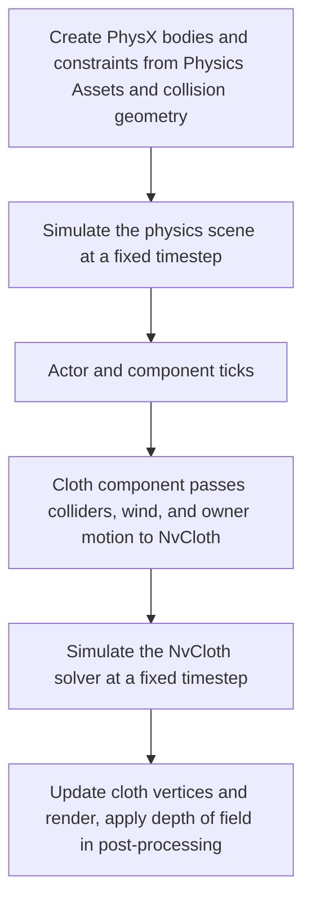

# 🧲 KRAFTON Jungle game tech Lab - Week 13

[한국어](./README.md) | **English**

***Understanding Focus and Force in 3D World***

2026.05.28. ~ 2026.06.04.

Team 6: 장민준([@nacho2407](https://github.com/nacho2407)), 박상혁([@UltraSion](https://github.com/UltraSion)), 성원희([@wwonnn](https://github.com/wwonnn)), 오준혁([@JHCard7872](https://github.com/JHCard7872))


We added **PhysX-based physics** and **depth of field** to the 3D editor. The collision bodies and joints of a skeletal mesh are authored in a **Physics Asset editor** and brought down as a **ragdoll**, a **PxVehicle car** can be driven, and **NvCloth cloth simulation** draws cloth blowing in the wind.


## 🎮 Week Overview

- We integrated the **PhysX SDK** into the engine to build a physics scene, and attached physics bodies to static meshes and skeletal meshes. The collision shape of each mesh is defined with spheres, boxes, capsules, and convex hulls

- A **Physics Asset**, which places a collision body on each bone of a skeletal mesh and connects the bodies with constraints, is created and edited in a dedicated editor. With this asset a character is simulated as a **ragdoll**, and the physics result is blended with the animation pose

- A four-wheeled **vehicle** is simulated with PxVehicle, and **cloth** that reacts to pins, wind, and collision is simulated with NvCloth

- **Depth of field** is added as a post-process that computes the size of the circle of confusion(CoC) per pixel from the focal distance and the aperture and blurs the near field and the far field separately, and bright areas are drawn as bokeh in the shape of the aperture


## ✨ Features

- **Physics Asset Editor**

  The Physics Asset of a skeletal mesh is created and edited in the `Physics Asset` tab of the `Mesh Editor`. Setting options such as `Primitive Type`(`Capsule`, `Box`, `Sphere`) and `Min Bone Size` in the `Physics Asset Build Options` over the viewport and pressing `Generate` creates bodies fitted to the bones. Right-clicking a body in the tree on the left adds a shape with `Add Sphere`, `Add Box`, or `Add Capsule` or creates a constraint with `Create Constraint`, and bodies and constraints are picked by clicking them in the viewport and then edited with the gizmo

- **Ragdoll Preview**

  Pressing `Play` in the `Ragdoll` panel of the same tab simulates a ragdoll with the Physics Asset being edited. `Pause` stops it, `Gravity` and `Constraints` are toggled on and off, and `Self Collision` chooses which bodies collide with each other(`Disable All`, `No Parent/Child`, `Enable All`)

- **Ragdoll**

  Turning on `Enable Ragdoll` on a skeletal mesh component builds a ragdoll from the bodies and constraints of the Physics Asset in PIE and moves it with physics. `Ragdoll Physics Blend Weight` blends the physics result with the animation pose, and the `Physical Animation Actor` applies forces that pull the bodies toward the animation pose(`Position Strength`, `Rotation Strength`) to use physics and animation together

- **Static Mesh Collision Geometry**

  In the `Aggregate Geometry` tab of the `Static Mesh Editor`, collision shapes are added with `Add Sphere`, `Add Box`, `Add Capsule`, and `Add Convex` and fitted with the gizmo. In the level, `Simulate Physics`, `Enable Gravity`, and `Mass (kg)` of a component define how its physics body behaves

- **Vehicle**

  Placing a `4W Vehicle` actor creates a four-wheeled vehicle. In PIE, `W` and `S` accelerate and reverse, `A` and `D` steer, `Space` applies the handbrake, and `Shift` triggers the boost

- **Cloth Simulation**

  Adding a Cloth component to an `Empty Actor` creates a grid-shaped cloth. `Num Particles X`, `Num Particles Y`, and `Particle Spacing` set its size and density, and `Pinning Mode` sets the edge or region to pin. `Enable Wind` turns the wind on, and `Cloth Wind` in the `World Settings` sets the wind that blows across the whole level. Sphere, capsule, box, and plane colliders are placed directly on the component, or `Enable Body Collision` makes the cloth collide with the physics bodies of the same actor, and turning on `Simulate In Editor` shows the result without PIE

- **Depth of Field**

  Turning on `DepthOfField` in the `Show Flags` of the viewport toolbar blurs what is out of focus. `Aperture (F-Stop)`, `Focal Distance`, and `Max CoC Radius` set the focal distance and the amount of blur, and the blur spreads in a polygon shape that follows the number of aperture blades set in `Aperture Blades`. Turning on `Bokeh Enable` adds bokeh to bright areas

- **Show Flags and Stats**

  In the `Show Flags`, `PhysicsBody` shows physics bodies as lines, `Debug PhysicsAsset` shows the bodies and constraint axes of a Physics Asset, and `Debug Cloth` shows the particles, pins, colliders, and wind direction of a cloth. The console command `stat cloth` shows the selected NvCloth backend, the number of cloth components, particles, pins, and colliders, and the number of simulation steps with the time they took


## 👥 Team

| Member | Responsibilities |
|------|------------------------|
| **장민준**([@nacho2407](https://github.com/nacho2407)) | Cloth simulation - NvCloth integration and backend selection, cloth component and dynamic render proxy, fixed timestep simulation, pins, colliders and body collision, wind and owner motion response, debug display and cloth stat |
| **박상혁**([@UltraSion](https://github.com/UltraSion)) | Physics Asset and editor - Physics Asset and automatic body generation, Physics Asset editor(body tree, constraint editing, gizmos, picking, ragdoll preview), debug body rendering, static mesh collision geometry editor, reflection-based property window |
| **성원희**([@wwonnn](https://github.com/wwonnn)) | Depth of field and vehicle - depth of field(CoC, near and far blur, bokeh), HDR render target, PxVehicle car(drift, boost), vehicle ribbon particles, triangle mesh collision |
| **오준혁**([@JHCard7872](https://github.com/JHCard7872)) | PhysX integration and ragdoll - PhysX SDK integration and physics scene, body and constraint instances, physics bodies for static and skeletal meshes, ragdoll and animation blending, PVD connection |


## 🧑‍💻 Work Details

### NvCloth Integration and Backend Selection

- **Goal**

  Integrate NvCloth into the engine and let it pick a backend that is available in the running environment

- **Implementation**

  The engine owns a single `FNvClothContext`, which manages the lifetime of the NvCloth factory. On initialization it tries to create a factory in the order of CUDA, DX11, and CPU and uses the first backend that succeeds, and if all of them fail, only cloth simulation is turned off while the engine keeps running. Which backend was selected and why the earlier ones failed are left in the log and in `stat cloth`

  The CUDA backend does not link the CUDA Toolkit. It loads `nvcuda.dll`, which ships with the NVIDIA driver, at runtime and looks up the driver API functions to create a CUDA context, so the project builds without the Toolkit and runs on CUDA as long as the driver is present. For the DX11 backend, the engine's D3D11 device and context are handed over through NvCloth's context manager callback

  NvCloth types are hidden behind an implementation struct so that the rest of the engine does not include NvCloth headers, and the whole feature can be turned off with the single `WITH_NV_CLOTH` macro

- **Related Code**

  [`Source/Engine/Cloth/NvClothContext.cpp`](./Source/Engine/Cloth/NvClothContext.cpp), [`Source/Engine/Cloth/NvClothContext.h`](./Source/Engine/Cloth/NvClothContext.h), [`Source/Engine/Cloth/ClothBuildConfig.h`](./Source/Engine/Cloth/ClothBuildConfig.h), [`Source/Engine/Cloth/ClothTypes.h`](./Source/Engine/Cloth/ClothTypes.h)


### Cloth Component and Rendering

- **Goal**

  Build a grid-shaped cloth procedurally, and upload the vertices that change every frame to the GPU only as much as needed

- **Implementation**

  `UClothComponent` builds the vertices and indices of the grid from the particle counts along the two axes and the spacing, and keeps them as CPU-side render data. When the simulation finishes, it writes the resulting positions into the vertices, recalculates normals and tangents from the triangles, and updates the local bounds

  The render data carries a revision number. `FClothSceneProxy` owns a dynamic vertex buffer and uploads it again only on the frames where the revision has changed. Cloth is drawn two-sided regardless of the culling setting of its material

  So that only what is needed is rebuilt when a property changes, the dirty state is split into topology, simulation resource, pins, pin targets, force settings, and collision. Changing the particle count rebuilds the grid and the simulation resource, while changing the wind or a collider only passes that setting again

- **Related Code**

  [`Source/Engine/Component/Primitive/ClothComponent.cpp`](./Source/Engine/Component/Primitive/ClothComponent.cpp), [`Source/Engine/Component/Primitive/ClothComponent.h`](./Source/Engine/Component/Primitive/ClothComponent.h), [`Source/Engine/Render/Proxy/ClothSceneProxy.cpp`](./Source/Engine/Render/Proxy/ClothSceneProxy.cpp), [`Source/Engine/Render/Proxy/ClothSceneProxy.h`](./Source/Engine/Render/Proxy/ClothSceneProxy.h)


### Simulation and Pins

- **Goal**

  Simulate at the same interval regardless of the frame rate, and pin part of the cloth where it is wanted

- **Implementation**

  `FClothSimulation` owns one NvCloth fabric, cloth, and solver per component. The grid mesh is cooked into a fabric, and a cloth is created on it from the particle positions and inverse masses and added to the solver

  Frame time is accumulated and the solver advances by `Fixed Time Step` at a time, up to `Max Substeps` times per frame. The accumulated time is clamped at `Max Accumulated Time`, so after a long frame hitch the simulation does not try to catch up on all the delayed time at once. Particle positions are read back and applied to the render data only on the frames where at least one step ran

  Pins are chosen with `Pinning Mode`. It selects a whole top, bottom, left, or right edge, or the vertices inside a sphere, a box, or a rectangle on the XZ plane given in actor-local coordinates. A pinned particle has its inverse mass set to 0 and both its current and previous positions set to the target position, so the solver does not move it. Changing `Pin Offset Actor Local` moves only the target positions without rebuilding the resource

  When every particle is pinned there is nothing to move, so fabric cooking is skipped, and the resource is created once any of the pins is released

- **Related Code**

  [`Source/Engine/Cloth/ClothSimulation.cpp`](./Source/Engine/Cloth/ClothSimulation.cpp), [`Source/Engine/Cloth/ClothSimulation.h`](./Source/Engine/Cloth/ClothSimulation.h), [`Source/Engine/Component/Primitive/ClothComponent.cpp`](./Source/Engine/Component/Primitive/ClothComponent.cpp)


### Collision

- **Goal**

  Make the cloth collide not only with colliders placed on their own but also with moving physics bodies such as characters and vehicles

- **Implementation**

  Sphere, capsule, box, and plane colliders are placed in actor-local coordinates through component properties. They are converted to component-local coordinates and passed as NvCloth collision data: a sphere as it is, a capsule as two spheres and the index pair that connects them, and a plane as a convex made of a single plane. NvCloth has no box shape, so a box is passed as six planes grouped into one convex. Only up to 32 planes can be used, so a box that goes over the limit is replaced with a sphere that encloses it instead of failing the whole collision update

  Turning on `Enable Body Collision` looks for a component with a physics body on the same actor. For a skeletal mesh component all of its ragdoll bodies are used, and for any other component its single body is used. Among the PhysX shapes, the current world poses of the spheres, boxes, and capsules used for simulation are read and converted into cloth colliders, and this snapshot is rebuilt every tick so that the cloth follows moving bodies. The source component can also be specified by name, and the number of colliders taken from bodies has an upper limit

- **Related Code**

  [`Source/Engine/Cloth/ClothSimulation.cpp`](./Source/Engine/Cloth/ClothSimulation.cpp), [`Source/Engine/Component/Primitive/ClothComponent.cpp`](./Source/Engine/Component/Primitive/ClothComponent.cpp), [`Source/Engine/Physics/BodyInstance.cpp`](./Source/Engine/Physics/BodyInstance.cpp), [`Source/Engine/Component/Primitive/SkeletalMeshComponent.cpp`](./Source/Engine/Component/Primitive/SkeletalMeshComponent.cpp)


### Wind and Owner Motion

- **Goal**

  Make the cloth blow in the wind and, when the actor wearing it moves, sway naturally along with that motion

- **Implementation**

  There are two kinds of wind: a global wind that blows across the whole level and a wind set directly on the component. The global wind lives in the `World Settings` and is saved with the scene, and each component decides whether to use the global wind and how strongly to respond to it. The combined wind velocity is passed to NvCloth together with the drag coefficient, lift coefficient, and fluid density

  Turbulence is expressed by adding, as a per-particle acceleration, a value made from the particle position, the simulation time, and a seed. No random values are used, so the same settings sway in the same shape

  The motion of the actor is reflected in two ways. First, the change of the component's world transform is passed to NvCloth as local-space motion, and the linear, angular, and centrifugal inertia coefficients decide how much the cloth is dragged along by it. When the component moves by more than a set distance or angle in one frame, it is treated as a teleport and only relocated without inertia, so the cloth does not jump wildly. Second, the opposite of the actor's velocity is added to the wind, so the cloth streams backward when the actor runs

- **Related Code**

  [`Source/Engine/Component/Primitive/ClothComponent.cpp`](./Source/Engine/Component/Primitive/ClothComponent.cpp), [`Source/Engine/Cloth/ClothSimulation.cpp`](./Source/Engine/Cloth/ClothSimulation.cpp), [`Source/Engine/GameFramework/WorldSettings.h`](./Source/Engine/GameFramework/WorldSettings.h), [`Source/Editor/UI/Panel/EditorWorldSettingsWidget.cpp`](./Source/Editor/UI/Panel/EditorWorldSettingsWidget.cpp)


## 🛠️ Tech Stack

- **Language**: C++20

- **Graphics API**: DirectX 11

- **Build**: Visual Studio 2022, MSBuild

- **Libraries**: Autodesk FBX SDK, Dear ImGui, DirectX Tool Kit for DirectX 11, FMOD Engine, imgui-node-editor, LuaJIT, NvCloth, NVIDIA PhysX SDK, RmlUi, SimpleJSON, sol2, stb


## 🖥️ Architecture



- Flow

    1. PhysX bodies and constraints are created from the collision geometry of static meshes and the Physics Assets of skeletal meshes and added to the physics scene

    2. At the start of the world tick, the physics scene splits the accumulated time into fixed timesteps and simulates

    3. Actors and components then tick, and the cloth component gathers its colliders, the physics bodies of the same actor, the wind, and the owner motion and passes them to NvCloth

    4. The NvCloth solver advances at a fixed timestep, and the resulting positions update the vertices, normals, and bounds of the cloth

    5. The render proxy uploads the changed vertices to a dynamic buffer and draws them, and depth of field is applied in the post-processing stage


## 📁 Directory Structure

```
week13/
├── week13.sln              // Solution
├── week13.vcxproj          // Project
├── Content/                // Materials, meshes, particles, montages, scene, fonts, textures, Lua scripts
├── Docs/                   // README media
├── Scripts/                // Reflection header generation script, embedded Python
├── Settings/               // Resource list, project settings, ImGui style
├── Shaders/                // HLSL shaders
├── Source/                 // Entry point
│   ├── Editor/             // Editor engine and render pipeline
│   │   ├── PIE/            // PIE types
│   │   ├── Selection/      // Selection management
│   │   ├── Settings/       // Editor settings
│   │   ├── Slate/          // Windows and splitters
│   │   ├── Subsystem/      // Overlay stats, asset factory
│   │   ├── UI/             // Editor widgets, content browser, mesh and Physics Asset, particle, and animation editors
│   │   └── Viewport/       // Level viewport and asset editor viewports
│   ├── Engine/
│   │   ├── Animation/      // Animation sequences, montages, animation graph, notifies
│   │   ├── Asset/          // Asset package and registry
│   │   ├── Audio/          // Audio manager
│   │   ├── CameraShake/    // Camera shake assets
│   │   ├── Cloth/          // NvCloth context and cloth simulation
│   │   ├── Collision/      // Ray tests, BVH, octree, collision math
│   │   ├── Component/      // Components
│   │   ├── Core/           // Common types, properties, logging, Delegate, project settings
│   │   ├── Debug/          // Debug drawing
│   │   ├── Distributions/  // Distribution types
│   │   ├── FloatCurve/     // Float curve assets
│   │   ├── GameFramework/  // Actors, level, world, game mode, camera manager
│   │   ├── Gizmo/          // Gizmo targets for components, bones, Physics Asset shapes and constraints
│   │   ├── Input/          // Input system
│   │   ├── Lua/            // Lua script manager
│   │   ├── LuaBlueprint/   // Lua blueprint assets and compiler
│   │   ├── Materials/      // Materials and material graph
│   │   ├── Math/           // Vectors, matrices, quaternions, transforms
│   │   ├── Mesh/           // FBX and Wavefront OBJ importers, static and skeletal meshes
│   │   ├── Object/         // UObject, reflection, garbage collection, names
│   │   ├── Particles/      // Particle system, emitters, modules
│   │   ├── Physics/        // PhysX physics scene, body and constraint instances
│   │   ├── PhysicsEngine/  // Physics Asset, body setup, collision geometry
│   │   ├── Platform/       // Window, paths, crash dump, directory watcher
│   │   ├── Profiling/      // Stats and GPU profiling
│   │   ├── Render/         // Render pipeline, render passes, scene proxies, shadows
│   │   ├── Resource/       // Resource management
│   │   ├── Runtime/        // Engine loop, game engine, actor placement registry
│   │   ├── Serialization/  // Archives, scene saving and loading
│   │   ├── Texture/        // Textures
│   │   ├── UI/             // UI manager and user widgets
│   │   └── Viewport/       // Viewport and game viewport client
│   ├── Game/               // Game actor placement list, game Lua bindings
│   └── ObjViewer/          // OBJ viewer
└── ThirdParty/             // Dear ImGui, imgui-node-editor, LuaJIT, NvCloth, NVIDIA PhysX SDK, RmlUi, SimpleJSON, sol2, stb
```


## ❓ Build and Run

### Running the Release Build

Executables are not provided for this week because of license issues with some of the assets and libraries.


### Building from Source

Some assets and libraries could not be included in the repository because of license issues, so this week cannot be built from the repository alone.


## ⌨️ Shortcuts

### Level Editor

| Shortcut | Action |
|--------|------|
| **Space** | Cycle the gizmo mode(move, rotate, scale) |
| **X** | Toggle the gizmo space(world, local) |
| **F** | Move the camera to the selected actor |
| **Ctrl + Click** | Add an actor to or remove it from the selection |
| **Ctrl + Alt + Drag** | Box selection |
| **Ctrl + X / Ctrl + C / Ctrl + V** | Cut, copy, paste the selected actors |
| **Ctrl + D** | Duplicate the selected actors |
| **Delete** | Delete the selected actors |
| **Ctrl + Alt + F** | Move the selected actors to the camera location |
| **Ctrl + Shift + F** | Align the selected actors with the camera location and rotation |
| **← / → / ↑ / ↓** | Rotate the camera in the perspective viewport |
| **Ctrl + N / Ctrl + O / Ctrl + S / Ctrl + Shift + S** | New scene, open scene, save scene, save as |
| **F2** | Rename the selected item in the Content Browser |
| **↑ / ↓** | Recall previously entered commands in the console input |
| **Tab** | Autocomplete the command name in the console input |
| **Esc** | End PIE |
| **F8** | Toggle between possessing and ejecting during PIE |


### Mesh Editor

| Shortcut | Action |
|--------|------|
| **F** | Move the camera to the selected bone |
| **Space** | Cycle the gizmo mode(move, rotate, scale), and play or pause the animation in the `Animation` tab |


## 📄 Third-Party Libraries

| Name | Author | Version | License |
|------|--------|------|----------|
| **[Autodesk FBX SDK](https://aps.autodesk.com/developer/overview/fbx-sdk)** | Autodesk, Inc. | 2020.3.9 | Autodesk License and Services Agreement |
| **[Brotli](https://github.com/google/brotli)** | the Brotli Authors. | - | [MIT License](./ThirdParty/RmlUi/Brotli-LICENSE) |
| **[bzip2](https://sourceware.org/bzip2/)** | Julian R Seward | - | bzip2 and libbzip2 License v1.0.6 |
| **[Dear ImGui](https://github.com/ocornut/imgui)** | Omar Cornut | 1.92.7 WIP | [MIT License](./ThirdParty/ImGui/LICENSE.txt) |
| **[DirectX Tool Kit for DirectX 11](https://github.com/microsoft/DirectXTK)** | Microsoft Corporation. | - | MIT License |
| **[FMOD Engine](https://www.fmod.com)** | Firelight Technologies Pty Ltd | 2.03.13 | FMOD End User License Agreement |
| **[FreeType](https://freetype.org)** | David Turner, Robert Wilhelm, and Werner Lemberg | 2.14.3 | Freetype Project License |
| **[imgui-node-editor](https://github.com/thedmd/imgui-node-editor)** | Michał Cichoń | 0.9.4 | [MIT License](./ThirdParty/imgui-node-editor/LICENSE) |
| **[libpng](https://github.com/pnggroup/libpng)** | The PNG Reference Library Authors. | - | PNG Reference Library version 2 |
| **[LuaJIT](https://luajit.org)** | Mike Pall | 2.1 | [MIT License](./ThirdParty/lua/COPYRIGHT) |
| **[NvCloth](https://github.com/NVIDIAGameWorks/NvCloth)** | NVIDIA GameWorks | - | [Nvidia Source Code License (1-Way Commercial)](./ThirdParty/NvCloth/license.txt) |
| **[NVIDIA PhysX SDK](https://github.com/NVIDIAGameWorks/PhysX)** | NVIDIA Corporation | 4.1.2 | [BSD 3-Clause "New" or "Revised" License](./ThirdParty/PhysX-4.1/LICENSE.md) |
| **[Python](https://www.python.org)** | Python Software Foundation | 3.12.9 | [Python Software Foundation License 2.0](./Scripts/python/LICENSE.txt) |
| **[RmlUi](https://github.com/mikke89/RmlUi)** | The RmlUi Team, and contributors | - | [MIT License](./ThirdParty/RmlUi/LICENSE.txt) |
| **[SimpleJSON](https://github.com/nbsdx/SimpleJSON)** | Neil | - | Do What the Fuck You Want to Public License |
| **[sol2](https://github.com/ThePhD/sol2)** | Rapptz, ThePhD, and contributors | 3.5.0 | [MIT License](./ThirdParty/sol2/LICENSE.txt) |
| **[stb](https://github.com/nothings/stb)** | Sean Barrett | 2.30 | The Unlicense |
| **[zlib](https://zlib.net)** | Jean-loup Gailly and Mark Adler | 1.3.2 | zlib License |

- This software is based in part on the work of the FreeType Team


## 🎨 Third-Party Assets

| Name | Author | License |
|------|--------|----------|
| **[Maplestory Font](https://maplestory.nexon.com/Media/Font)** | NEXON Korea Corporation | [Nexon Font License](https://maplestory.nexon.com/Media/Font) |


## ⚖️ License

The portions of this week's code written by Jang Minjun are released under the MIT License, and the rights to the portions written by other contributors belong to their respective contributors. See [LICENSE](../LICENSE) for details.
