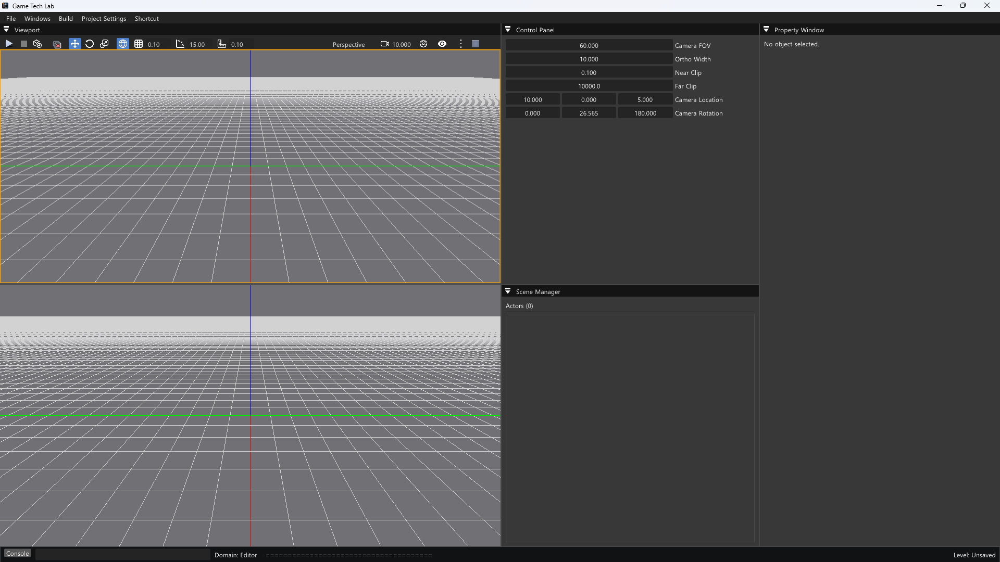
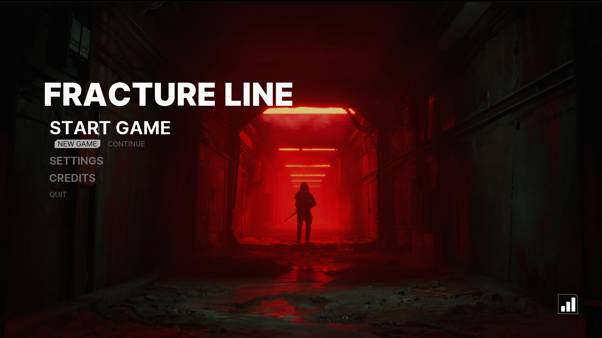
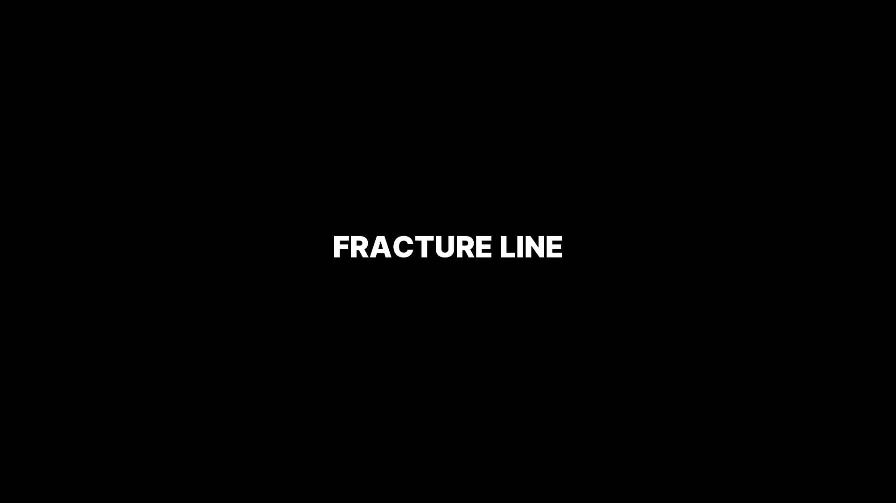
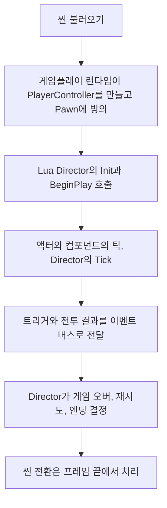

# 🎯 크래프톤 정글 게임테크랩 14주차

**한국어** | [English](./README_en.md)

***4th Game Jam - 모든 준비는 끝났다. 이제 게임이 시작된다!: FRACTURE LINE***

2026.06.04. ~ 2026.06.09.

1팀: 장민준([@nacho2407](https://github.com/nacho2407)), 김효범([@deepBeom](https://github.com/deepBeom)), 전현길([@alogeclock](https://github.com/alogeclock))






- [FRACTURE LINE - Gameplay | Custom C++ & DirectX 11 Engine](https://youtu.be/UixVYle4k0s)

  [](https://youtu.be/UixVYle4k0s)

자체 엔진으로 1인칭 슈팅 게임 **FRACTURE LINE**을 만들었습니다. 이단 점프와 슬라이딩, **벽 달리기**로 세 레벨을 지나 보스와 싸우는 게임이며, 게임의 흐름과 연출은 **Lua 스크립트**로 쓰고 에디터의 **게임 빌드** 창에서 단독 실행 게임으로 패키징합니다.


## 🎮 주차 소개

- 자원 개발 기업 VANTUS의 요원 케인이 되어, 핵심 모듈을 빼앗은 저항군을 쫓아 한 행성에 강하하는 1인칭 슈팅 게임 **FRACTURE LINE**을 만들었습니다. 착륙 컷씬으로 시작해 튜토리얼이 있는 첫 레벨, 적 병사와 전기 함정이 놓인 기지, 보스와 싸우는 마지막 레벨을 지나며, 게임이 끝나면 플레이 시간과 처치 수, 재시도와 사망 횟수로 점수를 매겨 점수판에 남깁니다

- 플레이어는 달리기, 이단 점프, **슬라이딩**, **벽 달리기**로 움직이고, 조준과 반동, 재장전이 있는 소총으로 싸웁니다. 명중 표시와 맞은 자리의 불꽃, 피격 화면 효과, 타격음으로 **타격감**을 더했고, 이야기는 음성이 붙은 대사와 **컷씬**으로 보여 줍니다

- 게임의 흐름은 **Lua 스크립트**로 씁니다. 프로젝트 설정에 정한 **Lua Director**가 레벨을 진행하고, 트리거와 전투 결과는 **이벤트 버스**로 스크립트 사이에 전달됩니다. 키보드와 마우스뿐 아니라 **게임패드**로도 플레이합니다

- 에디터에는 **실행 취소와 다시 실행**, 액터 **그룹과 프리팹**, RmlUi 화면을 고치는 **UI 에디터**를 더했고, **게임 빌드** 창에서 에디터 없이 실행되는 게임을 빌드하고 패키징합니다


## ✨ 구현 결과

- **FRACTURE LINE**

  **Titanfall 2**(Respawn Entertainment, 2016)를 레퍼런스로 삼아, 타이탄폴 특유의 시원시원한 액션 FPS와 극적인 연출을 적극 활용한 게임을 만드는 것을 목표로 했습니다

  26세기, 자원 개발 기업 VANTUS의 특수 전술 요원 케인은 저항군 Ashborne이 행성 이온(Eion)의 물류 기지에서 빼앗아 간 핵심 제어 모듈을 되찾고, 그 수장인 전직 VANTUS 엔지니어 제임스 매커슨을 제거하라는 명령을 받고 강하합니다. 케인은 회사가 실제로 무슨 일을 하는지 모른 채 임무를 이어 가다가, 매커슨이 남긴 데이터 드라이브에서 VANTUS가 자원을 다 뽑아낸 행성의 흔적을 궤도 병기 LANCER로 지워 왔다는 사실과, 그 발사를 승인한 사람이 자신을 가르친 상관 드레이크라는 사실을 알게 됩니다. 마지막 레벨에서 드레이크를 쓰러뜨린 뒤 그에게서 얻은 마스터 카드 키로 LANCER의 발사를 멈춥니다

  타이틀 화면에서 `START GAME`(`NEW GAME`, `CONTINUE`), `SETTINGS`, `CREDITS`, `QUIT`을 고르고, 오른쪽 아래 버튼으로 점수판을 엽니다. 게임을 시작하면 착륙 컷씬에 이어 레벨 1이 시작되고, 레벨 2와 레벨 3을 지나 보스를 쓰러뜨린 뒤 보스가 떨어뜨린 카드 키를 단말기에 넣으면 엔딩과 크레딧이 나옵니다. 마지막 결과 화면에서 ID를 입력해 점수를 저장합니다

- **레벨**

  레벨 1에서는 단계별 튜토리얼로 이동, 이단 점프, 슬라이딩, 사격과 조준, 재장전, 벽 달리기를 익힌 뒤 적과 싸웁니다. 레벨 2는 적 병사와 전기 함정이 놓인 기지이고, 천천히 깜빡이는 경고등과 불규칙하게 깜빡이는 고장 난 조명이 놓여 있습니다. 레벨 3에서는 단말기에 접속하면 대사가 이어진 뒤 보스가 떨어져 내립니다

- **게임 오버와 재시도**

  체력을 모두 잃거나 떨어지면 죽는 구역(데스 존)에 들어가면 게임 오버 화면이 열리고, `Retry`로 지금 레벨을 처음부터 다시 하거나 `Return to Title`로 타이틀로 돌아갑니다. 레벨 1을 다시 할 때는 착륙 컷씬을 건너뜁니다

- **이동**

  `Shift`로 달리고, 공중에서 한 번 더 뛰어오르며(이단 점프), 달리다가 `Ctrl`을 누르면 미끄러집니다(슬라이딩). 공중에서 충분한 속도로 벽에 붙으면 벽을 따라 달리고(벽 달리기), 이때 카메라가 기울어집니다

- **전투**

  좌클릭으로 쏘고 우클릭으로 조준하며, 쏠 때마다 반동으로 시점이 튑니다. `R`로 재장전하고, 무기 HUD에 남은 탄약이 표시됩니다. 적을 맞히거나 쓰러뜨리면 조준선에 표시가 나타나고 맞은 자리에 불꽃이 튀며, 표면에 따라 다른 타격음이 납니다. 플레이어가 맞으면 화면 가장자리가 어두워지고, 체력이 낮을수록 화면의 색이 빠집니다

- **적과 보스**

  적 병사는 대기, 경계, 추격 상태를 오가며 플레이어에게 에너지 탄을 쏩니다. 보스는 근접 공격, 두 가지 사격, 후퇴, 도약 공격 가운데 거리와 상황에 맞는 것을 고르고, 체력이 줄면 2단계로 넘어가 더 강하게 공격합니다

- **대사와 컷씬**

  대사는 대화 상자에 화자와 자막으로 나오고 대사마다 음성을 재생하며, 음성의 길이에 맞춰 다음 대사로 넘어갑니다. 착륙 장면과 레벨 3의 보스 등장 장면은 컷씬으로 보여 주고, `Ctrl`(게임패드 `B`)을 3초 동안 누르면 건너뜁니다

- **아이템 조사**

  레벨에 놓인 아이템을 바라보면 외곽선과 안내 문구가 나타나고, `E`(게임패드 `X`)를 누르면 이름과 설명이 담긴 조사 창이 열립니다. 카드 키처럼 주울 수 있는 아이템은 이 창에서 줍습니다

- **설정과 일시 정지**

  타이틀의 `SETTINGS`와 일시 정지 메뉴의 `Settings`에서 감마, 배경 음악과 효과음과 음성의 크기, 마우스 감도를 바꿉니다. 게임 중 일시 정지 메뉴에서는 `Resume`, `Restart`, `Settings`, `Return to Main Menu`, `Quit`을 고릅니다

- **게임패드**

  게임패드로 이동, 시점 회전, 점프, 달리기, 슬라이딩, 사격, 조준, 재장전, 타이틀 메뉴 조작을 모두 할 수 있습니다. XInput 게임패드와 DirectInput 게임패드를 모두 인식하고, 튜토리얼은 키보드 키와 게임패드 버튼을 함께 보여 줍니다

- **오디오**

  오디오는 miniaudio로 재생합니다. 소리 이벤트 표(`Content/Audio/SoundEvents.json`)에서 이벤트 이름에 소리 파일을 묶어 스크립트가 이벤트 이름으로 재생하고, 위치가 있는 소리는 거리에 따라 작아집니다. 배경 음악, 효과음, 음성은 따로 크기를 조절합니다

- **게임플레이 프레임워크**

  `Project Settings` 메뉴의 `Game` 항목에서 시작 레벨과 게임플레이 프리셋(Director 모듈, PlayerController 클래스, 기본 Pawn 클래스와 스크립트, PlayerStart 태그)을 정합니다. 씬이 시작되면 레벨에 놓인 Pawn에 빙의하거나 태그가 맞는 PlayerStart에 기본 Pawn을 만들어 빙의하고, Lua Director의 `Init`, `BeginPlay`, `Tick`, `EndPlay`를 차례로 부릅니다. 스크립트끼리는 `Game.On`, `Game.Emit`으로 이벤트를 주고받습니다

- **게임 빌드**

  `Build` 메뉴의 `Game Build...`에서 솔루션 파일을 고르고 `Build`를 누르면, MSBuild로 `Game` 구성을 빌드한 뒤 실행 파일과 DLL, `Content`, `Shaders`, `Settings`를 출력 폴더(기본값 `Bin/GameBuild`)에 모읍니다. 빌드 전 씬 저장과 PIE 중지, 출력 폴더 비우기, 항목별 패키징 여부를 고를 수 있고, 끝나면 `Open Output Folder`와 `Run Game`으로 결과를 확인합니다

- **실행 취소와 다시 실행**

  레벨 에디터에서 `Ctrl + Z`로 되돌리고 `Ctrl + Y`(또는 `Ctrl + Shift + Z`)로 다시 적용합니다. 액터 생성(배치, 복제, 프리팹 배치)과 삭제, 기즈모로 바꾼 위치와 회전과 크기, Details 창의 속성과 이름, 컴포넌트 추가와 삭제가 대상이고, 기록은 128단계까지 남습니다

- **여러 액터 편집**

  `Ctrl + A`로 레벨의 모든 액터를 고르고, 여러 액터를 고른 채 Details 창에서 값을 바꾸면 고른 액터 모두에 적용됩니다. 위치, 회전, 크기는 입력한 값이 아니라 바뀐 양만큼 각 액터에 더해집니다

- **그룹과 프리팹**

  `Scene Manager`에서 고른 액터를 `Group Selected`로 묶고, 그룹 안에 다시 그룹을 둘 수 있으며 `Rename Group`과 `Ungroup`으로 고칩니다. 그룹은 씬과 함께 저장됩니다. `Create Prefab From Selection`이나 `Create Prefab From Group`으로 액터들을 `.prefab` 파일로 저장하고, Content Browser에서 뷰포트나 `Scene Manager`로 끌어다 놓아 복사본을 배치합니다

- **UI 에디터**

  Content Browser에서 RmlUi 문서(`.rml`)를 열면 요소 목록과 미리 보기가 나옵니다. 요소의 위치(`Offset X`, `Offset Y`)와 크기, `Pivot`, 글꼴 크기와 굵기, 정렬을 고치거나 `Add Text`로 글자 요소를 더해 저장하고, `Open External`로 외부 편집기에서 열 수도 있습니다

- **에디터 편의 기능**

  Content Browser에 목록 보기를 더하고 썸네일의 비율을 바로잡았습니다. PIE 중에는 `F1`로 게임 화면을 에디터 창 전체로 키웁니다


## 👥 팀원 및 담당 파트

| 팀원 | 담당 파트 및 주요 역할 |
|------|------------------------|
| **장민준**([@nacho2407](https://github.com/nacho2407)) | 레벨 디자인과 게임플레이 프레임워크 - 레벨 1 ~ 3 디자인과 구성, 조명 연출, 착륙 컷씬과 보스 등장 컷씬, Lua Director와 이벤트 버스, 게임플레이 프리셋과 PlayerStart, 게임 빌드 창, 재시도와 데스 존, 게임패드 입력 코드와 XInput, 실행 취소와 다시 실행, 여러 액터 선택과 속성 일괄 편집, 씬 관리자의 그룹과 프리팹, 콘텐츠 브라우저 목록 보기, PIE 전체 화면 |
| **김효범**([@deepBeom](https://github.com/deepBeom)) | 캐릭터와 적 - 캐릭터 이동(달리기, 이단 점프, 슬라이딩, 벽 달리기), 1인칭 팔과 무기 애니메이션, 적 병사와 보스 AI, 히트박스, DirectInput 게임패드 입력, 타이틀 메뉴의 게임패드 조작 |
| **전현길**([@alogeclock](https://github.com/alogeclock)) | 게임 기획과 UI, 오디오 - 전반적인 게임 기획, 타이틀, 설정, 크레딧, 점수판 화면, 일시 정지와 게임 오버, HUD와 튜토리얼, 아이템 조사, UI 에디터, miniaudio 오디오 관리자와 소리 이벤트, 대사와 음성, 엔딩, 점수 관리, 전기 함정, 타격 효과, 보스 패턴 조정 |


## 🧑‍💻 담당 작업 상세

### 게임플레이 프레임워크

- **목표**

  게임마다 C++ 게임 모드를 만들지 않고, 플레이어를 준비하는 방법과 레벨 진행 규칙을 설정과 Lua 스크립트로 정합니다

- **구현 내용**

  C++ 게임 모드와 게임 스테이트를 없애고, 월드가 시작될 때 `FGameplayRuntime`이 프로젝트 설정의 게임플레이 프리셋을 읽어 게임을 준비하게 했습니다. PlayerController를 먼저 만든 뒤, 레벨에 자동 빙의로 놓인 Pawn이 있으면 그 Pawn에 빙의하고, 없으면 태그가 맞는 PlayerStart 위치에 기본 Pawn 클래스와 스크립트로 새 Pawn을 만들어 빙의합니다. 설정한 클래스 이름을 찾지 못하면 기본 클래스로 대신하고 로그를 남깁니다

  그다음 Director 모듈을 `require`로 불러 PlayerController와 Pawn을 담은 컨텍스트와 함께 `Init`, `BeginPlay`를 부르고, 매 프레임 `Tick`, 월드가 끝날 때 `EndPlay`를 부릅니다. 이번 게임의 Director(`Game.FractureDirector`)는 데스 존에 들어간 것을 게임 오버로, 보스의 죽음을 엔딩으로 잇습니다

  스크립트끼리는 Lua로 쓴 이벤트 버스(`Game.On`, `Game.Off`, `Game.Emit`)로 이벤트를 주고받습니다. 구독하면 토큰을 돌려주고 그 토큰으로 구독을 풉니다. 트리거 볼륨에 Pawn이 들어오면 엔진이 `TriggerEnter` 이벤트를 보내므로, 레벨의 규칙을 C++ 액터 없이 스크립트에서 정합니다. 재시도는 `Game.RestartLevel`이 지금 씬을 다시 여는 것으로 처리하고, 에디터의 PIE에서도 씬 전환과 재시도가 되게 했습니다

- **관련 코드**

  [`Source/Engine/GameFramework/Gameplay/GameplayRuntime.cpp`](./Source/Engine/GameFramework/Gameplay/GameplayRuntime.cpp), [`Source/Engine/GameFramework/Gameplay/GameplayRuntime.h`](./Source/Engine/GameFramework/Gameplay/GameplayRuntime.h), [`Source/Engine/GameFramework/Actor/PlayerStart.h`](./Source/Engine/GameFramework/Actor/PlayerStart.h), [`Source/Engine/Core/ProjectSettings.h`](./Source/Engine/Core/ProjectSettings.h), [`Source/Engine/Lua/LuaScriptManager.cpp`](./Source/Engine/Lua/LuaScriptManager.cpp), [`Content/Script/Game/LuaEventBus.lua`](./Content/Script/Game/LuaEventBus.lua), [`Content/Script/Game/FractureDirector.lua`](./Content/Script/Game/FractureDirector.lua)


### 게임 빌드 창

- **목표**

  에디터에서 바로 단독 실행 게임을 빌드하고, 실행에 필요한 파일을 한 폴더에 모읍니다

- **구현 내용**

  빌드는 작업 스레드에서 진행해 그동안에도 에디터가 멈추지 않고, 창에는 진행 상태와 로그를 보여 줍니다. 빌드 전에 씬을 저장하고 PIE를 멈춘 뒤, `vswhere.exe`로 설치된 Visual Studio의 MSBuild를 찾아 솔루션을 `Game` 구성과 `x64` 플랫폼으로 빌드합니다

  빌드가 끝나면 출력 폴더를 비우고 실행 파일과 DLL, `Content`, `Shaders`, `Settings` 폴더를 복사합니다. 출력 폴더가 비어 있거나 솔루션 폴더, 드라이브 루트를 가리키면 비우지 않고 멈춥니다. 상대 경로로 적은 솔루션과 출력 폴더는 솔루션 폴더를 기준으로 풀고, 결과 폴더를 열거나 만든 게임을 바로 실행하는 버튼을 두었습니다

- **관련 코드**

  [`Source/Editor/Build/EditorGameBuilder.cpp`](./Source/Editor/Build/EditorGameBuilder.cpp), [`Source/Editor/Build/EditorGameBuilder.h`](./Source/Editor/Build/EditorGameBuilder.h), [`Source/Editor/UI/Panel/EditorGameBuildWidget.cpp`](./Source/Editor/UI/Panel/EditorGameBuildWidget.cpp)


### 실행 취소와 다시 실행

- **목표**

  레벨 에디터에서 한 편집을 되돌리고 다시 적용합니다

- **구현 내용**

  편집이 끝난 뒤 그 편집을 명령으로 만들어 실행 취소 스택에 넣습니다. 명령마다 `Undo`와 `Redo`가 있고, 새 명령이 들어오면 다시 실행 스택을 비우며, 실행 취소 스택은 128개까지 남깁니다. 명령은 액터 생성, 액터 삭제, 컴포넌트 구조 변경, 트랜스폼, 속성, 이름 변경의 여섯 가지입니다

  대상은 객체 포인터 대신 UUID로 찾습니다. 지운 액터를 되살리면 객체가 새로 만들어지므로, 액터를 씬 저장 형식의 JSON으로 남길 때 실행 중의 UUID를 함께 기록하고 되살린 객체에 같은 UUID를 돌려줍니다. 그래서 뒤에 쌓인 명령도 같은 대상을 찾습니다. 선택 상태도 UUID로 남겨, 되돌린 뒤 같은 액터와 컴포넌트를 다시 고르고 기즈모를 붙입니다

  트랜스폼은 기즈모 조작 전후의 상대 트랜스폼을 비교해 바뀐 경우에만 기록하고, 속성은 바꾸기 전과 후의 객체 속성을 JSON으로 남깁니다. 여러 액터의 속성을 한꺼번에 바꾼 편집도 명령 하나로 되돌립니다

- **관련 코드**

  [`Source/Editor/Undo/EditorUndoCommand.cpp`](./Source/Editor/Undo/EditorUndoCommand.cpp), [`Source/Editor/Undo/EditorUndoCommand.h`](./Source/Editor/Undo/EditorUndoCommand.h), [`Source/Editor/Undo/EditorUndoManager.cpp`](./Source/Editor/Undo/EditorUndoManager.cpp), [`Source/Engine/Serialization/SceneSaveManager.cpp`](./Source/Engine/Serialization/SceneSaveManager.cpp), [`Source/Editor/Selection/SelectionManager.cpp`](./Source/Editor/Selection/SelectionManager.cpp)


### 씬 관리자의 그룹과 프리팹

- **목표**

  레벨을 꾸밀 때 여러 액터를 묶어 다루고, 자주 쓰는 액터 묶음을 다시 씁니다

- **구현 내용**

  그룹은 액터 UUID 목록과 부모 그룹 ID를 가진 에디터 전용 정보이고, 그룹 안에 그룹을 둘 수 있습니다. `Scene Manager`는 그룹을 트리로 보여 주고, 그룹을 고르면 하위 그룹까지 포함한 액터를 모두 고릅니다. 그룹 정보는 씬 파일에 따로 저장되어 게임 실행에는 쓰이지 않습니다

  프리팹은 고른 액터들을 씬 저장 형식의 JSON으로 복사해 둔 가벼운 템플릿입니다. 배치할 때는 프리팹의 원점을 놓을 위치로 옮겨 새 액터들을 만들고, 프리팹 안의 액터와 컴포넌트 사이의 참조는 새로 만든 객체끼리 다시 잇습니다. 그룹에서 만든 프리팹은 배치할 때 그룹도 함께 되살리고, 프리팹 배치도 실행 취소할 수 있습니다

- **관련 코드**

  [`Source/Engine/Editor/SceneOutlinerState.h`](./Source/Engine/Editor/SceneOutlinerState.h), [`Source/Editor/UI/Panel/EditorSceneWidget.cpp`](./Source/Editor/UI/Panel/EditorSceneWidget.cpp), [`Source/Engine/Serialization/SceneSaveManager.cpp`](./Source/Engine/Serialization/SceneSaveManager.cpp), [`Source/Editor/Viewport/Level/FLevelViewportLayout.cpp`](./Source/Editor/Viewport/Level/FLevelViewportLayout.cpp)


### 게임패드 입력 코드

- **목표**

  키보드와 마우스, 게임패드를 같은 방식으로 다뤄, 입력 매핑과 Lua 스크립트가 장치를 가리지 않게 합니다

- **구현 내용**

  입력 코드 0 ~ 255는 Win32 가상 키 코드를 그대로 쓰고, 그 위에 게임패드 버튼(`0x100`부터 16개)과 아날로그 축(`0x200`부터 6개)을 엔진 가상 코드로 더했습니다. `IsDown`, `WasPressed`, `GetAxisValue` 같은 조회 함수가 코드의 범위를 보고 키보드 상태나 게임패드 상태를 읽으므로, 입력 컴포넌트의 축과 액션 매핑에 키와 게임패드 입력을 함께 등록합니다(예: `MoveForward`에 `W`, `S`와 왼쪽 스틱의 Y축)

  게임패드는 XInput으로 네 개까지 읽습니다. 스틱 값은 데드 존을 뺀 뒤 양수와 음수 방향을 따로 나눠 -1 ~ 1로, 트리거는 기본 임계값을 뺀 뒤 0 ~ 1로 맞추고, 버튼은 프레임마다 눌린 순간과 뗀 순간을 계산합니다. 입력 시스템은 한 프레임의 입력을 스냅샷으로 만들어 넘기고, Lua에는 같은 코드를 `Key` 표로 열어 `Key.GamepadA`처럼 씁니다

- **관련 코드**

  [`Source/Engine/Input/InputSystem.cpp`](./Source/Engine/Input/InputSystem.cpp), [`Source/Engine/Input/InputSystem.h`](./Source/Engine/Input/InputSystem.h), [`Source/Engine/Component/Input/InputComponent.h`](./Source/Engine/Component/Input/InputComponent.h), [`Source/Engine/Lua/LuaScriptManager.cpp`](./Source/Engine/Lua/LuaScriptManager.cpp)


### 레벨 디자인과 컷씬

- **목표**

  게임의 세 레벨을 디자인하고, 착륙 장면과 보스 등장 장면을 컷씬으로 보여 줍니다

- **구현 내용**

  레벨 1 ~ 3을 디자인하고 지형과 구조물, 적, 트리거, 조명을 에디터에서 배치했습니다. 레벨 2의 경고등은 밝기를 천천히 올리고 내리고, 고장 난 조명은 안정된 시간과 깜빡이는 횟수를 무작위로 골라 깜빡이게 했습니다

  착륙 컷씬은 착륙선을 하늘에서 지면까지 내리고, 컷씬 카메라가 착륙선을 바라보는 동안 착지가 가까워질수록 흔들림을 키웁니다. 그동안 대사가 음성의 길이에 맞춰 이어지고 제작진 크레딧이 나오며, 착지한 뒤에는 플레이어 카메라로 돌아와 이동 잠금을 풉니다. 재시도로 레벨 1을 다시 열면 이 컷씬을 건너뜁니다

  레벨 3에서는 단말기에 접속하면 대사가 이어진 뒤 카메라가 보스 쪽으로 돌아가고, 보스가 공중에서 떨어져 착지하며 화면이 흔들리고 파티클이 터집니다. 보스를 쓰러뜨린 뒤에는 같은 단말기에 카드 키를 넣어야 엔딩으로 넘어갑니다. 두 컷씬 모두 길게 눌러 건너뛸 수 있습니다

  점수 기록에는 플레이어의 공격으로 적이 쓰러질 때만 처치 수를 올리고, 데스 존에서의 사망과 재시도를 더했습니다

- **관련 코드**

  [`Content/Script/Prologue.lua`](./Content/Script/Prologue.lua), [`Content/Script/Level/Level3BossIntroComputer.lua`](./Content/Script/Level/Level3BossIntroComputer.lua), [`Content/Script/Level/WarningPointLight.lua`](./Content/Script/Level/WarningPointLight.lua), [`Content/Script/Level/BrokenSpotLight.lua`](./Content/Script/Level/BrokenSpotLight.lua), [`Content/Script/Game/CombatEvents.lua`](./Content/Script/Game/CombatEvents.lua)


## 🛠️ 기술 스택

- **Language**: C++20, Lua

- **Graphics API**: DirectX 11

- **Build**: Visual Studio 2022, MSBuild

- **Libraries**: Autodesk FBX SDK, Dear ImGui, DirectX Tool Kit for DirectX 11, imgui-node-editor, LuaJIT, miniaudio, NvCloth, NVIDIA PhysX SDK, RmlUi, SimpleJSON, sol2, stb


## 🖥️ 구조



- 동작 흐름

    1. 씬을 불러오면 게임플레이 런타임이 프로젝트 설정의 게임플레이 프리셋대로 PlayerController를 만들고, 레벨에 놓인 Pawn이나 PlayerStart에 만든 Pawn에 빙의합니다

    2. Director 모듈을 불러 `Init`과 `BeginPlay`를 부르고, Director는 필요한 이벤트를 구독합니다

    3. 매 프레임 액터와 컴포넌트, 액터의 Lua 스크립트가 틱하고 Director의 `Tick`이 불립니다

    4. 트리거 볼륨에 들어가거나 공격이 맞고 적이 쓰러지면 그 결과가 이벤트 버스로 전달되고, 전투 결과는 점수 기록에도 더해집니다

    5. Director와 UI 스크립트가 게임 오버, 재시도, 다음 레벨, 엔딩을 정하고 씬 전환을 요청합니다

    6. 씬 전환은 틱과 렌더가 끝난 뒤 처리하고, 새 씬에서 다시 1부터 시작합니다


## 📁 디렉토리 구조

```
week14/
├── week14.sln              // 솔루션
├── week14.vcxproj          // 프로젝트
├── Content/                // 재질, 메시, 파티클, 몽타주, 프리팹, 씬, 폰트, 텍스처, 소리, UI 화면, Lua 스크립트
├── Docs/                   // README 미디어
├── Scripts/                // 리플렉션 헤더와 Lua 바인딩 생성 스크립트, 임베디드 Python
├── Settings/               // 리소스 목록, 프로젝트 설정, ImGui 스타일
├── Shaders/                // HLSL 셰이더
├── Source/                 // 진입점
│   ├── Editor/             // 에디터 엔진과 렌더 파이프라인
│   │   ├── Build/          // 게임 빌드와 패키징
│   │   ├── PIE/            // PIE 타입
│   │   ├── Selection/      // 선택 관리
│   │   ├── Settings/       // 에디터 설정
│   │   ├── Slate/          // 창과 스플리터
│   │   ├── Subsystem/      // 오버레이 통계, 에셋 팩토리, Physics Asset 생성
│   │   ├── UI/             // 에디터 위젯, 콘텐츠 브라우저, 메시, 파티클, 애니메이션, 재질, UI 에디터
│   │   ├── Undo/           // 실행 취소와 다시 실행
│   │   └── Viewport/       // 레벨 뷰포트와 에셋 에디터 뷰포트
│   ├── Engine/
│   │   ├── Animation/      // 애니메이션 시퀀스, 몽타주, 애니메이션 그래프와 상태 머신, 노티파이, Lua 애님 인스턴스
│   │   ├── Asset/          // 에셋 패키지와 레지스트리
│   │   ├── Audio/          // miniaudio 오디오 관리자와 소리 이벤트
│   │   ├── CameraShake/    // 카메라 셰이크 에셋
│   │   ├── Collision/      // 레이 판정, BVH, 옥트리, 충돌 수학
│   │   ├── Component/      // 컴포넌트
│   │   ├── Core/           // 공통 타입, 프로퍼티, 로그, Delegate, 프로젝트 설정
│   │   ├── Debug/          // 디버그 그리기
│   │   ├── Editor/         // 씬 관리자의 그룹 정보
│   │   ├── FloatCurve/     // 실수 커브 에셋
│   │   ├── GameFramework/  // 액터, 레벨, 월드, 게임플레이 런타임, 플레이어 컨트롤러, 카메라 매니저
│   │   ├── Gizmo/          // 컴포넌트와 본 기즈모 대상
│   │   ├── Input/          // 키보드, 마우스, 게임패드 입력
│   │   ├── Lua/            // Lua 스크립트 매니저
│   │   ├── Materials/      // 재질
│   │   ├── Math/           // 벡터, 행렬, 쿼터니언, 트랜스폼
│   │   ├── Mesh/           // FBX와 Wavefront OBJ 임포터, 스태틱 메시와 스켈레탈 메시
│   │   ├── Object/         // UObject, 리플렉션, 가비지 컬렉션, 이름
│   │   ├── Particles/      // 파티클 시스템, 이미터, 모듈
│   │   ├── Physics/        // PhysX 물리 씬, 바디와 컨스트레인트, 히트박스, 차량, NvCloth 천
│   │   ├── Platform/       // 창, 경로, 크래시 덤프, 디렉토리 감시
│   │   ├── Profiling/      // 통계와 GPU 프로파일링
│   │   ├── Render/         // 렌더 파이프라인, 렌더 패스, 씬 프록시, 섀도
│   │   ├── Resource/       // 리소스 관리
│   │   ├── Runtime/        // 엔진 루프, 게임 엔진, 액터 배치 레지스트리
│   │   ├── Score/          // 점수 기록과 저장
│   │   ├── Serialization/  // 아카이브, 씬과 프리팹 저장과 불러오기
│   │   ├── Texture/        // 텍스처
│   │   ├── UI/             // UI 매니저와 사용자 위젯
│   │   └── Viewport/       // 뷰포트와 게임 뷰포트 클라이언트
│   ├── Game/               // 게임 액터 배치 목록, 게임 Lua 바인딩
│   └── ObjViewer/          // OBJ 뷰어
└── ThirdParty/             // Dear ImGui, imgui-node-editor, LuaJIT, miniaudio, NvCloth, NVIDIA PhysX SDK, RmlUi, SimpleJSON, sol2, stb
```


## ❓ 빌드 및 실행

### 릴리즈 실행

일부 에셋과 라이브러리의 라이선스 문제로 인해 이 주차의 실행 파일은 제공하지 않습니다.


### 소스 빌드

일부 에셋과 라이브러리를 라이선스 문제로 저장소에 포함하지 못해, 이 주차는 저장소만으로 빌드할 수 없습니다.


## 🕹️ 조작 방법

### 키보드와 마우스

| 입력 | 동작 |
|------|------|
| **W / A / S / D** | 이동 |
| **마우스 이동** | 시점 회전 |
| **Space** | 점프, 공중에서 한 번 더 누르면 이단 점프 |
| **Shift(누르고 있기)** | 달리기 |
| **Ctrl(누르고 있기)** | 앉기, 달리는 중에 누르면 슬라이딩 |
| **좌클릭** | 사격, 메뉴 항목 결정 |
| **우클릭(누르고 있기)** | 조준 |
| **R** | 재장전 |
| **E** | 아이템 조사와 줍기, 단말기 사용 |
| **Ctrl(3초 누르고 있기)** | 컷씬 건너뛰기 |
| **Esc, Pause** | 일시 정지 메뉴 열기와 닫기. PIE에서는 `Esc`가 PIE를 끝내므로 `Pause`를 씀 |
| **↑ / ↓ / ← / →** | 타이틀 메뉴 항목 선택 |
| **Enter** | 타이틀 메뉴 항목 결정, 결과 화면에서 점수 저장 |


### 게임패드

| 입력 | 동작 |
|------|------|
| **왼쪽 스틱** | 이동, 타이틀 메뉴 항목 선택 |
| **오른쪽 스틱** | 시점 회전 |
| **왼쪽 스틱 누르기** | 달리기 |
| **A** | 점프와 이단 점프, 타이틀 메뉴 항목 결정 |
| **B** | 앉기와 슬라이딩, 타이틀 메뉴에서 뒤로 가기 |
| **B(3초 누르고 있기)** | 컷씬 건너뛰기 |
| **오른쪽 트리거** | 사격 |
| **왼쪽 트리거** | 조준 |
| **X** | 재장전, 아이템 조사와 줍기, 단말기 사용 |
| **Start** | 일시 정지 메뉴 열기와 닫기 |
| **방향 패드** | 타이틀 메뉴 항목 선택 |


## 📄 서드파티 라이브러리

| 이름 | 저작자 | 버전 | 라이선스 |
|------|--------|------|----------|
| **[Autodesk FBX SDK](https://aps.autodesk.com/developer/overview/fbx-sdk)** | Autodesk, Inc. | 2020.3.9 | Autodesk License and Services Agreement |
| **[Brotli](https://github.com/google/brotli)** | the Brotli Authors. | - | [MIT License](./ThirdParty/RmlUi/Brotli-LICENSE) |
| **[bzip2](https://sourceware.org/bzip2/)** | Julian R Seward | - | bzip2 and libbzip2 License v1.0.6 |
| **[Dear ImGui](https://github.com/ocornut/imgui)** | Omar Cornut | 1.92.7 WIP | [MIT License](./ThirdParty/ImGui/LICENSE.txt) |
| **[DirectX Tool Kit for DirectX 11](https://github.com/microsoft/DirectXTK)** | Microsoft Corporation. | - | MIT License |
| **[FreeType](https://freetype.org)** | David Turner, Robert Wilhelm, and Werner Lemberg | 2.14.3 | Freetype Project License |
| **[imgui-node-editor](https://github.com/thedmd/imgui-node-editor)** | Michał Cichoń | 0.9.4 | [MIT License](./ThirdParty/imgui-node-editor/LICENSE) |
| **[libpng](https://github.com/pnggroup/libpng)** | The PNG Reference Library Authors. | - | PNG Reference Library version 2 |
| **[LuaJIT](https://luajit.org)** | Mike Pall | 2.1 | [MIT License](./ThirdParty/lua/COPYRIGHT) |
| **[miniaudio](https://github.com/mackron/miniaudio)** | David Reid | 0.11.25 | The Unlicense |
| **[NvCloth](https://github.com/NVIDIAGameWorks/NvCloth)** | NVIDIA GameWorks | - | [Nvidia Source Code License (1-Way Commercial)](./ThirdParty/NvCloth/license.txt) |
| **[NVIDIA PhysX SDK](https://github.com/NVIDIAGameWorks/PhysX)** | NVIDIA Corporation | 4.1.2 | [BSD 3-Clause "New" or "Revised" License](./ThirdParty/PhysX/LICENSE.md) |
| **[Python](https://www.python.org)** | Python Software Foundation | 3.12.9 | [Python Software Foundation License 2.0](./Scripts/python/LICENSE.txt) |
| **[RmlUi](https://github.com/mikke89/RmlUi)** | The RmlUi Team, and contributors | - | [MIT License](./ThirdParty/RmlUi/LICENSE.txt) |
| **[SimpleJSON](https://github.com/nbsdx/SimpleJSON)** | Neil | - | Do What the Fuck You Want to Public License |
| **[sol2](https://github.com/ThePhD/sol2)** | Rapptz, ThePhD, and contributors | 3.5.0 | [MIT License](./ThirdParty/sol2/LICENSE.txt) |
| **[stb](https://github.com/nothings/stb)** | Sean Barrett | 2.30 | The Unlicense |
| **[zlib](https://zlib.net)** | Jean-loup Gailly and Mark Adler | 1.3.2 | zlib License |

- This software is based in part on the work of the FreeType Team


## 🎨 서드파티 에셋

| 이름 | 저작자 | 라이선스 |
|------|--------|----------|
| **[Animated FPS hands (rifle animation pack)](https://sketchfab.com/3d-models/animated-fps-hands-rifle-animation-pack-5f2d0ed780a94724b36ab505f7564057)** | Cransh(원작: DJMaesen의 [FP Arms](https://sketchfab.com/3d-models/fp-arms-8416c380544949bb9b224278819cbe6b), doomsentinel의 [Adaptive Combat Rifle](https://sketchfab.com/3d-models/adaptive-combat-rifle-a18a8008a299430caa5f1fe05563c949)) | [Creative Commons Attribution Non Commercial 4.0 International](https://creativecommons.org/licenses/by-nc/4.0/) |
| **[Derelict billboard](https://sketchfab.com/3d-models/derelict-billboard-06b7951d4e2f43ecbc30d8f00cccb499)** | matousekfoto | [Creative Commons Attribution 4.0 International](https://creativecommons.org/licenses/by/4.0/) |
| **[Free Barricade](https://sketchfab.com/3d-models/free-barricade-b7b92195d90e40ca99eece53b0de6314)** | JonhGillessen | [Creative Commons Attribution 4.0 International](https://creativecommons.org/licenses/by/4.0/) |
| **[Freight shipping container - Rusted](https://sketchfab.com/3d-models/freight-shipping-container-rusted-2b787d1a02174d0bbca9eac34eb3a486)** | Sousinho | [Creative Commons Attribution 4.0 International](https://creativecommons.org/licenses/by/4.0/) |
| **[Habitat Lander Pod](https://sketchfab.com/3d-models/habitat-lander-pod-9a55af34f7654097bd72f0642d83ccce)** | jmleach1987 | [Creative Commons Attribution 4.0 International](https://creativecommons.org/licenses/by/4.0/) |
| **[Landscape of an alien planet (Skybox)](https://sketchfab.com/3d-models/landscape-of-an-alien-planet-skybox-676c023d919344efbfa9876c85db7d11)** | Jungle Jim | [Creative Commons Attribution 4.0 International](https://creativecommons.org/licenses/by/4.0/) |
| **[Military Weapons Container](https://sketchfab.com/3d-models/military-weapons-container-8a1c32f395f549b8b22265b8a459fa8e)** | MeshSlinger | [Creative Commons Attribution 4.0 International](https://creativecommons.org/licenses/by/4.0/) |
| **[Particle Pack](https://kenney.nl/assets/particle-pack)** | Kenney | [Creative Commons Zero v1.0 Universal](https://creativecommons.org/publicdomain/zero/1.0/) |
| **[Pretendard](https://github.com/orioncactus/pretendard)** | Kil Hyung-jin | [SIL Open Font License 1.1](./Content/Font/Pretendard-LICENSE) |
| **[Sc-fi Building](https://sketchfab.com/3d-models/sc-fi-building-bb76aebb7dd947c8a4edf02ed12376ce)** | Jonathan | [Creative Commons Attribution 4.0 International](https://creativecommons.org/licenses/by/4.0/) |
| **[Sci Fi Meeting Room](https://sketchfab.com/3d-models/sci-fi-meeting-room-f85d369b6cb446929a518c02cf28b6d0)** | local.yany | [Creative Commons Attribution 4.0 International](https://creativecommons.org/licenses/by/4.0/) |
| **[Sci-fi box](https://sketchfab.com/3d-models/sci-fi-box-2c38ec80811042128f21c2e4a048d6fd)** | Scarecrow_original | [Creative Commons Attribution 4.0 International](https://creativecommons.org/licenses/by/4.0/) |
| **[Sci-fi Cell-Door](https://sketchfab.com/3d-models/sci-fi-cell-door-a2e1b6d6998c45d7b5c5bbcca704d3e7)** | calduty | [Creative Commons Attribution 4.0 International](https://creativecommons.org/licenses/by/4.0/) |
| **[sci-fi corridor trimsheet](https://sketchfab.com/3d-models/sci-fi-corridor-trimsheet-82eeb908068842e8bb51cf2dd8849c62)** | wojciechmiedziocha | [Creative Commons Attribution 4.0 International](https://creativecommons.org/licenses/by/4.0/) |
| **[Sci-fi crate](https://sketchfab.com/3d-models/sci-fi-crate-037d2624e22f4fb4b7066676c6321903)** | juicymalina | [Creative Commons Attribution 4.0 International](https://creativecommons.org/licenses/by/4.0/) |
| **[Sci-fi Door (high poly)](https://sketchfab.com/3d-models/sci-fi-door-high-poly-2e8c613214144d12bce416ce437614d6)** | Scarecrow_original | [Creative Commons Attribution 4.0 International](https://creativecommons.org/licenses/by/4.0/) |
| **[Sci-fi Hallway Tube](https://sketchfab.com/3d-models/sci-fi-hallway-tube-6987b3d35d2441e4b83ed9f87fbb74ff)** | SlyEye | [Creative Commons Attribution 4.0 International](https://creativecommons.org/licenses/by/4.0/) |
| **[Scifi Room Interior](https://sketchfab.com/3d-models/scifi-room-interior-c8ed41d8fd694e3d94f16e189b062c20)** | Sba Stuff | [Creative Commons Attribution 4.0 International](https://creativecommons.org/licenses/by/4.0/) |
| **[SSD Solid-State Drive](https://sketchfab.com/3d-models/ssd-solid-state-drive-ad215e54c381456895e21db5062f8714)** | isnainul | [Creative Commons Attribution 4.0 International](https://creativecommons.org/licenses/by/4.0/) |
| **[메이플스토리 서체](https://maplestory.nexon.com/Media/Font)** | (주)넥슨코리아 | [넥슨 서체 라이선스](https://maplestory.nexon.com/Media/Font) |


## ⚖️ 라이선스

이 주차의 코드 중 장민준이 작성한 부분은 MIT 라이선스로 공개하며, 다른 기여자가 작성한 부분의 권리는 각 기여자에게 있습니다. 자세한 내용은 [LICENSE](../LICENSE)를 확인해 주세요.
