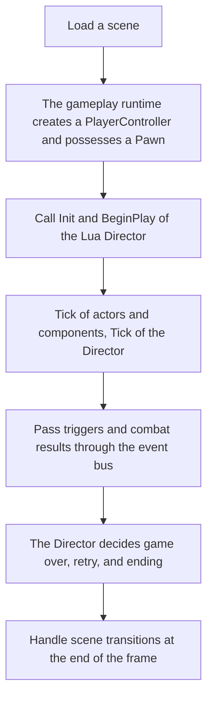

# 🎯 KRAFTON Jungle game tech Lab - Week 14

[한국어](./README.md) | **English**

***4th Game Jam - The stage is set. Let the game begin!: FRACTURE LINE***

2026.06.04. ~ 2026.06.09.

Team 1: 장민준([@nacho2407](https://github.com/nacho2407)), 김효범([@deepBeom](https://github.com/deepBeom)), 전현길([@alogeclock](https://github.com/alogeclock))


- [FRACTURE LINE - Gameplay | Custom C++ & DirectX 11 Engine](https://youtu.be/UixVYle4k0s)

  [](https://youtu.be/UixVYle4k0s)

We made **FRACTURE LINE**, a first-person shooter, on our own engine. The player goes through three levels with double jumps, slides, and **wall runs** and fights a boss at the end. The flow and staging of the game are written in **Lua scripts**, and the **Game Build** window of the editor packages it as a standalone game.


## 🎮 Week Overview

- We made **FRACTURE LINE**, a first-person shooter in which the player, as Kain, an operative of the resource development corporation VANTUS, drops onto a planet to chase a resistance group that has stolen a core module. The game starts with a landing cutscene and goes through a first level with a tutorial, a base with enemy soldiers and electric traps, and a final level with a boss. When the game ends, a score is given from the play time, the number of kills, retries, and deaths, and recorded on the scoreboard

- The player moves by sprinting, double jumping, **sliding**, and **wall running**, and fights with a rifle that has aiming, recoil, and reloading. Hit markers, sparks where shots land, a damage screen effect, and impact sounds add to the **sense of hitting**, and the story is told through voiced dialogue and **cutscenes**

- The flow of the game is written in **Lua scripts**. A **Lua Director** set in the project settings runs the level, and triggers and combat results are passed between scripts through an **event bus**. The game can be played with a **gamepad** as well as a keyboard and mouse

- In the editor, we added **undo and redo**, actor **groups and prefabs**, and a **UI editor** for RmlUi screens, and the **Game Build** window builds and packages a game that runs without the editor


## ✨ Features

- **FRACTURE LINE**

  Taking **Titanfall 2**(Respawn Entertainment, 2016) as a reference, we aimed to make a game that makes full use of the exhilarating action FPS gameplay and dramatic set pieces Titanfall is known for

  In the 26th century, Kain, a special tactical operative of the resource development corporation VANTUS, drops onto the planet Eion under orders to recover the core control module that the resistance group Ashborne took from the logistics depot there, and to eliminate its leader, James McCurson, a former VANTUS engineer. Carrying on with the mission without knowing what his company really does, Kain learns from the data drive McCurson left behind that VANTUS has been erasing the traces of planets drained of resources with LANCER, an orbital weapon, and that the launch was approved by Drake, the superior who trained him. In the final level, he defeats Drake and stops the LANCER launch with the master card key taken from him

  On the title screen, the player chooses `START GAME`(`NEW GAME`, `CONTINUE`), `SETTINGS`, `CREDITS`, or `QUIT`, and opens the scoreboard with the button at the bottom right. Starting the game plays the landing cutscene and then level 1. After levels 2 and 3, the player defeats the boss and inserts the card key it drops into the terminal, and the ending and credits follow. On the last result screen, the player enters an ID to save the score

- **Levels**

  In level 1, a step-by-step tutorial teaches moving, double jumping, sliding, shooting and aiming, reloading, and wall running before the fight with enemies. Level 2 is a base with enemy soldiers and electric traps, with warning lights that pulse slowly and broken lights that flicker irregularly. In level 3, accessing the terminal plays a conversation, and then the boss drops down

- **Game Over and Retry**

  Losing all health or entering an area where falling means death(a death zone) opens the game over screen, where `Retry` restarts the current level from the beginning and `Return to Title` goes back to the title. Retrying level 1 skips the landing cutscene

- **Movement**

  The player sprints with `Shift`, jumps once more in the air(double jump), and slides when pressing `Ctrl` while sprinting. Touching a wall in the air with enough speed starts running along the wall(wall run), and the camera tilts while doing so

- **Combat**

  Left click fires and right click aims, and each shot kicks the view with recoil. `R` reloads, and the weapon HUD shows the remaining ammo. Hitting or killing an enemy shows a mark on the crosshair, sparks fly where the shot lands, and the impact sound depends on the surface. When the player is hit, the edges of the screen darken, and the lower the health, the more the screen loses color

- **Enemies and Boss**

  Enemy soldiers switch between idle, alert, and chase states and fire energy bullets at the player. The boss chooses among a melee attack, two kinds of shots, a retreat, and a leap attack depending on the distance and the situation, and enters a second phase with stronger attacks when its health drops

- **Dialogue and Cutscenes**

  Dialogue appears in a dialogue box with the speaker and subtitles, each line plays its voice, and the next line comes after the voice ends. The landing and the boss's entrance in level 3 are shown as cutscenes, which are skipped by holding `Ctrl`(gamepad `B`) for 3 seconds

- **Item Inspection**

  Looking at an item placed in a level shows an outline and a prompt, and pressing `E`(gamepad `X`) opens an inspection window with its name and description. Items that can be picked up, such as the card key, are picked up from this window

- **Settings and Pause**

  `SETTINGS` on the title and `Settings` in the pause menu change the gamma, the volume of music, sound effects, and voice, and the mouse sensitivity. The pause menu during the game offers `Resume`, `Restart`, `Settings`, `Return to Main Menu`, and `Quit`

- **Gamepad**

  Moving, looking around, jumping, sprinting, sliding, shooting, aiming, reloading, and using the title menu all work with a gamepad. Both XInput and DirectInput gamepads are recognized, and the tutorial shows the keyboard key and the gamepad button together

- **Audio**

  Audio is played with miniaudio. A sound event table(`Content/Audio/SoundEvents.json`) maps event names to sound files so that scripts play sounds by event name, and positioned sounds get quieter with distance. Music, sound effects, and voice have separate volumes

- **Gameplay Framework**

  The `Game` section of the `Project Settings` menu sets the start level and the gameplay preset(the Director module, the PlayerController class, the default Pawn class and script, and the PlayerStart tag). When a scene starts, the player possesses a Pawn placed in the level, or a default Pawn spawned at the PlayerStart with the matching tag, and then `Init`, `BeginPlay`, `Tick`, and `EndPlay` of the Lua Director are called in turn. Scripts exchange events with `Game.On` and `Game.Emit`

- **Game Build**

  In `Game Build...` of the `Build` menu, choosing the solution file and pressing `Build` builds the `Game` configuration with MSBuild and gathers the executable, DLLs, `Content`, `Shaders`, and `Settings` into the output folder(`Bin/GameBuild` by default). Saving the scene and stopping PIE before the build, cleaning the output folder, and packaging each item are optional, and `Open Output Folder` and `Run Game` show the result afterwards

- **Undo and Redo**

  In the level editor, `Ctrl + Z` undoes and `Ctrl + Y`(or `Ctrl + Shift + Z`) redoes. Actor creation(placing, duplicating, and placing prefabs) and deletion, location, rotation, and scale changed with the gizmo, properties and names in the Details window, and adding and removing components are covered, and up to 128 steps are kept

- **Editing Multiple Actors**

  `Ctrl + A` selects all actors in the level, and changing a value in the Details window with several actors selected applies it to all of them. For location, rotation, and scale, the change is added to each actor instead of the entered value

- **Groups and Prefabs**

  In `Scene Manager`, selected actors are grouped with `Group Selected`, groups can be nested, and `Rename Group` and `Ungroup` edit them. Groups are saved with the scene. `Create Prefab From Selection` or `Create Prefab From Group` saves actors as a `.prefab` file, and dragging it from the Content Browser to a viewport or `Scene Manager` places a copy

- **UI Editor**

  Opening an RmlUi document(`.rml`) from the Content Browser shows the element list and a preview. The location(`Offset X`, `Offset Y`), size, `Pivot`, font size and weight, and alignment of an element can be edited, a text element can be added with `Add Text` and saved, and `Open External` opens the document in an external editor

- **Editor Improvements**

  The Content Browser got a list view, and the aspect ratio of thumbnails was fixed. During PIE, `F1` enlarges the game view to the whole editor window


## 👥 Team

| Member | Responsibilities |
|------|------------------------|
| **장민준**([@nacho2407](https://github.com/nacho2407)) | Level design and gameplay framework - design and layout of levels 1 ~ 3, lighting effects, landing cutscene and boss entrance cutscene, Lua Director and event bus, gameplay preset and PlayerStart, Game Build window, retry and death zones, gamepad input codes and XInput, undo and redo, multi-actor selection and batch property editing, groups and prefabs in the scene manager, content browser list view, PIE fullscreen |
| **김효범**([@deepBeom](https://github.com/deepBeom)) | Character and enemies - character movement(sprint, double jump, slide, wall run), first-person arm and weapon animation, enemy soldier and boss AI, hitboxes, DirectInput gamepad input, gamepad navigation of the title menu |
| **전현길**([@alogeclock](https://github.com/alogeclock)) | Game planning, UI, and audio - overall game planning, title, settings, credits, and scoreboard screens, pause and game over, HUD and tutorial, item inspection, UI editor, miniaudio audio manager and sound events, dialogue and voice, ending, score management, electric traps, hit effects, boss pattern tuning |


## 🧑‍💻 Work Details

### Gameplay Framework

- **Goal**

  Decide how the player is prepared and the rules of level progress with settings and Lua scripts, without writing a C++ game mode for each game

- **Implementation**

  I removed the C++ game mode and game state, and made `FGameplayRuntime` read the gameplay preset of the project settings and prepare the game when a world starts. It creates the PlayerController first, then possesses a Pawn placed in the level for auto possession if there is one, and otherwise spawns a new Pawn with the default Pawn class and script at the PlayerStart with the matching tag and possesses it. When a configured class name is not found, it falls back to the default class and logs it

  Then it loads the Director module with `require` and calls `Init` and `BeginPlay` with a context holding the PlayerController and the Pawn, `Tick` every frame, and `EndPlay` when the world ends. The Director of this game(`Game.FractureDirector`) turns entering a death zone into a game over and the boss's death into the ending

  Scripts exchange events through an event bus written in Lua(`Game.On`, `Game.Off`, `Game.Emit`). Subscribing returns a token, and the token is used to unsubscribe. When a Pawn enters a trigger volume, the engine sends a `TriggerEnter` event, so the rules of a level are written in scripts without C++ actors. A retry is handled by `Game.RestartLevel` reopening the current scene, and scene transitions and retries also work in the editor's PIE

- **Related Code**

  [`Source/Engine/GameFramework/Gameplay/GameplayRuntime.cpp`](./Source/Engine/GameFramework/Gameplay/GameplayRuntime.cpp), [`Source/Engine/GameFramework/Gameplay/GameplayRuntime.h`](./Source/Engine/GameFramework/Gameplay/GameplayRuntime.h), [`Source/Engine/GameFramework/Actor/PlayerStart.h`](./Source/Engine/GameFramework/Actor/PlayerStart.h), [`Source/Engine/Core/ProjectSettings.h`](./Source/Engine/Core/ProjectSettings.h), [`Source/Engine/Lua/LuaScriptManager.cpp`](./Source/Engine/Lua/LuaScriptManager.cpp), [`Content/Script/Game/LuaEventBus.lua`](./Content/Script/Game/LuaEventBus.lua), [`Content/Script/Game/FractureDirector.lua`](./Content/Script/Game/FractureDirector.lua)


### Game Build Window

- **Goal**

  Build a standalone game right from the editor and gather the files needed to run it into one folder

- **Implementation**

  The build runs on a worker thread so the editor does not freeze meanwhile, and the window shows the progress and the log. Before the build, it saves the scene and stops PIE, then finds MSBuild of the installed Visual Studio with `vswhere.exe` and builds the solution in the `Game` configuration for the `x64` platform

  After the build, it cleans the output folder and copies the executable, DLLs, and the `Content`, `Shaders`, and `Settings` folders. If the output folder is empty or points to the solution folder or a drive root, it stops without cleaning. Relative paths for the solution and the output folder are resolved from the solution folder, and there are buttons to open the result folder and to run the built game right away

- **Related Code**

  [`Source/Editor/Build/EditorGameBuilder.cpp`](./Source/Editor/Build/EditorGameBuilder.cpp), [`Source/Editor/Build/EditorGameBuilder.h`](./Source/Editor/Build/EditorGameBuilder.h), [`Source/Editor/UI/Panel/EditorGameBuildWidget.cpp`](./Source/Editor/UI/Panel/EditorGameBuildWidget.cpp)


### Undo and Redo

- **Goal**

  Undo and redo each edit in the level editor

- **Implementation**

  After an edit is done, it is made into a command and pushed onto the undo stack. Each command has `Undo` and `Redo`, a new command clears the redo stack, and the undo stack keeps up to 128 commands. There are six commands: actor creation, actor deletion, component structure change, transform, property, and rename

  Targets are found by UUID instead of object pointers. Restoring a deleted actor creates a new object, so when an actor is saved as JSON in the scene save format, its UUID at run time is recorded with it and given back to the restored object. This way, commands stacked later still find the same target. The selection is also kept by UUID, so after an undo the same actors and component are selected again and the gizmo is attached

  A transform is recorded only when the relative transform differs before and after the gizmo operation, and a property change keeps the object's properties before and after as JSON. An edit that changes the properties of several actors at once is also undone as a single command

- **Related Code**

  [`Source/Editor/Undo/EditorUndoCommand.cpp`](./Source/Editor/Undo/EditorUndoCommand.cpp), [`Source/Editor/Undo/EditorUndoCommand.h`](./Source/Editor/Undo/EditorUndoCommand.h), [`Source/Editor/Undo/EditorUndoManager.cpp`](./Source/Editor/Undo/EditorUndoManager.cpp), [`Source/Engine/Serialization/SceneSaveManager.cpp`](./Source/Engine/Serialization/SceneSaveManager.cpp), [`Source/Editor/Selection/SelectionManager.cpp`](./Source/Editor/Selection/SelectionManager.cpp)


### Groups and Prefabs in the Scene Manager

- **Goal**

  Handle several actors together while building levels, and reuse frequently used sets of actors

- **Implementation**

  A group is editor-only information that holds a list of actor UUIDs and a parent group ID, and groups can be nested. `Scene Manager` shows groups as a tree, and selecting a group selects all actors in it, including those in its subgroups. Group information is saved separately in the scene file and is not used when the game runs

  A prefab is a lightweight template that copies the selected actors as JSON in the scene save format. When it is placed, new actors are created with the prefab's origin moved to the placement location, and references between actors and components inside the prefab are reconnected among the newly created objects. A prefab made from a group restores the group when placed, and placing a prefab can be undone as well

- **Related Code**

  [`Source/Engine/Editor/SceneOutlinerState.h`](./Source/Engine/Editor/SceneOutlinerState.h), [`Source/Editor/UI/Panel/EditorSceneWidget.cpp`](./Source/Editor/UI/Panel/EditorSceneWidget.cpp), [`Source/Engine/Serialization/SceneSaveManager.cpp`](./Source/Engine/Serialization/SceneSaveManager.cpp), [`Source/Editor/Viewport/Level/FLevelViewportLayout.cpp`](./Source/Editor/Viewport/Level/FLevelViewportLayout.cpp)


### Gamepad Input Codes

- **Goal**

  Handle the keyboard and mouse and the gamepad in the same way, so that input mappings and Lua scripts do not depend on the device

- **Implementation**

  Input codes 0 ~ 255 keep the Win32 virtual key codes, and above them I added gamepad buttons(16 from `0x100`) and analog axes(6 from `0x200`) as engine virtual codes. Query functions such as `IsDown`, `WasPressed`, and `GetAxisValue` read the keyboard state or the gamepad state depending on the range of the code, so keys and gamepad inputs are registered together in the axis and action mappings of the input component(for example, `W`, `S`, and the Y axis of the left stick for `MoveForward`)

  Gamepads are read with XInput, up to four of them. Stick values are scaled to -1 ~ 1 after removing the dead zone, handling the positive and negative directions separately, triggers are scaled to 0 ~ 1 after removing the default threshold, and buttons get the moments they are pressed and released every frame. The input system passes one frame of input as a snapshot, and the same codes are exposed to Lua as the `Key` table so that scripts write `Key.GamepadA`

- **Related Code**

  [`Source/Engine/Input/InputSystem.cpp`](./Source/Engine/Input/InputSystem.cpp), [`Source/Engine/Input/InputSystem.h`](./Source/Engine/Input/InputSystem.h), [`Source/Engine/Component/Input/InputComponent.h`](./Source/Engine/Component/Input/InputComponent.h), [`Source/Engine/Lua/LuaScriptManager.cpp`](./Source/Engine/Lua/LuaScriptManager.cpp)


### Level Design and Cutscenes

- **Goal**

  Design the three levels of the game, and show the landing and the boss's entrance as cutscenes

- **Implementation**

  I designed levels 1 ~ 3 and placed the terrain, structures, enemies, triggers, and lights in the editor. The warning lights in level 2 slowly raise and lower their brightness, and the broken lights flicker with randomly chosen stable times and flicker counts

  The landing cutscene lowers the landing pod from the sky to the ground, and while the cutscene camera looks at the pod, the shake grows as the landing approaches. Meanwhile, the dialogue continues at the pace of the voices and the credits of the team appear, and after the landing the view returns to the player camera and the movement lock is released. Reopening level 1 by retrying skips this cutscene

  In level 3, accessing the terminal plays a conversation, then the camera turns toward the boss, and the boss drops from the air and lands with a screen shake and bursting particles. After the boss is defeated, the card key must be inserted into the same terminal to move on to the ending. Both cutscenes can be skipped by holding a key

  For the score record, the kill count goes up only when an enemy falls to the player's attack, and deaths in death zones and retries are added

- **Related Code**

  [`Content/Script/Prologue.lua`](./Content/Script/Prologue.lua), [`Content/Script/Level/Level3BossIntroComputer.lua`](./Content/Script/Level/Level3BossIntroComputer.lua), [`Content/Script/Level/WarningPointLight.lua`](./Content/Script/Level/WarningPointLight.lua), [`Content/Script/Level/BrokenSpotLight.lua`](./Content/Script/Level/BrokenSpotLight.lua), [`Content/Script/Game/CombatEvents.lua`](./Content/Script/Game/CombatEvents.lua)


## 🛠️ Tech Stack

- **Language**: C++20, Lua

- **Graphics API**: DirectX 11

- **Build**: Visual Studio 2022, MSBuild

- **Libraries**: Autodesk FBX SDK, Dear ImGui, DirectX Tool Kit for DirectX 11, imgui-node-editor, LuaJIT, miniaudio, NvCloth, NVIDIA PhysX SDK, RmlUi, SimpleJSON, sol2, stb


## 🖥️ Architecture



- Flow

    1. When a scene is loaded, the gameplay runtime creates a PlayerController according to the gameplay preset of the project settings, and possesses a Pawn placed in the level or one spawned at a PlayerStart

    2. It loads the Director module and calls `Init` and `BeginPlay`, and the Director subscribes to the events it needs

    3. Every frame, actors, components, and the Lua scripts of actors tick, and `Tick` of the Director is called

    4. When the player enters a trigger volume, or an attack hits and an enemy falls, the result is passed through the event bus, and combat results are also added to the score record

    5. The Director and UI scripts decide game over, retry, the next level, and the ending, and request scene transitions

    6. Scene transitions are handled after tick and render are done, and the new scene starts again from step 1


## 📁 Directory Structure

```
week14/
├── week14.sln              // Solution
├── week14.vcxproj          // Project
├── Content/                // Materials, meshes, particles, montages, prefabs, scenes, fonts, textures, sounds, UI screens, Lua scripts
├── Docs/                   // README media
├── Scripts/                // Reflection header and Lua binding generation scripts, embedded Python
├── Settings/               // Resource list, project settings, ImGui style
├── Shaders/                // HLSL shaders
├── Source/                 // Entry point
│   ├── Editor/             // Editor engine and render pipeline
│   │   ├── Build/          // Game build and packaging
│   │   ├── PIE/            // PIE types
│   │   ├── Selection/      // Selection management
│   │   ├── Settings/       // Editor settings
│   │   ├── Slate/          // Windows and splitters
│   │   ├── Subsystem/      // Overlay stats, asset factory, Physics Asset generation
│   │   ├── UI/             // Editor widgets, content browser, mesh, particle, animation, material, and UI editors
│   │   ├── Undo/           // Undo and redo
│   │   └── Viewport/       // Level viewports and asset editor viewports
│   ├── Engine/
│   │   ├── Animation/      // Animation sequences, montages, animation graphs and state machines, notifies, Lua anim instances
│   │   ├── Asset/          // Asset packages and registry
│   │   ├── Audio/          // miniaudio audio manager and sound events
│   │   ├── CameraShake/    // Camera shake assets
│   │   ├── Collision/      // Ray tests, BVH, octree, collision math
│   │   ├── Component/      // Components
│   │   ├── Core/           // Common types, properties, logging, Delegate, project settings
│   │   ├── Debug/          // Debug drawing
│   │   ├── Editor/         // Group information of the scene manager
│   │   ├── FloatCurve/     // Float curve assets
│   │   ├── GameFramework/  // Actors, levels, world, gameplay runtime, player controller, camera manager
│   │   ├── Gizmo/          // Component and bone gizmo targets
│   │   ├── Input/          // Keyboard, mouse, and gamepad input
│   │   ├── Lua/            // Lua script manager
│   │   ├── Materials/      // Materials
│   │   ├── Math/           // Vectors, matrices, quaternions, transforms
│   │   ├── Mesh/           // FBX and Wavefront OBJ importers, static and skeletal meshes
│   │   ├── Object/         // UObject, reflection, garbage collection, names
│   │   ├── Particles/      // Particle systems, emitters, modules
│   │   ├── Physics/        // PhysX physics scene, bodies and constraints, hitboxes, vehicles, NvCloth cloth
│   │   ├── Platform/       // Window, paths, crash dumps, directory watching
│   │   ├── Profiling/      // Stats and GPU profiling
│   │   ├── Render/         // Render pipeline, render passes, scene proxies, shadows
│   │   ├── Resource/       // Resource management
│   │   ├── Runtime/        // Engine loop, game engine, actor placement registry
│   │   ├── Score/          // Score recording and saving
│   │   ├── Serialization/  // Archives, saving and loading scenes and prefabs
│   │   ├── Texture/        // Textures
│   │   ├── UI/             // UI manager and user widgets
│   │   └── Viewport/       // Viewports and game viewport client
│   ├── Game/               // Game actor placement list, game Lua bindings
│   └── ObjViewer/          // OBJ viewer
└── ThirdParty/             // Dear ImGui, imgui-node-editor, LuaJIT, miniaudio, NvCloth, NVIDIA PhysX SDK, RmlUi, SimpleJSON, sol2, stb
```


## ❓ Build and Run

### Running the Release Build

Executables are not provided for this week because of license issues with some of the assets and libraries.


### Building from Source

Some assets and libraries could not be included in the repository because of license issues, so this week cannot be built from the repository alone.


## 🕹️ Controls

### Keyboard and Mouse

| Input | Action |
|------|------|
| **W / A / S / D** | Move |
| **Mouse movement** | Look around |
| **Space** | Jump, press again in the air to double jump |
| **Shift(hold)** | Sprint |
| **Ctrl(hold)** | Crouch, slide when pressed while sprinting |
| **Left click** | Fire, confirm a menu item |
| **Right click(hold)** | Aim |
| **R** | Reload |
| **E** | Inspect and pick up items, use the terminal |
| **Ctrl(hold for 3 seconds)** | Skip a cutscene |
| **Esc, Pause** | Open and close the pause menu. In PIE, `Esc` ends PIE, so `Pause` is used |
| **↑ / ↓ / ← / →** | Select a title menu item |
| **Enter** | Confirm a title menu item, save the score on the result screen |


### Gamepad

| Input | Action |
|------|------|
| **Left stick** | Move, select a title menu item |
| **Right stick** | Look around |
| **Left stick press** | Sprint |
| **A** | Jump and double jump, confirm a title menu item |
| **B** | Crouch and slide, go back in the title menu |
| **B(hold for 3 seconds)** | Skip a cutscene |
| **Right trigger** | Fire |
| **Left trigger** | Aim |
| **X** | Reload, inspect and pick up items, use the terminal |
| **Start** | Open and close the pause menu |
| **D-pad** | Select a title menu item |


## 📄 Third-Party Libraries

| Name | Author | Version | License |
|------|--------|------|----------|
| **[Autodesk FBX SDK](https://aps.autodesk.com/developer/overview/fbx-sdk)** | Autodesk, Inc. | 2020.3.9 | Autodesk License and Services Agreement |
| **[Brotli](https://github.com/google/brotli)** | the Brotli Authors. | - | [MIT License](./ThirdParty/RmlUi/Brotli-LICENSE) |
| **[bzip2](https://sourceware.org/bzip2/)** | Julian R Seward | - | bzip2 and libbzip2 License v1.0.6 |
| **[Dear ImGui](https://github.com/ocornut/imgui)** | Omar Cornut | 1.92.7 WIP | [MIT License](./ThirdParty/ImGui/LICENSE.txt) |
| **[DirectX Tool Kit for DirectX 11](https://github.com/microsoft/DirectXTK)** | Microsoft Corporation. | - | MIT License |
| **[FreeType](https://freetype.org)** | David Turner, Robert Wilhelm, and Werner Lemberg | 2.14.3 | Freetype Project License |
| **[imgui-node-editor](https://github.com/thedmd/imgui-node-editor)** | Michał Cichoń | 0.9.4 | [MIT License](./ThirdParty/imgui-node-editor/LICENSE) |
| **[libpng](https://github.com/pnggroup/libpng)** | The PNG Reference Library Authors. | - | PNG Reference Library version 2 |
| **[LuaJIT](https://luajit.org)** | Mike Pall | 2.1 | [MIT License](./ThirdParty/lua/COPYRIGHT) |
| **[miniaudio](https://github.com/mackron/miniaudio)** | David Reid | 0.11.25 | The Unlicense |
| **[NvCloth](https://github.com/NVIDIAGameWorks/NvCloth)** | NVIDIA GameWorks | - | [Nvidia Source Code License (1-Way Commercial)](./ThirdParty/NvCloth/license.txt) |
| **[NVIDIA PhysX SDK](https://github.com/NVIDIAGameWorks/PhysX)** | NVIDIA Corporation | 4.1.2 | [BSD 3-Clause "New" or "Revised" License](./ThirdParty/PhysX/LICENSE.md) |
| **[Python](https://www.python.org)** | Python Software Foundation | 3.12.9 | [Python Software Foundation License 2.0](./Scripts/python/LICENSE.txt) |
| **[RmlUi](https://github.com/mikke89/RmlUi)** | The RmlUi Team, and contributors | - | [MIT License](./ThirdParty/RmlUi/LICENSE.txt) |
| **[SimpleJSON](https://github.com/nbsdx/SimpleJSON)** | Neil | - | Do What the Fuck You Want to Public License |
| **[sol2](https://github.com/ThePhD/sol2)** | Rapptz, ThePhD, and contributors | 3.5.0 | [MIT License](./ThirdParty/sol2/LICENSE.txt) |
| **[stb](https://github.com/nothings/stb)** | Sean Barrett | 2.30 | The Unlicense |
| **[zlib](https://zlib.net)** | Jean-loup Gailly and Mark Adler | 1.3.2 | zlib License |

- This software is based in part on the work of the FreeType Team


## 🎨 Third-Party Assets

| Name | Author | License |
|------|--------|----------|
| **[Animated FPS hands (rifle animation pack)](https://sketchfab.com/3d-models/animated-fps-hands-rifle-animation-pack-5f2d0ed780a94724b36ab505f7564057)** | Cransh(original: [FP Arms](https://sketchfab.com/3d-models/fp-arms-8416c380544949bb9b224278819cbe6b) by DJMaesen, [Adaptive Combat Rifle](https://sketchfab.com/3d-models/adaptive-combat-rifle-a18a8008a299430caa5f1fe05563c949) by doomsentinel) | [Creative Commons Attribution Non Commercial 4.0 International](https://creativecommons.org/licenses/by-nc/4.0/) |
| **[Derelict billboard](https://sketchfab.com/3d-models/derelict-billboard-06b7951d4e2f43ecbc30d8f00cccb499)** | matousekfoto | [Creative Commons Attribution 4.0 International](https://creativecommons.org/licenses/by/4.0/) |
| **[Free Barricade](https://sketchfab.com/3d-models/free-barricade-b7b92195d90e40ca99eece53b0de6314)** | JonhGillessen | [Creative Commons Attribution 4.0 International](https://creativecommons.org/licenses/by/4.0/) |
| **[Freight shipping container - Rusted](https://sketchfab.com/3d-models/freight-shipping-container-rusted-2b787d1a02174d0bbca9eac34eb3a486)** | Sousinho | [Creative Commons Attribution 4.0 International](https://creativecommons.org/licenses/by/4.0/) |
| **[Habitat Lander Pod](https://sketchfab.com/3d-models/habitat-lander-pod-9a55af34f7654097bd72f0642d83ccce)** | jmleach1987 | [Creative Commons Attribution 4.0 International](https://creativecommons.org/licenses/by/4.0/) |
| **[Landscape of an alien planet (Skybox)](https://sketchfab.com/3d-models/landscape-of-an-alien-planet-skybox-676c023d919344efbfa9876c85db7d11)** | Jungle Jim | [Creative Commons Attribution 4.0 International](https://creativecommons.org/licenses/by/4.0/) |
| **[Maplestory Font](https://maplestory.nexon.com/Media/Font)** | NEXON Korea Corporation | [Nexon Font License](https://maplestory.nexon.com/Media/Font) |
| **[Military Weapons Container](https://sketchfab.com/3d-models/military-weapons-container-8a1c32f395f549b8b22265b8a459fa8e)** | MeshSlinger | [Creative Commons Attribution 4.0 International](https://creativecommons.org/licenses/by/4.0/) |
| **[Particle Pack](https://kenney.nl/assets/particle-pack)** | Kenney | [Creative Commons Zero v1.0 Universal](https://creativecommons.org/publicdomain/zero/1.0/) |
| **[Pretendard](https://github.com/orioncactus/pretendard)** | Kil Hyung-jin | [SIL Open Font License 1.1](./Content/Font/Pretendard-LICENSE) |
| **[Sc-fi Building](https://sketchfab.com/3d-models/sc-fi-building-bb76aebb7dd947c8a4edf02ed12376ce)** | Jonathan | [Creative Commons Attribution 4.0 International](https://creativecommons.org/licenses/by/4.0/) |
| **[Sci Fi Meeting Room](https://sketchfab.com/3d-models/sci-fi-meeting-room-f85d369b6cb446929a518c02cf28b6d0)** | local.yany | [Creative Commons Attribution 4.0 International](https://creativecommons.org/licenses/by/4.0/) |
| **[Sci-fi box](https://sketchfab.com/3d-models/sci-fi-box-2c38ec80811042128f21c2e4a048d6fd)** | Scarecrow_original | [Creative Commons Attribution 4.0 International](https://creativecommons.org/licenses/by/4.0/) |
| **[Sci-fi Cell-Door](https://sketchfab.com/3d-models/sci-fi-cell-door-a2e1b6d6998c45d7b5c5bbcca704d3e7)** | calduty | [Creative Commons Attribution 4.0 International](https://creativecommons.org/licenses/by/4.0/) |
| **[sci-fi corridor trimsheet](https://sketchfab.com/3d-models/sci-fi-corridor-trimsheet-82eeb908068842e8bb51cf2dd8849c62)** | wojciechmiedziocha | [Creative Commons Attribution 4.0 International](https://creativecommons.org/licenses/by/4.0/) |
| **[Sci-fi crate](https://sketchfab.com/3d-models/sci-fi-crate-037d2624e22f4fb4b7066676c6321903)** | juicymalina | [Creative Commons Attribution 4.0 International](https://creativecommons.org/licenses/by/4.0/) |
| **[Sci-fi Door (high poly)](https://sketchfab.com/3d-models/sci-fi-door-high-poly-2e8c613214144d12bce416ce437614d6)** | Scarecrow_original | [Creative Commons Attribution 4.0 International](https://creativecommons.org/licenses/by/4.0/) |
| **[Sci-fi Hallway Tube](https://sketchfab.com/3d-models/sci-fi-hallway-tube-6987b3d35d2441e4b83ed9f87fbb74ff)** | SlyEye | [Creative Commons Attribution 4.0 International](https://creativecommons.org/licenses/by/4.0/) |
| **[Scifi Room Interior](https://sketchfab.com/3d-models/scifi-room-interior-c8ed41d8fd694e3d94f16e189b062c20)** | Sba Stuff | [Creative Commons Attribution 4.0 International](https://creativecommons.org/licenses/by/4.0/) |
| **[SSD Solid-State Drive](https://sketchfab.com/3d-models/ssd-solid-state-drive-ad215e54c381456895e21db5062f8714)** | isnainul | [Creative Commons Attribution 4.0 International](https://creativecommons.org/licenses/by/4.0/) |


## ⚖️ License

The portions of this week's code written by Jang Minjun are released under the MIT License, and the rights to the portions written by other contributors belong to their respective contributors. See [LICENSE](../LICENSE) for details.
